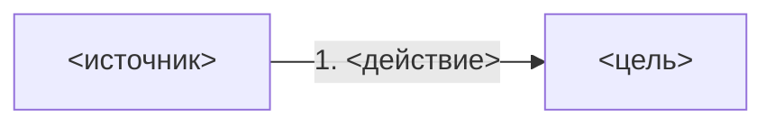

**Русский** (английская и китайская версии ещё не написаны)

<!--
Шаблон типовой архитектуры mess.systems. Скопируйте файл в <папка>/README.ru.md и замените подсказки.

Правила шаблона:
1. Все 14 разделов и «Источники» остаются. Если раздел не применим, оставьте заголовок и одну фразу:
   «Не применимо: <причина>». Так видно, что о разделе подумали, а не забыли.
2. Раздел 2.2 «Состав по этапам» с условиями перехода обязателен всегда.
3. Тон безличный, по делу. Таблицы вместо прозы, где это возможно. Истории и выводы — в постах, не здесь.
4. Каждый факт о продукте подтверждается официальным источником (документация, release notes, исходный код)
   и попадает в «Источники». Непроверенное помечается «проверить».
5. Никогда: имена хостов, IP-адреса, реальные конфигурации, пути к секретам, группы доступа, инвентарь устройств,
   версии агентов на устройствах. Имена в примерах — в домене mess.systems и по стандарту именования.
6. Новый компонент сначала получает карточку в техрадаре, потом попадает в состав.
7. Компания mess.systems и её руководители выдуманы: это модельный состав, а не отчёт о внедрении.
Удалите этот комментарий в готовом документе.
-->

# Типовая архитектура: <папка>

<Один абзац: какую возможность компании закрывает документ, для кого и какие вопросы он фиксирует. Последняя фраза перечисляет разделы: «Эта типовая архитектура фиксирует состав, ..., открытые вопросы».>

**Статус:** черновик типовой архитектуры. Создано ГГГГ-ММ-ДД. Нормативный английский текст ещё не написан. Компания mess.systems выдумана, это модельный состав, а не отчёт о внедрении. Имена ниже являются примерами в домене `mess.systems`. Факты о продуктах сверены с официальными источниками на ГГГГ-ММ-ДД.

**Коды возможностей.** <Код(ы) из [стандарта именования](https://github.com/mess-systems/naming-standard/blob/main/i18n/ru/01-naming-conventions.md#43-коды-возможностей-уникальны-во-всех-доменах) и домен. Если кода нет — предложение регистрации отдельным изменением стандарта. Соседние коды, на которые опирается архитектура.>

**Плоскость.** <Плоскость домена по умолчанию или обоснование другой.>

**Связанные типовые архитектуры.** <Ссылки на соседние blueprints: что решено там и здесь не повторяется.>

## 1. Границы

<Таблица «Входит | Не входит». У каждого «не входит» — ссылка, где это решено, или «вне набора».>

| Входит | Не входит |
|---|---|
| <...> | <...>: см. [`<blueprint>`](../<blueprint>/) |

## 2. Состав

<Одна строка на часть. Кольцо радара — ссылкой на карточку. Карточка появляется в техрадаре раньше, чем компонент попадает в состав (правило 6).>

| Часть | Роль | Продукт | Радар |
|---|---|---|---|
| <...> | <...> | <...> | [<кольцо>](https://github.com/mess-systems/tech-radar/blob/main/technologies/<card>.md) |

<Лицензии компонентов на критическом пути, если они влияют на выбор.>

### 2.1 Цель и задачи по частям

<Зачем каждая часть и как понять, что она готова. «Готово, когда» — проверяемое условие, оно потом попадает в матрицу 10.2.>

| Часть | Цель | Задачи | Готово, когда |
|---|---|---|---|
| <...> | <...> | <...> | <...> |

### 2.2 Состав по этапам

<Обязательный раздел. Простой этап — то, что содержит один-два человека; средний — команда; целевой — виден заранее и включается по условиям. Строка на роль.>

| Роль | Простой | Средний | Целевой |
|---|---|---|---|
| <...> | <...> | <...> | <...> |

**Когда переходить к среднему этапу.** <Измеримые условия: размер, инциденты, требования аудита, стоимость.>

**Когда переходить к целевому этапу.** <То же.>

## 3. Путь запроса

<Mermaid-схема и нумерованные шаги. Для возможностей без запроса (рабочее место, резервное копирование) — путь восстановления или путь изменения; заголовок тогда «Путь восстановления» или «Путь изменения».>

1. **<Шаг>.** <Что происходит и кто проверяет.>

## 4. Имена

<Каждый именуемый объект и правило стандарта именования, по которому он назван.>

| Объект | Имя | Правило |
|---|---|---|
| <...> | `<...>` | [<раздел стандарта>](https://github.com/mess-systems/naming-standard/...) |

## 5. Аутентификация и учётные данные

### 5.1 Требования

<Нумерованные проверяемые требования. Каждое потом есть в матрице 10.2.>

1. <...>

### 5.2 <Интерфейс или компонент>

<Как именно проверяется подлинность и откуда берутся учётные данные.>

### 5.3 Что не кладётся на устройство и в конфигурацию

<Список того, чего не должно быть в файлах, репозиториях и на диске.>

## 6. Права

| Слой | Отвечает на вопрос | Где | Пример |
|---|---|---|---|
| <...> | <...> | <...> | <...> |

## 7. Сеть

<Кто к кому и по каким правилам. Сама сеть — ссылкой на `net-mesh`. Что работает, если сети нет.>

## 8. TLS и шифрование

<Шифрование в канале и на диске; где хранятся ключи и сертификаты.>

## 9. Аудит

<Какие журналы, что в них видно, как связать запись с человеком.>

| Журнал | Что видно | Где хранится |
|---|---|---|
| <...> | <...> | <...> |

## 10. Развёртывание

<Как архитектура описана кодом, где ревью, как выглядит готовность.>

### 10.1 Порядок изменений

<У каждого шага есть откат.>

| # | Шаг | Где | Откат |
|---|---|---|---|
| 1 | <...> | <...> | <...> |

### 10.2 Матрица проверок

<Положительные и отрицательные проверки. Каждое требование из 2.1 и 5.1 представлено строкой.>

| Источник | Цель | Действие | Ожидание | Доказательство |
|---|---|---|---|---|
| <...> | <...> | <...> | <...> | <...> |

### 10.3 Замеры и учения

<Что, как и когда мерили; дата. Если замеров ещё нет — «замеров нет» и план, без оценочных цифр.>

## 11. Известные проблемы

<Каждая проблема — заголовок жирным и абзац. Нерешённое помечается «не решено, требует исследования».>

**<Проблема>.** <Описание, последствия, что делаем сейчас.>

## 12. Рассмотренные альтернативы

| Вариант | Радар | Почему не сейчас |
|---|---|---|
| <...> | <...> | <...> |

**Решение.** <Что выбрано и почему, какое кольцо предлагается.>

## 13. Примеры

Файлы в [examples/](examples/) — **только примеры**: заготовки с условными значениями, которые показывают форму настройки. Это не конфигурация работающей системы.

| Файл | Что показывает |
|---|---|
| <...> | <...> |

<Если примеров нет: «Файлы примеров ещё не написаны. Кандидаты: ...».>

## 14. Открытые вопросы

1. <Вопрос, без которого состав нельзя считать закрытым.>

## Источники

Проверено ГГГГ-ММ-ДД.

- <Продукт, тема>: <URL официального источника>
