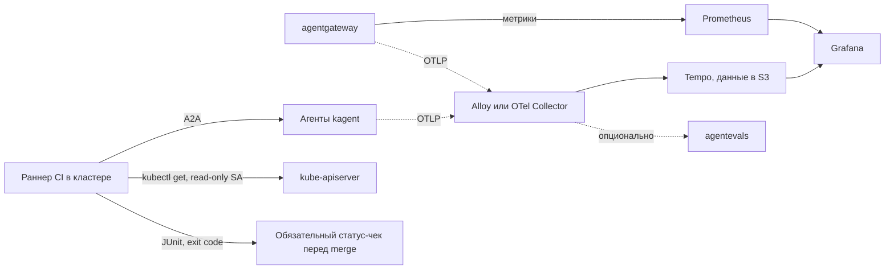

**Русский** (английская и китайская версии ещё не написаны)

# Типовая архитектура: adlc-agent-evals

Как наблюдать за AI-агентами в Kubernetes и проверять их ответы, не ставя на старте ещё одну платформу. Здесь собраны трассы агентов и инструментов, токены и стоимость, проверочные случаи с эталоном из живого кластера, регрессионный гейт в CI, сравнение моделей и аудит. Отдельно описано, когда всё-таки стоит переходить на LLM-observability-платформу.

**Статус:** черновик типовой архитектуры. Создано 2026-11-12 по оценке от 2026-11-11. Версии взяты с GitHub Releases и PyPI на 2026-11-11, перед внедрением их стоит перепроверить. Нормативный английский текст ещё не написан. Компания mess.systems выдумана, это модельный состав, а не отчёт о внедрении. Имена ниже являются примерами в домене `mess.systems` и не относятся к работающей системе.

**Коды возможностей.** Проверки `evals` (домен `adlc`), трассы `traces`, метрики `metrics` и дашборды `dashboards` (домен `obs`), LLM-шлюз `gateway` и LLM-трассы `llm-traces` (домен `ai`), CI `ci` и GitOps `gitops` (домен `sdlc`). Отдельный код на эту типовую архитектуру не вводится.

**Откуда взялась.** История про агента, который уверенно ответил «все поды Running», хотя один под был в CrashLoopBackOff: [пост в блоге](https://mess.systems/ru/blog/agent-confident-wrong-answer/). Одним из следующих шагов там был выбор инструмента для трасс и проверок. Эта типовая архитектура и есть ответ на него.

**Связанные типовые архитектуры.** Доступ агентов только на чтение к Kubernetes, метрикам и логам: [`obs-mcp-readonly`](https://github.com/mess-systems/blueprints/tree/main/obs-mcp-readonly). Раннеры CI в своём Kubernetes: [`sdlc-ci-runners`](https://github.com/mess-systems/blueprints/blob/main/sdlc-ci-runners/README.ru.md).

## 1. Границы

| Входит | Не входит |
|---|---|
| Трассы агентов и инструментов, токены и стоимость | Выбор моделей и их размещение |
| Проверочные случаи с эталоном из живого кластера | Red teaming и проверки на вредоносные запросы |
| Регрессионный гейт в CI перед merge | Online-оценка прод-трафика и ручная разметка ответов (это сигнал перехода на платформу, раздел 8) |
| Сравнение моделей на одних и тех же случаях | Точные манифесты и размеры |
| Источники аудита | Политика ретенции: её задаёт CISO |

## 2. Исходная картина

Агенты работают в Kubernetes как обычные нагрузки на [kagent](https://github.com/mess-systems/tech-radar/blob/main/technologies/kagent.md) (Trial), разворачиваются через GitOps на [Argo CD](https://github.com/mess-systems/tech-radar/blob/main/technologies/argo-cd.md) (Adopt), вызываются по A2A, к моделям ходят через [agentgateway](https://github.com/mess-systems/tech-radar/blob/main/technologies/agentgateway.md) (Adopt). Для наблюдаемости уже есть Grafana, Prometheus, Loki и Tempo. Базы данных на PostgreSQL в CloudNativePG, хранилище S3-совместимое. Всё только self-hosted.

Компания в легенде сокращается. Поэтому каждая новая платформа здесь проходит простой вопрос CFO: кто её будет обновлять, мониторить и бэкапить. Если то же самое можно получить из того, что уже стоит, лучше начать с этого.

## 3. Короткий ответ

Начинать стоит **без отдельной LLM-observability-платформы**:

- **трассы:** kagent отправляет OTLP в Alloy или OpenTelemetry Collector, оттуда в [Tempo](https://github.com/mess-systems/tech-radar/blob/main/technologies/tempo.md) (Adopt), Tempo хранит данные в S3;
- **токены и стоимость:** метрики agentgateway собирает [Prometheus](https://github.com/mess-systems/tech-radar/blob/main/technologies/prometheus.md) (Adopt), показывает [Grafana](https://github.com/mess-systems/tech-radar/blob/main/technologies/grafana.md) (Adopt);
- **проверки и гейт в CI:** лёгкий раннер. Это [promptfoo](https://github.com/mess-systems/tech-radar/blob/main/technologies/promptfoo.md) (Trial, область расширяется на регрессионный гейт) или pytest со своим кодом на [DeepEval](https://github.com/mess-systems/tech-radar/blob/main/technologies/deepeval.md) (Adopt);
- **проверка траекторий по трассам**, если понадобится: [agentevals](https://github.com/mess-systems/tech-radar/blob/main/technologies/agentevals.md) (Assess).

Платформа ([Langfuse](https://github.com/mess-systems/tech-radar/blob/main/technologies/langfuse.md) или Phoenix) нужна, когда появятся ручная разметка ответов, online-оценка прод-трафика, сотни случаев у нескольких команд или версионирование промптов.

## 4. Что уже умеют kagent и agentgateway

**kagent 0.10.x** (проверено по исходникам v0.10.6):

- трассы включаются values `otel.tracing.enabled` и `otel.tracing.exporter.otlp.endpoint`;
- контроллер пробрасывает все переменные `OTEL_*` в pod'ы агентов;
- инструментированы входящий A2A (`invoke_agent` с `gen_ai.agent.*`), спаны ADK `invoke_agent`, `call_llm`, `execute_tool` с `gen_ai.usage.*`, вызовы LLM через SDK OpenAI и Anthropic, HTTP к MCP и между агентами;
- семантические соглашения OpenTelemetry для GenAI поддержаны частично, рядом живут старые атрибуты ADK и OpenLLMetry;
- в **kagent 1.0.0** (вышел 2026-11-09) Python-рантаймы переведены на upstream-инструментацию GenAI, добавлены метрики по соглашениям и `user.id`, а старые спаны ADK убраны. Обновиться лучше до того, как строить дашборды на именах спанов.

**agentgateway 1.7.0:**

- метрики Prometheus `gen_ai_client_token_usage` и `gen_ai_client_cost` (в USD, по каталогу цен моделей), время до первого токена и длительность;
- атрибуты `gen_ai.usage.*` в логах и трассах;
- журнал запросов можно писать в PostgreSQL;
- в закрытом контуре каталог цен нужно положить локально.

## 5. Кандидаты

| Кандидат | Версия (дата) | Лицензия, что платно | Зависимости self-hosted | OTLP, GenAI | Наборы случаев, судья, CI | Helm, зрелость |
|---|---|---|---|---|---|---|
| Langfuse | v4.78.0 (2026-11-10) | MIT core; в EE audit log, RBAC по проектам, ретенция, SCIM. SSO бесплатно | PostgreSQL, ClickHouse, Redis или Valkey, S3 | Да (`/api/public/otel`) | Да, да, SDK и GitHub Action | Официальный Helm, очень зрелый; несколько уязвимостей средней критичности в 2025–2026 закрыты |
| Arize Phoenix | 21.0.0 (2026-10-30) | ELv2; платных функций в self-hosted нет | Один контейнер и PostgreSQL | Да, `gen_ai.*` конвертируется с 2026-10-15 | Да, да, клиент и свой гейт | Helm, зрелый; критическая уязвимость исправлена в 15.7.0 |
| Opik | 2.2.143 (2026-11-06) | Apache-2.0; в OSS нет управления пользователями | MySQL, ClickHouse и ZooKeeper, Redis, MinIO | OTLP есть | Да, да, SDK, pytest | Helm, зрелый |
| MLflow 3 | 3.18.0 (2026-11-04) | Apache-2.0; SSO через плагин | PostgreSQL и S3 | Да | Да, да, Python | Только community Helm; серия уязвимостей RCE и SSRF в 10.2026, исправлено в 3.17.0; без аутентификации не запускать |
| Laminar | v0.3.4 (2026-11-10) | Apache-2.0 | PostgreSQL, ClickHouse, RabbitMQ, Valkey, Quickwit | Нативно OTel | Да, да, `lmnr eval` | Helm нет |
| Agenta | v0.128.12 (2026-11-11) | MIT и EE | PostgreSQL, Redis и другие | Да | Да, да, SDK | Несколько уязвимостей высокой критичности в 2026, в том числе RCE в песочнице оценщиков |
| Helicone | тег 2025-08-21 | Apache-2.0 | ClickHouse, PostgreSQL, MinIO | Прокси | Слабо | Дублирует LLM-шлюз |
| OpenLIT | 2.1.1 (2026-10-26) | Apache-2.0 | ClickHouse и Collector | Сильная поддержка соглашений | Базово | Helm есть |
| TruLens | 2.16.0 (2026-10-19) | MIT | Библиотека и БД | OTel | Да | Helm нет |
| Langtrace | 4.0.11 (2025-04-17) | AGPL-3.0 | нет | нет | нет | Заброшен, исключён |
| promptfoo (раннер) | 0.125.1 (2026-10-25) | MIT | Нет | нет | YAML, матрица моделей, `llm-rubric`, `--fail-on-error`, JUnit | Провайдер A2A поддерживает только привязку HTTP+JSON |
| DeepEval (раннер) | 4.3.3 (2026-11-04) | Apache-2.0 | Нет | нет | GEval, pytest, exit code | нет |
| Inspect AI (раннер) | 0.3.289 (2026-11-10) | MIT | Нет | нет | Сильные scorers | Больше подходит для бенчмарков моделей |
| agentevals | v0.12.1 (2026-11-10) | Apache-2.0 | Нет или Helm | Принимает OTLP, GenAI | Траектории, судья, CLI | Ранняя стадия |

## 6. Проверки с эталоном из живого кластера

1. Раннер делает `kubectl get -o json` под отдельным ServiceAccount только на чтение: `get`, `list`, `watch`, без `secrets` и без `exec`.
2. Задаёт агенту вопрос по A2A и просит ответ в JSON по схеме.
3. Повторяет `kubectl get`.
4. Ответ засчитывается, если совпадает со снимком **до или после** вопроса. Сравнение идёт по множествам, без учёта порядка.
5. Свободный текст оценивает судья: другая модель, чем у агента, и рубрика с явными критериями.
6. Каждый случай прогоняется трижды и считается пройденным при 2 из 3.

Кластер меняется во время проверки, поэтому:

- основной набор для гейта на pull request строится на **fixture-namespace под Argo CD**: статичные ресурсы и заранее сломанные сценарии, например под в CrashLoopBackOff;
- живые namespace проверяются ночным прогоном;
- там, где точные значения нестабильны, проверяются инварианты.

Проверочный случай хранится в git рядом с манифестами агента. Минимальный состав: вопрос, ответ агента, правильный ответ, как его проверить и почему агент ошибся.

**Сравнение моделей.** Модель задаётся в ModelConfig. В тестовом namespace разворачиваются варианты одного агента с разными моделями, и раннер получает матрицу «случай × модель» с долей пройденных случаев, задержкой и стоимостью.

## 7. CI

- Раннер работает **внутри кластера** (Forgejo Actions, GitLab Kubernetes executor или Argo Workflows) под своим ServiceAccount, поэтому kubeconfig не покидает кластер. Как устроить такие раннеры для GitHub Actions, описано в [`sdlc-ci-runners`](https://github.com/mess-systems/blueprints/blob/main/sdlc-ci-runners/README.ru.md).
- Если раннер снаружи, короткоживущий доступ выдаётся через OIDC или JWT из хранилища секретов.
- Pipeline на pull request: эфемерный namespace с изменённым агентом, ожидание Ready, прогон раннера, отчёт JUnit, обязательный статус-чек, удаление namespace.

## 8. Аудит

Аудит не стоит строить на LLM-платформе. Например, audit log в Langfuse это платная функция, и записывает она только действия пользователей самой Langfuse. Источники аудита:

- Kubernetes audit log для ServiceAccount агентов и раннера;
- журнал запросов LLM-шлюза;
- трассы и логи с ретенцией по требованиям CISO.

Отдельно надо решить, писать ли содержимое промптов и ответов в спаны. По умолчанию оно пишется, вырезать его можно в Collector.

## 9. Когда переходить на платформу

Сигналы:

- нужна ручная разметка ответов;
- нужна online-оценка прод-трафика;
- случаев больше примерно 200, и их ведут несколько команд;
- нужно версионирование промптов;
- нужен интерфейс сравнения прогонов для людей вне CI.

Выбор:

- **Langfuse** (MIT core) по умолчанию, на радаре он уже несёт `llm-traces`. Агентов перенастраивать не надо: Collector просто получает второй экспортёр;
- **Phoenix**, если нужен минимум эксплуатации и подходит ELv2;
- **MLflow**, если он уже есть у ML-команды.

## 10. Пилот на 2–3 недели

1. Включить OTel в kagent с отправкой в Tempo, собрать метрики шлюза, построить дашборд токенов и стоимости.
2. Сделать fixture-namespace, ServiceAccount только на чтение и 20 случаев.
3. Встроить гейт в CI на pull request.
4. Собрать матрицу двух моделей.
5. Согласовать аудит с CISO.
6. Провести ретро: нужна ли платформа.

## 11. Открытые вопросы

- Не начнёт ли агент после правок промпта отвечать «не уверен» там, где ответ есть. Это стоит мерить отдельно от доли пройденных случаев.
- Как поведёт себя проверка «до или после» на живых namespace с частыми выкатками.
- Хватит ли провайдера A2A в promptfoo (только HTTP+JSON) или придётся писать свою обёртку на pytest.
- Какая ретенция трасс с содержимым промптов допустима.

## Источники

- kagent: https://github.com/kagent-dev/kagent (v0.10.6, v1.0.0), https://kagent.dev/docs/kagent/getting-started/tracing
- agentgateway: https://github.com/agentgateway/agentgateway (v1.7.0)
- Langfuse: https://langfuse.com/self-hosting, https://langfuse.com/self-hosting/license-key
- Phoenix: https://arize.com/docs/phoenix/self-hosting
- Opik: https://www.comet.com/docs/opik/self-host/overview
- MLflow: https://mlflow.org/docs/latest/genai/tracing/opentelemetry/
- promptfoo: https://www.promptfoo.dev/docs/providers/a2a/
- agentevals: https://github.com/agentevals-dev/agentevals
