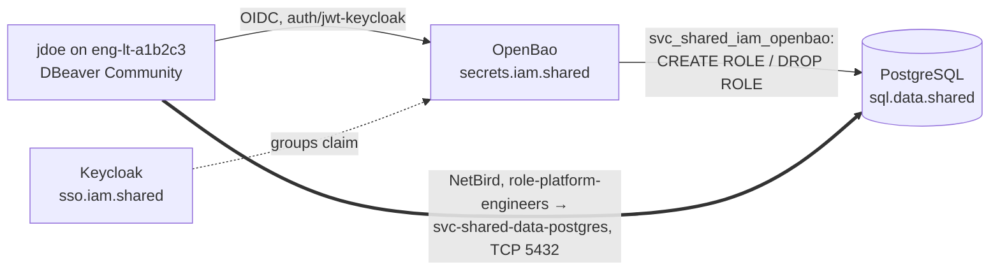

**English** | [Русский](README.ru.md) | [简体中文](README.zh-CN.md)

# Practice: agent-assisted-network-rollout

Safe rollout of network access to a database with an AI agent in the code editor: the person leads, the agent does, an assistant reviews. This practice fixes the roles, the separation of privileges, the requirements, the rollout process and the architecture of people's access to databases.

**Status:** draft, evolving. Created 2026-10-31. All names are fictional and follow the [naming standard](https://github.com/mess-systems/naming-standard/blob/main/README.md) of mess.systems. Component statuses are taken from the [tech radar](https://github.com/mess-systems/tech-radar) as of 2026-10-31.

## 1. Purpose and scenario

The practice sets the order of work when network access to a database through the mesh network of mess.systems is opened by an AI agent in the code editor (Cursor), not by a person by hand. The [requirements](#5-requirements) apply to any database; the examples follow one mess.systems scenario.

**Scenario.** The shared PostgreSQL cluster of the plane `shared` (capability `sql` in the domain `data`) becomes reachable through the NetBird network:

- for the OpenBao server, which issues temporary credentials;
- for platform engineers, to read the Forgejo database `eng_sdlc_git_prd`;
- for T1 administrators, for maintenance.

| Role | Who in mess.systems | Device | Account |
|---|---|---|---|
| Lead | Platform engineer | `eng-lt-a1b2c3` for preparation, `paw-lt-g7h8j9` for privileged steps | `jdoe` (`role-platform-engineers`, T2), `jdoe-adm` (`tier-t1-platform-ops`, T1) |
| Executor | Cursor agent in the lead's session | `eng-lt-a1b2c3` | human's tool `user-jdoe-cursor` |
| Reviewer | Second assistant | outside the lead's devices | agent `agent-code-review`, `operator: jdoe` |

Out of scope: the design of the network (the [`net-mesh`](../net-mesh/) blueprint), agent access to tools over MCP (the [`obs-mcp-readonly`](../obs-mcp-readonly/) blueprint), the base configuration of devices (the [`endpoint`](../endpoint/) blueprint).

## 2. Composition and radar status

| Part | Product | Radar |
|---|---|---|
| Identity provider, groups | Keycloak | [Adopt](https://github.com/mess-systems/tech-radar/blob/main/technologies/keycloak.md) |
| Sign-in protocol | OpenID Connect | [Adopt](https://github.com/mess-systems/tech-radar/blob/main/technologies/oidc.md) (specification) |
| Secrets, temporary credentials | OpenBao, database engine | [Adopt](https://github.com/mess-systems/tech-radar/blob/main/technologies/openbao.md) |
| Mesh network and its policies | NetBird | [Adopt](https://github.com/mess-systems/tech-radar/blob/main/technologies/netbird.md) |
| Database | PostgreSQL | [Adopt](https://github.com/mess-systems/tech-radar/blob/main/technologies/postgresql.md) |
| Network and policies as code | OpenTofu | [Adopt](https://github.com/mess-systems/tech-radar/blob/main/technologies/opentofu.md) |
| Host configuration, host firewall | Ansible | [Adopt](https://github.com/mess-systems/tech-radar/blob/main/technologies/ansible.md) |
| IaC repositories, review | Forgejo | [Adopt](https://github.com/mess-systems/tech-radar/blob/main/technologies/forgejo.md) |
| Logs and metrics | Loki, Prometheus, Grafana | [Loki](https://github.com/mess-systems/tech-radar/blob/main/technologies/loki.md), [Prometheus](https://github.com/mess-systems/tech-radar/blob/main/technologies/prometheus.md), [Grafana](https://github.com/mess-systems/tech-radar/blob/main/technologies/grafana.md): Adopt |
| Host firewall | nftables | **no card** |
| Tunnel | WireGuard (inside NetBird) | **no card** |
| AI agent in the editor | Cursor | **no card**; `endpoint` names OpenCode as the default agent |
| Database client | DBeaver Community | **no card** |
| Container runtime of OpenBao, if it runs in a container | Podman | [Trial](https://github.com/mess-systems/tech-radar/blob/main/technologies/podman.md) (domain `device`); Docker has **no card** |

## 3. Names

Every name has a form in the naming standard; the column "Rule" links to it. No name is invented without a form.

| Object | Name | Rule |
|---|---|---|
| PostgreSQL cluster, internal name | `sql.data.shared.svc.mess.systems` | [Grammar A: internal](https://github.com/mess-systems/naming-standard/blob/main/01-naming-conventions.md#31-grammar-a-internal) |
| Application of the cluster | `shared-data-postgres` | [PostgreSQL objects](https://github.com/mess-systems/naming-standard/blob/main/08-operations-objects.md#7-postgresql-objects) |
| Host of the cluster | `dc1-shared-data-postgres-prd-01` | [Object forms](https://github.com/mess-systems/naming-standard/blob/main/01-naming-conventions.md#5-object-forms) |
| Forgejo database | `eng_sdlc_git_prd` | [PostgreSQL objects](https://github.com/mess-systems/naming-standard/blob/main/08-operations-objects.md#7-postgresql-objects) |
| Database roles | `eng_sdlc_git_ro`, `eng_sdlc_git_rw`, `eng_sdlc_git_owner` | [Database roles](https://github.com/mess-systems/naming-standard/blob/main/04-identity-conventions.md#11-database-roles) |
| Forgejo application user | `svc_eng_sdlc_forgejo` | [Database roles](https://github.com/mess-systems/naming-standard/blob/main/04-identity-conventions.md#11-database-roles) |
| OpenBao service role in PostgreSQL | `svc_shared_iam_openbao` | [Database roles](https://github.com/mess-systems/naming-standard/blob/main/04-identity-conventions.md#11-database-roles) |
| Local break-glass administrator | `breakglass_sql` (database role), account `breakglass-sql-01` | [Database roles](https://github.com/mess-systems/naming-standard/blob/main/04-identity-conventions.md#11-database-roles), [identity kinds](https://github.com/mess-systems/naming-standard/blob/main/04-identity-conventions.md#2-identity-kinds) |
| Temporary user | `v_<auth>_<identity>_<role>_<ts>_<rand6>`, for example `v_oidc_jdoe_eng_sdlc_git_ro_20261031t020000z_k7m2qa` | [Temporary database users](https://github.com/mess-systems/naming-standard/blob/main/04-identity-conventions.md#111-temporary-database-users) |
| Write role and its group (off by default) | `eng_sdlc_git_rw`; group, login role and policy `app-sql-editor` | [App groups](https://github.com/mess-systems/naming-standard/blob/main/04-identity-conventions.md#33-app-groups-access-to-one-capability), [database roles](https://github.com/mess-systems/naming-standard/blob/main/04-identity-conventions.md#11-database-roles), [policies](https://github.com/mess-systems/naming-standard/blob/main/03-secrets-conventions.md#5-policies) |
| PKI | mount `pki-int/`, issuer `mess-systems-int-2026`, issuing role `data-shared` | [Engines other than kv](https://github.com/mess-systems/naming-standard/blob/main/03-secrets-conventions.md#21-engines-other-than-kv) |
| Mesh nameserver group | `svc-mess-systems-dc1` (zone `svc.mess.systems`) | [Mesh DNS](https://github.com/mess-systems/naming-standard/blob/main/04-identity-conventions.md#43-mesh-dns) |
| OpenBao | `secrets.iam.shared.svc.mess.systems`, application `shared-iam-openbao`, host `dc1-shared-iam-openbao-prd-01` | [Secrets conventions](https://github.com/mess-systems/naming-standard/blob/main/03-secrets-conventions.md), [object forms](https://github.com/mess-systems/naming-standard/blob/main/01-naming-conventions.md#5-object-forms) |
| People's sign-in to OpenBao | `auth/jwt-keycloak`, role `role-platform-engineers`, TTL 8 h | [Mounts](https://github.com/mess-systems/naming-standard/blob/main/03-secrets-conventions.md#2-mounts), [auth roles and tokens](https://github.com/mess-systems/naming-standard/blob/main/03-secrets-conventions.md#6-auth-roles-and-tokens) |
| OpenBao policy | `role-platform-engineers` | [Policies](https://github.com/mess-systems/naming-standard/blob/main/03-secrets-conventions.md#5-policies) |
| Database engine mount | `database-shared/`, connection `shared-data-postgres`, role `eng_sdlc_git_ro` | [Engines other than kv](https://github.com/mess-systems/naming-standard/blob/main/03-secrets-conventions.md#21-engines-other-than-kv) |
| OpenBao client in Keycloak | application `shared-iam-openbao`, provider `shared-iam-openbao-oidc`, mapper `shared-iam-openbao-groups` | [IdP objects](https://github.com/mess-systems/naming-standard/blob/main/04-identity-conventions.md#6-idp-objects) |
| Keycloak | `sso.iam.shared.svc.mess.systems`, realm `mess-systems`; public exception `sso.mess.systems` | [Worked encodings](https://github.com/mess-systems/naming-standard/blob/main/01-naming-conventions.md#11-worked-encodings), [IdP objects](https://github.com/mess-systems/naming-standard/blob/main/04-identity-conventions.md#6-idp-objects), [grammar B: public](https://github.com/mess-systems/naming-standard/blob/main/01-naming-conventions.md#32-grammar-b-public) |
| Mesh coordinator | `mesh.net.shared.svc.mess.systems`, application `shared-net-netbird`, exception `netbird.mess.systems` | [Worked encodings](https://github.com/mess-systems/naming-standard/blob/main/01-naming-conventions.md#11-worked-encodings), [grammar B: public](https://github.com/mess-systems/naming-standard/blob/main/01-naming-conventions.md#32-grammar-b-public) |
| Mesh groups: service peers | `svc-shared-data-postgres`, `svc-shared-iam-openbao` | [Mesh VPN groups](https://github.com/mess-systems/naming-standard/blob/main/04-identity-conventions.md#4-mesh-vpn-groups) |
| Mesh groups: people | `role-platform-engineers`, `tier-t1-platform-ops` | [Groups](https://github.com/mess-systems/naming-standard/blob/main/04-identity-conventions.md#3-groups) |
| Site group, routing peers | `site-dc1`; `router-dc1` | [Mesh VPN groups](https://github.com/mess-systems/naming-standard/blob/main/04-identity-conventions.md#4-mesh-vpn-groups) |
| Mesh policies and rule | `role-platform-engineers -> svc-shared-data-postgres`, rule `postgresql` | [Mesh policies, rules and posture checks](https://github.com/mess-systems/naming-standard/blob/main/04-identity-conventions.md#41-mesh-policies-rules-and-posture-checks) |
| Posture check | `posture-client-current` | [Mesh policies, rules and posture checks](https://github.com/mess-systems/naming-standard/blob/main/04-identity-conventions.md#41-mesh-policies-rules-and-posture-checks) |
| Devices | `eng-lt-a1b2c3`, `paw-lt-g7h8j9` | [Endpoint conventions](https://github.com/mess-systems/naming-standard/blob/main/06-endpoint-conventions.md#2-form) |
| Lead | `jdoe`, `jdoe-adm` | [Identity kinds](https://github.com/mess-systems/naming-standard/blob/main/04-identity-conventions.md#2-identity-kinds) |
| Cursor agent | `user-jdoe-cursor` (account and OIDC client) | [Identity kinds](https://github.com/mess-systems/naming-standard/blob/main/04-identity-conventions.md#2-identity-kinds) (human's tool), [IdP objects](https://github.com/mess-systems/naming-standard/blob/main/04-identity-conventions.md#6-idp-objects) |
| Reviewer | `agent-code-review` | [Identity kinds](https://github.com/mess-systems/naming-standard/blob/main/04-identity-conventions.md#2-identity-kinds) |
| IaC repository of the network | `shared-net-iac` | [Object forms](https://github.com/mess-systems/naming-standard/blob/main/01-naming-conventions.md#5-object-forms) |
| OpenTofu resource, Ansible groups | `shared_data_postgres_prd`; `shared_data`, `shared_data_postgres` | [Object forms](https://github.com/mess-systems/naming-standard/blob/main/01-naming-conventions.md#5-object-forms) |
| `service_name` in Loki | `shared-data-postgres`, `shared-iam-openbao`, `shared-iam-keycloak` | [Object forms](https://github.com/mess-systems/naming-standard/blob/main/01-naming-conventions.md#5-object-forms) |
| Agent branch | `user-jdoe-cursor/pg-access` | [Git branches and tags](https://github.com/mess-systems/naming-standard/blob/main/08-operations-objects.md#1-git-branches-and-tags) |
| Snapshot before a change | `shared-data-postgres-prd-20261031t020000z` | [Backups and snapshots](https://github.com/mess-systems/naming-standard/blob/main/08-operations-objects.md#3-backups-and-snapshots) |

A name grants nothing (rule I3 of the [identity conventions](https://github.com/mess-systems/naming-standard/blob/main/04-identity-conventions.md#1-principles-applied)): access comes from Keycloak groups, mesh policies and OpenBao policies.

## 4. Separation of privileges

The [`endpoint`](../endpoint/) blueprint forbids AI clients on `paw` devices, and the `tier-*` admin paths of [`net-mesh`](../net-mesh/README.md#4-request-paths) start only from `paw` devices and `-adm` accounts. Hence a rule that the plain "the agent does everything" scheme lacks:

1. The agent works on an `eng` device in the session of the lead's daily account (T2). The agent has no T1 credentials.
2. The agent prepares IaC changes in its own branch and runs unprivileged checks: the OpenTofu plan, rule syntax checks, reachability checks from its own group.
3. Privileged steps (applying the plan to the network, applying the Ansible role on a host of the plane `shared`, `rotate-root`) are run by the lead as `jdoe-adm` from `paw-lt-g7h8j9`, or by the pipeline after the branch is merged.
4. The reviewer receives the plan and the result, but not the credentials.

## 5. Requirements

The keywords "must", "must not" and "should" are used in their normative sense.

### 5.1 Close first, then open

1. The host firewall of `dc1-shared-data-postgres-prd-01` (an nftables table, an Ansible role) with an allow list on TCP 5432 must be applied and checked **before** the block on inbound connections (`--block-inbound`) is removed from the NetBird client.
2. The rollback of every step is written in the runbook before work starts: which command returns the previous state and how to check the return.
3. Access preflight: if a change needs access to another peer (SSH, API, a service port), that access is checked before work starts. Missing access is a blocker: work stops and the lead decides how to grant access. Looking for a workaround is not allowed.
4. Order: apply the host rules → [matrix](#57-matrix-check) → remove the inbound block → repeat the matrix.

### 5.2 Do not compete with the rules of the mesh agent

1. The NetBird client keeps its own nftables table and inserts an accept rule for its interface into other base chains with input and forward hooks, restoring it when tables change ([host firewall](../net-mesh/README.md#8-host-firewall) of `net-mesh`). A script should not delete this rule: the exposure window stays open until the next apply.
2. The host table filters only the LAN and the direct WireGuard port; the file never runs `flush ruleset`. Example: [`net-mesh/examples/nftables-hostfw.example.nft`](../net-mesh/examples/nftables-hostfw.example.nft).
3. Traffic on the mesh interface is governed by NetBird policies. Since the host does not filter it, mesh policies are a critical control: they are described in OpenTofu (`shared-net-iac`) and are part of the check matrix on a par with the host rules.
4. Resilience is checked by fact: a snapshot of `nft list ruleset` before and after a restart of the NetBird client is attached to the change.

### 5.3 A manual change goes into IaC at once

1. A change made by hand (NetBird console, Keycloak console, a command on a host) is moved into OpenTofu or Ansible within the same change. Otherwise the next apply rolls it back.
2. An object that IaC overwrites as a whole is described as a full copy of the live one: for the client `shared-iam-openbao-oidc` in Keycloak these are the redirect URIs, the audiences and the mapper `shared-iam-openbao-groups`. An incomplete description erases fields and breaks sign-in to OpenBao.
3. Before the first apply the live object is imported; a plan with no changes confirms that the description is complete.

### 5.4 Temporary relaxations only as technical debt

1. A relaxation is recorded as an issue in Forgejo with an owner (a group, see [owners](https://github.com/mess-systems/naming-standard/blob/main/04-identity-conventions.md#5-owners)), a deadline and a condition for reverting it.
2. Example: the token TTL of the NetBird service user for OpenTofu is raised from 1 h to 12 h for the duration of the deployment; owner `role-platform-engineers`; revert when the deployment ends.
3. A relaxation made by hand is also recorded in IaC ([a manual change goes into IaC at once](#53-a-manual-change-goes-into-iac-at-once)); the revert is a change in IaC, not another manual edit.
4. A change is not finished while it has open relaxations.

### 5.5 Emergency stop for the agent

1. The lead stops the agent (Stop) when it improvises: looks for credentials in files, reads other people's configurations, bypasses or reorders runbook steps, runs commands outside the plan.
2. After a stop: what has already changed; the plan of the next commands; continue only after an explicit "OK".
3. The person hands secrets to the agent the standard way: `bao login -method=oidc` through `auth/jwt-keycloak` on the `eng` device, with the token kept by the token helper of the `bao` CLI (rule S5 of the [secrets conventions](https://github.com/mess-systems/naming-standard/blob/main/03-secrets-conventions.md#1-principles-applied): no tokens on disk outside the helper). The agent does not look for secrets itself and does not write them to files or to the chat log.
4. When access is missing (for example, a host rejected an SSH key), the agent stops and names the access and the step it needs. The agent must not try other keys, accounts or paths.
5. A frequent cause of a 403 error: a stale token in an environment variable (`BAO_TOKEN`, `VAULT_TOKEN`) takes precedence over the token helper. Before diagnosing permissions, the variable in the session environment is checked and cleared.

### 5.6 Git hygiene

1. The agent works in its own branch (`user-jdoe-cursor/<topic>`, see [Git branches and tags](https://github.com/mess-systems/naming-standard/blob/main/08-operations-objects.md#1-git-branches-and-tags)), not in someone else's feature branch.
2. History is rewritten only for commits not yet pushed to Forgejo.
3. A commit describes what changed and how it was checked; secrets and command output containing secrets never go into a commit.

### 5.7 Matrix check

Every step that changes access is checked with the matrix; each row carries the nftables rule, NetBird policy or PostgreSQL privilege that produced the result.

| Source | Destination | Action | Expected | Evidence |
|---|---|---|---|---|
| `svc-shared-iam-openbao` | `svc-shared-data-postgres` | TCP 5432 | allowed | NetBird policy |
| `role-platform-engineers` | `svc-shared-data-postgres` | TCP 5432 | allowed | NetBird policy |
| `tier-t1-platform-ops` from `paw` | `svc-shared-data-postgres` | TCP 5432 | allowed | NetBird policy with posture check |
| `role-developers` | `svc-shared-data-postgres` | TCP 5432 | denied | no policy |
| `svc-shared-data-postgres` | `svc-shared-iam-openbao` | any port | denied | the policy is one-way |
| Site collector of `dc1` on the allow list | database host over the LAN | TCP 5432 | allowed | host table rule |
| LAN host outside the allow list | database host over the LAN | TCP 5432 | denied | chain drop policy |
| `jdoe` in `role-platform-engineers` | OpenBao | `bao read database-shared/creds/eng_sdlc_git_ro` | issued | OpenBao audit log |
| User outside the group | OpenBao | the same | denied (403) | OpenBao policy |
| Temporary user of the `ro` role | `eng_sdlc_git_prd` | `CREATE TABLE` | denied (`permission denied`) | role privileges |
| Temporary user after TTL | `sql.data.shared` | sign-in | denied | `DROP ROLE` in the log |
| Lead | OpenBao | `bao audit list` | at least one device | command output |
| Lead | OpenBao audit log | search for the issue by the temporary user's name | found, `username` not hashed | audit record |
| `jdoe` in `role-platform-engineers` | OpenBao | `bao read database-shared/creds/eng_sdlc_git_rw` | denied (403): writing is off | OpenBao policy |
| Temporary user | name | length and form of [temporary database users](https://github.com/mess-systems/naming-standard/blob/main/04-identity-conventions.md#111-temporary-database-users) | at most 63, contains `oidc`, `jdoe`, the role, UTC time | `pg_roles`, audit log |
| Client, `sslmode=verify-full` | `sql.data.shared.svc.mess.systems` | sign-in | allowed, TLS | `pg_stat_ssl` |
| Client, `sslmode=verify-full` | database host by mesh peer name or by address | sign-in | denied: the name does not match the certificate | client error |
| Client, `sslmode=disable` | `sql.data.shared.svc.mess.systems` | sign-in | denied | line `hostnossl … reject` |
| Lead | `pki-int/issue/data-shared` | issue `*.data.shared.svc.mess.systems`, `data.shared.svc.mess.systems`, a name outside the zone | denied | PKI role settings |
| Temporary user of the `ro` role | `eng_sdlc_git_prd` | `DROP DATABASE eng_sdlc_git_prd` | denied (`must be owner`) | role privileges |
| `svc_shared_iam_openbao` | `eng_sdlc_git_prd` | `CREATE TABLE`, `SELECT` from the database's tables | denied | account privileges |
| Lead | Loki and Wazuh | search for the `CREATE TABLE` denial by the temporary user's name | found in both | Loki query, Wazuh event |
| Lead | Keycloak log | sign-in of `jdoe` at the time of the issue | found, second factor passed | sign-in event |

### 5.8 Database access: temporary users

This section sets the requirements for the [flow](#71-flow) of people's access. Names follow the [names](#3-names) table.

#### 5.8.1 Issuing

1. A person signs in to OpenBao only through OIDC: `bao login -method=oidc` on the mount `auth/jwt-keycloak`. The login role `role-platform-engineers` is bound by `bound_claims` to the Keycloak group with the same ID; `user_claim = preferred_username`.
2. The policy `role-platform-engineers` allows only `read` on `database-shared/creds/eng_sdlc_git_ro`. It has no rights on `database-shared/config/*`, `database-shared/roles/*`, `rotate-root` or `sys/leases/*`.
3. OpenBao connects to PostgreSQL as the service account `svc_shared_iam_openbao` (connection `shared-data-postgres`). After `rotate-root` only OpenBao knows its password. Attributes: `LOGIN CREATEROLE NOSUPERUSER NOCREATEDB NOREPLICATION NOBYPASSRLS`; on the group role, `GRANT eng_sdlc_git_ro TO svc_shared_iam_openbao WITH ADMIN TRUE, INHERIT FALSE, SET FALSE` (PostgreSQL 16+): the account can grant the role but cannot use it. To end sessions it is a member of `pg_signal_backend`. It owns no database objects.
4. User creation (`creation_statements` of the role `eng_sdlc_git_ro`):

   ```sql
   CREATE ROLE "{{name}}" WITH LOGIN PASSWORD '{{password}}' VALID UNTIL '{{expiration}}';
   GRANT eng_sdlc_git_ro TO "{{name}}";
   ```

   Revocation (`revocation_statements`):

   ```sql
   SELECT pg_terminate_backend(pid) FROM pg_stat_activity WHERE usename = '{{name}}';
   DROP ROLE IF EXISTS "{{name}}";
   ```

5. The user name follows [temporary database users](https://github.com/mess-systems/naming-standard/blob/main/04-identity-conventions.md#111-temporary-database-users): `v_<auth>_<identity>_<role>_<ts>_<rand6>`, for example `v_oidc_jdoe_eng_sdlc_git_ro_20261031t020000z_k7m2qa`. The template is set in the connection's `username_template`.
6. TTL: `default_ttl = 8h`, `max_ttl = 24h`. When the lease expires, OpenBao runs the revocation (item 4). `VALID UNTIL` closes new sign-ins even if OpenBao has not revoked the user in time.
7. Changes in the database are made only as a temporary user. `svc_shared_iam_openbao` only creates and drops temporary users; it is not used to read or change data.

#### 5.8.2 Connection

1. The client connects by the functional name `sql.data.shared.svc.mess.systems` ([grammar A: internal](https://github.com/mess-systems/naming-standard/blob/main/01-naming-conventions.md#31-grammar-a-internal)). The name resolves in the private zone `svc.mess.systems` of the NetBird network through the nameserver group `svc-mess-systems-dc1` ([mesh DNS](https://github.com/mess-systems/naming-standard/blob/main/04-identity-conventions.md#43-mesh-dns)). Mesh peer names and addresses are not used in client settings.
2. The server certificate is issued by OpenBao PKI: mount `pki-int/`, issuer `mess-systems-int-2026`, issuing role `data-shared` ([engines other than kv](https://github.com/mess-systems/naming-standard/blob/main/03-secrets-conventions.md#21-engines-other-than-kv)). One role per zone `data.shared.svc.mess.systems`: `allowed_domains` = the zone, `allow_subdomains = true`, `allow_bare_domains = false`, `allow_wildcard_certificates = false`, `allow_ip_sans = false`. The certificate SAN is only `sql.data.shared.svc.mess.systems`.
3. Server: `pg_hba.conf` has only `hostssl` lines; `hostnossl` for all is `reject`.
4. Client: `sslmode=verify-full`, `sslrootcert` is the root CA chain of mess.systems distributed by the `endpoint` profile. The modes `require` and `verify-ca` are not allowed: they do not check the name.

#### 5.8.3 Questions and answers

**Where is it described who can do what?** In IaC, in three layers:

| Layer | Answers | Where | Example |
|---|---|---|---|
| IdP group | who | Keycloak, OpenTofu | `role-platform-engineers` |
| OIDC role and OpenBao policy | by which path credentials are issued | OpenBao, OpenTofu | role `role-platform-engineers` in `auth/jwt-keycloak`, policy `role-platform-engineers` → `database-shared/creds/eng_sdlc_git_ro` |
| Privileges of the database group role | what can be done in the database | PostgreSQL, Ansible or migrations | `GRANT SELECT` on the schema tables of `eng_sdlc_git_prd` to the role `eng_sdlc_git_ro` |

Effective access is the intersection of the three layers; a change to one layer without review of the other two does not widen access unnoticed.

**How is writing turned on?** Writing is off by default: there is no issuing role `database-shared/roles/eng_sdlc_git_rw`. Turning it on is one IaC change in three parts: a new Keycloak group `app-sql-editor` ([app groups](https://github.com/mess-systems/naming-standard/blob/main/04-identity-conventions.md#33-app-groups-access-to-one-capability)); a login role and a policy with the same ID that allow only `read` on `database-shared/creds/eng_sdlc_git_rw`; and privileges of the role `eng_sdlc_git_rw` on specific schemas (`SELECT, INSERT, UPDATE, DELETE`, no `TRUNCATE` and no DDL). Rights on the whole database or on all of `public` are not granted.

**Who makes the changes?** A temporary user whose name states the sign-in method, the person, the role and the time of issue. The OpenBao service account only creates and drops users ([issuing](#581-issuing), item 7).

**Can the database be dropped?** No. `DROP DATABASE` is allowed only to the database owner (`eng_sdlc_git_owner`) and to a superuser. The `ro` role has no DDL; this is checked by the `CREATE TABLE` denial in the [matrix](#57-matrix-check). The `rw` role is not an owner or a superuser either. Narrow schema privileges and a snapshot before the change ([backups and snapshots](https://github.com/mess-systems/naming-standard/blob/main/08-operations-objects.md#3-backups-and-snapshots)) protect against deleting rows as `rw`.

**How is it proved who did what?** With a chain of three logs:

1. PostgreSQL log: the temporary user and the command (`log_statement = 'ddl'` or pgaudit).
2. OpenBao audit log: who got this user and when (the lease on `database-shared/creds/eng_sdlc_git_ro`, the entity and the alias `jdoe`).
3. Keycloak log: the sign-in of `jdoe` and the passed second factor.

Link 1 → 2 is the user name, 2 → 3 the OpenBao entity and the IdP session. The time in the name (`<ts>`) narrows the search.

#### 5.8.4 Log requirements

1. OpenBao must have at least one audit device enabled (`bao audit list` is not empty); two are recommended, so that a failure of one does not stop OpenBao. On the mount `database-shared/` the key `username` is excluded from HMAC: `bao secrets tune -audit-non-hmac-response-keys=username database-shared/`. Otherwise the user name is hashed in the log and can be found only through `sys/audit-hash`.
2. PostgreSQL: `log_connections = on`, `log_disconnections = on`, `log_statement = 'ddl'` or pgaudit (`pgaudit.log = 'ddl, role'`), and `log_line_prefix` carries the user, database, client address and session ID (`%u %d %r %c`).
3. Keycloak: saving of sign-in events and admin events is on.
4. The logs of the three systems go to central storage: Loki (radar Adopt; `service_name` = `shared-data-postgres`, `shared-iam-openbao`, `shared-iam-keycloak`) and the Wazuh SIEM ([radar Adopt](https://github.com/mess-systems/tech-radar/blob/main/technologies/wazuh.md)). Retention is at least the incident investigation period.
5. If any link is missing, attributing an action to a person rests only on the user name. OpenBao forms the name, but without the logs nothing confirms that claim. Such a rollout is not accepted (step 8 of the [rollout process](#6-rollout-process)).

#### 5.8.5 Check recommendations

- Before the rollout: `bao audit list`; the settings of the mount `database-shared/` (`audit_non_hmac_response_keys`); `SHOW log_connections; SHOW log_statement; SHOW log_line_prefix;` and, if used, `SHOW pgaudit.log;`.
- Delivery: a control event (issuing a user, a `CREATE TABLE` denial) is found in Loki and in Wazuh by the temporary user's name.
- End-to-end check: from one line of the PostgreSQL log, recover the person and the sign-in with the second factor without asking the person.

## 6. Rollout process

| # | Step | Who | Where |
|---|---|---|---|
| 1 | Goal and runbook with a rollback for every step; an issue in Forgejo | lead | `eng` |
| 2 | Access preflight to all affected peers ([close first, then open](#51-close-first-then-open), item 3) | agent | `eng` |
| 3 | Command plan; review against the [requirements](#5-requirements); "OK" | agent, reviewer, lead | `eng` |
| 4 | Ansible role with the host table and NetBird policies in the agent's branch; OpenTofu plan | agent | `eng` |
| 5 | Apply the host table, snapshot of the rules, matrix over the LAN | lead as `jdoe-adm` or the pipeline | `paw` |
| 6 | Apply the mesh policies, remove `--block-inbound`, full matrix, snapshot after a client restart | lead as `jdoe-adm` or the pipeline | `paw` |
| 7 | Reconciliation: IaC matches the live state, relaxations are recorded, the branch is clean | reviewer | — |
| 8 | Acceptance or rollback | lead | `paw` |

## 7. Architecture of people's access to databases

### 7.1 Flow



1. **Sign-in.** `jdoe` signs in to OpenBao through `auth/jwt-keycloak`. The role `role-platform-engineers` is bound by `bound_claims` to the Keycloak group of the same name, token TTL 8 h ([auth roles and tokens](https://github.com/mess-systems/naming-standard/blob/main/03-secrets-conventions.md#6-auth-roles-and-tokens)). The policy `role-platform-engineers` allows only `read` on `database-shared/creds/eng_sdlc_git_ro`.
2. **Temporary credentials.** `bao read database-shared/creds/eng_sdlc_git_ro` creates the user `v_oidc_jdoe_eng_sdlc_git_ro_<ts>_<rand6>` ([temporary database users](https://github.com/mess-systems/naming-standard/blob/main/04-identity-conventions.md#111-temporary-database-users)) with a TTL of 8 h (at most 24 h), which inherits the `NOLOGIN` role `eng_sdlc_git_ro`. It has no DDL rights: it neither owns schemas nor has `CREATE` in them; a row of the [matrix](#57-matrix-check) checks this. When the lease expires, OpenBao ends its sessions (`pg_terminate_backend`) and runs `DROP ROLE`.
3. **Client.** The credentials are pasted into DBeaver Community by hand: the free edition has no OpenBao integration. DBeaver Enterprise and DataGrip can fetch them themselves; that is an option for the future.
4. **Rotation.** `rotate-root` for `svc_shared_iam_openbao` is a separate step after issuing has been checked, run as `jdoe-adm`. After rotation only OpenBao knows the password; `breakglass-sql-01` remains for emergencies (rule I6 of the [identity conventions](https://github.com/mess-systems/naming-standard/blob/main/04-identity-conventions.md#1-principles-applied)).
5. **Audit.** PostgreSQL has `log_connections = on` and `log_statement = 'ddl'`; the logs go to Loki with `service_name = shared-data-postgres`. The OpenBao audit log goes to Loki with `service_name = shared-iam-openbao`. The link "person → temporary user" is recovered from the OpenBao log.

### 7.2 Network

- OpenBao is a separate mesh peer in the group `svc-shared-iam-openbao` ([request paths](../net-mesh/README.md#4-request-paths) of `net-mesh`), not a service on a routing peer. If it still sits behind `router-dc1` with masquerade, PostgreSQL sees the router's address and `pg_hba.conf` cannot be bound to the source ([enrolment](../net-mesh/README.md#7-enrolment) of `net-mesh`).
- Preflight: TCP 5432 to `sql.data.shared.svc.mess.systems` is checked from the OpenBao host and, if OpenBao runs in a container, from the container's network namespace.
- NetBird policies ([mesh policies, rules and posture checks](https://github.com/mess-systems/naming-standard/blob/main/04-identity-conventions.md#41-mesh-policies-rules-and-posture-checks)), all one-way, rule `postgresql` (TCP 5432), in OpenTofu:
  - `svc-shared-iam-openbao -> svc-shared-data-postgres`;
  - `role-platform-engineers -> svc-shared-data-postgres`;
  - `tier-t1-platform-ops -> svc-shared-data-postgres` with the check `posture-client-current`;
  - the group All is never a source or a destination ([groups and policies](../net-mesh/README.md#6-groups-and-policies) of `net-mesh`).
- Host table of the database: an allow list of the `dc1` site LAN for log and metric collectors; `wt0` traffic is governed by NetBird policies.
- PostgreSQL listens on the LAN address and on the address of the mesh interface; `pg_hba.conf` sets rules per role and source.
- Site log and metric collectors do not depend on the NetBird network or the internet: the mesh serves people and cloud services, not the site's own telemetry.

### 7.3 Alternatives considered

| Option | Radar | Why not chosen now |
|---|---|---|
| Teleport | [Hold](https://github.com/mess-systems/tech-radar/blob/main/technologies/teleport.md) | The radar defers new adoption; one more proxy with its own account model |
| Pomerium | [Trial](https://github.com/mess-systems/tech-radar/blob/main/technologies/pomerium.md) | Context-aware access to HTTP applications; for TCP to a database it adds a second path next to NetBird |
| StrongDM | no card | External SaaS: access data leaves the organization boundary |
| DataGrip, DBeaver Enterprise | no cards | Paid clients; compatible with the scheme, an option for the future |
| SPIFFE / SPIRE | [SPIFFE Adopt](https://github.com/mess-systems/tech-radar/blob/main/technologies/spiffe.md), [SPIRE Trial](https://github.com/mess-systems/tech-radar/blob/main/technologies/spire.md) | Solves service-to-service access (`auth/jwt-spire`, [auth roles and tokens](https://github.com/mess-systems/naming-standard/blob/main/03-secrets-conventions.md#6-auth-roles-and-tokens)), not people's access |

**Decision.** Keycloak + OpenBao + NetBird: all three are in the Adopt ring and already run in the plane `shared`; there are no new components. SPIRE is considered later for service-to-service access.

## 8. Organization boundaries

The naming standard calls the data boundary of one organization the **organization boundary**, so as not to confuse it with the corp and product contours ([two contours](https://github.com/mess-systems/naming-standard/blob/main/07-deployment-and-tenants.md#1-two-contours)).

- The whole scenario is inside the organization boundary of mess.systems and in the corporate contour (`contour: corp`): the planes `shared` and `eng`, corporate names without an env in production.
- One organization boundary has its own Keycloak, OpenBao and NetBird installation ([organization boundaries](../net-mesh/README.md#10-organization-boundaries) of `net-mesh`). There are no mesh policies between boundaries; credentials of one boundary are not issued in another.
- StrongDM and other external access proxies are not used: access data would leave the organization boundary.
- The configuration has no defaults that point to mess.systems infrastructure: in the deployment template of a boundary, names are parameters.
- The deployment template of a boundary includes the [rollout process](#6-rollout-process), the [matrix](#57-matrix-check) as an acceptance test and the [people's access flow](#71-flow) with names as parameters.
- The deployment of the mesh installation itself follows this practice: a task for the agent, a runbook for deployment and restore, policies in OpenTofu, a check before publishing. A published product instance peer has no inbound ports, the same "close first" rule as for the database host ([publishing products](../net-mesh/README.md#9-publishing-products) of `net-mesh`).

## 9. Related material

- [`net-mesh`](../net-mesh/): [groups and policies](../net-mesh/README.md#6-groups-and-policies), [enrolment](../net-mesh/README.md#7-enrolment), [host firewall](../net-mesh/README.md#8-host-firewall), [publishing products](../net-mesh/README.md#9-publishing-products).
- [`endpoint`](../endpoint/): the `eng` and `paw` profiles, the `bao` CLI with SSO sign-in.
- [`obs-mcp-readonly`](../obs-mcp-readonly/): the agent's effective rights are the intersection of layers; the agent acts on behalf of a person and is visible in the audit. This practice does not have that yet: see [gaps and open questions](#10-gaps-and-open-questions).
- [Naming standard](https://github.com/mess-systems/naming-standard/blob/main/README.md), [tech radar](https://github.com/mess-systems/tech-radar).

## 10. Gaps and open questions

1. **Delegation for a CLI agent.** The Cursor agent uses the token of `jdoe` from the token helper; in the OpenBao log it cannot be told apart from the person. `obs-mcp-readonly` solves this with token exchange carrying `act`; there is no solution for a CLI yet. The names of the tool's client and of the actor in token exchange are set in [IdP objects](https://github.com/mess-systems/naming-standard/blob/main/04-identity-conventions.md#6-idp-objects); only the mechanism is open.
2. **Names new in v2.7.** The forms of the database mount, the temporary user, the agent branch, the group `router-<site-code>`, mesh policies and posture checks were added in naming standard v2.7. The [names](#3-names) table follows them and changes together with the standard.
3. **Radar cards:** nftables, WireGuard, Cursor (and AI CLI agents in general, see the open questions of [`endpoint`](../endpoint/)), DBeaver, Docker.
4. The TTL values (8 h / 24 h) are a starting point; refine them from real sessions.
5. **Write groups per database.** `app-sql-editor` ([app groups](https://github.com/mess-systems/naming-standard/blob/main/04-identity-conventions.md#33-app-groups-access-to-one-capability)) is one group for the capability `sql`. If writing is ever needed separately per database, the standard has no group form with a database or schema; it would have to be added.
