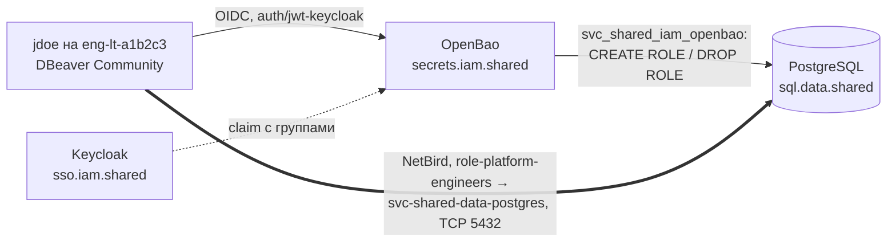

[English](README.md) | **Русский** | [简体中文](README.zh-CN.md)

# Практика: agent-assisted-network-rollout

Безопасный выкат сетевого доступа к базе данных с ИИ-агентом в редакторе кода: человек ведёт, агент делает, ассистент ревьюит. Практика фиксирует роли, разделение привилегий, требования, процесс выката и архитектуру доступа людей к базам данных.

**Статус:** черновик, развивается. Создано 2026-10-31. Перевод информативный; нормативный текст [английский](README.md). Все имена вымышлены и построены по [стандарту именования](https://github.com/mess-systems/naming-standard/blob/main/README.ru.md) mess.systems. Статусы компонентов взяты из [технологического радара](https://github.com/mess-systems/tech-radar) на 2026-10-31.

## 1. Назначение и сценарий

Практика задаёт порядок работ, когда сетевой доступ к базе данных через mesh-сеть mess.systems открывает ИИ-агент в редакторе кода (Cursor), а не человек вручную. [Требования](#5-требования) применимы к любой БД; примеры построены на одном сценарии mess.systems.

**Сценарий.** Общий кластер PostgreSQL плоскости `shared` (возможность `sql` в домене `data`) становится доступен через сеть NetBird:

- серверу OpenBao, который выдаёт временные учётные данные;
- инженерам платформы для чтения базы Forgejo `eng_sdlc_git_prd`;
- администраторам T1 для обслуживания.

| Роль | Кто в mess.systems | Устройство | Учётная запись |
|---|---|---|---|
| Ведущий | Инженер платформы | `eng-lt-a1b2c3` для подготовки, `paw-lt-g7h8j9` для привилегированных шагов | `jdoe` (`role-platform-engineers`, T2), `jdoe-adm` (`tier-t1-platform-ops`, T1) |
| Исполнитель | Агент Cursor в сессии ведущего | `eng-lt-a1b2c3` | инструмент человека `user-jdoe-cursor` |
| Ревьюер | Второй ассистент | вне устройств ведущего | агент `agent-code-review`, `operator: jdoe` |

Не входит: устройство сети (типовая архитектура [`net-mesh`](../net-mesh/)), доступ агентов к инструментам по MCP (типовая архитектура [`obs-mcp-readonly`](../obs-mcp-readonly/)), базовая конфигурация устройств (типовая архитектура [`endpoint`](../endpoint/)).

## 2. Состав и статус в радаре

| Часть | Продукт | Радар |
|---|---|---|
| Поставщик идентичностей, группы | Keycloak | [Adopt](https://github.com/mess-systems/tech-radar/blob/main/technologies/keycloak.md) |
| Протокол входа | OpenID Connect | [Adopt](https://github.com/mess-systems/tech-radar/blob/main/technologies/oidc.md) (спецификация) |
| Секреты, временные учётные данные | OpenBao, движок database | [Adopt](https://github.com/mess-systems/tech-radar/blob/main/technologies/openbao.md) |
| Mesh-сеть и её политики | NetBird | [Adopt](https://github.com/mess-systems/tech-radar/blob/main/technologies/netbird.md) |
| База данных | PostgreSQL | [Adopt](https://github.com/mess-systems/tech-radar/blob/main/technologies/postgresql.md) |
| Сеть и политики как код | OpenTofu | [Adopt](https://github.com/mess-systems/tech-radar/blob/main/technologies/opentofu.md) |
| Настройка хостов, межсетевой экран хоста | Ansible | [Adopt](https://github.com/mess-systems/tech-radar/blob/main/technologies/ansible.md) |
| Репозитории IaC, ревью | Forgejo | [Adopt](https://github.com/mess-systems/tech-radar/blob/main/technologies/forgejo.md) |
| Журналы и метрики | Loki, Prometheus, Grafana | [Loki](https://github.com/mess-systems/tech-radar/blob/main/technologies/loki.md), [Prometheus](https://github.com/mess-systems/tech-radar/blob/main/technologies/prometheus.md), [Grafana](https://github.com/mess-systems/tech-radar/blob/main/technologies/grafana.md): Adopt |
| Межсетевой экран хоста | nftables | **карточки нет** |
| Туннель | WireGuard (внутри NetBird) | **карточки нет** |
| ИИ-агент в редакторе | Cursor | **карточки нет**; в `endpoint` агентом по умолчанию указан OpenCode |
| Клиент БД | DBeaver Community | **карточки нет** |
| Контейнерная среда OpenBao, если он в контейнере | Podman | [Trial](https://github.com/mess-systems/tech-radar/blob/main/technologies/podman.md) (домен `device`); у Docker **карточки нет** |

## 3. Имена

У каждого имени есть форма в стандарте именования; колонка «Правило» ссылается на неё. Придуманных имён без формы нет.

| Объект | Имя | Правило |
|---|---|---|
| Кластер PostgreSQL, внутреннее имя | `sql.data.shared.svc.mess.systems` | [Грамматика A: внутренняя](https://github.com/mess-systems/naming-standard/blob/main/i18n/ru/01-naming-conventions.md#31-грамматика-a-внутренняя) |
| Приложение кластера | `shared-data-postgres` | [Объекты PostgreSQL](https://github.com/mess-systems/naming-standard/blob/main/i18n/ru/08-operations-objects.md#7-объекты-postgresql) |
| Хост кластера | `dc1-shared-data-postgres-prd-01` | [Формы объектов](https://github.com/mess-systems/naming-standard/blob/main/i18n/ru/01-naming-conventions.md#5-формы-объектов) |
| База Forgejo | `eng_sdlc_git_prd` | [Объекты PostgreSQL](https://github.com/mess-systems/naming-standard/blob/main/i18n/ru/08-operations-objects.md#7-объекты-postgresql) |
| Роли базы | `eng_sdlc_git_ro`, `eng_sdlc_git_rw`, `eng_sdlc_git_owner` | [Роли баз данных](https://github.com/mess-systems/naming-standard/blob/main/i18n/ru/04-identity-conventions.md#11-роли-баз-данных) |
| Пользователь приложения Forgejo | `svc_eng_sdlc_forgejo` | [Роли баз данных](https://github.com/mess-systems/naming-standard/blob/main/i18n/ru/04-identity-conventions.md#11-роли-баз-данных) |
| Служебная роль OpenBao в PostgreSQL | `svc_shared_iam_openbao` | [Роли баз данных](https://github.com/mess-systems/naming-standard/blob/main/i18n/ru/04-identity-conventions.md#11-роли-баз-данных) |
| Локальный аварийный администратор | `breakglass_sql` (роль БД), учётная запись `breakglass-sql-01` | [Роли баз данных](https://github.com/mess-systems/naming-standard/blob/main/i18n/ru/04-identity-conventions.md#11-роли-баз-данных), [виды идентичностей](https://github.com/mess-systems/naming-standard/blob/main/i18n/ru/04-identity-conventions.md#2-виды-идентичностей) |
| Временный пользователь | `v_<auth>_<identity>_<role>_<ts>_<rand6>`, например `v_oidc_jdoe_eng_sdlc_git_ro_20261031t020000z_k7m2qa` | [Временные пользователи баз данных](https://github.com/mess-systems/naming-standard/blob/main/i18n/ru/04-identity-conventions.md#111-временные-пользователи-баз-данных) |
| Роль записи и группа для неё (выключены по умолчанию) | `eng_sdlc_git_rw`; группа, роль входа и политика `app-sql-editor` | [Группы приложений](https://github.com/mess-systems/naming-standard/blob/main/i18n/ru/04-identity-conventions.md#33-группы-приложений-доступ-к-одной-возможности), [роли баз данных](https://github.com/mess-systems/naming-standard/blob/main/i18n/ru/04-identity-conventions.md#11-роли-баз-данных), [политики](https://github.com/mess-systems/naming-standard/blob/main/i18n/ru/03-secrets-conventions.md#5-политики) |
| PKI | mount `pki-int/`, issuer `mess-systems-int-2026`, роль выпуска `data-shared` | [Механизмы, отличные от kv](https://github.com/mess-systems/naming-standard/blob/main/i18n/ru/03-secrets-conventions.md#21-механизмы-отличные-от-kv) |
| Группа DNS-серверов mesh | `svc-mess-systems-dc1` (зона `svc.mess.systems`) | [DNS в mesh](https://github.com/mess-systems/naming-standard/blob/main/i18n/ru/04-identity-conventions.md#43-dns-в-mesh) |
| OpenBao | `secrets.iam.shared.svc.mess.systems`, приложение `shared-iam-openbao`, хост `dc1-shared-iam-openbao-prd-01` | [Соглашения о секретах](https://github.com/mess-systems/naming-standard/blob/main/i18n/ru/03-secrets-conventions.md), [формы объектов](https://github.com/mess-systems/naming-standard/blob/main/i18n/ru/01-naming-conventions.md#5-формы-объектов) |
| Вход людей в OpenBao | `auth/jwt-keycloak`, роль `role-platform-engineers`, TTL 8 ч | [Точки монтирования](https://github.com/mess-systems/naming-standard/blob/main/i18n/ru/03-secrets-conventions.md#2-точки-монтирования), [роли аутентификации и токены](https://github.com/mess-systems/naming-standard/blob/main/i18n/ru/03-secrets-conventions.md#6-роли-аутентификации-и-токены) |
| Политика OpenBao | `role-platform-engineers` | [Политики](https://github.com/mess-systems/naming-standard/blob/main/i18n/ru/03-secrets-conventions.md#5-политики) |
| Монтирование движка database | `database-shared/`, подключение `shared-data-postgres`, роль `eng_sdlc_git_ro` | [Механизмы, отличные от kv](https://github.com/mess-systems/naming-standard/blob/main/i18n/ru/03-secrets-conventions.md#21-механизмы-отличные-от-kv) |
| Клиент OpenBao в Keycloak | приложение `shared-iam-openbao`, провайдер `shared-iam-openbao-oidc`, сопоставление `shared-iam-openbao-groups` | [Объекты IdP](https://github.com/mess-systems/naming-standard/blob/main/i18n/ru/04-identity-conventions.md#6-объекты-idp) |
| Keycloak | `sso.iam.shared.svc.mess.systems`, realm `mess-systems`; публичное исключение `sso.mess.systems` | [Разобранные примеры кодирования](https://github.com/mess-systems/naming-standard/blob/main/i18n/ru/01-naming-conventions.md#11-разобранные-примеры-кодирования), [объекты IdP](https://github.com/mess-systems/naming-standard/blob/main/i18n/ru/04-identity-conventions.md#6-объекты-idp), [грамматика B: публичная](https://github.com/mess-systems/naming-standard/blob/main/i18n/ru/01-naming-conventions.md#32-грамматика-b-публичная) |
| Координатор сети | `mesh.net.shared.svc.mess.systems`, приложение `shared-net-netbird`, исключение `netbird.mess.systems` | [Разобранные примеры кодирования](https://github.com/mess-systems/naming-standard/blob/main/i18n/ru/01-naming-conventions.md#11-разобранные-примеры-кодирования), [грамматика B: публичная](https://github.com/mess-systems/naming-standard/blob/main/i18n/ru/01-naming-conventions.md#32-грамматика-b-публичная) |
| Группы сети: узлы сервисов | `svc-shared-data-postgres`, `svc-shared-iam-openbao` | [Группы mesh VPN](https://github.com/mess-systems/naming-standard/blob/main/i18n/ru/04-identity-conventions.md#4-группы-mesh-vpn) |
| Группы сети: люди | `role-platform-engineers`, `tier-t1-platform-ops` | [Группы](https://github.com/mess-systems/naming-standard/blob/main/i18n/ru/04-identity-conventions.md#3-группы) |
| Группа площадки, маршрутизирующие узлы | `site-dc1`; `router-dc1` | [Группы mesh VPN](https://github.com/mess-systems/naming-standard/blob/main/i18n/ru/04-identity-conventions.md#4-группы-mesh-vpn) |
| Политики сети и правило | `role-platform-engineers -> svc-shared-data-postgres`, правило `postgresql` | [Политики, правила и проверки состояния mesh](https://github.com/mess-systems/naming-standard/blob/main/i18n/ru/04-identity-conventions.md#41-политики-правила-и-проверки-состояния-mesh) |
| Проверка состояния устройства | `posture-client-current` | [Политики, правила и проверки состояния mesh](https://github.com/mess-systems/naming-standard/blob/main/i18n/ru/04-identity-conventions.md#41-политики-правила-и-проверки-состояния-mesh) |
| Устройства | `eng-lt-a1b2c3`, `paw-lt-g7h8j9` | [Соглашения о рабочих местах](https://github.com/mess-systems/naming-standard/blob/main/i18n/ru/06-endpoint-conventions.md#2-форма) |
| Ведущий | `jdoe`, `jdoe-adm` | [Виды идентичностей](https://github.com/mess-systems/naming-standard/blob/main/i18n/ru/04-identity-conventions.md#2-виды-идентичностей) |
| Агент Cursor | `user-jdoe-cursor` (учётная запись и OIDC-клиент) | [Виды идентичностей](https://github.com/mess-systems/naming-standard/blob/main/i18n/ru/04-identity-conventions.md#2-виды-идентичностей) (инструмент человека), [объекты IdP](https://github.com/mess-systems/naming-standard/blob/main/i18n/ru/04-identity-conventions.md#6-объекты-idp) |
| Ревьюер | `agent-code-review` | [Виды идентичностей](https://github.com/mess-systems/naming-standard/blob/main/i18n/ru/04-identity-conventions.md#2-виды-идентичностей) |
| Репозиторий IaC сети | `shared-net-iac` | [Формы объектов](https://github.com/mess-systems/naming-standard/blob/main/i18n/ru/01-naming-conventions.md#5-формы-объектов) |
| Ресурс OpenTofu, группы Ansible | `shared_data_postgres_prd`; `shared_data`, `shared_data_postgres` | [Формы объектов](https://github.com/mess-systems/naming-standard/blob/main/i18n/ru/01-naming-conventions.md#5-формы-объектов) |
| `service_name` в Loki | `shared-data-postgres`, `shared-iam-openbao`, `shared-iam-keycloak` | [Формы объектов](https://github.com/mess-systems/naming-standard/blob/main/i18n/ru/01-naming-conventions.md#5-формы-объектов) |
| Ветка агента | `user-jdoe-cursor/pg-access` | [Ветки и теги Git](https://github.com/mess-systems/naming-standard/blob/main/i18n/ru/08-operations-objects.md#1-ветки-и-теги-git) |
| Снимок перед изменением | `shared-data-postgres-prd-20261031t020000z` | [Резервные копии и снимки](https://github.com/mess-systems/naming-standard/blob/main/i18n/ru/08-operations-objects.md#3-резервные-копии-и-снимки) |

Имя ничего не разрешает (правило I3 [соглашений об идентичностях](https://github.com/mess-systems/naming-standard/blob/main/i18n/ru/04-identity-conventions.md#1-применяемые-принципы)): доступ дают группы Keycloak, политики сети и политики OpenBao.

## 4. Разделение привилегий

Типовая архитектура [`endpoint`](../endpoint/) запрещает ИИ-клиенты на устройствах `paw`, а административные пути `tier-*` в [`net-mesh`](../net-mesh/README.ru.md#4-пути-запросов) начинаются только с `paw` и учётных записей `-adm`. Отсюда правило, которого нет в простой схеме «агент делает всё»:

1. Агент работает на устройстве `eng` в сессии дневной учётной записи ведущего (T2). Учётных данных T1 у агента нет.
2. Агент готовит изменения в IaC в своей ветке и выполняет непривилегированные проверки: план OpenTofu, проверку синтаксиса правил, проверки доступности из своей группы.
3. Привилегированные шаги (применение плана к сети, применение роли Ansible на хосте плоскости `shared`, `rotate-root`) выполняет ведущий под `jdoe-adm` с `paw-lt-g7h8j9` или конвейер после слияния ветки.
4. Ревьюер получает план и результат, но не учётные данные.

## 5. Требования

Ключевые слова «должен», «не должен», «следует» используются в нормативном смысле.

### 5.1 Сначала закрыть, потом открыть

1. Межсетевой экран хоста `dc1-shared-data-postgres-prd-01` (таблица nftables, роль Ansible) с allow-list на TCP 5432 должен быть применён и проверен **до** того, как с клиента NetBird снят запрет входящих соединений (`--block-inbound`).
2. Откат каждого шага записан в runbook до начала работ: какая команда возвращает предыдущее состояние и как проверить возврат.
3. Предварительная проверка доступа (preflight): если изменение требует доступа к другому узлу (SSH, API, порт сервиса), доступ проверяется до начала работ. Отсутствие доступа — блокер: работа останавливается, ведущий решает, как выдать доступ. Искать обходной путь не допускается.
4. Порядок: применить правила хоста → [матрица](#57-проверка-матрицей) → снять запрет входящих → повторить матрицу.

### 5.2 Не конкурировать с правилами mesh-агента

1. Клиент NetBird держит свою таблицу nftables и вставляет разрешающее правило для своего интерфейса в чужие базовые цепочки с хуками input и forward, восстанавливая его при изменении таблиц ([межсетевой экран хоста](../net-mesh/README.ru.md#8-межсетевой-экран-хоста) в `net-mesh`). Удалять это правило скриптом не следует: окно уязвимости остаётся до следующего применения.
2. Таблица хоста фильтрует только LAN и прямой порт WireGuard; файл не выполняет `flush ruleset`. Пример: [`net-mesh/examples/nftables-hostfw.example.nft`](../net-mesh/examples/nftables-hostfw.example.nft).
3. Трафик mesh-интерфейса регулируют политики NetBird. Раз хост его не фильтрует, политики сети — критичное средство защиты: они описаны в OpenTofu (`shared-net-iac`) и входят в матрицу проверок наравне с правилами хоста.
4. Устойчивость проверяется фактом: снимок `nft list ruleset` до и после перезапуска клиента NetBird прикладывается к изменению.

### 5.3 Ручная правка сразу попадает в IaC

1. Изменение, сделанное вручную (консоль NetBird, консоль Keycloak, команда на хосте), переносится в OpenTofu или Ansible в рамках того же изменения. Иначе следующее применение его откатит.
2. Объект, который IaC перезаписывает целиком, описывается полной копией живого: для клиента `shared-iam-openbao-oidc` в Keycloak это redirect URI, аудитории и сопоставление `shared-iam-openbao-groups`. Неполное описание стирает поля и ломает вход в OpenBao.
3. Перед первым применением живой объект импортируется; план без изменений подтверждает, что описание полное.

### 5.4 Временные послабления только как технический долг

1. Послабление записывается задачей в Forgejo с владельцем (группой, см. [владельцы](https://github.com/mess-systems/naming-standard/blob/main/i18n/ru/04-identity-conventions.md#5-владельцы)), сроком и условием возврата.
2. Пример: TTL токена служебного пользователя NetBird для OpenTofu увеличен с 1 ч до 12 ч на время развёртывания; владелец `role-platform-engineers`; возврат — по окончании развёртывания.
3. Послабление, сделанное вручную, тоже фиксируется в IaC ([ручная правка сразу попадает в IaC](#53-ручная-правка-сразу-попадает-в-iac)); возврат выполняется изменением в IaC, а не повторной ручной правкой.
4. Изменение не завершено, пока у него есть открытые послабления.

### 5.5 Стоп-кран для агента

1. Ведущий останавливает агента (Stop), если тот импровизирует: ищет учётные данные в файлах, читает чужие конфигурации, обходит или переставляет шаги runbook, выполняет команды вне плана.
2. После остановки: что уже изменено; план следующих команд; продолжение только после явного «OK».
3. Секреты агенту выдаёт человек штатно: `bao login -method=oidc` через `auth/jwt-keycloak` на устройстве `eng`, токен хранит token helper CLI `bao` (правило S5 [соглашений о секретах](https://github.com/mess-systems/naming-standard/blob/main/i18n/ru/03-secrets-conventions.md#1-применяемые-принципы): без токенов на диске вне helper). Агент не ищет секреты сам и не пишет их в файлы и журнал чата.
4. При отсутствии доступа (например, хост отклонил SSH-ключ) агент останавливается и называет нужный доступ и шаг. Пробовать другие ключи, учётные записи или пути агент не должен.
5. Частая причина ошибки 403: устаревший токен в переменной окружения (`BAO_TOKEN`, `VAULT_TOKEN`) имеет приоритет над token helper. Перед диагностикой прав переменная в окружении сессии проверяется и сбрасывается.

### 5.6 Гигиена git

1. Агент работает в своей ветке (`user-jdoe-cursor/<topic>`, см. [ветки и теги Git](https://github.com/mess-systems/naming-standard/blob/main/i18n/ru/08-operations-objects.md#1-ветки-и-теги-git)), а не в чужой feature-ветке.
2. История переписывается только для коммитов, не отправленных в Forgejo.
3. Коммит описывает, что изменено и чем проверено; секреты и выводы команд с секретами в коммит не попадают.

### 5.7 Проверка матрицей

Каждый шаг, меняющий доступ, проверяется матрицей; к строке прикладывается правило nftables, политика NetBird или права PostgreSQL, давшие результат.

| Источник | Назначение | Действие | Ожидание | Доказательство |
|---|---|---|---|---|
| `svc-shared-iam-openbao` | `svc-shared-data-postgres` | TCP 5432 | разрешено | политика NetBird |
| `role-platform-engineers` | `svc-shared-data-postgres` | TCP 5432 | разрешено | политика NetBird |
| `tier-t1-platform-ops` с `paw` | `svc-shared-data-postgres` | TCP 5432 | разрешено | политика NetBird с проверкой состояния |
| `role-developers` | `svc-shared-data-postgres` | TCP 5432 | отказ | нет политики |
| `svc-shared-data-postgres` | `svc-shared-iam-openbao` | любой порт | отказ | политика односторонняя |
| Сборщик площадки `dc1` из allow-list | хост БД по LAN | TCP 5432 | разрешено | правило таблицы хоста |
| Хост LAN вне allow-list | хост БД по LAN | TCP 5432 | отказ | политика drop цепочки |
| `jdoe` в `role-platform-engineers` | OpenBao | `bao read database-shared/creds/eng_sdlc_git_ro` | выдано | журнал аудита OpenBao |
| Пользователь вне группы | OpenBao | то же | отказ (403) | политика OpenBao |
| Временный пользователь роли `ro` | `eng_sdlc_git_prd` | `CREATE TABLE` | отказ (`permission denied`) | права роли |
| Временный пользователь после TTL | `sql.data.shared` | вход | отказ | `DROP ROLE` в журнале |
| Ведущий | OpenBao | `bao audit list` | не меньше одного устройства | вывод команды |
| Ведущий | журнал аудита OpenBao | поиск выдачи по имени временного пользователя | найдено, `username` не захеширован | запись аудита |
| `jdoe` в `role-platform-engineers` | OpenBao | `bao read database-shared/creds/eng_sdlc_git_rw` | отказ (403): запись выключена | политика OpenBao |
| Временный пользователь | имя | длина и форма [временных пользователей баз данных](https://github.com/mess-systems/naming-standard/blob/main/i18n/ru/04-identity-conventions.md#111-временные-пользователи-баз-данных) | не больше 63, есть `oidc`, `jdoe`, роль, время UTC | `pg_roles`, журнал аудита |
| Клиент, `sslmode=verify-full` | `sql.data.shared.svc.mess.systems` | вход | разрешено, TLS | `pg_stat_ssl` |
| Клиент, `sslmode=verify-full` | хост БД по имени узла mesh или по адресу | вход | отказ: имя не совпадает с сертификатом | ошибка клиента |
| Клиент, `sslmode=disable` | `sql.data.shared.svc.mess.systems` | вход | отказ | строка `hostnossl … reject` |
| Ведущий | `pki-int/issue/data-shared` | выпуск `*.data.shared.svc.mess.systems`, `data.shared.svc.mess.systems`, имени вне зоны | отказ | настройки роли PKI |
| Временный пользователь роли `ro` | `eng_sdlc_git_prd` | `DROP DATABASE eng_sdlc_git_prd` | отказ (`must be owner`) | права роли |
| `svc_shared_iam_openbao` | `eng_sdlc_git_prd` | `CREATE TABLE`, `SELECT` из таблиц базы | отказ | права учётной записи |
| Ведущий | Loki и Wazuh | поиск отказа `CREATE TABLE` по имени временного пользователя | найдено в обоих | запрос в Loki, событие Wazuh |
| Ведущий | журнал Keycloak | вход `jdoe` во время выдачи | найдено, второй фактор пройден | событие входа |

### 5.8 Доступ к БД: временные пользователи

Раздел задаёт требования к [потоку](#71-поток) доступа людей. Имена по таблице [имён](#3-имена).

#### 5.8.1 Выдача

1. Человек входит в OpenBao только через OIDC: `bao login -method=oidc` на mount `auth/jwt-keycloak`. Роль входа `role-platform-engineers` привязана `bound_claims` к группе Keycloak с тем же ID; `user_claim = preferred_username`.
2. Политика `role-platform-engineers` разрешает только `read` на `database-shared/creds/eng_sdlc_git_ro`. Прав на `database-shared/config/*`, `database-shared/roles/*`, `rotate-root` и `sys/leases/*` у неё нет.
3. OpenBao подключается к PostgreSQL под сервисной учётной записью `svc_shared_iam_openbao` (подключение `shared-data-postgres`). Её пароль после `rotate-root` знает только OpenBao. Атрибуты: `LOGIN CREATEROLE NOSUPERUSER NOCREATEDB NOREPLICATION NOBYPASSRLS`; на групповую роль — `GRANT eng_sdlc_git_ro TO svc_shared_iam_openbao WITH ADMIN TRUE, INHERIT FALSE, SET FALSE` (PostgreSQL 16+): учётная запись может выдать роль, но не может ею пользоваться. Для завершения сессий — членство в `pg_signal_backend`. Объектами БД она не владеет.
4. Создание пользователя (`creation_statements` роли `eng_sdlc_git_ro`):

   ```sql
   CREATE ROLE "{{name}}" WITH LOGIN PASSWORD '{{password}}' VALID UNTIL '{{expiration}}';
   GRANT eng_sdlc_git_ro TO "{{name}}";
   ```

   Отзыв (`revocation_statements`):

   ```sql
   SELECT pg_terminate_backend(pid) FROM pg_stat_activity WHERE usename = '{{name}}';
   DROP ROLE IF EXISTS "{{name}}";
   ```

5. Имя пользователя — по форме [временных пользователей баз данных](https://github.com/mess-systems/naming-standard/blob/main/i18n/ru/04-identity-conventions.md#111-временные-пользователи-баз-данных): `v_<auth>_<identity>_<role>_<ts>_<rand6>`, например `v_oidc_jdoe_eng_sdlc_git_ro_20261031t020000z_k7m2qa`. Шаблон задаётся в `username_template` подключения.
6. TTL: `default_ttl = 8h`, `max_ttl = 24h`. По истечении аренды OpenBao выполняет отзыв (п. 4). `VALID UNTIL` закрывает новый вход, даже если OpenBao не успел отозвать пользователя.
7. Изменения в БД выполняются только под временным пользователем. `svc_shared_iam_openbao` только создаёт и удаляет временных пользователей; для чтения и изменения данных она не используется.

#### 5.8.2 Подключение

1. Клиент подключается по функциональному имени `sql.data.shared.svc.mess.systems` ([грамматика A: внутренняя](https://github.com/mess-systems/naming-standard/blob/main/i18n/ru/01-naming-conventions.md#31-грамматика-a-внутренняя)). Имя разрешается в частной зоне `svc.mess.systems` сети NetBird через группу DNS-серверов `svc-mess-systems-dc1` ([DNS в mesh](https://github.com/mess-systems/naming-standard/blob/main/i18n/ru/04-identity-conventions.md#43-dns-в-mesh)). Имена узлов mesh и адреса в настройках клиента не используются.
2. Сертификат сервера выпускает OpenBao PKI: mount `pki-int/`, issuer `mess-systems-int-2026`, роль выпуска `data-shared` ([механизмы, отличные от kv](https://github.com/mess-systems/naming-standard/blob/main/i18n/ru/03-secrets-conventions.md#21-механизмы-отличные-от-kv)). Одна роль на зону `data.shared.svc.mess.systems`: `allowed_domains` = зона, `allow_subdomains = true`, `allow_bare_domains = false`, `allow_wildcard_certificates = false`, `allow_ip_sans = false`. SAN сертификата — только `sql.data.shared.svc.mess.systems`.
3. Сервер: в `pg_hba.conf` только строки `hostssl`; `hostnossl` для всех — `reject`.
4. Клиент: `sslmode=verify-full`, `sslrootcert` — цепочка корневого CA mess.systems, распространённая профилем `endpoint`. Режимы `require` и `verify-ca` не допускаются: они не проверяют имя.

#### 5.8.3 Вопросы и ответы

**Где описано, кто и что может?** В IaC, в трёх слоях:

| Слой | Отвечает на вопрос | Где | Пример |
|---|---|---|---|
| Группа IdP | кто | Keycloak, OpenTofu | `role-platform-engineers` |
| Роль OIDC и политика OpenBao | каким путём выдаются учётные данные | OpenBao, OpenTofu | роль `role-platform-engineers` в `auth/jwt-keycloak`, политика `role-platform-engineers` → `database-shared/creds/eng_sdlc_git_ro` |
| Права групповой роли БД | что можно делать в базе | PostgreSQL, Ansible или миграции | `GRANT SELECT` на таблицы схем базы `eng_sdlc_git_prd` роли `eng_sdlc_git_ro` |

Эффективный доступ — пересечение трёх слоёв; изменение одного слоя без ревью двух других не расширяет доступ незаметно.

**Как включить запись?** По умолчанию запись выключена: роли выдачи `database-shared/roles/eng_sdlc_git_rw` нет. Включение — одно изменение в IaC из трёх частей: новая группа Keycloak `app-sql-editor` ([группы приложений](https://github.com/mess-systems/naming-standard/blob/main/i18n/ru/04-identity-conventions.md#33-группы-приложений-доступ-к-одной-возможности)); роль входа и политика с тем же ID, разрешающая только `read` на `database-shared/creds/eng_sdlc_git_rw`; права роли `eng_sdlc_git_rw` на конкретные схемы (`SELECT, INSERT, UPDATE, DELETE`, без `TRUNCATE` и без DDL). Права на всю базу или на `public` целиком не выдаются.

**Кто выполняет изменения?** Временный пользователь, имя которого называет способ входа, человека, роль и время выдачи. Сервисная учётная запись OpenBao только создаёт и удаляет пользователей ([выдача](#581-выдача), п. 7).

**Можно ли удалить базу?** Нет. `DROP DATABASE` разрешён только владельцу базы (`eng_sdlc_git_owner`) и суперпользователю. Роль `ro` не имеет DDL; это проверяется отказом `CREATE TABLE` в [матрице](#57-проверка-матрицей). Роль `rw` тоже не владелец и не суперпользователь. От удаления строк под `rw` защищают узкие права на схемы и снимок перед изменением ([резервные копии и снимки](https://github.com/mess-systems/naming-standard/blob/main/i18n/ru/08-operations-objects.md#3-резервные-копии-и-снимки)).

**Как доказать, кто что сделал?** Цепочкой из трёх журналов:

1. Журнал PostgreSQL: временный пользователь и команда (`log_statement = 'ddl'` или pgaudit).
2. Журнал аудита OpenBao: кто и когда получил этого пользователя (аренда на `database-shared/creds/eng_sdlc_git_ro`, сущность и alias `jdoe`).
3. Журнал Keycloak: вход `jdoe` и пройденный второй фактор.

Связь 1 → 2 — по имени пользователя, 2 → 3 — по сущности OpenBao и сессии IdP. Время в имени (`<ts>`) сужает поиск.

#### 5.8.4 Требования к журналам

1. В OpenBao должно быть включено хотя бы одно устройство аудита (`bao audit list` не пуст); рекомендуется два, чтобы отказ одного не останавливал OpenBao. На mount `database-shared/` ключ `username` выводится из HMAC: `bao secrets tune -audit-non-hmac-response-keys=username database-shared/`. Иначе имя пользователя в журнале захешировано и ищется только через `sys/audit-hash`.
2. PostgreSQL: `log_connections = on`, `log_disconnections = on`, `log_statement = 'ddl'` или pgaudit (`pgaudit.log = 'ddl, role'`), в `log_line_prefix` — пользователь, база, адрес клиента и ID сессии (`%u %d %r %c`).
3. Keycloak: сохранение событий входа и событий администрирования включено.
4. Журналы трёх систем уходят в центральное хранилище: Loki (радар Adopt; `service_name` = `shared-data-postgres`, `shared-iam-openbao`, `shared-iam-keycloak`) и в SIEM Wazuh ([радар Adopt](https://github.com/mess-systems/tech-radar/blob/main/technologies/wazuh.md)). Срок хранения не меньше срока расследования инцидента.
5. Если хотя бы одно звено не выполнено, принадлежность действия человеку опирается только на имя пользователя. Имя формирует OpenBao, но без журналов это утверждение нечем подтвердить. Такой выкат не принимается (шаг 8 [процесса выката](#6-процесс-выката)).

#### 5.8.5 Рекомендации к проверке

- Перед выкатом: `bao audit list`; настройка mount `database-shared/` (`audit_non_hmac_response_keys`); `SHOW log_connections; SHOW log_statement; SHOW log_line_prefix;` и, если используется, `SHOW pgaudit.log;`.
- Доставка: контрольное событие (выдача пользователя, отказ `CREATE TABLE`) находится в Loki и в Wazuh по имени временного пользователя.
- Сквозная проверка: по одной строке журнала PostgreSQL восстановить человека и вход со вторым фактором, не обращаясь к нему самому.

## 6. Процесс выката

| # | Шаг | Кто | Где |
|---|---|---|---|
| 1 | Цель и runbook с откатом для каждого шага; задача в Forgejo | ведущий | `eng` |
| 2 | Preflight доступа ко всем затронутым узлам ([сначала закрыть, потом открыть](#51-сначала-закрыть-потом-открыть), п. 3) | агент | `eng` |
| 3 | План команд; ревью против [требований](#5-требования); «OK» | агент, ревьюер, ведущий | `eng` |
| 4 | Роль Ansible с таблицей хоста и политики NetBird в ветке агента; план OpenTofu | агент | `eng` |
| 5 | Применение таблицы хоста, снимок правил, матрица по LAN | ведущий под `jdoe-adm` или конвейер | `paw` |
| 6 | Применение политик сети, снятие `--block-inbound`, полная матрица, снимок после перезапуска клиента | ведущий под `jdoe-adm` или конвейер | `paw` |
| 7 | Сверка: IaC совпадает с живым состоянием, послабления записаны, ветка чистая | ревьюер | — |
| 8 | Приёмка или откат | ведущий | `paw` |

## 7. Архитектура доступа людей к базам данных

### 7.1 Поток



1. **Вход.** `jdoe` входит в OpenBao через `auth/jwt-keycloak`. Роль `role-platform-engineers` привязана `bound_claims` к группе Keycloak с тем же именем, TTL токена 8 ч ([роли аутентификации и токены](https://github.com/mess-systems/naming-standard/blob/main/i18n/ru/03-secrets-conventions.md#6-роли-аутентификации-и-токены)). Политика `role-platform-engineers` разрешает только `read` на `database-shared/creds/eng_sdlc_git_ro`.
2. **Временные учётные данные.** `bao read database-shared/creds/eng_sdlc_git_ro` создаёт пользователя `v_oidc_jdoe_eng_sdlc_git_ro_<ts>_<rand6>` ([временные пользователи баз данных](https://github.com/mess-systems/naming-standard/blob/main/i18n/ru/04-identity-conventions.md#111-временные-пользователи-баз-данных)) с TTL 8 ч (максимум 24 ч), который наследует роль `eng_sdlc_git_ro` с `NOLOGIN`. Прав на DDL у него нет: ни владения схемами, ни `CREATE` в них; это проверяется строкой [матрицы](#57-проверка-матрицей). По истечении срока OpenBao завершает его сессии (`pg_terminate_backend`) и выполняет `DROP ROLE`.
3. **Клиент.** Учётные данные вставляются в DBeaver Community вручную: в бесплатной редакции нет интеграции с OpenBao. DBeaver Enterprise и DataGrip умеют получать их сами; это вариант на будущее.
4. **Ротация.** `rotate-root` для `svc_shared_iam_openbao` выполняется отдельным шагом после проверки выдачи, под `jdoe-adm`. После ротации пароль знает только OpenBao; для аварий остаётся `breakglass-sql-01` (правило I6 [соглашений об идентичностях](https://github.com/mess-systems/naming-standard/blob/main/i18n/ru/04-identity-conventions.md#1-применяемые-принципы)).
5. **Аудит.** В PostgreSQL `log_connections = on` и `log_statement = 'ddl'`, журналы уходят в Loki с `service_name = shared-data-postgres`. Журнал аудита OpenBao уходит в Loki с `service_name = shared-iam-openbao`. Связь «человек → временный пользователь» восстанавливается по журналу OpenBao.

### 7.2 Сеть

- OpenBao — отдельный узел сети в группе `svc-shared-iam-openbao` ([пути запросов](../net-mesh/README.ru.md#4-пути-запросов) в `net-mesh`), а не сервис на маршрутизирующем узле. Если он всё же стоит за `router-dc1` с маскарадингом, PostgreSQL видит адрес маршрутизатора, и `pg_hba.conf` нельзя привязать к источнику ([подключение узлов](../net-mesh/README.ru.md#7-подключение-узлов) в `net-mesh`).
- Preflight: TCP 5432 до `sql.data.shared.svc.mess.systems` проверяется с хоста OpenBao и, если OpenBao в контейнере, из сетевого пространства имён контейнера.
- Политики NetBird ([политики, правила и проверки состояния mesh](https://github.com/mess-systems/naming-standard/blob/main/i18n/ru/04-identity-conventions.md#41-политики-правила-и-проверки-состояния-mesh)), все односторонние, правило `postgresql` (TCP 5432), в OpenTofu:
  - `svc-shared-iam-openbao -> svc-shared-data-postgres`;
  - `role-platform-engineers -> svc-shared-data-postgres`;
  - `tier-t1-platform-ops -> svc-shared-data-postgres` с проверкой `posture-client-current`;
  - группа All не бывает ни источником, ни назначением ([группы и политики](../net-mesh/README.ru.md#6-группы-и-политики) в `net-mesh`).
- Таблица хоста БД: allow-list LAN площадки `dc1` для сборщиков журналов и метрик; трафик `wt0` регулируют политики NetBird.
- PostgreSQL слушает адрес LAN и адрес mesh-интерфейса; `pg_hba.conf` задаёт правила по ролям и источникам.
- Сборщики журналов и метрик площадки не зависят от сети NetBird и интернета: mesh нужна людям и облачным сервисам, а не собственной телеметрии площадки.

### 7.3 Рассмотренные альтернативы

| Вариант | Радар | Почему не выбран сейчас |
|---|---|---|
| Teleport | [Hold](https://github.com/mess-systems/tech-radar/blob/main/technologies/teleport.md) | Радар откладывает новое внедрение; ещё один прокси и своя модель учётных записей |
| Pomerium | [Trial](https://github.com/mess-systems/tech-radar/blob/main/technologies/pomerium.md) | Контекстный доступ к HTTP-приложениям; для TCP к БД даёт второй путь рядом с NetBird |
| StrongDM | карточки нет | Внешний SaaS: данные о доступе уходят за периметр организации |
| DataGrip, DBeaver Enterprise | карточек нет | Платные клиенты; совместимы со схемой, вариант на будущее |
| SPIFFE / SPIRE | [SPIFFE Adopt](https://github.com/mess-systems/tech-radar/blob/main/technologies/spiffe.md), [SPIRE Trial](https://github.com/mess-systems/tech-radar/blob/main/technologies/spire.md) | Решает доступ сервис-к-сервису (`auth/jwt-spire`, [роли аутентификации и токены](https://github.com/mess-systems/naming-standard/blob/main/i18n/ru/03-secrets-conventions.md#6-роли-аутентификации-и-токены)), а не доступ людей |

**Решение.** Keycloak + OpenBao + NetBird: все три в кольце Adopt и уже есть в плоскости `shared`, новых компонентов нет. SPIRE рассматривается позже для доступа сервис-к-сервису.

## 8. Периметры организаций

Стандарт именования называет границу данных одной организации **периметром организации**, чтобы не путать её с контурами corp и product ([два контура](https://github.com/mess-systems/naming-standard/blob/main/i18n/ru/07-deployment-and-tenants.md#1-два-контура)).

- Сценарий целиком внутри периметра организации mess.systems и в корпоративном контуре (`contour: corp`): плоскости `shared` и `eng`, корпоративные имена без env в production.
- У одного периметра организации свои Keycloak, OpenBao и установка NetBird ([периметры организаций](../net-mesh/README.ru.md#10-периметры-организаций) в `net-mesh`). Политик сети между периметрами нет; учётные данные одного периметра не выдаются в другом.
- StrongDM и другие внешние прокси доступа не используются: данные о доступе уходили бы за пределы периметра организации.
- Конфигурация не содержит значений по умолчанию, указывающих на инфраструктуру mess.systems: в шаблоне развёртывания периметра имена — параметры.
- Шаблон развёртывания периметра включает [процесс выката](#6-процесс-выката), [матрицу](#57-проверка-матрицей) как приёмочный тест и [поток доступа людей](#71-поток) с именами-параметрами.
- Развёртывание самой установки сети следует этой практике: задание агенту, runbook развёртывания и восстановления, политики в OpenTofu, проверка перед публикацией. У узла опубликованного экземпляра продукта нет входящих портов — то же правило «сначала закрыть», что и для хоста БД ([публикация продуктов](../net-mesh/README.ru.md#9-публикация-продуктов) в `net-mesh`).

## 9. Связь с другими материалами

- [`net-mesh`](../net-mesh/): [группы и политики](../net-mesh/README.ru.md#6-группы-и-политики), [подключение узлов](../net-mesh/README.ru.md#7-подключение-узлов), [межсетевой экран хоста](../net-mesh/README.ru.md#8-межсетевой-экран-хоста), [публикация продуктов](../net-mesh/README.ru.md#9-публикация-продуктов).
- [`endpoint`](../endpoint/): профили `eng` и `paw`, CLI `bao` с входом через SSO.
- [`obs-mcp-readonly`](../obs-mcp-readonly/): эффективные права агента — пересечение слоёв, агент действует от имени человека и виден в аудите. В этой практике этого пока нет: см. [пробелы и открытые вопросы](#10-пробелы-и-открытые-вопросы).
- [Стандарт именования](https://github.com/mess-systems/naming-standard/blob/main/README.ru.md), [технологический радар](https://github.com/mess-systems/tech-radar).

## 10. Пробелы и открытые вопросы

1. **Делегирование CLI-агента.** Агент Cursor пользуется токеном `jdoe` из token helper; в журнале OpenBao он неотличим от человека. В `obs-mcp-readonly` эта задача решена обменом токена с `act`; для CLI решения пока нет. Имена клиента инструмента и actor при обмене токена заданы в [объектах IdP](https://github.com/mess-systems/naming-standard/blob/main/i18n/ru/04-identity-conventions.md#6-объекты-idp); открыт только механизм.
2. **Имена, появившиеся в v2.7.** Формы mount database, временного пользователя, ветки агента, группы `router-<site-code>`, политик и проверок состояния сети добавлены в стандарт именования v2.7. Таблица [имён](#3-имена) следует им и меняется вместе со стандартом.
3. **Карточки радара:** nftables, WireGuard, Cursor (и AI CLI-агенты вообще, см. открытые вопросы [`endpoint`](../endpoint/)), DBeaver, Docker.
4. Значения TTL (8 ч / 24 ч) — исходная точка; уточнить по реальным сессиям.
5. **Группы записи по базам.** `app-sql-editor` ([группы приложений](https://github.com/mess-systems/naming-standard/blob/main/i18n/ru/04-identity-conventions.md#33-группы-приложений-доступ-к-одной-возможности)) — одна группа на возможность `sql`. Если запись понадобится раздельно по базам, формы группы с базой или схемой в стандарте нет; её нужно завести.
