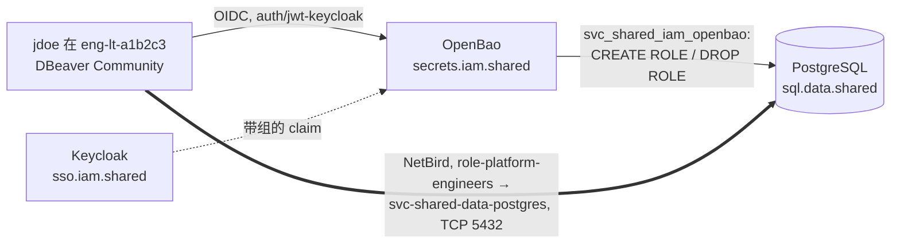

[English](README.md) | [Русский](README.ru.md) | **简体中文**

# 实践：agent-assisted-network-rollout

借助代码编辑器中的 AI 代理安全地推出对数据库的网络访问：人主导，代理执行，助手评审。本实践规定角色、权限分离、要求、推出流程以及人员访问数据库的架构。

**状态：** 草稿，持续演进。创建于 2026-10-31。译文仅供参考；规范文本为[英文版](README.md)。所有名称均为虚构，并遵循 mess.systems 的[命名标准](https://github.com/mess-systems/naming-standard/blob/main/README.zh-CN.md)。组件状态取自 2026-10-31 的[技术雷达](https://github.com/mess-systems/tech-radar)。

## 1. 目的与场景

本实践规定当通过 mess.systems 网格网络访问数据库的网络权限由代码编辑器（Cursor）中的 AI 代理而非人工手动开通时的工作顺序。[要求](#5-要求)适用于任何数据库；示例基于 mess.systems 的一个场景。

**场景。** 平面 `shared` 的共享 PostgreSQL 集群（域 `data` 中的能力 `sql`）通过 NetBird 网络向以下对象开放：

- 签发临时凭据的 OpenBao 服务器；
- 读取 Forgejo 数据库 `eng_sdlc_git_prd` 的平台工程师；
- 负责维护的 T1 管理员。

| 角色 | mess.systems 中由谁担任 | 设备 | 账户 |
|---|---|---|---|
| 主导者 | 平台工程师 | 准备工作用 `eng-lt-a1b2c3`，特权步骤用 `paw-lt-g7h8j9` | `jdoe`（`role-platform-engineers`，T2），`jdoe-adm`（`tier-t1-platform-ops`，T1） |
| 执行者 | 主导者会话中的 Cursor 代理 | `eng-lt-a1b2c3` | 人员的工具 `user-jdoe-cursor` |
| 评审者 | 第二个助手 | 不在主导者的设备上 | 代理 `agent-code-review`，`operator: jdoe` |

不在范围内：网络的结构（参考架构 [`net-mesh`](../net-mesh/)）、代理通过 MCP 访问工具（参考架构 [`obs-mcp-readonly`](../obs-mcp-readonly/)）、设备的基线配置（参考架构 [`endpoint`](../endpoint/)）。

## 2. 组成与雷达状态

| 部分 | 产品 | 雷达 |
|---|---|---|
| 身份提供者、组 | Keycloak | [Adopt](https://github.com/mess-systems/tech-radar/blob/main/technologies/keycloak.md) |
| 登录协议 | OpenID Connect | [Adopt](https://github.com/mess-systems/tech-radar/blob/main/technologies/oidc.md)（规范） |
| 机密、临时凭据 | OpenBao，database 引擎 | [Adopt](https://github.com/mess-systems/tech-radar/blob/main/technologies/openbao.md) |
| 网格网络及其策略 | NetBird | [Adopt](https://github.com/mess-systems/tech-radar/blob/main/technologies/netbird.md) |
| 数据库 | PostgreSQL | [Adopt](https://github.com/mess-systems/tech-radar/blob/main/technologies/postgresql.md) |
| 网络与策略即代码 | OpenTofu | [Adopt](https://github.com/mess-systems/tech-radar/blob/main/technologies/opentofu.md) |
| 主机配置、主机防火墙 | Ansible | [Adopt](https://github.com/mess-systems/tech-radar/blob/main/technologies/ansible.md) |
| IaC 仓库、评审 | Forgejo | [Adopt](https://github.com/mess-systems/tech-radar/blob/main/technologies/forgejo.md) |
| 日志与指标 | Loki、Prometheus、Grafana | [Loki](https://github.com/mess-systems/tech-radar/blob/main/technologies/loki.md)、[Prometheus](https://github.com/mess-systems/tech-radar/blob/main/technologies/prometheus.md)、[Grafana](https://github.com/mess-systems/tech-radar/blob/main/technologies/grafana.md)：Adopt |
| 主机防火墙 | nftables | **无卡片** |
| 隧道 | WireGuard（在 NetBird 内部） | **无卡片** |
| 编辑器中的 AI 代理 | Cursor | **无卡片**；`endpoint` 中默认代理为 OpenCode |
| 数据库客户端 | DBeaver Community | **无卡片** |
| OpenBao 的容器运行时（若运行在容器中） | Podman | [Trial](https://github.com/mess-systems/tech-radar/blob/main/technologies/podman.md)（域 `device`）；Docker **无卡片** |

## 3. 名称

每个名称在命名标准中都有对应形式；“规则”列链接到该形式。没有无形式的自造名称。

| 对象 | 名称 | 规则 |
|---|---|---|
| PostgreSQL 集群，内部名称 | `sql.data.shared.svc.mess.systems` | [语法 A：内部](https://github.com/mess-systems/naming-standard/blob/main/i18n/zh-CN/01-naming-conventions.md#31-语法-a内部) |
| 集群的应用 | `shared-data-postgres` | [PostgreSQL 对象](https://github.com/mess-systems/naming-standard/blob/main/i18n/zh-CN/08-operations-objects.md#7-postgresql-对象) |
| 集群主机 | `dc1-shared-data-postgres-prd-01` | [对象形式](https://github.com/mess-systems/naming-standard/blob/main/i18n/zh-CN/01-naming-conventions.md#5-对象形式) |
| Forgejo 数据库 | `eng_sdlc_git_prd` | [PostgreSQL 对象](https://github.com/mess-systems/naming-standard/blob/main/i18n/zh-CN/08-operations-objects.md#7-postgresql-对象) |
| 数据库角色 | `eng_sdlc_git_ro`、`eng_sdlc_git_rw`、`eng_sdlc_git_owner` | [数据库角色](https://github.com/mess-systems/naming-standard/blob/main/i18n/zh-CN/04-identity-conventions.md#11-数据库角色) |
| Forgejo 应用用户 | `svc_eng_sdlc_forgejo` | [数据库角色](https://github.com/mess-systems/naming-standard/blob/main/i18n/zh-CN/04-identity-conventions.md#11-数据库角色) |
| OpenBao 在 PostgreSQL 中的服务角色 | `svc_shared_iam_openbao` | [数据库角色](https://github.com/mess-systems/naming-standard/blob/main/i18n/zh-CN/04-identity-conventions.md#11-数据库角色) |
| 本地应急管理员 | `breakglass_sql`（数据库角色），账户 `breakglass-sql-01` | [数据库角色](https://github.com/mess-systems/naming-standard/blob/main/i18n/zh-CN/04-identity-conventions.md#11-数据库角色)、[身份类型](https://github.com/mess-systems/naming-standard/blob/main/i18n/zh-CN/04-identity-conventions.md#2-身份类型) |
| 临时用户 | `v_<auth>_<identity>_<role>_<ts>_<rand6>`，例如 `v_oidc_jdoe_eng_sdlc_git_ro_20261031t020000z_k7m2qa` | [临时数据库用户](https://github.com/mess-systems/naming-standard/blob/main/i18n/zh-CN/04-identity-conventions.md#111-临时数据库用户) |
| 写入角色及其组（默认关闭） | `eng_sdlc_git_rw`；组、登录角色和策略 `app-sql-editor` | [应用组](https://github.com/mess-systems/naming-standard/blob/main/i18n/zh-CN/04-identity-conventions.md#33-应用组对单个能力的访问)、[数据库角色](https://github.com/mess-systems/naming-standard/blob/main/i18n/zh-CN/04-identity-conventions.md#11-数据库角色)、[策略](https://github.com/mess-systems/naming-standard/blob/main/i18n/zh-CN/03-secrets-conventions.md#5-策略) |
| PKI | mount `pki-int/`，issuer `mess-systems-int-2026`，签发角色 `data-shared` | [kv 以外的引擎](https://github.com/mess-systems/naming-standard/blob/main/i18n/zh-CN/03-secrets-conventions.md#21-kv-以外的引擎) |
| 网格 DNS 服务器组 | `svc-mess-systems-dc1`（区域 `svc.mess.systems`） | [网格 DNS](https://github.com/mess-systems/naming-standard/blob/main/i18n/zh-CN/04-identity-conventions.md#43-网状网络-dns) |
| OpenBao | `secrets.iam.shared.svc.mess.systems`，应用 `shared-iam-openbao`，主机 `dc1-shared-iam-openbao-prd-01` | [机密约定](https://github.com/mess-systems/naming-standard/blob/main/i18n/zh-CN/03-secrets-conventions.md)、[对象形式](https://github.com/mess-systems/naming-standard/blob/main/i18n/zh-CN/01-naming-conventions.md#5-对象形式) |
| 人员登录 OpenBao | `auth/jwt-keycloak`，角色 `role-platform-engineers`，TTL 8 小时 | [挂载点](https://github.com/mess-systems/naming-standard/blob/main/i18n/zh-CN/03-secrets-conventions.md#2-挂载点)、[认证角色与令牌](https://github.com/mess-systems/naming-standard/blob/main/i18n/zh-CN/03-secrets-conventions.md#6-认证角色与令牌) |
| OpenBao 策略 | `role-platform-engineers` | [策略](https://github.com/mess-systems/naming-standard/blob/main/i18n/zh-CN/03-secrets-conventions.md#5-策略) |
| database 引擎挂载 | `database-shared/`，连接 `shared-data-postgres`，角色 `eng_sdlc_git_ro` | [kv 以外的引擎](https://github.com/mess-systems/naming-standard/blob/main/i18n/zh-CN/03-secrets-conventions.md#21-kv-以外的引擎) |
| Keycloak 中的 OpenBao 客户端 | 应用 `shared-iam-openbao`，提供者 `shared-iam-openbao-oidc`，映射 `shared-iam-openbao-groups` | [IdP 对象](https://github.com/mess-systems/naming-standard/blob/main/i18n/zh-CN/04-identity-conventions.md#6-idp-对象) |
| Keycloak | `sso.iam.shared.svc.mess.systems`，realm `mess-systems`；公共例外 `sso.mess.systems` | [编码示例](https://github.com/mess-systems/naming-standard/blob/main/i18n/zh-CN/01-naming-conventions.md#11-编码示例)、[IdP 对象](https://github.com/mess-systems/naming-standard/blob/main/i18n/zh-CN/04-identity-conventions.md#6-idp-对象)、[语法 B：公共](https://github.com/mess-systems/naming-standard/blob/main/i18n/zh-CN/01-naming-conventions.md#32-语法-b公共) |
| 网络协调器 | `mesh.net.shared.svc.mess.systems`，应用 `shared-net-netbird`，例外 `netbird.mess.systems` | [编码示例](https://github.com/mess-systems/naming-standard/blob/main/i18n/zh-CN/01-naming-conventions.md#11-编码示例)、[语法 B：公共](https://github.com/mess-systems/naming-standard/blob/main/i18n/zh-CN/01-naming-conventions.md#32-语法-b公共) |
| 网络组：服务节点 | `svc-shared-data-postgres`、`svc-shared-iam-openbao` | [网格 VPN 组](https://github.com/mess-systems/naming-standard/blob/main/i18n/zh-CN/04-identity-conventions.md#4-网状-vpn-组) |
| 网络组：人员 | `role-platform-engineers`、`tier-t1-platform-ops` | [组](https://github.com/mess-systems/naming-standard/blob/main/i18n/zh-CN/04-identity-conventions.md#3-组) |
| 站点组、路由节点 | `site-dc1`；`router-dc1` | [网格 VPN 组](https://github.com/mess-systems/naming-standard/blob/main/i18n/zh-CN/04-identity-conventions.md#4-网状-vpn-组) |
| 网络策略与规则 | `role-platform-engineers -> svc-shared-data-postgres`，规则 `postgresql` | [网格策略、规则与状态检查](https://github.com/mess-systems/naming-standard/blob/main/i18n/zh-CN/04-identity-conventions.md#41-网状网络策略规则与状态检查) |
| 设备状态检查 | `posture-client-current` | [网格策略、规则与状态检查](https://github.com/mess-systems/naming-standard/blob/main/i18n/zh-CN/04-identity-conventions.md#41-网状网络策略规则与状态检查) |
| 设备 | `eng-lt-a1b2c3`、`paw-lt-g7h8j9` | [终端约定](https://github.com/mess-systems/naming-standard/blob/main/i18n/zh-CN/06-endpoint-conventions.md#2-形式) |
| 主导者 | `jdoe`、`jdoe-adm` | [身份类型](https://github.com/mess-systems/naming-standard/blob/main/i18n/zh-CN/04-identity-conventions.md#2-身份类型) |
| Cursor 代理 | `user-jdoe-cursor`（账户与 OIDC 客户端） | [身份类型](https://github.com/mess-systems/naming-standard/blob/main/i18n/zh-CN/04-identity-conventions.md#2-身份类型)（人员的工具）、[IdP 对象](https://github.com/mess-systems/naming-standard/blob/main/i18n/zh-CN/04-identity-conventions.md#6-idp-对象) |
| 评审者 | `agent-code-review` | [身份类型](https://github.com/mess-systems/naming-standard/blob/main/i18n/zh-CN/04-identity-conventions.md#2-身份类型) |
| 网络 IaC 仓库 | `shared-net-iac` | [对象形式](https://github.com/mess-systems/naming-standard/blob/main/i18n/zh-CN/01-naming-conventions.md#5-对象形式) |
| OpenTofu 资源、Ansible 组 | `shared_data_postgres_prd`；`shared_data`、`shared_data_postgres` | [对象形式](https://github.com/mess-systems/naming-standard/blob/main/i18n/zh-CN/01-naming-conventions.md#5-对象形式) |
| Loki 中的 `service_name` | `shared-data-postgres`、`shared-iam-openbao`、`shared-iam-keycloak` | [对象形式](https://github.com/mess-systems/naming-standard/blob/main/i18n/zh-CN/01-naming-conventions.md#5-对象形式) |
| 代理分支 | `user-jdoe-cursor/pg-access` | [Git 分支与标签](https://github.com/mess-systems/naming-standard/blob/main/i18n/zh-CN/08-operations-objects.md#1-git-分支与标签) |
| 变更前快照 | `shared-data-postgres-prd-20261031t020000z` | [备份与快照](https://github.com/mess-systems/naming-standard/blob/main/i18n/zh-CN/08-operations-objects.md#3-备份与快照) |

名称不授予任何权限（[身份约定](https://github.com/mess-systems/naming-standard/blob/main/i18n/zh-CN/04-identity-conventions.md#1-所采用的原则)的规则 I3）：访问权限由 Keycloak 组、网络策略和 OpenBao 策略授予。

## 4. 权限分离

参考架构 [`endpoint`](../endpoint/) 禁止在 `paw` 设备上运行 AI 客户端，而 [`net-mesh`](../net-mesh/README.zh-CN.md#4-请求路径) 中的 `tier-*` 管理路径只能从 `paw` 和 `-adm` 账户发起。由此得出一条“代理包办一切”的简单方案中没有的规则：

1. 代理在 `eng` 设备上、在主导者日常账户（T2）的会话中工作。代理没有 T1 凭据。
2. 代理在自己的分支中准备 IaC 变更，并执行非特权检查：OpenTofu 计划、规则语法检查、从其所在组发起的可达性检查。
3. 特权步骤（将计划应用到网络、在平面 `shared` 的主机上应用 Ansible 角色、`rotate-root`）由主导者以 `jdoe-adm` 在 `paw-lt-g7h8j9` 上执行，或在分支合并后由流水线执行。
4. 评审者获得计划和结果，但不获得凭据。

## 5. 要求

关键词“必须”、“不得”、“应当”按规范含义使用。

### 5.1 先关闭，再开放

1. 在从 NetBird 客户端移除入站连接禁止（`--block-inbound`）**之前**，必须在 `dc1-shared-data-postgres-prd-01` 上应用并验证主机防火墙（nftables 表，Ansible 角色），其中 TCP 5432 采用允许列表。
2. 每个步骤的回滚在工作开始前写入 runbook：哪条命令恢复先前状态，以及如何验证恢复。
3. 访问预检（preflight）：若变更需要访问另一个节点（SSH、API、服务端口），在工作开始前检查访问。没有访问权限即为阻塞项：工作停止，由主导者决定如何授予访问。不允许寻找绕行路径。
4. 顺序：应用主机规则 → [矩阵](#57-矩阵检查) → 移除入站禁止 → 再次执行矩阵。

### 5.2 不与网格代理的规则竞争

1. NetBird 客户端维护自己的 nftables 表，并在其他带 input 和 forward 钩子的基础链中为自己的接口插入允许规则，在表发生变化时恢复该规则（`net-mesh` 的[主机防火墙](../net-mesh/README.zh-CN.md#8-主机防火墙)）。不应当用脚本删除该规则：漏洞窗口会一直持续到下一次应用。
2. 主机表只过滤 LAN 和 WireGuard 直连端口；该文件不执行 `flush ruleset`。示例：[`net-mesh/examples/nftables-hostfw.example.nft`](../net-mesh/examples/nftables-hostfw.example.nft)。
3. 网格接口的流量由 NetBird 策略管控。既然主机不过滤它，网络策略就是关键防护手段：它们以 OpenTofu 描述（`shared-net-iac`），并与主机规则一样纳入检查矩阵。
4. 稳定性以事实验证：NetBird 客户端重启前后的 `nft list ruleset` 快照附在变更上。

### 5.3 手动变更立即纳入 IaC

1. 手动完成的变更（NetBird 控制台、Keycloak 控制台、主机上的命令）在同一变更中转入 OpenTofu 或 Ansible。否则下一次应用会将其回滚。
2. IaC 整体覆盖的对象按实时对象的完整副本描述：对于 Keycloak 中的客户端 `shared-iam-openbao-oidc`，即 redirect URI、受众和映射 `shared-iam-openbao-groups`。描述不完整会抹去字段并破坏 OpenBao 登录。
3. 首次应用前先导入实时对象；无变更的计划确认描述完整。

### 5.4 临时放宽仅作为技术债

1. 放宽以 Forgejo 任务记录，带有所有者（组，见[所有者](https://github.com/mess-systems/naming-standard/blob/main/i18n/zh-CN/04-identity-conventions.md#5-所有者)）、期限和恢复条件。
2. 示例：用于 OpenTofu 的 NetBird 服务用户令牌 TTL 在部署期间从 1 小时提高到 12 小时；所有者 `role-platform-engineers`；部署结束时恢复。
3. 手动做出的放宽同样记录在 IaC 中（[手动变更立即纳入 IaC](#53-手动变更立即纳入-iac)）；恢复通过 IaC 变更完成，而不是再次手动修改。
4. 只要变更还有未关闭的放宽，变更就未完成。

### 5.5 代理的紧急停止

1. 当代理即兴发挥时，主导者停止代理（Stop）：在文件中搜索凭据、读取他人的配置、绕过或调换 runbook 步骤、执行计划外的命令。
2. 停止之后：已经改了什么；后续命令的计划；只有在明确的“OK”之后才继续。
3. 机密由人以常规方式交给代理：在 `eng` 设备上通过 `auth/jwt-keycloak` 执行 `bao login -method=oidc`，令牌由 CLI `bao` 的 token helper 保存（[机密约定](https://github.com/mess-systems/naming-standard/blob/main/i18n/zh-CN/03-secrets-conventions.md#1-所采用的原则)的规则 S5：helper 之外的磁盘上没有令牌）。代理不自行搜索机密，也不把机密写入文件和聊天记录。
4. 没有访问权限时（例如主机拒绝了 SSH 密钥），代理停止并说明所需的访问和步骤。代理不得尝试其他密钥、账户或路径。
5. 403 错误的常见原因：环境变量中的过期令牌（`BAO_TOKEN`、`VAULT_TOKEN`）优先于 token helper。在诊断权限之前，先检查并清除会话环境中的该变量。

### 5.6 Git 规范

1. 代理在自己的分支（`user-jdoe-cursor/<topic>`，见 [Git 分支与标签](https://github.com/mess-systems/naming-standard/blob/main/i18n/zh-CN/08-operations-objects.md#1-git-分支与标签)）中工作，而不是在他人的 feature 分支中。
2. 只改写尚未推送到 Forgejo 的提交历史。
3. 提交说明改了什么以及用什么验证；机密和包含机密的命令输出不进入提交。

### 5.7 矩阵检查

每个改变访问权限的步骤都用矩阵检查；每一行附上产生该结果的 nftables 规则、NetBird 策略或 PostgreSQL 权限。

| 来源 | 目标 | 操作 | 期望 | 证据 |
|---|---|---|---|---|
| `svc-shared-iam-openbao` | `svc-shared-data-postgres` | TCP 5432 | 允许 | NetBird 策略 |
| `role-platform-engineers` | `svc-shared-data-postgres` | TCP 5432 | 允许 | NetBird 策略 |
| 来自 `paw` 的 `tier-t1-platform-ops` | `svc-shared-data-postgres` | TCP 5432 | 允许 | 带状态检查的 NetBird 策略 |
| `role-developers` | `svc-shared-data-postgres` | TCP 5432 | 拒绝 | 无策略 |
| `svc-shared-data-postgres` | `svc-shared-iam-openbao` | 任意端口 | 拒绝 | 策略为单向 |
| 允许列表中的站点 `dc1` 采集器 | 经 LAN 的数据库主机 | TCP 5432 | 允许 | 主机表规则 |
| 允许列表之外的 LAN 主机 | 经 LAN 的数据库主机 | TCP 5432 | 拒绝 | 链的 drop 策略 |
| `role-platform-engineers` 中的 `jdoe` | OpenBao | `bao read database-shared/creds/eng_sdlc_git_ro` | 已签发 | OpenBao 审计日志 |
| 组外用户 | OpenBao | 同上 | 拒绝（403） | OpenBao 策略 |
| `ro` 角色的临时用户 | `eng_sdlc_git_prd` | `CREATE TABLE` | 拒绝（`permission denied`） | 角色权限 |
| TTL 过期后的临时用户 | `sql.data.shared` | 登录 | 拒绝 | 日志中的 `DROP ROLE` |
| 主导者 | OpenBao | `bao audit list` | 至少一个设备 | 命令输出 |
| 主导者 | OpenBao 审计日志 | 按临时用户名搜索签发记录 | 找到，`username` 未被哈希 | 审计记录 |
| `role-platform-engineers` 中的 `jdoe` | OpenBao | `bao read database-shared/creds/eng_sdlc_git_rw` | 拒绝（403）：写入已关闭 | OpenBao 策略 |
| 临时用户 | 名称 | [临时数据库用户](https://github.com/mess-systems/naming-standard/blob/main/i18n/zh-CN/04-identity-conventions.md#111-临时数据库用户)的长度与形式 | 不超过 63，包含 `oidc`、`jdoe`、角色、UTC 时间 | `pg_roles`、审计日志 |
| 客户端，`sslmode=verify-full` | `sql.data.shared.svc.mess.systems` | 登录 | 允许，TLS | `pg_stat_ssl` |
| 客户端，`sslmode=verify-full` | 按网格节点名或地址访问数据库主机 | 登录 | 拒绝：名称与证书不符 | 客户端错误 |
| 客户端，`sslmode=disable` | `sql.data.shared.svc.mess.systems` | 登录 | 拒绝 | `hostnossl … reject` 行 |
| 主导者 | `pki-int/issue/data-shared` | 签发 `*.data.shared.svc.mess.systems`、`data.shared.svc.mess.systems`、区域外名称 | 拒绝 | PKI 角色设置 |
| `ro` 角色的临时用户 | `eng_sdlc_git_prd` | `DROP DATABASE eng_sdlc_git_prd` | 拒绝（`must be owner`） | 角色权限 |
| `svc_shared_iam_openbao` | `eng_sdlc_git_prd` | `CREATE TABLE`、从数据库的表中 `SELECT` | 拒绝 | 账户权限 |
| 主导者 | Loki 与 Wazuh | 按临时用户名搜索 `CREATE TABLE` 拒绝记录 | 两处均找到 | Loki 查询、Wazuh 事件 |
| 主导者 | Keycloak 日志 | 签发时 `jdoe` 的登录 | 找到，已通过第二因素 | 登录事件 |

### 5.8 数据库访问：临时用户

本节规定人员访问[流程](#71-流程)的要求。名称见[名称](#3-名称)表。

#### 5.8.1 签发

1. 人员只能通过 OIDC 登录 OpenBao：在 mount `auth/jwt-keycloak` 上执行 `bao login -method=oidc`。登录角色 `role-platform-engineers` 通过 `bound_claims` 绑定到同 ID 的 Keycloak 组；`user_claim = preferred_username`。
2. 策略 `role-platform-engineers` 只允许对 `database-shared/creds/eng_sdlc_git_ro` 执行 `read`。它对 `database-shared/config/*`、`database-shared/roles/*`、`rotate-root` 和 `sys/leases/*` 没有权限。
3. OpenBao 以服务账户 `svc_shared_iam_openbao` 连接 PostgreSQL（连接 `shared-data-postgres`）。`rotate-root` 之后只有 OpenBao 知道其密码。属性：`LOGIN CREATEROLE NOSUPERUSER NOCREATEDB NOREPLICATION NOBYPASSRLS`；对组角色：`GRANT eng_sdlc_git_ro TO svc_shared_iam_openbao WITH ADMIN TRUE, INHERIT FALSE, SET FALSE`（PostgreSQL 16+）：该账户可以授予角色，但不能使用它。为结束会话，它是 `pg_signal_backend` 的成员。它不拥有任何数据库对象。
4. 创建用户（角色 `eng_sdlc_git_ro` 的 `creation_statements`）：

   ```sql
   CREATE ROLE "{{name}}" WITH LOGIN PASSWORD '{{password}}' VALID UNTIL '{{expiration}}';
   GRANT eng_sdlc_git_ro TO "{{name}}";
   ```

   撤销（`revocation_statements`）：

   ```sql
   SELECT pg_terminate_backend(pid) FROM pg_stat_activity WHERE usename = '{{name}}';
   DROP ROLE IF EXISTS "{{name}}";
   ```

5. 用户名遵循[临时数据库用户](https://github.com/mess-systems/naming-standard/blob/main/i18n/zh-CN/04-identity-conventions.md#111-临时数据库用户)的形式：`v_<auth>_<identity>_<role>_<ts>_<rand6>`，例如 `v_oidc_jdoe_eng_sdlc_git_ro_20261031t020000z_k7m2qa`。模板在连接的 `username_template` 中设置。
6. TTL：`default_ttl = 8h`，`max_ttl = 24h`。租约到期时 OpenBao 执行撤销（第 4 项）。即使 OpenBao 未能及时撤销用户，`VALID UNTIL` 也会阻止新的登录。
7. 数据库中的变更只能以临时用户执行。`svc_shared_iam_openbao` 只创建和删除临时用户；不用于读取或修改数据。

#### 5.8.2 连接

1. 客户端通过功能名称 `sql.data.shared.svc.mess.systems` 连接（[语法 A：内部](https://github.com/mess-systems/naming-standard/blob/main/i18n/zh-CN/01-naming-conventions.md#31-语法-a内部)）。该名称在 NetBird 网络的私有区域 `svc.mess.systems` 中通过 DNS 服务器组 `svc-mess-systems-dc1` 解析（[网格 DNS](https://github.com/mess-systems/naming-standard/blob/main/i18n/zh-CN/04-identity-conventions.md#43-网状网络-dns)）。客户端设置中不使用网格节点名和地址。
2. 服务器证书由 OpenBao PKI 签发：mount `pki-int/`，issuer `mess-systems-int-2026`，签发角色 `data-shared`（[kv 以外的引擎](https://github.com/mess-systems/naming-standard/blob/main/i18n/zh-CN/03-secrets-conventions.md#21-kv-以外的引擎)）。每个区域 `data.shared.svc.mess.systems` 一个角色：`allowed_domains` = 区域，`allow_subdomains = true`，`allow_bare_domains = false`，`allow_wildcard_certificates = false`，`allow_ip_sans = false`。证书的 SAN 只有 `sql.data.shared.svc.mess.systems`。
3. 服务器：`pg_hba.conf` 中只有 `hostssl` 行；对所有人的 `hostnossl` 为 `reject`。
4. 客户端：`sslmode=verify-full`，`sslrootcert` 为由 `endpoint` 配置文件分发的 mess.systems 根 CA 证书链。不允许 `require` 和 `verify-ca` 模式：它们不校验名称。

#### 5.8.3 问与答

**在哪里描述谁能做什么？** 在 IaC 中，分三层：

| 层 | 回答的问题 | 位置 | 示例 |
|---|---|---|---|
| IdP 组 | 谁 | Keycloak，OpenTofu | `role-platform-engineers` |
| OIDC 角色与 OpenBao 策略 | 凭据通过哪条路径签发 | OpenBao，OpenTofu | `auth/jwt-keycloak` 中的角色 `role-platform-engineers`，策略 `role-platform-engineers` → `database-shared/creds/eng_sdlc_git_ro` |
| 数据库组角色的权限 | 在数据库中能做什么 | PostgreSQL，Ansible 或迁移 | 对数据库 `eng_sdlc_git_prd` 各模式的表向角色 `eng_sdlc_git_ro` 授予 `GRANT SELECT` |

有效访问权限是三层的交集；修改其中一层而不评审另外两层，不会悄然扩大访问权限。

**如何开启写入？** 默认写入关闭：不存在签发角色 `database-shared/roles/eng_sdlc_git_rw`。开启是一次包含三部分的 IaC 变更：新的 Keycloak 组 `app-sql-editor`（[应用组](https://github.com/mess-systems/naming-standard/blob/main/i18n/zh-CN/04-identity-conventions.md#33-应用组对单个能力的访问)）；同 ID 的登录角色和策略，只允许对 `database-shared/creds/eng_sdlc_git_rw` 执行 `read`；角色 `eng_sdlc_git_rw` 对具体模式的权限（`SELECT, INSERT, UPDATE, DELETE`，不含 `TRUNCATE`，不含 DDL）。不授予整个数据库或整个 `public` 的权限。

**谁执行变更？** 临时用户，其名称标明登录方式、人员、角色和签发时间。OpenBao 的服务账户只创建和删除用户（[签发](#581-签发)，第 7 项）。

**能删除数据库吗？** 不能。`DROP DATABASE` 只允许数据库所有者（`eng_sdlc_git_owner`）和超级用户执行。`ro` 角色没有 DDL；这由[矩阵](#57-矩阵检查)中 `CREATE TABLE` 被拒绝来验证。`rw` 角色同样不是所有者或超级用户。对模式的窄权限和变更前快照（[备份与快照](https://github.com/mess-systems/naming-standard/blob/main/i18n/zh-CN/08-operations-objects.md#3-备份与快照)）防止以 `rw` 删除行。

**如何证明谁做了什么？** 通过三份日志组成的链条：

1. PostgreSQL 日志：临时用户与命令（`log_statement = 'ddl'` 或 pgaudit）。
2. OpenBao 审计日志：谁在何时获得了该用户（`database-shared/creds/eng_sdlc_git_ro` 上的租约，实体与 alias `jdoe`）。
3. Keycloak 日志：`jdoe` 的登录及已通过的第二因素。

1 → 2 通过用户名关联，2 → 3 通过 OpenBao 实体和 IdP 会话关联。名称中的时间（`<ts>`）缩小搜索范围。

#### 5.8.4 日志要求

1. OpenBao 中必须至少启用一个审计设备（`bao audit list` 非空）；建议两个，以免一个故障导致 OpenBao 停止。在 mount `database-shared/` 上将键 `username` 排除在 HMAC 之外：`bao secrets tune -audit-non-hmac-response-keys=username database-shared/`。否则日志中的用户名被哈希，只能通过 `sys/audit-hash` 查找。
2. PostgreSQL：`log_connections = on`，`log_disconnections = on`，`log_statement = 'ddl'` 或 pgaudit（`pgaudit.log = 'ddl, role'`），`log_line_prefix` 中包含用户、数据库、客户端地址和会话 ID（`%u %d %r %c`）。
3. Keycloak：启用登录事件和管理事件的保存。
4. 三个系统的日志进入中央存储：Loki（雷达 Adopt；`service_name` = `shared-data-postgres`、`shared-iam-openbao`、`shared-iam-keycloak`）以及 SIEM Wazuh（[雷达 Adopt](https://github.com/mess-systems/tech-radar/blob/main/technologies/wazuh.md)）。保留期不短于事件调查所需时间。
5. 只要有一个环节未满足，操作归属于某个人就只能依赖用户名。名称由 OpenBao 生成，但没有日志就无从证实这一点。这样的推出不予验收（[推出流程](#6-推出流程)第 8 步）。

#### 5.8.5 检查建议

- 推出前：`bao audit list`；mount `database-shared/` 的设置（`audit_non_hmac_response_keys`）；`SHOW log_connections; SHOW log_statement; SHOW log_line_prefix;`，如使用则还有 `SHOW pgaudit.log;`。
- 投递：按临时用户名在 Loki 和 Wazuh 中都能找到一个对照事件（用户签发、`CREATE TABLE` 被拒绝）。
- 端到端检查：仅凭 PostgreSQL 日志中的一行，在不询问当事人的情况下还原出人员及其带第二因素的登录。

## 6. 推出流程

| # | 步骤 | 谁 | 在哪 |
|---|---|---|---|
| 1 | 目标和每一步带回滚的 runbook；Forgejo 任务 | 主导者 | `eng` |
| 2 | 对所有受影响节点的访问预检（[先关闭，再开放](#51-先关闭再开放)，第 3 项） | 代理 | `eng` |
| 3 | 命令计划；对照[要求](#5-要求)评审；“OK” | 代理、评审者、主导者 | `eng` |
| 4 | 代理分支中带主机表的 Ansible 角色和 NetBird 策略；OpenTofu 计划 | 代理 | `eng` |
| 5 | 应用主机表、规则快照、经 LAN 的矩阵 | 以 `jdoe-adm` 的主导者或流水线 | `paw` |
| 6 | 应用网络策略、移除 `--block-inbound`、完整矩阵、客户端重启后的快照 | 以 `jdoe-adm` 的主导者或流水线 | `paw` |
| 7 | 核对：IaC 与实时状态一致，放宽已记录，分支干净 | 评审者 | — |
| 8 | 验收或回滚 | 主导者 | `paw` |

## 7. 人员访问数据库的架构

### 7.1 流程



1. **登录。** `jdoe` 通过 `auth/jwt-keycloak` 登录 OpenBao。角色 `role-platform-engineers` 通过 `bound_claims` 绑定到同名 Keycloak 组，令牌 TTL 为 8 小时（[认证角色与令牌](https://github.com/mess-systems/naming-standard/blob/main/i18n/zh-CN/03-secrets-conventions.md#6-认证角色与令牌)）。策略 `role-platform-engineers` 只允许对 `database-shared/creds/eng_sdlc_git_ro` 执行 `read`。
2. **临时凭据。** `bao read database-shared/creds/eng_sdlc_git_ro` 创建用户 `v_oidc_jdoe_eng_sdlc_git_ro_<ts>_<rand6>`（[临时数据库用户](https://github.com/mess-systems/naming-standard/blob/main/i18n/zh-CN/04-identity-conventions.md#111-临时数据库用户)），TTL 8 小时（最长 24 小时），继承带 `NOLOGIN` 的角色 `eng_sdlc_git_ro`。它没有 DDL 权限：既不拥有模式，也不能在其中 `CREATE`；这由[矩阵](#57-矩阵检查)的一行验证。到期时 OpenBao 结束其会话（`pg_terminate_backend`）并执行 `DROP ROLE`。
3. **客户端。** 凭据手动粘贴到 DBeaver Community：免费版没有 OpenBao 集成。DBeaver Enterprise 和 DataGrip 能自行获取凭据；这是未来的选项。
4. **轮换。** 在验证签发之后，以 `jdoe-adm` 作为单独步骤对 `svc_shared_iam_openbao` 执行 `rotate-root`。轮换后只有 OpenBao 知道密码；应急时保留 `breakglass-sql-01`（[身份约定](https://github.com/mess-systems/naming-standard/blob/main/i18n/zh-CN/04-identity-conventions.md#1-所采用的原则)的规则 I6）。
5. **审计。** PostgreSQL 中 `log_connections = on` 且 `log_statement = 'ddl'`，日志以 `service_name = shared-data-postgres` 进入 Loki。OpenBao 审计日志以 `service_name = shared-iam-openbao` 进入 Loki。“人员 → 临时用户”的关联通过 OpenBao 日志还原。

### 7.2 网络

- OpenBao 是 `svc-shared-iam-openbao` 组中的独立网络节点（`net-mesh` 的[请求路径](../net-mesh/README.zh-CN.md#4-请求路径)），而不是路由节点上的服务。如果它仍位于带伪装（masquerade）的 `router-dc1` 之后，PostgreSQL 看到的是路由器地址，`pg_hba.conf` 就无法按来源绑定（`net-mesh` 的[节点接入](../net-mesh/README.zh-CN.md#7-节点接入)）。
- 预检：从 OpenBao 主机检查到 `sql.data.shared.svc.mess.systems` 的 TCP 5432；若 OpenBao 在容器中，还要从容器的网络命名空间检查。
- NetBird 策略（[网格策略、规则与状态检查](https://github.com/mess-systems/naming-standard/blob/main/i18n/zh-CN/04-identity-conventions.md#41-网状网络策略规则与状态检查)），全部单向，规则 `postgresql`（TCP 5432），在 OpenTofu 中：
  - `svc-shared-iam-openbao -> svc-shared-data-postgres`；
  - `role-platform-engineers -> svc-shared-data-postgres`；
  - `tier-t1-platform-ops -> svc-shared-data-postgres`，带检查 `posture-client-current`；
  - All 组既不作为来源也不作为目标（`net-mesh` 的[组与策略](../net-mesh/README.zh-CN.md#6-组与策略)）。
- 数据库主机表：站点 `dc1` 的 LAN 允许列表，供日志和指标采集器使用；`wt0` 流量由 NetBird 策略管控。
- PostgreSQL 监听 LAN 地址和网格接口地址；`pg_hba.conf` 按角色和来源设定规则。
- 站点的日志和指标采集器不依赖 NetBird 网络和互联网：网格服务于人员和云服务，而不是站点自身的遥测。

### 7.3 考虑过的替代方案

| 方案 | 雷达 | 目前为何未选 |
|---|---|---|
| Teleport | [Hold](https://github.com/mess-systems/tech-radar/blob/main/technologies/teleport.md) | 雷达推迟新的采用；又一个代理，且有自己的账户模型 |
| Pomerium | [Trial](https://github.com/mess-systems/tech-radar/blob/main/technologies/pomerium.md) | 面向 HTTP 应用的上下文感知访问；对数据库的 TCP 访问会在 NetBird 之外增加第二条路径 |
| StrongDM | 无卡片 | 外部 SaaS：访问数据离开组织边界 |
| DataGrip、DBeaver Enterprise | 无卡片 | 付费客户端；与该方案兼容，是未来的选项 |
| SPIFFE / SPIRE | [SPIFFE Adopt](https://github.com/mess-systems/tech-radar/blob/main/technologies/spiffe.md)、[SPIRE Trial](https://github.com/mess-systems/tech-radar/blob/main/technologies/spire.md) | 解决服务到服务的访问（`auth/jwt-spire`，[认证角色与令牌](https://github.com/mess-systems/naming-standard/blob/main/i18n/zh-CN/03-secrets-conventions.md#6-认证角色与令牌)），而不是人员访问 |

**决定。** Keycloak + OpenBao + NetBird：三者均处于 Adopt 环，且已运行在平面 `shared` 中；没有新组件。SPIRE 以后再考虑用于服务到服务的访问。

## 8. 组织边界

命名标准把一个组织的数据边界称为**组织边界**，以免与 corp 和 product 轮廓混淆（[两个轮廓](https://github.com/mess-systems/naming-standard/blob/main/i18n/zh-CN/07-deployment-and-tenants.md#1-两个轮廓)）。

- 整个场景位于 mess.systems 的组织边界内，并处于企业轮廓（`contour: corp`）：平面 `shared` 和 `eng`，生产环境中不带 env 的企业名称。
- 一个组织边界拥有自己的 Keycloak、OpenBao 和 NetBird 安装（`net-mesh` 的[组织边界](../net-mesh/README.zh-CN.md#10-组织边界)）。边界之间没有网络策略；一个边界的凭据不在另一个边界中签发。
- 不使用 StrongDM 和其他外部访问代理：访问数据会离开组织边界。
- 配置中没有指向 mess.systems 基础设施的默认值：在边界的部署模板中，名称是参数。
- 边界的部署模板包含[推出流程](#6-推出流程)、作为验收测试的[矩阵](#57-矩阵检查)，以及以名称为参数的[人员访问流程](#71-流程)。
- 网络安装本身的部署也遵循本实践：给代理的任务、部署与恢复 runbook、OpenTofu 中的策略、发布前检查。已发布产品实例的节点没有入站端口，与数据库主机的“先关闭”规则相同（`net-mesh` 的[发布产品](../net-mesh/README.zh-CN.md#9-发布产品)）。

## 9. 相关材料

- [`net-mesh`](../net-mesh/)：[组与策略](../net-mesh/README.zh-CN.md#6-组与策略)、[节点接入](../net-mesh/README.zh-CN.md#7-节点接入)、[主机防火墙](../net-mesh/README.zh-CN.md#8-主机防火墙)、[发布产品](../net-mesh/README.zh-CN.md#9-发布产品)。
- [`endpoint`](../endpoint/)：`eng` 和 `paw` 配置文件，通过 SSO 登录的 CLI `bao`。
- [`obs-mcp-readonly`](../obs-mcp-readonly/)：代理的有效权限是各层的交集；代理代表人员行事并在审计中可见。本实践尚不具备这一点：见[差距与未决问题](#10-差距与未决问题)。
- [命名标准](https://github.com/mess-systems/naming-standard/blob/main/README.zh-CN.md)、[技术雷达](https://github.com/mess-systems/tech-radar)。

## 10. 差距与未决问题

1. **CLI 代理的委托。** Cursor 代理使用 token helper 中 `jdoe` 的令牌；在 OpenBao 日志中无法将其与人员区分。`obs-mcp-readonly` 通过携带 `act` 的令牌交换解决了这一问题；CLI 尚无解决方案。工具客户端和令牌交换中 actor 的名称已在 [IdP 对象](https://github.com/mess-systems/naming-standard/blob/main/i18n/zh-CN/04-identity-conventions.md#6-idp-对象)中规定；只有机制尚未确定。
2. **v2.7 中新增的名称。** database 挂载、临时用户、代理分支、组 `router-<site-code>`、网格策略与状态检查的形式已在命名标准 v2.7 中加入。[名称](#3-名称)表遵循这些形式，并随标准一同变化。
3. **雷达卡片：** nftables、WireGuard、Cursor（以及一般的 AI CLI 代理，见 [`endpoint`](../endpoint/) 的未决问题）、DBeaver、Docker。
4. TTL 值（8 小时 / 24 小时）是起点；根据实际会话调整。
5. **按数据库划分的写入组。** `app-sql-editor`（[应用组](https://github.com/mess-systems/naming-standard/blob/main/i18n/zh-CN/04-identity-conventions.md#33-应用组对单个能力的访问)）是能力 `sql` 的一个组。如果将来需要按数据库分别写入，标准中没有带数据库或模式的组形式；需要新增。
