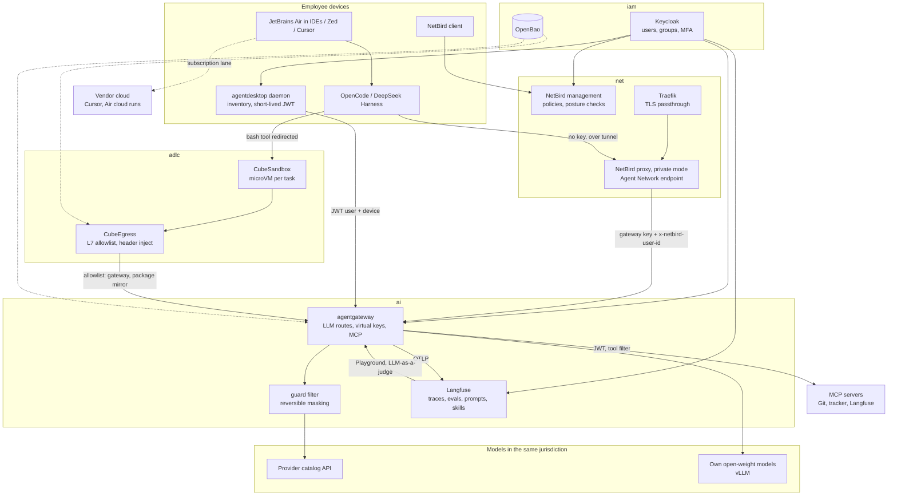
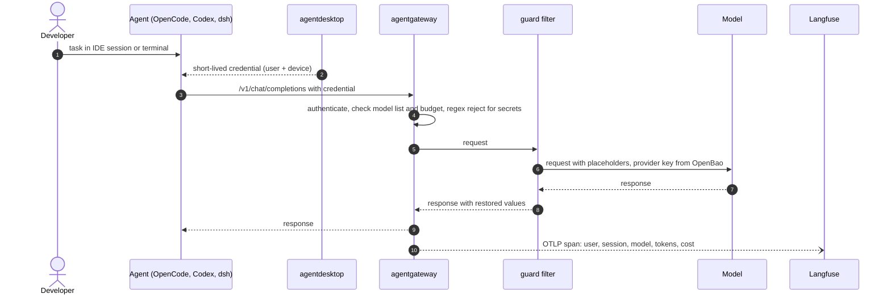
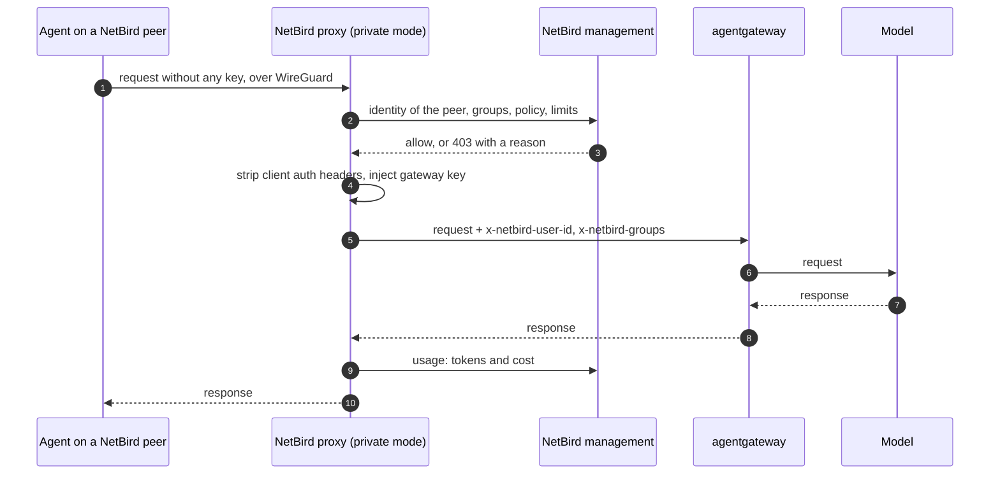
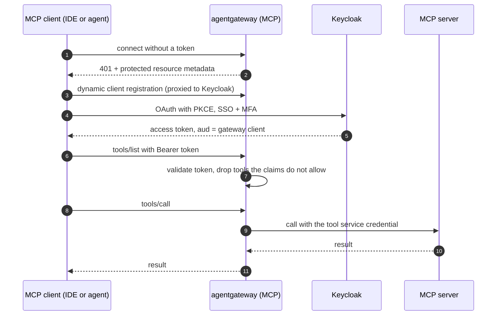
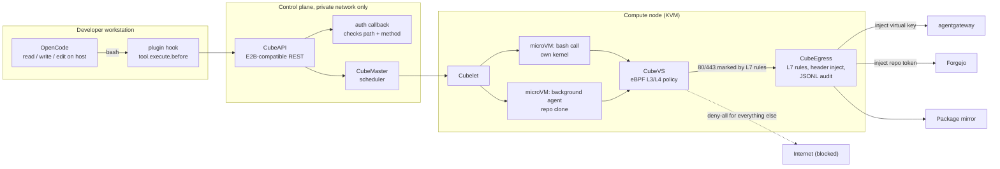
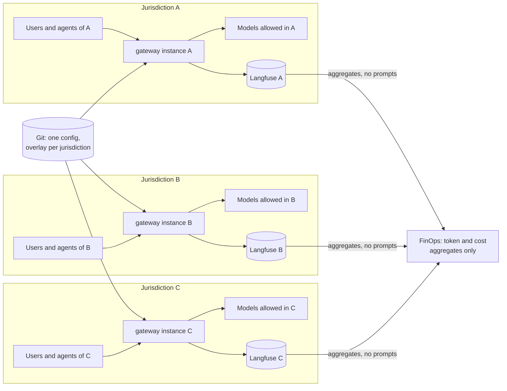
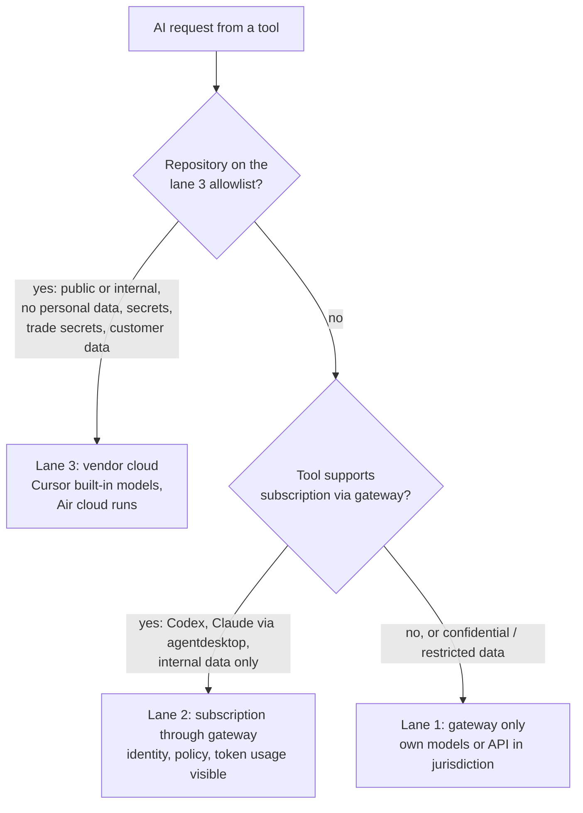
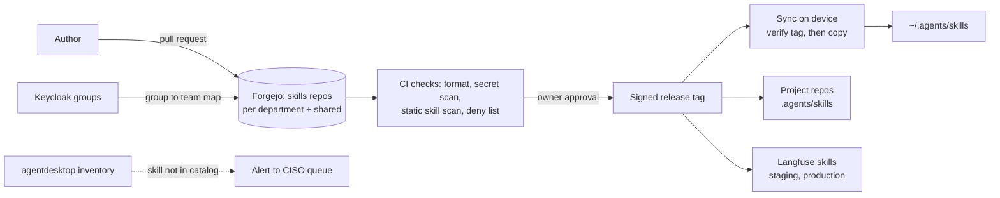

**Русский** (английская и китайская версии ещё не написаны)

# Типовая архитектура: ai-enablement

Как дать доступ к языковым моделям, инструментам MCP и агентам каждому сотруднику и каждому автоматическому агенту компании так, чтобы любой вызов был привязан к человеку или агенту, ключи провайдеров не покидали серверы, код, написанный моделью, выполнялся в известном и изолированном месте, а стоимость и качество измерялись. Эта типовая архитектура фиксирует состав, пути запросов, зоны выполнения кода, имена, учётные данные, права, сеть, работу в нескольких юрисдикциях, подписки, стоимость, навыки агентов, аудит, развёртывание, известные проблемы, альтернативы и открытые вопросы.

**Статус:** черновик. Создано 2026-11-26. Нормативный английский текст ещё не написан. Все конфигурации являются примерами с вымышленными именами в домене `mess.systems` и плейсхолдерами вместо адресов и секретов, а не работающей системой. Факты о продуктах сверены с официальной документацией и репозиториями на 2026-11-26; версии указаны в разделе 2. Где факт подтвердить не удалось, это сказано в тексте.

**Коды возможностей.** Типовая архитектура собирает несколько уже зарегистрированных возможностей [стандарта именования](https://github.com/mess-systems/naming-standard/blob/main/i18n/ru/01-naming-conventions.md#43-коды-возможностей-уникальны-во-всех-доменах): шлюз моделей и инструментов `gateway` и трассировки LLM `llm-traces` (домен `ai`), фильтр защиты данных в запросах `guard` (домен `ai`), песочница для кода агентов `sandbox` и оценки `evals` (домен `adlc`), сеть `mesh` (домен `net`), поставщик идентичностей `sso` и секреты `secrets` (домен `iam`), агенты на устройствах `endpoint` (домен `device`). Каталог навыков агентов использует код `skills` в домене `adlc`; код согласован и добавляется в таблицу стандарта отдельным изменением. Своего кода у самой типовой архитектуры нет: это сборка возможностей, а не новая возможность.

**Плоскость.** Шлюз, трассировки и фильтр работают в плоскости `corp` (плоскость домена `ai` по умолчанию), песочница и оценки в плоскости `eng`, сеть, поставщик идентичностей и секреты в `shared`. AI-компонент продукта X обращается к тому же шлюзу через отдельный маршрут; отдельный шлюз в плоскости `x` не вводится до решения, описанного в разделе 22.

**Контекст.** Компания вымышленная: mess.systems, около 350 сотрудников, бывший B2B-интегратор с собственным SaaS, который перестраивается под работу с AI и выпускает продукт X с AI-компонентом. Команды и юридические лица находятся в России, США и Китае. Разработчики работают в JetBrains IDE с Air in IDEs, в Zed, в Cursor и в терминальных агентах OpenCode и DeepSeek Harness; сотрудники без IDE пользуются чатом. Роли руководства в тексте указаны только по должности: CEO, CTO, CISO, CFO.

## 1. Границы

| Входит | Не входит |
|---|---|
| Доступ людей и агентов к языковым моделям через один шлюз: маршруты, ключи на приложение, бюджеты, защита данных в запросах | Обучение и дообучение моделей, подготовка датасетов для обучения |
| Доступ агентов к инструментам MCP через шлюз с токеном поставщика идентичностей | Сами MCP-серверы инструментов (Git, трекер, базы данных) и права внутри них |
| Сеть между устройствами, агентами и сервисами; доступ агентов к моделям без ключа; допуск устройств по состоянию | Управление устройствами (MDM), установка ПО, шифрование дисков: см. типовую архитектуру [`endpoint`](https://github.com/mess-systems/blueprints/tree/main/endpoint) |
| Зоны выполнения кода, написанного моделью: рабочая станция, microVM, облако поставщика | Раннеры CI: см. [`sdlc-ci-runners`](https://github.com/mess-systems/blueprints/tree/main/sdlc-ci-runners) |
| Трассировки, стоимость, проверочные наборы и оценки качества | Подробная методика оценок агентов: см. [`adlc-agent-evals`](https://github.com/mess-systems/blueprints/tree/main/adlc-agent-evals) |
| Рабочие инструменты разработчика с AI и их настройка на шлюз | Выбор IDE для задач без AI |
| Каталог навыков агентов (Agent Skills): хранение, ревью, доставка, запрет | Содержание конкретных навыков |
| Работа в трёх юрисдикциях: размещение данных запросов, доступность моделей и сервисов | Юридические выводы. Раздел 11 перечисляет факты и вопросы к юристу |
| Подписки на инструменты с облачными функциями и их место рядом со шлюзом | Закупка и договоры с поставщиками |

## 2. Состав

| Часть | Роль | Продукт и версия на 2026-11-26 | Радар |
|---|---|---|---|
| Поставщик идентичностей | Вход людей, группы, MFA, токены для MCP, вход устройств в agentdesktop | Keycloak 26.8.2 | [Adopt](https://github.com/mess-systems/tech-radar/blob/main/technologies/keycloak.md) |
| Сеть | WireGuard-сеть между устройствами, агентами и сервисами; политики от группы к ресурсу; проверки состояния устройства; точка доступа агентов к моделям без ключа (Agent Network) | NetBird 0.83.2; Agent Network и Reverse Proxy в статусе beta | [Adopt](https://github.com/mess-systems/tech-radar/blob/main/technologies/netbird.md) |
| Внешний обратный прокси сети | TLS passthrough для Reverse Proxy NetBird на собственном сервере | Traefik | [Adopt](https://github.com/mess-systems/tech-radar/blob/main/technologies/traefik.md) |
| Шлюз моделей и инструментов | OpenAI-совместимая точка ко всем моделям, виртуальные ключи, бюджеты, каталог цен, фильтры запросов, MCP с OAuth, трассировки OTLP | agentgateway 1.7.0 | [Adopt](https://github.com/mess-systems/tech-radar/blob/main/technologies/agentgateway.md) |
| Трассировки и оценки | Трассировки вызовов, стоимость по определениям моделей, управление промптами и навыками, датасеты, оценка моделью-судьёй | Langfuse 4.88.0 (самостоятельное размещение) | [Adopt](https://github.com/mess-systems/tech-radar/blob/main/technologies/langfuse.md) |
| Секреты | Ключи провайдеров, ключи шлюза, ключи проектов Langfuse, пароли аварийного входа | OpenBao | [Adopt](https://github.com/mess-systems/tech-radar/blob/main/technologies/openbao.md) |
| Git и ревью | Конфигурации как код, каталог навыков, pull request | Forgejo | [Adopt](https://github.com/mess-systems/tech-radar/blob/main/technologies/forgejo.md) |
| Песочница для кода агентов | microVM на задачу, закрытый исходящий трафик, подстановка учётных данных на выходе | CubeSandbox 0.8.0 | [Adopt](https://github.com/mess-systems/tech-radar/blob/main/technologies/cubesandbox.md) |
| AI-инструменты на устройствах | Инвентарь AI-инструментов, MCP-серверов и навыков; раздача конфигураций и политики песочницы; короткоживущие учётные данные к шлюзу с пользователем и устройством | agentdesktop 0.7.0 | [Trial](https://github.com/mess-systems/tech-radar/blob/main/technologies/agentdesktop.md) |
| Состояние ОС устройства | Шифрование, межсетевой экран, обновления как сигнал для допуска | Fleet | [Trial](https://github.com/mess-systems/tech-radar/blob/main/technologies/fleet.md) |
| Терминальный агент | Агент разработчика, раннер оценок | OpenCode 2.4.2 | карточки нет, предлагается Trial |
| Терминальный агент | Агент с архитектурой «всё плагин», режим без интерфейса для CI | DeepSeek Harness 0.2.3-alpha.2 (developer preview) | [Trial](https://github.com/mess-systems/tech-radar/blob/main/technologies/deepseek-harness.md) |
| Редактор | Встроенный агент Zed на шлюзе, внешние агенты по ACP | Zed 1.30.2 | карточки нет, предлагается Assess |
| Рабочее место агентов в IDE | Параллельные сессии агентов, ревью изменений, политики организации | JetBrains Air in IDEs (в составе IDE с 2026.3) | карточки нет, предлагается Trial |
| IDE с облачными функциями | Основная IDE части команд по подписке | Cursor | карточки нет, решение в разделе 12 |
| Защита данных в запросах | Обратимое маскирование персональных данных и секретов | guardrails-llm-filter 0.1.2.1 | карточки нет, предлагается Assess |
| Модели | Каталоги провайдеров в каждой юрисдикции и свои модели с открытыми весами | провайдер-нейтрально; свои модели на vLLM | [vLLM Adopt](https://github.com/mess-systems/tech-radar/blob/main/technologies/vllm.md) |

Лицензии: Keycloak, agentgateway, CubeSandbox, agentdesktop под Apache-2.0; OpenCode, DeepSeek Harness под MIT; NetBird под BSD-3-Clause, кроме каталогов `management`, `signal`, `relay` и `combined`, которые под AGPLv3; Langfuse под MIT вне каталогов `ee`. JetBrains Air in IDEs и Cursor проприетарные. agentgateway входит в Linux Foundation.

## 3. Инварианты

Каждый инвариант проверяется строкой матрицы в разделе 18.3.

| # | Инвариант | Как проверяется |
|---|---|---|
| И1 | Ключ провайдера моделей хранится только на сервере: в шлюзе, в NetBird или в OpenBao. У людей и агентов есть виртуальный ключ шлюза, короткоживущий токен или нет ключа вообще | поиск по устройствам и образам песочниц, журнал подстановки ключей |
| И2 | Любой вызов модели проходит через шлюз, включая AI-функции самих платформ (Langfuse) | исходящий трафик к провайдерам разрешён только с узла шлюза |
| И3 | В каждом вызове известны человек или агент, группа, приложение и сессия | атрибуты трассировки в Langfuse |
| И4 | Код, написанный моделью, выполняется в зоне, выбранной по таблице раздела 6; запуск на хосте без изоляции требует явного решения | профиль агента, журнал песочницы |
| И5 | Всё запрещено, пока не разрешено: политики сети, исходящий трафик песочниц, списки моделей на ключ | матрица проверок |
| И6 | Конфигурация шлюза, сети, песочниц и навыков хранится в Git и меняется через pull request, в том числе когда её меняет агент | история Forgejo |
| И7 | Данные запросов и трассировки не покидают юрисдикцию, в которой созданы, если юрист не разрешил иное | размещение экземпляров шлюза и Langfuse, раздел 11 |

## 4. Схема

Сплошные стрелки показывают контролируемый путь. Пунктир к облаку поставщика показывает трафик, который шлюз не видит; его правила описаны в разделе 12.

## 5. Пути запроса

### 5.1 Разработчик в IDE или терминале

1. **Учётные данные.** Агент получает короткоживущие учётные данные от agentdesktop: токен несёт пользователя, устройство и разрешённый клиент, ключ провайдера остаётся на шлюзе ([README agentdesktop](https://github.com/agentdesktop-dev/agentdesktop)). Если agentdesktop не развёрнут, агенту выдаётся виртуальный ключ шлюза на человека или на приложение ([виртуальные ключи](https://agentgateway.dev/docs/standalone/latest/llm/cost-controls/virtual-keys/)).
2. **Проверки шлюза.** Шлюз проверяет ключ или токен, список разрешённых моделей ключа (`allowedModels`, модель вне списка даёт `403`, модель вне каталога шлюза даёт `404`) и бюджет, затем применяет фильтры запросов.
3. **Защита данных.** Регулярные выражения шлюза отклоняют запросы с секретами; обратимое маскирование персональных данных выполняет отдельный фильтр, см. раздел 15.
4. **Трассировка.** Шлюз отправляет спан по OTLP в Langfuse. Пользователь и сессия попадают в трассировку атрибутами `user.id` и `session.id`; их значения задаются выражениями CEL в настройке трассировки шлюза, а Langfuse сопоставляет эти атрибуты с пользователем и сессией ([атрибуты трассировки agentgateway](https://agentgateway.dev/docs/standalone/latest/observability/traces/setup/), [соответствие атрибутов в Langfuse](https://langfuse.com/integrations/native/opentelemetry)).

### 5.2 Агент на узле сети без ключа

1. **Туннель как учётные данные.** Запрос приходит по туннелю WireGuard, поэтому прокси NetBird знает узел, пользователя поставщика идентичностей или идентичность автономного агента и их группы. Ключа у клиента нет; прокси снимает клиентские заголовки авторизации и подставляет ключ, сохранённый на сервере ([How Agent Network Works](https://docs.netbird.io/agent-network/how-it-works)).
2. **agentgateway как провайдер NetBird.** В NetBird шлюз подключается как провайдер типа AI Gateway; NetBird передаёт ему доверенные заголовки `x-netbird-user-id` и `x-netbird-groups` ([Providers](https://docs.netbird.io/agent-network/providers)). Агенты на узлах сети вызывают модели только через прокси NetBird: прямой доступ к шлюзу политикой сети им не выдаётся.
3. **Отказы.** По умолчанию ничего не разрешено: политика связывает группу-источник с провайдером. Отказ возвращает `403` с причиной: модель недоступна, нет разрешённого провайдера, модель вне списка, исчерпан лимит токенов или бюджета.
4. **Два пути у одного агента.** Вызовы моделей идут через прокси, а внутренние ресурсы (базы данных, внутренние API, свои модели на GPU-узле) агент вызывает напрямую по туннелю, без прокси, без подстановки ключа и без учёта токенов. Поэтому свои модели публикуются агентам только как маршрут шлюза, а прямой доступ к GPU-узлу политикой сети не выдаётся.

### 5.3 Агент и инструмент MCP

1. **Keycloak как сервер авторизации.** Шлюз использует провайдер `keycloak` в `mcpAuthentication`: берёт ключи с нестандартного адреса Keycloak, отдаёт метаданные сервера авторизации и проксирует динамическую регистрацию клиентов ([руководство agentgateway для Keycloak](https://agentgateway.dev/docs/standalone/latest/integrations/auth/keycloak)).
2. **Аудитория.** На клиенте Keycloak нужен маппер аудитории: по умолчанию Keycloak ставит `aud=account`, и шлюз отвергает каждый токен. Keycloak не поддерживает индикаторы ресурсов RFC 8707, поэтому в шлюзе указывается та аудитория, которую выпускает realm.
3. **Регистрация клиентов.** Политика Trusted Hosts realm по умолчанию отклоняет анонимную регистрацию; для регистрации через шлюз в ней выключается `host-sending-registration-request-must-match`, иначе регистрация возвращает `403`.
4. **Фильтр инструментов по группам.** `mcpAuthorization` содержит правила CEL по имени инструмента, целевому серверу и утверждениям токена, например `"app-gateway-admin" in jwt.groups`. Запрещённые инструменты исчезают из `tools/list`, вызов отклоняется. Аргументы вызова в правилах авторизации недоступны; для проверки аргументов используются `mcpGuardrails` ([MCP authorization](https://agentgateway.dev/docs/standalone/latest/configuration/security/mcp-authz/), [MCP guardrails](https://agentgateway.dev/docs/standalone/latest/documentation/mcp/guardrails/about/)).

### 5.4 AI-компонент продукта X

Продукт X обращается к шлюзу как приложение: у каждого сервиса продукта свой виртуальный ключ с ограниченным списком моделей и бюджетом, пользователь продукта передаётся атрибутом трассировки, а не ключом. Запросы клиентов продукта X проходят тот же фильтр защиты данных, что и запросы сотрудников. Модели для продукта выбираются в юрисдикции, где размещена ячейка продукта (ключ развёртывания `residency` по [стандарту](https://github.com/mess-systems/naming-standard/blob/main/i18n/ru/07-deployment-and-tenants.md)).

## 6. Где выполняется код

Модель только предлагает команды; выполняет их инструмент агента. Поэтому для каждого способа работы с агентом фиксируется зона выполнения: на каком ядре идёт процесс, что он видит в файловой системе, куда может отправить пакеты и какие учётные данные у него есть.

### 6.1 Зоны

| Зона | Где выполняется код | Граница изоляции | Исходящая сеть | Учётные данные внутри | Применение |
|---|---|---|---|---|---|
| Z0 | Нигде: модель отвечает текстом | нет исполнения | не применимо | нет | чат, Playground Langfuse, ревью кода моделью |
| Z1 | Рабочая станция разработчика, процесс агента | права пользователя ОС; правила `permissions` OpenCode и режимы песочницы DeepSeek Harness ограничивают действия агента, но не являются границей изоляции | сеть рабочей станции | всё, что доступно пользователю | чтение кода, правки файлов, команды из списка разрешённых с подтверждением |
| Z2a | microVM CubeSandbox, только shell-команды агента; агент и файлы проекта на рабочей станции | отдельное ядро KVM на вызов | запрещено всё, кроме списка; HTTPS через CubeEgress | нет, ключи подставляет CubeEgress | интерактивная работа в OpenCode, команды из непроверенных источников |
| Z2b | microVM CubeSandbox, агент целиком вместе с клоном репозитория | отдельное ядро KVM на задачу | только шлюз моделей, Git и зеркало пакетов | нет, ключи подставляет CubeEgress | фоновые задачи, агенты по расписанию, проверочные прогоны, code interpreter продукта X |
| Z3 | Облако поставщика инструмента: облачные агенты Cursor, облачные прогоны Air | среда поставщика | по правилам поставщика | секреты, выданные в облачную среду | только разрешённые классы данных и репозитории, раздел 12 |
| Z4 | Раннеры CI | Kata Containers | по типовой архитектуре CI | токены CI | сборка и тесты после pull request: [`sdlc-ci-runners`](https://github.com/mess-systems/blueprints/tree/main/sdlc-ci-runners) |

Правило выбора: зона по умолчанию для любого кода, который агент запускает без человека, это Z2b. Z1 допустима, только когда человек видит и подтверждает команды. Z3 допустима только для классов данных, разрешённых в разделе 12.

В OpenCode правила `permissions` действуют по принципу «последнее совпадение выигрывает», базовая политика по умолчанию разрешает всё, а shell выполняется с правами хоста ([OpenCode Permissions](https://opencode.ai/docs/permissions/)). В DeepSeek Harness режим песочницы (`read-only`, `workspace-write`, `danger-full-access`) управляет только записью в файловую систему; сеть и видимость процессов в него не входят, а на Windows и старых ядрах без полной поддержки Landlock защита сообщается как частичная (`partial`) ([DeepSeek Harness, sandbox](https://github.com/deepseek-ai/deepseek-harness)). Поэтому Z1 считается зоной без изоляции.

### 6.2 CubeSandbox: устройство

Компоненты по документации проекта: CubeAPI (REST, совместимый с E2B), CubeMaster (оркестратор кластера), Cubelet (жизненный цикл песочниц на узле), CubeVS (виртуальный коммутатор на eBPF), CubeEgress (прокси на OpenResty: фильтрация по домену, подстановка учётных данных, аудит), CubeHypervisor и CubeShim (microVM на KVM и интеграция с containerd) ([README CubeSandbox](https://github.com/TencentCloud/CubeSandbox)). По данным проекта, песочница создаётся быстрее 60 мс при накладных расходах памяти меньше 5 МБ; эти цифры приведены проектом и в этой типовой архитектуре не перепроверялись.

**Z2a: перенаправление shell-команд.** Официальный плагин для OpenCode перехватывает инструмент `bash` в хуке `tool.execute.before` и выполняет команду в microVM; `read`, `write` и `edit` продолжают работать с файлами на рабочей станции ([OpenCode Integration Guide](https://github.com/TencentCloud/CubeSandbox/blob/master/docs/guide/integrations/opencode-plugin.md)). Ограничения, которые нужно учитывать при выборе зоны:

- microVM создаётся на каждый вызов, а не на сессию; рабочий каталог и переменные окружения переносятся между вызовами, файлы нет;
- файлы, которые агент правит на хосте, не видны команде в microVM, поэтому цикл «правка, затем запуск тестов» в этой зоне не работает; монтирование проекта сняло бы большую часть изоляции;
- перехватывается только инструмент с именем ровно `bash`; любой другой инструмент, способный выполнять команды, работает на хосте, поэтому после каждого обновления OpenCode перехват проверяется строкой M25 матрицы;
- плагин закрыт при сбое: если перенаправление невозможно, вызов блокируется, а не выполняется на хосте.

**Z2b: агент целиком в microVM.** Для фоновых задач в microVM запускается сам агент в режиме без интерфейса (`opencode run` или `dsh --profile headless --json`) вместе с клоном репозитория. Результат возвращается веткой и pull request в Forgejo, а не записью на рабочую станцию. Это схема этой типовой архитектуры, а не готовая интеграция проекта: шаблон собирается из образа с агентом, создание песочницы выполняет оркестратор задач через SDK, совместимый с E2B.

**Сеть песочницы.** Настройки, без которых песочница не изолирована:

1. `allow_internet_access=False` при каждом создании. По умолчанию значение `true`, и всё, что не запрещено явно, разрешено; порядок применения правил: allow, затем deny, затем разрешение по умолчанию ([Network Policy](https://github.com/TencentCloud/CubeSandbox/blob/master/docs/guide/network-policy.md)).
2. Разрешения по доменам в `allow_out` работают только вместе с запретом всего остального (`allow_internet_access=False` или `0.0.0.0/0` в `deny_out`), иначе список доменов вводит в заблуждение.
3. Любое обновление сетевых настроек песочницы повторяет `allow_internet_access=False`: поле, пропущенное при обновлении, сбрасывается, и песочница снова получает доступ в интернет.
4. Доступ к шлюзу, Git и зеркалу пакетов задаётся L7-правилами с `host`/`sni` и `scheme="https"`; ключ подставляется действием `inject` и не попадает в окружение, файловую систему и процессы песочницы. Подстановку по HTTP без TLS проект прямо называет рискованной.
5. HTTPS-клиенты в песочнице доверяют сертификатам CubeEgress, только если шаблон собран с CA CubeEgress; при `--with-cube-ca=false` вызовы HTTPS падают на проверке сертификата.
6. Отказ возвращает `403` от CubeEgress; каждое решение пишется в JSONL-журнал на хосте, значения подставленных секретов из журнала вычищаются ([Egress Proxy](https://github.com/TencentCloud/CubeSandbox/blob/master/docs/guide/security-proxy.md)).
7. TCP на порты, не покрытые L7-правилами, проходит только по L3/L4-политике и в журнал CubeEgress не попадает.

**Плоскость управления.** По умолчанию CubeAPI пропускает все запросы без аутентификации; проверка включается параметром `--auth-callback-url` или переменной `AUTH_CALLBACK_URL`, и обработчик должен проверять и путь (`X-Request-Path`), и метод (`X-Request-Method`), иначе чтение шаблона не отличается от его удаления ([Authentication](https://github.com/TencentCloud/CubeSandbox/blob/master/docs/guide/authentication.md)). CubeMaster (HTTP без аутентификации), CubeAPI, Cubelet gRPC (без TLS) и WebUI по умолчанию слушают `0.0.0.0`; адреса привязки меняются в `.env` и конфигурации Cubelet, остальное закрывается межсетевым экраном ([Network Hardening](https://github.com/TencentCloud/CubeSandbox/blob/master/docs/guide/network-hardening.md)). В этой типовой архитектуре плоскость управления доступна только из сети NetBird группе `app-sandbox-admin`, а CubeAPI вызывают только оркестратор задач и рабочие станции группы `app-sandbox-user` через обработчик аутентификации.

**Требования к узлу.** Нужен KVM на bare metal или ядро PVM на облачной ВМ (PVM только x86_64) и раздел XFS не меньше 50 ГБ для данных Cubelet ([README CubeSandbox](https://github.com/TencentCloud/CubeSandbox)).

### 6.3 Кандидаты на замену

| Кандидат | Чем отличается | Кольцо в этой типовой архитектуре |
|---|---|---|
| OpenSandbox с Kata Containers | API песочниц для агентов, локально Docker, в кластере Kubernetes; в репозитории есть пример с Kata Containers и быстрый runtime на Firecracker; стабильный выпуск release-1.2.1 ([OpenSandbox](https://github.com/opensandbox-group/OpenSandbox), [Kata Containers](https://katacontainers.io/)) | Assess |
| gVisor с agent-sandbox | Ядро приложения в пространстве пользователя (`runsc`) вместо отдельной ВМ; ресурс `Sandbox` в Kubernetes от kubernetes-sigs, изоляцию даёт выбранный RuntimeClass ([gVisor](https://gvisor.dev/docs/), [agent-sandbox](https://github.com/kubernetes-sigs/agent-sandbox)) | Assess |

Сравнение проводится на одном наборе проверок: запрет исходящего трафика по умолчанию, подстановка учётных данных без попадания в песочницу, аутентификация API, время создания, работа на имеющемся оборудовании.

### 6.4 Что песочница не закрывает

- Правки файлов агентом на рабочей станции (Z2a) не изолированы.
- Подсказки, внедрённые в данные (prompt injection), песочница не распознаёт: она ограничивает последствия, а не решения модели.
- Разрешённые адреса остаются каналом утечки: всё, что агент прочитал, он может отправить в шлюз моделей или в Git. Поэтому в Z2b секреты в репозитории недопустимы, а запись в Git ограничена веткой задачи.
- Git hooks в рабочем каталоге выполняются при операциях git ([githooks](https://git-scm.com/docs/githooks)); агент, получивший право записи в каталог репозитория на рабочей станции, может добавить hook, который выполнится вне песочницы при следующей операции человека.

## 7. Имена

Имена ниже вымышленные и следуют [стандарту именования](https://github.com/mess-systems/naming-standard/blob/main/i18n/ru/01-naming-conventions.md) и [соглашениям об идентичностях](https://github.com/mess-systems/naming-standard/blob/main/i18n/ru/04-identity-conventions.md). Адреса, номера портов и пути секретов в имена не входят.

| Объект | Имя | Правило |
|---|---|---|
| Шлюз моделей и MCP | `gateway.ai.corp.svc.mess.systems` | грамматика A, код `gateway` |
| Трассировки | `llm-traces.ai.corp.svc.mess.systems` | код `llm-traces` |
| Фильтр защиты данных | `guard.ai.corp.svc.mess.systems` | код `guard`; вызывается только шлюзом |
| API песочниц | `sandbox.adlc.eng.svc.mess.systems` | код `sandbox`, плоскость `eng` |
| Каталог навыков | `skills.adlc.eng.svc.mess.systems` | код `skills`, согласован, добавляется в стандарт отдельным изменением |
| Поставщик идентичностей | `sso.iam.shared.svc.mess.systems` | код `sso` |
| Секреты | `secrets.iam.shared.svc.mess.systems` | код `secrets` |
| Управление сетью | `mesh.net.shared.svc.mess.systems` | код `mesh` |
| Группы доступа | `app-gateway-user`, `app-gateway-admin`, `app-llm-traces-user`, `app-sandbox-user`, `app-sandbox-admin`, `app-skills-editor` | `app-<capability>-<access>` |
| Агент | `agent-code-review`, `agent-release-notes` | `agent-<name>`, с записью `operator` и `scope` в каталоге |
| Инструмент человека | `user-<handle>-ide`, `user-<handle>-cli` | ключ шлюза, выданный инструменту человека |
| Сервис продукта X | `svc-x-<service>` | сервисная учётная запись продукта |
| Политика сети | `role-developers -> svc-corp-ai-agentgateway` | `<subject-group> -> <target-group>` |
| Проверка состояния | `posture-client-current`, `posture-os-supported`, `posture-device-cert` | `posture-<what>-<condition>` |
| L7-правило песочницы | `<task-id>-<target>`, например `<task-id>-gateway` | имя правила попадает в журнал CubeEgress и связывает его с задачей агента |
| Юрисдикция развёртывания | непрозрачный код каталога (`jur-a`, `jur-b`) | ключ развёртывания `jurisdiction`, [07](https://github.com/mess-systems/naming-standard/blob/main/i18n/ru/07-deployment-and-tenants.md) |

## 8. Аутентификация и учётные данные

| Кто вызывает | Что предъявляет шлюзу | Кто выпускает | Срок жизни и отзыв |
|---|---|---|---|
| Сотрудник в чате | сессия SSO у клиента чата; клиент чата вызывает шлюз своим ключом и передаёт пользователя | Keycloak, шлюз | сессия SSO; ключ клиента чата ротируется по графику |
| Агент на рабочей станции под agentdesktop | короткоживущий токен с пользователем и устройством | agentdesktop после входа через OIDC | минуты; отзыв устройства в agentdesktop и в NetBird |
| Агент на рабочей станции без agentdesktop | виртуальный ключ `user-<handle>-<tool>` | администратор шлюза через запрос | 90 дней; ключ хранится в системном хранилище ключей, не в файлах настроек |
| Агент на узле NetBird | ничего: туннель WireGuard | NetBird | отзыв узла или группы |
| Агент в песочнице Z2b | ничего: ключ подставляет CubeEgress | оркестратор задач из OpenBao | время жизни песочницы |
| Сервис продукта X | виртуальный ключ `svc-x-<service>` | OpenBao, выдача при развёртывании | ротация без простоя: два ключа на время перехода |
| AI-функции Langfuse | виртуальный ключ `svc-corp-ai-langfuse` | OpenBao | по графику |
| MCP-клиент | токен Keycloak с аудиторией шлюза | Keycloak (OAuth с PKCE) | минуты; refresh по политике realm |
| Шлюз к провайдеру | ключ провайдера | OpenBao | ротация провайдером и OpenBao; у людей ключа нет |

Правила:

- Хэш ключа (`keyHash: sha256:…`) хранится в конфигурации шлюза вместо открытого значения ([виртуальные ключи](https://agentgateway.dev/docs/standalone/latest/llm/cost-controls/virtual-keys/)).
- Одно приложение получает один ключ. Общий ключ на несколько приложений ломает атрибуцию стоимости и отзыв.
- Ключи в Zed задаются переменной окружения `<PROVIDER_ID>_API_KEY` или хранятся в системном хранилище ключей; в `settings.json` ключ не пишется ([Zed, API access](https://zed.dev/docs/ai/use-api-access)).
- Keycloak за прокси запускается с полным URL в `--hostname`, с `--hostname-backchannel-dynamic true`, если внутренние клиенты обращаются по другому адресу, и с `--proxy-headers`, соответствующим прокси ([Keycloak, Configuring the hostname](https://www.keycloak.org/server/hostname)).
- Langfuse входит через Keycloak (`AUTH_KEYCLOAK_*`); регистрация и вход по паролю выключаются (`AUTH_DISABLE_SIGNUP`, `AUTH_DISABLE_USERNAME_PASSWORD`); организация, проект и ключи создаются при первом запуске переменными `LANGFUSE_INIT_*`, без ручных шагов в интерфейсе ([Langfuse, Authentication and SSO](https://langfuse.com/self-hosting/security/authentication-and-sso), [Headless Initialization](https://langfuse.com/self-hosting/administration/headless-initialization)).

## 9. Права

**Модели по группам.** Список моделей задаётся на ключ (`allowedModels`) и на политику NetBird (список моделей провайдера). Пустой список моделей у провайдера NetBird означает «любая модель»; документация называет это типичным для шлюзов, но в этой типовой архитектуре список заполняется явно, чтобы NetBird оставался независимым верхним пределом ([Providers](https://docs.netbird.io/agent-network/providers)).

| Группа | Модели | Инструменты MCP |
|---|---|---|
| все сотрудники (`app-gateway-user`) | модели общего назначения юрисдикции сотрудника | чтение трекера и вики |
| разработчики (`role-developers`) | плюс модели для кода | плюс чтение Git, чтение трассировок Langfuse |
| владельцы платформы (`app-gateway-admin`) | все модели каталога | плюс инструменты администрирования |
| агенты (`agent-*`) | только модели из `scope` агента | только инструменты из `scope` агента |
| сервисы продукта X (`svc-x-*`) | модели, утверждённые для продукта в его юрисдикции | нет |

**Инструменты MCP.** Права проверяет шлюз по утверждениям токена (раздел 5.3). MCP-сервер Langfuse по умолчанию даёт чтение и запись; для режима только чтения список разрешённых инструментов задаётся на стороне клиента или правилом шлюза ([Langfuse MCP Server](https://langfuse.com/docs/api-and-data-platform/features/mcp-server)).

**Агенты в IDE.** JetBrains Air in IDEs подключает агентов по ACP и не поставляет собственных моделей; администратор организации задаёт в JetBrains Console или IDE Services списки разрешённых агентов, провайдеров, моделей и MCP-серверов и обязательные политики ([Air in IDEs](https://www.jetbrains.com/help/air/air-in-ides-overview.html)). Встроенный агент Zed ходит в шлюз как OpenAI-совместимый провайдер (`language_models.openai_compatible` с `api_url`); внешние агенты Zed по ACP используют свои модели и свою аутентификацию, поэтому их тоже направляют в шлюз настройками самих агентов ([Zed, External Agents](https://zed.dev/docs/ai/external-agents)). В OpenCode разрешения задаются в конфигурации проекта, а запреты, которые проект не может снять, задаются глобальной или централизованной политикой.

**Трассировки.** Доступ к проекту Langfuse выдаётся группой `app-llm-traces-user`; промпты и ответы видны только участникам проекта. Отдельные проекты Langfuse заводятся на каждую юрисдикцию и на продукт X.

## 10. Сеть

1. **Группы и политики.** Каждый ресурс доступен только по политике `<группа> -> <ресурс>`; встроенная политика `Default` выключена. Шлюз, Langfuse, API песочниц и MCP-серверы доступны только из сети NetBird ([NetBird, Access Control](https://docs.netbird.io/manage/access-control)).
2. **Проверки состояния устройства.** К политикам доступа к шлюзу и песочницам добавляются проверки версии клиента, ОС и сертификата устройства. Проверка сертификата подписывает вызов ключом устройства, требует NetBird 0.81.0 или новее на сервере и клиентах и не поддерживается на iOS и Android; повторная проверка во время сессии требует сервера 0.74.0 или новее ([Posture Checks](https://docs.netbird.io/manage/access-control/posture-checks)). Сигналы EDR и MDM в NetBird подключаются через коммерческие интеграции; в этой типовой архитектуре состояние ОС собирает Fleet, а NetBird проверяет сертификат, выданный только устройствам в норме.
3. **Agent Network и Reverse Proxy.** Обе функции в статусе beta. На собственном сервере NetBird внешним обратным прокси должен быть Traefik: по документации это единственный поддерживаемый прокси с TLS passthrough ([Reverse Proxy](https://docs.netbird.io/manage/reverse-proxy)). Для Agent Network на существующем собственном сервере нужен прокси в частном режиме (`NB_PROXY_PRIVATE=true`) ([Agent Network на существующем сервере](https://docs.netbird.io/agent-network/existing-self-hosted)).
4. **Исходящий трафик к провайдерам.** Выход в интернет к API провайдеров есть только у узла шлюза; NetBird и рабочие станции к провайдерам моделей напрямую не обращаются, кроме полосы подписок (раздел 12).
5. **Песочницы.** Узлы CubeSandbox находятся в плоскости `eng`; из microVM доступны только адреса, перечисленные в L7-правилах (раздел 6.2).
6. **SSH через NetBird.** NetBird SSH по умолчанию авторизует пользователя по JWT поставщика идентичностей, и соединение требует входа через браузер (токен кэшируется); для автоматизации используются отдельные сервисные учётные записи и ключи, а не пользовательский SSH ([NetBird SSH](https://docs.netbird.io/manage/peers/ssh)).

## 11. Юрисдикции: Россия, США, Китай

Раздел перечисляет проверяемые факты, которые влияют на архитектуру, и показывает, как архитектура оставляет место для решений юристов. Юридических выводов раздел не делает: применимость каждого факта к mess.systems определяет юрист.

### 11.1 Факты

| Тема | Факт на 2026-11-26 | Источник |
|---|---|---|
| Доступность моделей | Россия и Китай отсутствуют в списке стран, где поддерживается API OpenAI | [OpenAI, supported countries](https://platform.openai.com/docs/supported-countries) |
| Доступность моделей | Россия и Китай отсутствуют в списке поддерживаемых регионов Anthropic. Политика в редакции, действующей с 2026-11-12, запрещает использование организациями, зарегистрированными или имеющими штаб-квартиру в неподдерживаемом регионе, и организациями, которыми прямо или косвенно владеют или управляют лица из неподдерживаемых регионов, независимо от того, где находятся их сотрудники | [Anthropic, Supported Regions Policy](https://www.anthropic.com/legal/supported-regions) |
| Доступность инструментов | Air in IDEs распространяется без географических ограничений, но в Китае JetBrains AI нельзя использовать как источник авторизации; при регионе IDE «China Mainland» каталог показывает только агентов, доступных в Китае | [Air in IDEs, FAQ](https://www.jetbrains.com/help/air/air-in-ides-overview.html) |
| Открытые веса | Модели с открытыми весами под разрешительными лицензиями можно разместить в любой юрисдикции на своём оборудовании; например, DeepSeek-V3.2 опубликована под MIT | [карточка модели](https://huggingface.co/deepseek-ai/DeepSeek-V3.2) |
| США: данные | Data Security Program Министерства юстиции США (28 CFR Part 202) действует с 2025-04-08 и ограничивает сделки, дающие странам, вызывающим озабоченность, доступ к массивам чувствительных персональных данных американцев и к данным, связанным с правительством США. В список стран входят Китай и Россия | [DOJ, Data Security](https://www.justice.gov/nsd/data-security), [28 CFR Part 202](https://www.ecfr.gov/current/title-28/chapter-I/part-202) |
| США: услуги | Решение OFAC от 2024-06-12 по EO 14071, действующее с 2024-09-12, запрещает лицам США оказывать лицам в России ИТ-консалтинг и услуги проектирования, а также ИТ-поддержку и облачные услуги для программного обеспечения управления предприятием и проектирования и производства | [OFAC, Determination](https://ofac.treasury.gov/system/files/2024-06/determination_06122024_eo14071.pdf), [FAQ 1187](https://ofac.treasury.gov/faqs/1187) |
| Китай: сервисы генеративного AI | Временные меры по управлению сервисами генеративного AI (вступили в силу 2023-08-15) применяются к сервисам, предоставляемым населению на территории КНР; исследования, разработка и применение без предоставления сервиса населению из сферы действия исключены | [CAC, Interim Measures](https://www.cac.gov.cn/2023-07/13/c_1690898327029107.htm) |
| Китай: передача персональной информации | Закон о защите персональной информации, статьи 38–40: передача за границу требует одного из оснований (оценка безопасности, сертификация, стандартный договор или иное основание по закону), отдельного согласия и, для операторов критической информационной инфраструктуры и обработчиков свыше установленных объёмов, хранения внутри страны | [PIPL](http://www.npc.gov.cn/npc/c2/c30834/202108/t20210820_313088.html) |
| Россия | Требования к обработке персональных данных и к размещению данных в России в этой типовой архитектуре не приводятся; их формулирует юрист для российского сегмента | нет |

### 11.2 Как это отражено в архитектуре

1. **Экземпляр шлюза и Langfuse на юрисдикцию.** Запросы, ответы и трассировки создаются и хранятся там, где работает пользователь или где размещена ячейка продукта X. Код юрисдикции берётся из ключа развёртывания `jurisdiction`; реальное соответствие кодов странам хранится в закрытом каталоге, как требует [стандарт](https://github.com/mess-systems/naming-standard/blob/main/i18n/ru/07-deployment-and-tenants.md).
2. **Каталог моделей на юрисдикцию.** Общая конфигурация шлюза в Git дополняется наложением для каждой юрисдикции: список провайдеров, моделей и цен. Модель, недоступная в юрисдикции по условиям провайдера, в её наложение не попадает.
3. **Свои модели как общий знаменатель.** Модели с открытыми весами на vLLM дают одинаковый набор моделей во всех юрисдикциях и служат запасным маршрутом при недоступности провайдера.
4. **Пользователь привязан к юрисдикции.** Атрибут юрисдикции пользователя в Keycloak попадает в токен; agentdesktop и Agent Network направляют пользователя на шлюз его юрисдикции. Пересечение границ (сотрудник из одной юрисдикции работает с данными другой) требует решения юриста, а не настройки шлюза.
5. **Между юрисдикциями передаются только агрегаты.** Для FinOps экспортируются токены, стоимость и метрики качества без текстов запросов и ответов.
6. **Администрирование разделяется.** Если юрист применит ограничения на услуги между юрисдикциями, разделение экземпляров позволяет назначить отдельные группы администраторов на каждый экземпляр без перестройки архитектуры.
7. **Продукт X.** Ячейка продукта X получает ключ `residency`; AI-компонент вызывает шлюз и модели только своей юрисдикции.

## 12. Подписки и шлюз

Найти равновесие между подписками на инструменты и контролем через шлюз трудно, и универсального ответа нет. Подписка с фиксированной ценой за место часто дешевле оплаты тех же токенов по API, но облачные функции инструмента работают на стороне поставщика: шлюз не видит запросы, не применяет фильтры, не ведёт трассировки и не может ограничить модели. Контроль через шлюз даёт полную видимость, но переводит оплату на токены и отнимает часть функций инструмента.

### 12.1 Что известно о конкретных инструментах

- **Cursor.** Собственный ключ API работает только для чат-моделей; автодополнение Tab всегда использует модели Cursor. Все запросы проходят через серверы Cursor для финальной сборки промпта, поэтому шлюз, указанный в Cursor как собственный провайдер, должен быть доступен с серверов Cursor. Политика Zero Data Retention Cursor не действует при использовании собственного ключа. На планах Teams и Enterprise к подходящим запросам к моделям сторонних провайдеров, в том числе с собственным ключом, добавляется Cursor Token Rate 0,25 доллара за миллион токенов ([Cursor, Bring your own API key](https://cursor.com/help/models-and-usage/api-keys)). В этой типовой архитектуре Cursor работает только на встроенных моделях внутри полосы 3; собственный ключ к шлюзу не подключается (раздел 20).
- **JetBrains Air.** Локальные агенты Air in IDEs можно направить в шлюз через base URL провайдера. Облачные прогоны выкатываются постепенно и доступны части клиентов; если организация выключает AI в JetBrains Console, пользователь теряет доступ к облачным прогонам ([Air in IDEs](https://www.jetbrains.com/help/air/air-in-ides-overview.html), [JetBrains Air](https://www.jetbrains.com/air/)).
- **Подписки провайдеров через agentdesktop.** Для Codex, Claude Code и Claude Desktop agentdesktop умеет вести подписку провайдера через шлюз (`auth: subscription`): клиент получает составные учётные данные, шлюз проверяет идентичность сотрудника и только затем восстанавливает токен подписки. Для Codex шлюзу задаётся base URL `https://chatgpt.com/backend-api/codex`, и маршрутизация, политики и учёт токенов шлюза продолжают работать ([agentdesktop, Provider subscriptions](https://github.com/agentdesktop-dev/agentdesktop#provider-subscriptions)). По README проекта Codex проверен с синтетическими учётными данными и тестовым шлюзом, а не с оплаченной учётной записью; перед Trial это проверяется на одной учётной записи вместе с условиями использования провайдера.

### 12.2 Предлагаемый подход: полосы

| Полоса | Что идёт | Контроль | Оплата |
|---|---|---|---|
| 1. Только шлюз | Репозитории и документы классов `confidential` и `restricted`, репозитории продукта X с данными клиентов, IaC с описанием сетей и доступа, все агенты без человека | полный: ключ, модели, фильтры, трассировки | токены API или GPU-часы своих моделей |
| 2. Подписка через шлюз | Codex и Claude по подписке сотрудника или компании через agentdesktop для данных класса `internal` | идентичность, политика и учёт токенов на шлюзе; модель и цена задаются подпиской | фиксированная за место |
| 3. Облако поставщика | Cursor на встроенных моделях (Tab, чат, облачные агенты) и облачные прогоны Air, только для репозиториев из списка разрешённых | на стороне поставщика: управление организацией; на стороне компании: список репозиториев в Git и квартальная сверка | фиксированная за место плюс сверх лимита |

**Почему граница проходит здесь.** В mess.systems исходный код сам по себе не считается тайной: ценность и риск находятся в данных, которые попадают в репозиторий вместе с кодом. Поэтому в полосу 3 допускается только репозиторий, который одновременно входит в явный список разрешённых, имеет класс данных `public` или `internal` (метка `data-class` по [стандарту](https://github.com/mess-systems/naming-standard/blob/main/i18n/ru/05-labels-and-tags.md)) и не содержит персональных данных, секретов, коммерческой тайны и данных клиентов. Репозитории продукта X с данными клиентов и репозитории IaC с описанием сетей и доступа в полосу 3 не попадают независимо от метки: первые содержат данные клиентов, вторые описывают поверхность атаки. Для всего остального подписка дешевле токенов, а потеря видимости запросов приемлема.

Правила полос:

1. Класс данных задаётся репозиторию, а не человеку и не отдельному запросу: переключение полосы по запросу невозможно проверить.
2. Список разрешённых репозиториев для полосы 3 хранится в Git; добавление репозитория проходит pull request с одобрением CISO и владельца репозитория.
3. Секреты в репозиториях из списка ищет сканер секретов в CI; находка исключает репозиторий из списка до очистки истории.
4. Полоса 3 доступна только в юрисдикциях, где поставщик официально работает, и только на устройствах, прошедших проверки состояния.
5. Раз в квартал CTO, CISO и CFO пересматривают список репозиториев и сверяют стоимость мест с API-эквивалентом по фактическому использованию: трассировки полос 1 и 2 и данные об использовании, которые поставщик даёт администратору организации, для полосы 3.

## 13. Стоимость и лимиты

| Уровень | Что ограничивает | Как работает |
|---|---|---|
| NetBird Agent Network | верхний предел на группу и пользователя: токены и бюджет | окно фиксированное, выровненное по эпохе, а не скользящее; проверка `использовано >= предел` выполняется до запроса, поэтому один запрос может превысить предел; цены задаются за 1 000 токенов, бюджет в долларах США ([Limits](https://docs.netbird.io/agent-network/policies/limits)) |
| agentgateway | бюджет на виртуальный ключ, список моделей | бюджеты задаются при создании ключа, например `--budget 1000tokens/24h`; для хранения ключей с бюджетом нужна база данных (`config.database`) ([бюджеты на ключ](https://agentgateway.dev/docs/standalone/latest/documentation/llm/cost-controls/budget-limits/per-key/)) |
| Каталог цен шлюза | стоимость в трассировках и отчётах | `config.modelCatalog` с ценами в долларах США; расчёт по каталогу проект называет приблизительным ([Model costs](https://agentgateway.dev/docs/standalone/latest/llm/cost-controls/costs/)) |
| Langfuse | отчёты по стоимости | стоимость считается по определениям моделей в Langfuse или берётся из трассировки; подключения LLM в Langfuse на стоимость трассировок не влияют |
| Свои модели | GPU-часы | стоимость часа узла делится на токены за период; публикуется в каталоге цен как внутренняя цена |

Правила:

1. Единственный источник цен для решений: каталог цен шлюза в Git. NetBird и Langfuse получают цены из него при развёртывании (для NetBird есть файл начальных цен `server.agentNetwork.pricingDefaultsFile`).
2. Все цены хранятся в одной валюте и за одну единицу. Цены провайдеров в другой валюте или за миллион токенов пересчитываются при записи в каталог с датой курса.
3. Модель без цены в каталоге не публикуется людям: в пробном внедрении из 29 моделей провайдера цена была опубликована у 16, одна была бесплатным предварительным выпуском, у 12 тарифа не было.
4. Предел NetBird ставится выше суммы бюджетов шлюза и служит защитой от сбоя учёта, а не основным бюджетом.

## 14. Навыки агентов

Навык в формате [Agent Skills](https://agentskills.io/specification) это каталог с файлом `SKILL.md` и вспомогательными файлами. Описание навыка попадает в контекст агента ещё до вызова, поэтому навык является исполняемым содержимым и проходит тот же путь, что и код.

### 14.1 Где клиенты ищут навыки

| Клиент | Каталоги навыков | Централизованный запрет |
|---|---|---|
| OpenCode | `~/.config/opencode/skills`, `~/.agents/skills`, `.agents/skills` в проекте; HTTP-каталог с `index.json`, поле `version` сбрасывает кэш | правило `permissions` с действием `skill` и эффектом `deny` ([OpenCode Skills](https://opencode.ai/docs/skills/)) |
| Zed | `~/.agents/skills`, `.agents/skills` | не найден ([Zed Skills](https://zed.dev/docs/ai/skills)) |
| JetBrains Air | `.agents/skills` и каталоги конкретных агентов | не найден ([Air Skills](https://www.jetbrains.com/help/air/skills.html)) |
| Cursor | `.agents/skills`, `.cursor/skills`, `~/.agents/skills`, `~/.cursor/skills` | не найден ([Cursor Skills](https://cursor.com/docs/skills)) |
| Langfuse | управление навыками с метками `staging` и `production`, до 200 файлов и 1 МБ на навык, в самостоятельном размещении с v4.73.0 | права проекта ([Skill Management](https://langfuse.com/docs/skill-management/overview)) |
| MCP-клиенты | навыки, отдаваемые MCP-сервером через расширение MCP Skills | зависит от клиента ([MCP Skills](https://modelcontextprotocol.io/extensions/skills/overview)) |

Общий знаменатель: каталог `.agents/skills` в проекте и `~/.agents/skills` у пользователя. Типовая архитектура доставляет навыки туда, а клиентские каталоги использует только для навыков, которым нужны функции конкретного клиента.

### 14.2 Цепочка поставки

1. **Источник истины.** Навыки хранятся в репозиториях Forgejo: общий репозиторий, по репозиторию на отдел и репозиторий с правилами (обязательные навыки, список запрещённых, соответствие отдела набору). Группы Keycloak отображаются в команды Forgejo (`--group-team-map`), поэтому право читать репозиторий отдела и право получить его навыки совпадают ([Forgejo CLI](https://forgejo.org/docs/latest/admin/command-line/)).
2. **Проверки.** Pull request проверяется на соответствие формату, на секреты, статическим сканером навыков и по списку запрещённых; описание навыка читает человек по чек-листу. Сканер с моделью-судьёй, если включён, вызывает модель только через шлюз.
3. **Выпуск.** Синхронизатор на устройстве ставит только подписанный тег, прошедший `git verify-tag` по списку доверенных ключей; навыки, которых нет в каталоге, он удаляет из управляемых каталогов.
4. **Запрет.** Запрет навыка на устройстве с правами администратора у пользователя является гигиеной и аудитом, а не границей безопасности: в OpenCode запрет задаётся правилом `permissions`, у других клиентов навык удаляет синхронизатор, а agentdesktop сообщает о навыках вне каталога.
5. **Наблюдаемость.** Загрузку локального навыка клиент выполняет чтением файла, и шлюз видит только её следствие в промпте. Явное событие использования навыка дают навыки, выданные через Langfuse или MCP.

## 15. Защита данных в запросах

| Слой | Что делает | Режим при сбое |
|---|---|---|
| Регулярные выражения шлюза | отклоняет запрос с секретами и известными форматами ключей до отправки провайдеру; добавляют 0,4–2 мс | закрыт: запрос отклоняется ([prompt guards, regex](https://agentgateway.dev/docs/standalone/latest/documentation/llm/prompt-guards/regex/)) |
| Фильтр маскирования `guard` | заменяет персональные данные и секреты плейсхолдерами в запросе и восстанавливает значения в ответе, включая потоковые ответы и вызовы инструментов; правила регулярных выражений, часть взята из gitleaks | открыт: при сбое фильтра запрос проходит без маскирования, поэтому сбой фильтра является сигналом тревоги ([guardrails-llm-filter](https://github.com/cloud-ru-tech/guardrails-llm-filter)) |
| Внешние проверки шлюза | модерация и классификаторы через вебхук или облачные сервисы, многоуровневые цепочки | настраивается ([prompt guards](https://agentgateway.dev/docs/standalone/latest/documentation/llm/prompt-guards/)) |
| Правила MCP | проверка аргументов и результатов вызовов инструментов | настраивается (раздел 5.3) |

Правила:

1. Фильтр маскирования вызывается только шлюзом, а его API управления (без аутентификации в проверенной версии) недоступен из сети NetBird.
2. Шлюз вырезает из клиентских запросов заголовок, которым клиент может отключить маскирование (`x-guardrails-data-types`).
3. Фильтр не распознаёт prompt injection и попытки обойти ограничения модели; эту задачу он не решает.
4. На 14 КБ русского текста фильтр добавлял 20–30 мс; задержка измеряется на своих данных перед включением для всех.
5. Персональные данные в запросах рассматриваются в общем виде: какие категории маскируются в каждой юрисдикции, определяет юрист и CISO (раздел 11).

## 16. Аудит и хранение

| Журнал | Что фиксирует | Где хранится | Кто читает |
|---|---|---|---|
| Трассировки шлюза | пользователь или агент, сессия, модель, токены, стоимость; тексты запросов и ответов | Langfuse юрисдикции | участники проекта, CISO по запросу |
| Журнал доступа шлюза | решение по ключу, модели, бюджету, правилам MCP | система журналов юрисдикции | владельцы платформы |
| Журнал Agent Network | использование всегда; журнал доступа и запись промптов включаются отдельно, со сроком хранения и вычищением персональных данных ([How Agent Network Works](https://docs.netbird.io/agent-network/how-it-works)) | NetBird | владельцы сети |
| Журнал CubeEgress | каждое решение allow, deny, inject по песочнице; значения секретов вычищены | JSONL на узле, затем система журналов | владельцы песочниц, CISO |
| Журнал Keycloak | входы, выдача токенов, регистрация клиентов | Keycloak, затем система журналов | CISO |
| Git | конфигурации шлюза, сети, песочниц, навыков; кто изменил и кто одобрил | Forgejo | все с доступом к репозиторию |
| Инвентарь agentdesktop | AI-инструменты, MCP-серверы, навыки на устройстве | agentdesktop | CISO |

Сроки хранения. В самостоятельно размещённом Langfuse данные по умолчанию хранятся бессрочно, а функция Data Retention (срок хранения на проект) доступна только в Enterprise Edition ([Data Retention](https://langfuse.com/docs/administration/data-retention)); в редакции с открытым кодом срок хранения трассировок обеспечивается на уровне хранилищ или процедурой очистки. Конкретные сроки по юрисдикциям вынесены в открытые вопросы.

## 17. Угрозы и где они закрываются

| Актив | Угроза | Контроль | Раздел |
|---|---|---|---|
| Ключи провайдеров | утечка с рабочей станции или из образа | ключи только на сервере; виртуальные ключи по хэшу; подстановка ключей NetBird и CubeEgress | 8 |
| Ключи шлюза | общий ключ на несколько приложений, ключ в файле настроек | ключ на приложение; ключ в системном хранилище; короткоживущие токены agentdesktop | 8 |
| Рабочая станция | агент выполняет команду из внедрённой подсказки | зона Z2a или подтверждение человеком; Z2b для работы без человека | 6 |
| Рабочая станция | агент добавляет git hook, который выполнится вне песочницы | агенты Z2b не пишут в рабочую копию человека; ревью изменений каталога `.git` | 6.4 |
| Плоскость управления песочниц | вызов CubeAPI или CubeMaster без аутентификации | обработчик аутентификации; привязка к частному адресу; политика сети | 6.2 |
| Исходящий трафик песочницы | выход в интернет из-за значения по умолчанию или сброса поля при обновлении | `allow_internet_access=False` при создании и каждом обновлении; проверка в матрице | 6.2 |
| Данные клиентов | отправка в облако поставщика | полосы по классу данных репозитория | 12 |
| Данные клиентов | персональные данные в промпте у провайдера | маскирование, регулярные выражения шлюза, модели в юрисдикции | 11, 15 |
| Фильтр маскирования | отключение клиентским заголовком; молчаливый сбой | вырезание заголовка; тревога при сбое | 15 |
| Инструменты MCP | вызов инструмента администрирования не той группой | `mcpAuthorization` по утверждениям токена | 5.3 |
| Навыки | внедрённая подсказка или скрипт в навыке; автообновление вредного навыка | ревью, сканер, подписанные теги, синхронизатор | 14 |
| Бюджет | бесконтрольный цикл агента | бюджеты на ключ; предел NetBird; тревоги по стоимости | 13 |
| Доступность | провайдер недоступен в юрисдикции | свои модели как запасной маршрут | 11 |
| Конфигурация платформы | агент меняет шлюз или сеть в обход ревью | изменения только через pull request; агентам нет прав записи в базы управления | 18.4 |

## 18. Развёртывание

### 18.1 Этапы

Каждый этап заканчивается, когда его строки матрицы проверок (раздел 18.3) проходят на рабочей среде. Следующий этап не начинается раньше.

| Этап | Что появляется | Кто получает доступ | Критерий завершения |
|---|---|---|---|
| A. Идентичность и сеть | Keycloak с MFA, OpenBao, NetBird с политиками по группам и выключенной `Default`, Forgejo | владельцы платформы | строки M1–M3 |
| B. Один путь к моделям | agentgateway с виртуальными ключами, каталог цен, Langfuse с входом через Keycloak, регулярные выражения шлюза, фильтр маскирования | пилотная группа разработчиков | строки M4–M9, M26 |
| C. Инструменты | OpenCode, Zed, Air in IDEs, DeepSeek Harness на шлюзе; MCP через шлюз; каталог навыков; agentdesktop на пилотных устройствах | все разработчики | строки M10–M13 |
| D. Изоляция кода | CubeSandbox с закрытой плоскостью управления; Z2a для OpenCode; Z2b для фоновых задач | все разработчики, агенты | строки M14–M18, M25 |
| E. Агенты без человека | Agent Network для агентов на узлах сети; бюджеты на агента; наборы оценок в Langfuse | агенты из каталога | строки M19–M20 |
| F. Юрисдикции и полосы | экземпляры шлюза и Langfuse во второй и третьей юрисдикции; правила полос; список разрешённых репозиториев полосы 3; первая квартальная сверка | все сотрудники | строки M21–M23 |
| G. Продукт X | маршруты и ключи сервисов продукта; песочница для code interpreter продукта | сервисы продукта X | строка M24 и проверки продукта |

### 18.2 Порядок изменений

1. Изменение конфигурации шлюза, политики NetBird, шаблона песочницы или навыка оформляется pull request в Forgejo.
2. CI проверяет схему конфигурации, отсутствие открытых секретов и подстановок переменных в комментариях, затем применяет изменение на тестовом экземпляре.
3. На тестовом экземпляре прогоняются строки матрицы, относящиеся к изменённой части.
4. Владелец возможности одобряет pull request; изменение выкатывается на рабочую среду той же процедурой.
5. Если конфигурация смонтирована только для чтения, изменения через интерфейс управления не сохраняются; источником остаётся Git.
6. Одновременно конфигурацию одной возможности меняет одна сессия: блокировка задаётся веткой или меткой в трекере.

### 18.3 Матрица проверок

| # | Источник | Цель | Действие | Ожидание | Доказательство |
|---|---|---|---|---|---|
| M1 | устройство вне групп | шлюз | TCP-соединение | отказ сети | журнал NetBird |
| M2 | устройство со старым клиентом | шлюз | запрос | отказ проверки состояния | журнал NetBird |
| M3 | пользователь без MFA | Keycloak | вход | требование второго фактора | журнал Keycloak |
| M4 | рабочая станция | API провайдера моделей | прямой HTTPS | отказ исходящего трафика | журнал межсетевого экрана |
| M5 | ключ `user-<handle>-cli` | шлюз | модель вне `allowedModels` | `403` | журнал шлюза |
| M6 | ключ с бюджетом | шлюз | запросы сверх бюджета | отказ после исчерпания | журнал шлюза |
| M7 | ключ пилота | шлюз | запрос с тестовым секретом | отклонение регулярным выражением | журнал шлюза |
| M8 | ключ пилота | шлюз | запрос с тестовыми персональными данными | провайдер получает плейсхолдеры, клиент исходные значения | журнал фильтра, трассировка |
| M9 | любой клиент | шлюз | запрос с `x-guardrails-data-types: none` | заголовок вырезан, маскирование работает | трассировка |
| M10 | MCP-клиент без токена | шлюз MCP | `tools/list` | `401` и метаданные ресурса | ответ шлюза |
| M11 | токен без группы администрирования | шлюз MCP | `tools/list` | инструменты администрирования отсутствуют | ответ шлюза |
| M12 | агент в IDE | шлюз | запрос | `user.id` и `session.id` в трассировке | Langfuse |
| M13 | синхронизатор | устройство | тег без подписи | навык не установлен | журнал синхронизатора |
| M14 | узел вне группы `app-sandbox-admin` | CubeMaster, Cubelet | соединение | отказ сети | журнал NetBird |
| M15 | клиент без учётных данных | CubeAPI | создание песочницы | `401` | ответ CubeAPI |
| M16 | учётные данные только на чтение | CubeAPI | `DELETE` шаблона | отказ обработчика | журнал обработчика |
| M17 | microVM | произвольный адрес в интернете | HTTPS | `403` от CubeEgress или сброс соединения | журнал CubeEgress |
| M18 | microVM после обновления `allowOut` | произвольный адрес в интернете | HTTPS | по-прежнему отказ | журнал CubeEgress |
| M19 | агент на узле сети | Agent Network | запрос без ключа | ответ модели, ключ подставлен на сервере | журнал NetBird, журнал шлюза |
| M20 | агент в microVM | переменные окружения и файлы | поиск ключа шлюза | ключа нет | вывод команды |
| M21 | пользователь юрисдикции A | шлюз юрисдикции B | запрос | отказ | журнал шлюза |
| M22 | Langfuse юрисдикции A | FinOps | экспорт | только агрегаты без текстов | содержимое экспорта |
| M23 | аудит | список разрешённых репозиториев полосы 3 | сверка с меткой `data-class` и результатами сканера секретов | в списке только `public` и `internal` без исключённых категорий, нет репозиториев продукта X с данными клиентов и IaC | pull request и отчёт CI |
| M24 | сервис продукта X | шлюз | модель вне утверждённых для продукта | `403` | журнал шлюза |
| M25 | OpenCode с плагином CubeSandbox | инструмент выполнения команд | `uname -r` | ядро отличается от ядра хоста | вывод команды и журнал CubeAPI |
| M26 | модель-кандидат | шлюз | запрос с описанием инструмента, требующий его вызова | вызов инструмента в структурированном поле ответа, а не текстом | журнал шлюза, трассировка |

### 18.4 Правила для агентов, которые меняют платформу

Агенты, которым поручено менять конфигурацию платформы, получают в инструкциях явные границы:

1. Изменения только через pull request; прямые изменения баз данных управления NetBird, Langfuse и Keycloak запрещены.
2. Секреты не записываются в файлы, коммиты и комментарии; в конфигурации указывается только ссылка на секрет.
3. Агент не меняет политики сети и права, которые сам использует.
4. Агент не работает с той же конфигурацией, что и параллельная сессия.
5. Агент запускается в зоне Z2b или с подтверждением каждой команды человеком.

## 19. Известные проблемы

Здесь собраны проблемы, с которыми компания сталкивается при внедрении такой платформы, и показано, как их учитывает эта типовая архитектура. Ошибки настройки отдельных продуктов сюда не входят: они описаны в разделах о соответствующих частях и проверяются матрицей (раздел 18.3).

### 19.1 Подписки на инструменты против контроля через шлюз

**Проблема.** Подписка с фиксированной ценой за место обычно дешевле оплаты тех же токенов по API, но облачные функции инструментов работают на стороне поставщика. Например, у Cursor собственный ключ подключается только к чат-моделям, автодополнение Tab всегда использует модели Cursor, а все запросы проходят через серверы Cursor (раздел 12.1).

**Почему это важно.** Запросы по подписке шлюз не видит: к ним не применяются фильтры, по ним нет трассировок, состав моделей определяет поставщик. Если запретить подписки, оплата переходит на токены, а сотрудники теряют часть функций инструментов. Если разрешить их без условий, данные компании уходят из-под контроля.

**Как решается.** Решение принимается по классу данных репозитория, а не по инструменту и не по отдельному запросу. Предусмотрены три полосы (раздел 12.2): только шлюз для данных классов `confidential` и `restricted` и для всех агентов без человека; подписка через шлюз с agentdesktop для данных класса `internal`; облако поставщика только для репозиториев из списка разрешённых. Список хранится в Git и проверяется строкой M23. Раз в квартал CTO, CISO и CFO пересматривают список и сверяют стоимость мест с API-эквивалентом. Подключение шлюза к Cursor в качестве собственного провайдера отклонено (раздел 20).

### 19.2 Агенты выходят за рамки задачи

**Проблема.** Модель только предлагает команды, а выполняет их инструмент агента, по умолчанию с правами пользователя. В OpenCode базовая политика разрешает всё, а shell-команды выполняются с правами хоста; режимы песочницы DeepSeek Harness ограничивают только файловую систему (раздел 6.1). Агент с широкой задачей может изменить всё, к чему у него есть доступ, а подсказка, внедрённая в данные, может направить его к чужой цели.

**Почему это важно.** Правила разрешений инструмента ограничивают действия агента, но границей изоляции не являются. Ошибка модели или внедрённая подсказка превращается в изменения на рабочей станции, в репозиториях или в конфигурации самой платформы.

**Как решается.** Для каждого способа работы с агентом фиксируется зона выполнения (раздел 6.1). Код, который агент запускает без человека, по умолчанию выполняется в microVM CubeSandbox вместе с клоном репозитория (зона Z2b), и результат возвращается через pull request. На рабочей станции команды выполняются только с подтверждением человека или в зоне Z2a. Агенты, которые меняют платформу, работают по правилам раздела 18.4: изменения только через pull request, без права менять собственные политики и без записи в базы управления. Песочница ограничивает последствия, но не решения модели; что она не закрывает, перечислено в разделе 6.4. Проверки: строки M14–M18, M20 и M25.

### 19.3 Небезопасные значения по умолчанию

**Проблема.** Многие компоненты по умолчанию открыты. CubeAPI принимает запросы без аутентификации, а сервисы управления CubeSandbox слушают все интерфейсы. Новая песочница имеет доступ в интернет, а обновление сетевых настроек без явного запрета возвращает этот доступ (раздел 6.2). Пустой список моделей у провайдера NetBird означает «любая модель» (раздел 9). Самостоятельно размещённый Langfuse хранит данные бессрочно (раздел 16). Фильтр маскирования при сбое пропускает запрос без маскирования (раздел 15).

**Почему это важно.** Платформа, собранная по инструкциям быстрого старта, работает, но не изолирована, и при обычном использовании этого не видно: ошибок нет, просто нет контроля.

**Как решается.** Каждое значение, от которого зависит изоляция, задаётся явно в конфигурации в Git и подтверждается отрицательной проверкой: проверяется не то, что запрос проходит, а то, что он отклоняется там, где должен. Такие проверки собраны в строках M1, M4, M5, M9, M10 и M14–M18. Они повторяются после каждого обновления (раздел 19.5). Сбой фильтра маскирования поднимает тревогу (разделы 15 и 17).

### 19.4 Модели по-разному вызывают инструменты

**Проблема.** Единый OpenAI-совместимый интерфейс шлюза не гарантирует одинакового поведения моделей за ним. Агентам нужен структурированный вызов инструментов, а модели и их предварительные версии поддерживают его по-разному. В пробном внедрении предварительная версия одной модели возвращала вызовы инструментов текстом, хотя другая модель тем же путём работала.

**Почему это важно.** Агент на такой модели не завершается с ошибкой: он перестаёт выполнять действия или выполняет их неверно. Без отдельной проверки это выглядит как низкое качество агента, а не как несовместимость модели.

**Как решается.** Модель попадает в каталог моделей юрисдикции (раздел 11.2), только если она прошла проверку вызова инструментов (строка M26) и у неё есть цена в каталоге (раздел 13). Качество агентов на допущенных моделях измеряется наборами оценок в Langfuse (типовая архитектура [`adlc-agent-evals`](https://github.com/mess-systems/blueprints/tree/main/adlc-agent-evals)). Свои модели с открытыми весами дают одинаковый проверенный набор во всех юрисдикциях.

### 19.5 Частые несовместимые изменения инструментов

**Проблема.** Многие части платформы ещё не стабильны: DeepSeek Harness находится в статусе developer preview, Agent Network и Reverse Proxy NetBird в статусе beta, облачные прогоны Air выкатываются постепенно (разделы 2, 10 и 12.1). Интеграции зависят от внутренних деталей соседних продуктов. Например, плагин CubeSandbox перехватывает в OpenCode только инструмент с именем ровно `bash`, а любой другой инструмент, способный выполнять команды, работает на хосте (раздел 6.2).

**Почему это важно.** Обновление одного инструмента может незаметно снять изоляцию или контроль: команда выполнится на хосте, правило доступа перестанет срабатывать. Так, в agentgateway была ошибка, из-за которой утверждения токена были недоступны правилам `mcpAuthorization`, если одновременно была включена политика `authorization` ([#981](https://github.com/agentgateway/agentgateway/issues/981), задача закрыта 2026-06-25).

**Как решается.** Версии закрепляются (раздел 2). Обновление оформляется pull request и проходит строки матрицы, относящиеся к изменённой части, на тестовом экземпляре (раздел 18.2). Для известных точек отказа есть отдельные строки: M25 после каждого обновления OpenCode, M11 после обновления agentgateway, M17 и M18 после обновления CubeSandbox.

### 19.6 Учёт стоимости

**Проблема.** Данные о стоимости приходят из разных источников в разных единицах. NetBird считает в долларах США за 1 000 токенов, каталог цен agentgateway ведётся в долларах США, провайдеры публикуют цены в других валютах и за миллион токенов, у части моделей цена не опубликована. Подписки оплачиваются за место, свои модели стоят GPU-часов. Предел NetBird проверяется до запроса по накопленному итогу, поэтому один запрос может его превысить (раздел 13).

**Почему это важно.** Без единого источника цен отчёты шлюза, NetBird и Langfuse расходятся, а подписки нельзя сравнить с API, как и свои модели с моделями провайдеров.

**Как решается.** Единственный источник цен для решений: каталог цен шлюза в Git, в одной валюте и за одну единицу. Цены провайдеров пересчитываются при записи в каталог с указанием даты курса; NetBird и Langfuse получают цены из каталога при развёртывании. Модель без цены людям не публикуется. Основной бюджет задаётся на виртуальный ключ шлюза (строка M6), а предел NetBird ставится выше суммы бюджетов и защищает от сбоя учёта (раздел 13). Подписки раз в квартал сверяются с API-эквивалентом (раздел 12.2).

### 19.7 Работа в нескольких юрисдикциях

**Проблема.** Набор доступных моделей и функций инструментов различается по странам. Россия и Китай отсутствуют в списках поддерживаемых регионов OpenAI и Anthropic, а функции Air in IDEs в Китае ограничены. Требования к данным и к услугам между юрисдикциями тоже различаются (раздел 11.1).

**Почему это важно.** Единая платформа на всю компанию либо нарушает условия провайдеров и требования к данным, либо сводится к наименьшему общему набору возможностей.

**Как решается.** Одна конфигурация в Git дополняется наложением для каждой юрисдикции. В каждой юрисдикции работают свои экземпляры шлюза и Langfuse, пользователь привязан к юрисдикции атрибутом в Keycloak, а между юрисдикциями передаются только агрегаты без текстов запросов (раздел 11.2). Свои модели с открытыми весами служат общим знаменателем и запасным маршрутом. Песочницы получают пакеты из зеркала, а не напрямую из публичных реестров (раздел 6.1). Применимость конкретных требований определяет юрист; разделение экземпляров позволяет назначить отдельных администраторов без перестройки архитектуры. Проверки: строки M21 и M22.

### 19.8 Параллельные изменения конфигурации

**Проблема.** Конфигурацию платформы одновременно меняют несколько людей и агентов, причём разными путями: через файлы в Git, интерфейсы управления, API и прямые правки баз данных.

**Почему это важно.** Две сессии, которые меняют одну конфигурацию, перезаписывают друг друга. Изменение через интерфейс или в обход API расходится с Git: оно теряется при следующем развёртывании или оставляет сервис в состоянии, которое нельзя воспроизвести.

**Как решается.** Источник конфигурации один, это Git. Изменения вносятся только через pull request, с проверкой схемы и отсутствия секретов и с прогоном матрицы на тестовом экземпляре (раздел 18.2). Конфигурацию одной возможности одновременно меняет одна сессия; блокировка задаётся веткой или меткой в трекере (раздел 18.2, правило 6, и раздел 18.4, правило 4). Агентам запрещена прямая запись в базы управления NetBird, Langfuse и Keycloak (раздел 18.4, правило 1).

## 20. Рассмотренные альтернативы

| Альтернатива | Почему не выбрана | Радар |
|---|---|---|
| LiteLLM как шлюз | шлюз моделей уже покрыт agentgateway, который также обслуживает MCP | [Hold](https://github.com/mess-systems/tech-radar/blob/main/technologies/litellm.md) |
| Ключи провайдеров у сотрудников | нет атрибуции, отзыва и фильтров; противоречит инварианту И1 | нет |
| Публикация шлюза в интернет для Cursor с собственным ключом | Cursor обращается к собственному провайдеру со своих серверов, поэтому шлюз пришлось бы открыть в интернет. Запрос приходит от серверов Cursor с одним ключом, и шлюз не видит идентичность сотрудника и устройства; растёт поверхность атаки на шлюз, который держит ключи провайдеров. Вернуться к варианту стоит, если Cursor даст способ подключать собственного провайдера без открытия его в интернет (частное подключение) и передавать шлюзу проверяемую идентичность пользователя, или если полоса 3 перестанет покрывать нужные Cursor-пользователям классы данных | нет |
| Только облачные функции поставщиков IDE | нет контроля данных и моделей; недоступно в части юрисдикций | нет |
| Облачные песочницы по API | код и данные уходят к внешнему поставщику; противоречит инварианту И7 | нет |
| OpenSandbox с Kata, gVisor с agent-sandbox | рассматриваются как кандидаты, раздел 6.3 | Assess |
| Authentik вместо Keycloak | Keycloak уже выбран поставщиком идентичностей и имеет руководство интеграции с agentgateway для MCP | [Trial](https://github.com/mess-systems/tech-radar/blob/main/technologies/authentik.md) |
| Отдельный шлюз на каждую команду | дублирование каталога цен и правил; один шлюз на юрисдикцию с ключами на приложение решает ту же задачу | нет |
| Единый экземпляр Langfuse на компанию | тексты запросов пересекают границы юрисдикций | нет |

## 21. Примеры

Каталог [`examples/`](examples/) содержит конфигурации с плейсхолдерами `<...>` вместо адресов, имён узлов и секретов:

| Файл | Что показывает |
|---|---|
| [`agentgateway-llm.yaml`](examples/agentgateway-llm.yaml) | маршруты моделей, виртуальные ключи по хэшу, список моделей на ключ, регулярные выражения, трассировка в Langfuse с атрибутами пользователя и сессии |
| [`agentgateway-mcp.yaml`](examples/agentgateway-mcp.yaml) | MCP с аутентификацией через Keycloak и правилами по группам |
| [`opencode.jsonc`](examples/opencode.jsonc) | провайдер на шлюзе, запреты, навыки |
| [`zed-settings.json`](examples/zed-settings.json) | OpenAI-совместимый провайдер на шлюзе без ключа в файле |
| [`cubesandbox_task.py`](examples/cubesandbox_task.py) | создание песочницы Z2b с запретом исходящего трафика и подстановкой ключей |
| [`agentdesktop-daemon.yaml`](examples/agentdesktop-daemon.yaml) | шлюз по OIDC и подписка Codex через шлюз |

## 22. Открытые вопросы

1. Срок хранения трассировок в Langfuse в каждой юрисдикции и способ его обеспечить: Enterprise Edition или очистка на уровне хранилищ.
2. Один экземпляр Keycloak с атрибутом юрисдикции или отдельный экземпляр на юрисдикцию.
3. Отдельный шлюз в плоскости продукта X или маршрут в общем шлюзе.
4. Кольцо agentdesktop: в этой типовой архитектуре Trial; подтверждается или меняется по итогам пилота.
5. Карточки радара для OpenCode, Zed, JetBrains Air, Cursor, guardrails-llm-filter, OpenSandbox и gVisor.
6. Английская и китайская версии текста.

## Источники

Продукты:

- agentgateway: [документация](https://agentgateway.dev/docs/standalone/latest/), [виртуальные ключи](https://agentgateway.dev/docs/standalone/latest/llm/cost-controls/virtual-keys/), [бюджеты на ключ](https://agentgateway.dev/docs/standalone/latest/documentation/llm/cost-controls/budget-limits/per-key/), [Model costs](https://agentgateway.dev/docs/standalone/latest/llm/cost-controls/costs/), [prompt guards](https://agentgateway.dev/docs/standalone/latest/documentation/llm/prompt-guards/), [MCP authorization](https://agentgateway.dev/docs/standalone/latest/configuration/security/mcp-authz/), [Keycloak](https://agentgateway.dev/docs/standalone/latest/integrations/auth/keycloak), [трассировки](https://agentgateway.dev/docs/standalone/latest/observability/traces/setup/), [Langfuse](https://agentgateway.dev/docs/standalone/latest/integrations/llm/observability/langfuse/)
- NetBird: [How Agent Network Works](https://docs.netbird.io/agent-network/how-it-works), [Providers](https://docs.netbird.io/agent-network/providers), [Limits](https://docs.netbird.io/agent-network/policies/limits), [существующий сервер](https://docs.netbird.io/agent-network/existing-self-hosted), [Reverse Proxy](https://docs.netbird.io/manage/reverse-proxy), [Posture Checks](https://docs.netbird.io/manage/access-control/posture-checks), [SSH](https://docs.netbird.io/manage/peers/ssh)
- Keycloak: [Configuring the hostname](https://www.keycloak.org/server/hostname)
- Langfuse: [OpenTelemetry](https://langfuse.com/integrations/native/opentelemetry), [Authentication and SSO](https://langfuse.com/self-hosting/security/authentication-and-sso), [Headless Initialization](https://langfuse.com/self-hosting/administration/headless-initialization), [Data Retention](https://langfuse.com/docs/administration/data-retention), [Skill Management](https://langfuse.com/docs/skill-management/overview), [MCP Server](https://langfuse.com/docs/api-and-data-platform/features/mcp-server)
- CubeSandbox: [README](https://github.com/TencentCloud/CubeSandbox), [Network Policy](https://github.com/TencentCloud/CubeSandbox/blob/master/docs/guide/network-policy.md), [Egress Proxy](https://github.com/TencentCloud/CubeSandbox/blob/master/docs/guide/security-proxy.md), [Authentication](https://github.com/TencentCloud/CubeSandbox/blob/master/docs/guide/authentication.md), [Network Hardening](https://github.com/TencentCloud/CubeSandbox/blob/master/docs/guide/network-hardening.md), [OpenCode Integration Guide](https://github.com/TencentCloud/CubeSandbox/blob/master/docs/guide/integrations/opencode-plugin.md)
- OpenCode: [Permissions](https://opencode.ai/docs/permissions/), [Skills](https://opencode.ai/docs/skills/), [CLI](https://opencode.ai/docs/cli/), [Providers](https://opencode.ai/docs/providers/)
- DeepSeek Harness: [репозиторий](https://github.com/deepseek-ai/deepseek-harness)
- Zed: [API access](https://zed.dev/docs/ai/use-api-access), [External Agents](https://zed.dev/docs/ai/external-agents), [Skills](https://zed.dev/docs/ai/skills)
- JetBrains Air: [Air in IDEs](https://www.jetbrains.com/help/air/air-in-ides-overview.html), [Skills](https://www.jetbrains.com/help/air/skills.html), [JetBrains Air](https://www.jetbrains.com/air/)
- Cursor: [Bring your own API key](https://cursor.com/help/models-and-usage/api-keys), [Skills](https://cursor.com/docs/skills)
- agentdesktop: [репозиторий](https://github.com/agentdesktop-dev/agentdesktop)
- Песочницы: [OpenSandbox](https://github.com/opensandbox-group/OpenSandbox), [agent-sandbox](https://github.com/kubernetes-sigs/agent-sandbox), [gVisor](https://gvisor.dev/docs/), [Kata Containers](https://katacontainers.io/)
- Навыки: [Agent Skills](https://agentskills.io/specification), [MCP Skills](https://modelcontextprotocol.io/extensions/skills/overview), [Forgejo CLI](https://forgejo.org/docs/latest/admin/command-line/)
- Защита данных: [guardrails-llm-filter](https://github.com/cloud-ru-tech/guardrails-llm-filter)
- Git: [githooks](https://git-scm.com/docs/githooks)

Юрисдикции:

- [OpenAI, supported countries](https://platform.openai.com/docs/supported-countries)
- [Anthropic, Supported Regions Policy](https://www.anthropic.com/legal/supported-regions)
- [DOJ, Data Security Program](https://www.justice.gov/nsd/data-security), [28 CFR Part 202](https://www.ecfr.gov/current/title-28/chapter-I/part-202)
- [OFAC, Determination от 2024-06-12](https://ofac.treasury.gov/system/files/2024-06/determination_06122024_eo14071.pdf), [FAQ 1187](https://ofac.treasury.gov/faqs/1187)
- [CAC, временные меры по сервисам генеративного AI](https://www.cac.gov.cn/2023-07/13/c_1690898327029107.htm)
- [Закон КНР о защите персональной информации](http://www.npc.gov.cn/npc/c2/c30834/202108/t20210820_313088.html)

Стандарты mess.systems:

- [Стандарт именования](https://github.com/mess-systems/naming-standard/blob/main/i18n/ru/01-naming-conventions.md), [соглашения об идентичностях](https://github.com/mess-systems/naming-standard/blob/main/i18n/ru/04-identity-conventions.md), [развёртывание](https://github.com/mess-systems/naming-standard/blob/main/i18n/ru/07-deployment-and-tenants.md)
- [Технологический радар](https://github.com/mess-systems/tech-radar)
- Связанные типовые архитектуры: [`net-mesh`](https://github.com/mess-systems/blueprints/tree/main/net-mesh), [`endpoint`](https://github.com/mess-systems/blueprints/tree/main/endpoint), [`obs-mcp-readonly`](https://github.com/mess-systems/blueprints/tree/main/obs-mcp-readonly), [`adlc-agent-evals`](https://github.com/mess-systems/blueprints/tree/main/adlc-agent-evals), [`device-workstation-stages`](https://github.com/mess-systems/blueprints/tree/main/device-workstation-stages), [`sdlc-ci-runners`](https://github.com/mess-systems/blueprints/tree/main/sdlc-ci-runners)
