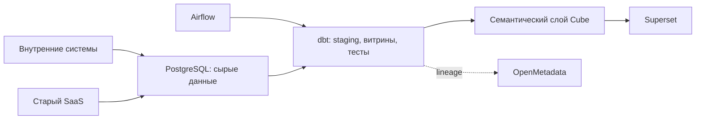
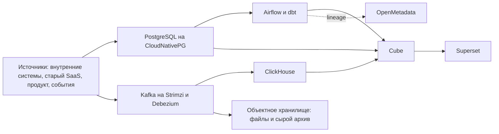
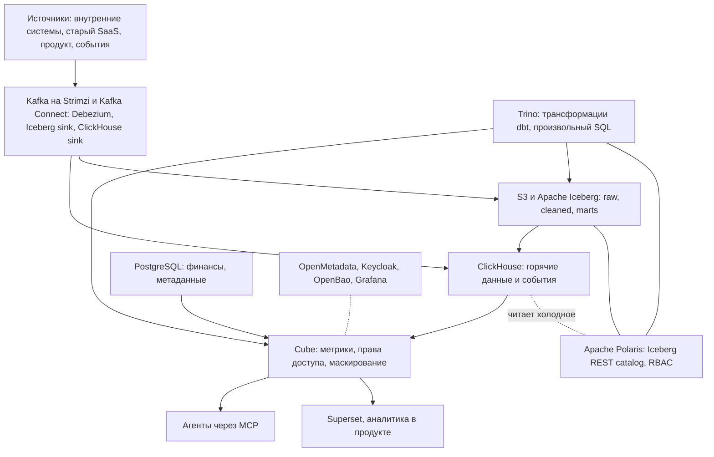

**Русский** (английская и китайская версии ещё не написаны)

# Типовая архитектура: data-platform-stages

Как платформа данных mess.systems растёт от простого стека к среднему и к целевому. На каждом этапе указаны технологии по ролям, чтобы было видно, во что стек вырастет, когда для этого появится причина. Эта типовая архитектура фиксирует границы, состав по этапам, условия перехода, то, что в набор не входит, и открытые вопросы.

**Статус:** черновик типовой архитектуры. Создано 2026-11-11. Нормативный английский текст ещё не написан. Компания mess.systems и её руководители выдуманы. Это модельный состав, не отчёт о внедрении. Имена ниже являются примерами в домене `mess.systems` и не относятся к работающей системе.

**Коды возможностей.** Платформа данных собирается из уже известных кодов домена `data`: хранилище `warehouse`, преобразования `transform`, оркестрация `orchestrate`, каталог данных `data-catalog`, BI `bi`, семантический слой `semantic`. Код `semantic` в [стандарте именования](https://github.com/mess-systems/naming-standard/blob/main/i18n/ru/01-naming-conventions.md#43-коды-возможностей-уникальны-во-всех-доменах) ещё не зарегистрирован; он предложен отдельным изменением, имя сервиса `semantic.data.platform`. Рядом стоят поставщик идентичностей `sso` и секреты `secrets` (домен `iam`), дашборды `dashboards` и журналы `logs` (домен `obs`). Отдельный код на всю платформу данных здесь не вводится.

**Плоскость.** Предварительное решение: `platform`, плоскость домена `data` по умолчанию. Отдельная плоскость для домена `data` не вводится.

**Связанные типовые архитектуры.** Договор семантического слоя: [`semantic-layer-cube`](https://github.com/mess-systems/blueprints/blob/main/semantic-layer-cube/README.ru.md). Доступ людей к PostgreSQL: [`data-sql-access`](https://github.com/mess-systems/blueprints/blob/main/data-sql-access/README.ru.md).

## 1. Границы

| Входит | Не входит |
|---|---|
| Три этапа роста стека: простой, средний, целевой, и состав технологий на каждом | Развёртывание, манифесты Kubernetes и точные размеры кластеров |
| Условия перехода с этапа на этап | Построение конкретной семантической модели: см. [`semantic-layer-cube`](https://github.com/mess-systems/blueprints/blob/main/semantic-layer-cube/README.ru.md) |
| Что добавляется на следующем этапе и что сознательно не входит в набор | Интерактивный доступ людей к PostgreSQL: см. [`data-sql-access`](https://github.com/mess-systems/blueprints/blob/main/data-sql-access/README.ru.md) |
| Открытые вопросы, без которых нельзя считать состав закрытым | Выбор конкретного поставщика объектного хранилища и управляемых сервисов |

## 2. Зачем растить стек по этапам

В легенде mess.systems раньше было много людей. Инвестиционный ландшафт изменился, компания сокращается. Данных меньше не стало, людей, которые могут их обслуживать, стало меньше. Данные по-прежнему актив, поэтому CDO вместе с CFO выбирает стек, который можно содержать: решения должны быть эффективны операционно, по CAPEX и по OPEX.

При этом мы смотрим и вперёд. Экономический цикл, скорее всего, снова даст рост, компания снова станет большой и сильной, и наше время ещё придёт. Целевой состав как раз про это будущее. Пока разворачиваем только то, для чего уже есть причина: простой и средний этапы закрывают текущую работу, а целевой виден заранее и подключается, когда сработают условия.

Эволюционный подход здесь потому, что денег на большой взрыв нет. Каждый этап добавляет слой, а модели dbt, Cube и дашборды остаются. Большой набор крупных компаний рядом не копируем: там часто живут несколько аналитических движков, два табличных формата и сопровождение, которое сокращающейся команде дорого содержать. Модные ребята из Big Tech говорят, что Hadoop уже не модно. К этому я бы прислушался. Весь их набор как есть всё равно не переносим.

Что нужно от стека на любом этапе:

1. У каждой роли один продукт. Меньше развёртывания, меньше эксплуатации, меньше шансов получить две разные «выручки» и два места, где описаны права.
2. Открытые форматы и протоколы. Данные остаются, движки можно сменить, не перекладывая всё заново.
3. Одна дверь к данным для людей, продукта и агентов.
4. Не держать простаивающие кластеры и не разворачивать целевой набор раньше, чем для него появится повод.

CISO просит одну дверь и маскирование персональных данных. CTO уже зафиксировал на радаре два решения, на которые опирается этот стек: [CloudNativePG](https://github.com/mess-systems/tech-radar/blob/main/technologies/cloudnative-pg.md) как целевой PostgreSQL в Kubernetes (кольцо Adopt) и [Cube](https://github.com/mess-systems/tech-radar/blob/main/technologies/cube.md) в кольце Trial.

## 3. Сводный состав по этапам

«Целевой рост» в таблице: компоненты, которые видны в целевой картине на вырост, когда компания снова вырастет. В базовом среднем этапе их ещё нет, и без сработавших условий их не разворачиваем.

| Роль | Простой | Средний | Целевой |
|---|---|---|---|
| Хранение | PostgreSQL: сырые данные и витрины | PostgreSQL на CloudNativePG; объектное хранилище S3 для файлов и сырого архива; горячие данные в ClickHouse | Объектное хранилище S3 как основное аналитическое хранилище; PostgreSQL и ClickHouse остаются в своих ролях |
| Табличный формат | Таблицы PostgreSQL | Таблицы PostgreSQL и ClickHouse; сырой архив ещё без табличного формата озера | Apache Iceberg, слои raw, cleaned и marts (часто называют bronze, silver, gold) |
| Каталог таблиц | Нет отдельного сервиса | Нет отдельного сервиса | Apache Polaris по протоколу Iceberg REST, с RBAC. Это новый сервис этапа |
| Движки | PostgreSQL | PostgreSQL и ClickHouse | К ним добавляется Trino для озера и трансформаций dbt. Это второй новый сервис этапа. Spark, Flink и StarRocks только по своему триггеру, это уже следующий рост |
| Приём и CDC | Загрузка из систем, которые уже есть, в PostgreSQL | Kafka на Strimzi, Debezium, sink в ClickHouse; логическая репликация CloudNativePG | Тот же контур плюс Iceberg sink в озеро |
| Оркестрация | Apache Airflow | Apache Airflow | Apache Airflow |
| Преобразования | dbt | dbt | dbt, часть прогонов переносится на Trino и озеро |
| Семантический слой | Cube (Trial), код `semantic` | Cube: метрики, кэш, права доступа и маскирование | Cube остаётся дверью к данным для BI, продукта и агентов |
| BI | Apache Superset | Apache Superset; аналитика внутри продукта поверх Cube | Apache Superset; аналитика внутри продукта |
| Каталог данных и lineage | OpenMetadata | OpenMetadata | OpenMetadata: PostgreSQL, ClickHouse, Iceberg и dbt в одном каталоге |
| Идентичность и доступ | Keycloak; права в Cube; секреты в OpenBao | То же; политики доступа и маскирование персональных данных в Cube | То же плюс RBAC в Polaris. Целевой рост: APISIX для обычного API продукта и agentgateway для MCP-трафика агентов |
| Наблюдаемость | Grafana | Grafana | Grafana. Целевой рост: рядом Prometheus и Loki |

Почему на две роли берутся Trino и ClickHouse и почему каталог таблиц именно Polaris, разобрано в [разделе целевого этапа](#7-целевой-этап). Лицензии на критическом пути предпочтительны Apache-2.0 или MIT, без отдельной платной «плюс»-редакции.

## 4. Простой этап

Первая цель скромная: собрать данные из систем, которые уже есть, и из старого SaaS, и начать пользоваться BI. Новых аналитических СУБД и озера не ставим: это и капитальные затраты, и постоянные операционные затраты раньше, чем они нужны.

Состав:

- Источники пишут сырые данные в PostgreSQL. К сырью сразу кладём метаданные загрузки, чтобы позже перенести этот слой в Iceberg без переделки модели.
- Airflow запускает dbt: staging, витрины, тесты.
- Поверх витрин стоит Cube, потребители смотрят Superset.
- Описание и lineage ведутся в OpenMetadata.
- Вход людей: Keycloak. Секреты: OpenBao.

Несколько дашбордов по двум-трём доменам достаточно, чтобы начать пользоваться данными. Чего на этом этапе я бы не делал: не ставить озеро и лишние движки раньше времени, не делать потоковую обработку для финансов, не заводить второй BI и второй каталог данных, не строить дашборды мимо Cube прямым SQL к сырым таблицам, не писать свой фреймворк загрузки и не проектировать сырой слой так, будто озеро уже есть.

### Когда переходить к среднему этапу

Средний этап нужен, когда платформа продуктов заработала и появились изменения из её базы и потоки событий. Пока этого нет, остаёмся на простом составе.

## 5. Средний этап

На этом этапе я бы развёл три роли и не притворялся, что ими всё исчерпывается.

- **PostgreSQL** в Kubernetes. Целевой стек mess.systems это [CloudNativePG](https://cloudnative-pg.io/). На нём финансы, небольшие точные витрины и метаданные сервисов: объёмы небольшие, join сложные, точность важна.
- **ClickHouse** берёт события и изменения из базы продукта. Путь такой: логическая репликация CloudNativePG, Debezium, Kafka, sink в ClickHouse.
- **Cube** я бы сделал дверью к данным: метрики, кэш, права доступа и маскирование. На радаре Cube в кольце Trial: слой пробуем в ограниченной области, каждое расширение этой области нужно отдельно обосновать. Как устроен договор с потребителем, уже описано в [типовой архитектуре семантического слоя](https://github.com/mess-systems/blueprints/blob/main/semantic-layer-cube/README.ru.md).

За тремя ролями стоят ещё Kafka и Debezium, объектное хранилище для файлов и сырого архива, Airflow, dbt, Superset и OpenMetadata. ClickHouse я бы не считал системой записи. Сырые события сразу копируются в объектное хранилище. Когда озеро понадобится, историю не придётся заново тянуть из источников. Это небольшая предусмотрительность, которая потом экономит и капитал, и сопровождение.

Kafka я бы ставил через оператор Strimzi. Реестр схем, например Apicurio, я бы не заводил сразу: только если топики начнут читать несколько команд. Такой реестр тоже относится к росту. В обязательный состав среднего этапа он не входит.

Озеро на этом этапе ещё не подключаем.

## 6. Когда переходить к целевому этапу

Озеро надстраивается над средним этапом, когда сработают условия перехода, не заранее. Достаточно одного жёсткого триггера или двух мягких. Пороги вроде «раз в квартал» или «дольше часа» это только ориентиры, их надо будет уточнить по своим измерениям. Когда именно сработают условия, заранее не загадываю: это будет видно по измерениям.

Жёсткие:

- нужен второй движок над теми же данными: обучение моделей, произвольный SQL, внешний потребитель файлов;
- нужна длинная история с пересчётом, а горячие диски ClickHouse растут;
- историю приходится пересчитывать часто, например чаще раза в квартал, из-за новой логики метрики или исправления ошибки.

Мягкие:

- ночные трансформации на PostgreSQL идут неприемлемо долго, например дольше часа, или сама база заметно разрастается;
- тяжёлые join по нескольким большим таблицам в ClickHouse начинают тормозить дашборды;
- появляется требование аудита: воспроизвести состояние данных на дату или доказуемо показать, что сырой слой не переписывали;
- больше двух команд хотят прямой SQL мимо Cube.

Модели dbt, Cube и дашборды при переходе остаются.

## 7. Целевой этап

Одной строкой, к которому я бы шёл, когда сработают триггеры: объектное хранилище S3, Apache Iceberg, Apache Polaris; Trino для озера и трансформаций dbt; ClickHouse для быстрых ответов; Kafka на Strimzi и Debezium; Airflow и dbt; Cube как дверь к данным; Superset; OpenMetadata. К среднему этапу добавляются два новых сервиса: Polaris и Trino, плюс коннектор Iceberg sink.

Как я это вижу:

- **Объектное хранилище.** Вместо своих дисков, кластеров хранения и их обновлений. Меньше капитальных затрат на железо, меньше операционных на сопровождение. Для аналитики системой записи я бы сделал Iceberg: сырой, очищенный и витринный слои в одном формате, который умеют читать выбранные движки.
- **Один табличный формат, Iceberg.** Paimon имеет смысл для потоковых обновлений вместе с Flink. Flink в базовом наборе нет, поэтому второй формат я бы сейчас не заводил: появится и второе обслуживание.
- **Каталог таблиц Polaris.** Стандартный протокол Iceberg REST, проект Apache без платной «плюс»-редакции, Keycloak как внешний провайдер идентичности, служебная база в PostgreSQL. Lakekeeper тоже выглядит хорошо и легче, но для прав на таблицы ему нужен ещё OpenFGA. Nessie с ветками каталога и Gravitino как мета-каталог здесь, кажется, больше, чем нужно. Протокол один, поэтому от Polaris к Lakekeeper можно будет уйти, если выбор не зайдёт.
- **Пара движков: Trino и ClickHouse.** Trino считает трансформации в озере и отвечает аналитикам. ClickHouse отвечает быстро и держит свежие данные. StarRocks может закрыть обе роли сразу, и к этому я бы вернулся, если ClickHouse не выдержит join-нагрузку, а Trino окажется слишком тяжёлым по памяти.
- **Дверь к данным: семантический слой.** BI, аналитика в продукте и агенты ходят через Cube. Метрики, права доступа и маскирование персональных данных описаны один раз. Агенты получают права пользователя, от чьего имени работают. Прямого SQL агентов к хранилищам я бы не давал.
- **Каталог данных.** OpenMetadata описывает и PostgreSQL, и ClickHouse, и Iceberg, и dbt. Второй каталог данных рядом я пока не вижу смысла ставить.

### Целевой рост: что видно на вырост

Это не отдельный четвёртый этап и не повод разворачивать сервисы заранее. Это то, как целевой стек выглядит, когда компания снова вырастет и появятся соответствующие задачи.

- **Доступ снаружи.** В целевой картине обычный API продукта проходит через APISIX, а MCP-трафик агентов через agentgateway. Оба стоят перед Cube и не заменяют политики доступа самого слоя. Если публичный API продукта и MCP-контур агентов ещё не дошли до этой платформы, эти два сервиса можно не поднимать ради неё.
- **Наблюдаемость.** Рядом с Grafana в целевой картине стоят Prometheus и Loki. Журналы запросов к Cube, Trino и Polaris имеют смысл как раз когда этих сервисов становится больше.
- **Spark, Flink и StarRocks только по своему триггеру.** Свежесть в минуты, как мне сейчас кажется, закрывается связкой Kafka и ClickHouse. Flink я бы смотрел, когда появится обработка с состоянием по событийному времени и задержкой в секунды. Spark я бы смотрел, когда придут обучение моделей и тяжёлая обработка, которую не выразить в SQL, и запускал бы разовые задания, без постоянного кластера, который простаивает. StarRocks я бы смотрел, если не сложатся роли Trino и ClickHouse.
- **Реестр схем.** Как уже сказано на среднем этапе: только если топики начнут читать несколько команд.

Сколько будет стоить целевой этап в капитальных и операционных затратах и сколько людей понадобится на постройку и на устойчивую эксплуатацию, я пока точно не знаю: это зависит от того, насколько управляемы Kubernetes и объектное хранилище. Заранее закладывать отдельную команду и отдельные кластеры под озеро не хочу.

## 8. Что в набор не входит

Эти продукты я бы не включал в базовый состав ни на одном этапе:

- Greenplum. Исходный проект закрыт с мая 2024, а отдельный MPP на дисках узлов пришлось бы содержать рядом с ClickHouse и Iceberg.
- Hadoop и HDFS. Про них модные ребята из Big Tech как раз говорят, что это уже не модно.
- Второй табличный формат рядом с Iceberg, в том числе Paimon и Delta Lake, пока нет своего триггера у Flink.
- Второй BI рядом с Superset и второй каталог данных рядом с OpenMetadata.
- Отдельный постоянный кластер Spark или Flink «на всякий случай».
- Прямой SQL агентов к ClickHouse, Trino и другим хранилищам в рабочем контуре.

Альтернативы, которые я смотрел и пока не беру в базовый набор: StarRocks как замена пары Trino и ClickHouse; Apache Doris; Lakekeeper, Nessie, Gravitino и Hive Metastore как каталог таблиц; Dagster, Prefect и SQLMesh вместо связки Airflow и dbt; DataHub, Amundsen и Soda Core как замена или дополнение OpenMetadata. Если появятся измерения, которые изменят этот выбор, состав можно пересмотреть: открытые протоколы как раз для этого.

## 9. Что пока не понятно

- Насколько реальные потоки отличаются от того, что видно на простом этапе. Это станет ясно только после измерений.
- Как соотносятся CAPEX и OPEX целевого этапа с тем, чтобы остаться на среднем. Без измерений это пока не понятно.
- Где держать финансы и коммерческую тайну: в том же контуре, что и озеро, или на своих серверах, а в общее хранилище отдавать только агрегаты. Здесь нужно слово CISO, это пока не понятно.
- PostgreSQL я склонен ставить сами, через CloudNativePG: это уже целевой стек. Kafka: сами через Strimzi или управляемый сервис, я пока не решил.
- Поддерживает ли выбранное объектное хранилище временные токены STS, без которых каталог таблиц не может выдавать движкам права на уровне файлов.
- Как переживает переключение основного экземпляра логическая репликация из PostgreSQL в CloudNativePG.
- Выдержит ли ClickHouse join-нагрузку семантического слоя, или лучше смотреть на StarRocks.
- Когда именно в целевом росте понадобятся APISIX и agentgateway, если контур агентов и публичного API продукта появится позже озера, или наоборот. Это пока не понятно.
