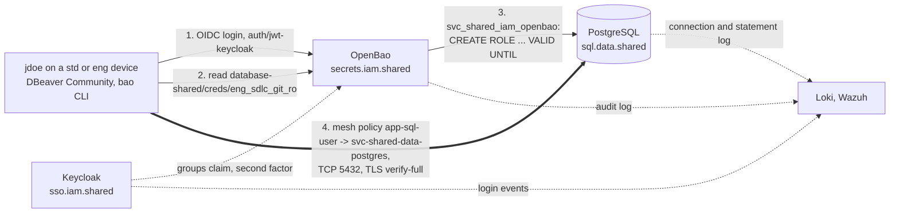

**English** | [Русский](README.ru.md) | [简体中文](README.zh-CN.md)

# Blueprint: data-sql-access

Access of people to PostgreSQL in mess.systems. A person signs in to OpenBao through Keycloak, receives a temporary database user with a short lifetime, and connects over the NetBird mesh with verified TLS. Every statement can be traced back to the person through three logs. This blueprint fixes the request path, names, authentication and credentials, permissions, network, TLS, audit, deployment, known issues, alternatives and open questions.

**Status:** draft, evolving. Created 2026-10-31. All configurations are examples with fictional names under `mess.systems`, not a running system.

**Capability codes.** The database is `sql` in the domain `data` of the [naming standard](https://github.com/mess-systems/naming-standard/blob/main/01-naming-conventions.md#43-capability-codes-unique-across-all-domains), service name `sql.data.shared`. The secrets vault that issues credentials and certificates is `secrets` (domain `iam`), the identity provider is `sso` (domain `iam`), the mesh is `mesh` (domain `net`), logs are `logs` (domain `obs`) and the SIEM is `siem` (domain `sec`).

## 1. Scope

| In scope | Out of scope |
|---|---|
| Interactive access of people to PostgreSQL databases: sign-in, temporary users, permissions | Access of applications to their own databases: static per-application users `svc_<plane>_<domain>_<product>` |
| Mesh policies and host firewall rules for TCP 5432 | The mesh itself: see the [`net-mesh`](../net-mesh/) blueprint |
| Server certificates and client TLS settings | The internal CA as a whole: capability `pki` |
| The attribution chain from a database log line to a sign-in | Storage and retention of logs: capabilities `logs` and `siem` |
| Order of changes and the verification matrix | Device baselines and the `bao` CLI on devices: see the [`endpoint`](../endpoint/) blueprint |

## 2. Composition

| Part | Role | Product | Radar |
|---|---|---|---|
| Identity provider | Sign-in of people with a second factor, groups claim | Keycloak | [Adopt](https://github.com/mess-systems/tech-radar/blob/main/technologies/keycloak.md) |
| Sign-in protocol | Login of people to OpenBao | OpenID Connect | [Adopt](https://github.com/mess-systems/tech-radar/blob/main/technologies/oidc.md) (specification) |
| Secrets | JWT/OIDC auth method, database secrets engine, PKI for server certificates, audit log | OpenBao | [Adopt](https://github.com/mess-systems/tech-radar/blob/main/technologies/openbao.md) |
| Mesh | Policies from group to group, split DNS for `svc.mess.systems` | NetBird | [Adopt](https://github.com/mess-systems/tech-radar/blob/main/technologies/netbird.md) |
| Tunnel | Encrypted transport between peers | WireGuard (inside NetBird) | [Adopt](https://github.com/mess-systems/tech-radar/blob/main/technologies/wireguard.md) |
| Database | Group roles, temporary users, connection and statement logs | PostgreSQL | [Adopt](https://github.com/mess-systems/tech-radar/blob/main/technologies/postgresql.md) |
| Host firewall | Rules outside the mesh | nftables | [Adopt](https://github.com/mess-systems/tech-radar/blob/main/technologies/nftables.md) |
| Database client | Desktop client of people | DBeaver Community | [Adopt](https://github.com/mess-systems/tech-radar/blob/main/technologies/dbeaver.md) |
| Access as code | OpenBao roles and policies, mesh policies | OpenTofu | [Adopt](https://github.com/mess-systems/tech-radar/blob/main/technologies/opentofu.md) |
| Host configuration | PostgreSQL settings, group roles, host firewall | Ansible | [Adopt](https://github.com/mess-systems/tech-radar/blob/main/technologies/ansible.md) |
| Review | Repositories of the code above, pull requests | Forgejo | [Adopt](https://github.com/mess-systems/tech-radar/blob/main/technologies/forgejo.md) |
| Logs and SIEM | Central store of the three logs, correlation | Loki, Wazuh | [Loki](https://github.com/mess-systems/tech-radar/blob/main/technologies/loki.md), [Wazuh](https://github.com/mess-systems/tech-radar/blob/main/technologies/wazuh.md): Adopt |

## 3. Request path



1. **Sign-in.** The person signs in to OpenBao with `bao login -method=oidc` on the mount `auth/jwt-keycloak`. Keycloak asks for the second factor and puts the groups claim into the token.
2. **Credentials.** The person reads `database-shared/creds/eng_sdlc_git_ro`. OpenBao creates a temporary user and returns its name and password.
3. **Temporary user.** OpenBao connects to PostgreSQL as `svc_shared_iam_openbao` and creates the user as a member of the `NOLOGIN` group role `eng_sdlc_git_ro`. When the lease ends, OpenBao terminates the user's sessions and drops the user.
4. **Connection.** The client connects by the service name `sql.data.shared.svc.mess.systems` through the mesh. Only a policy from the person's group to the database peer group opens TCP 5432.

A name, a device or a network location never grants access: access comes from the Keycloak group, the OpenBao policy and the rights of the database role (rule I3 of the [identity conventions](https://github.com/mess-systems/naming-standard/blob/main/04-identity-conventions.md#1-principles-applied)).

## 4. Names

Every name below has a form in the naming standard. There are no names without a form.

| Object | Name | Rule |
|---|---|---|
| PostgreSQL cluster, internal name | `sql.data.shared.svc.mess.systems` | [Grammar A: internal](https://github.com/mess-systems/naming-standard/blob/main/01-naming-conventions.md#31-grammar-a-internal) |
| Cluster application, `service_name` in Loki | `shared-data-postgres` | [PostgreSQL objects](https://github.com/mess-systems/naming-standard/blob/main/08-operations-objects.md#7-postgresql-objects), [object forms](https://github.com/mess-systems/naming-standard/blob/main/01-naming-conventions.md#5-object-forms) |
| Cluster host | `dc1-shared-data-postgres-prd-01` | [Object forms](https://github.com/mess-systems/naming-standard/blob/main/01-naming-conventions.md#5-object-forms) |
| Example database | `eng_sdlc_git_prd` (database of the git forge) | [PostgreSQL objects](https://github.com/mess-systems/naming-standard/blob/main/08-operations-objects.md#7-postgresql-objects) |
| Group roles of the database | `eng_sdlc_git_ro`, `eng_sdlc_git_rw`, `eng_sdlc_git_owner` | [Database roles](https://github.com/mess-systems/naming-standard/blob/main/04-identity-conventions.md#11-database-roles) |
| Service account of OpenBao in PostgreSQL | `svc_shared_iam_openbao` | [Database roles](https://github.com/mess-systems/naming-standard/blob/main/04-identity-conventions.md#11-database-roles) |
| Local break-glass administrator | database role `breakglass_sql`, account `breakglass-sql-01` | [Database roles](https://github.com/mess-systems/naming-standard/blob/main/04-identity-conventions.md#11-database-roles), [identity kinds](https://github.com/mess-systems/naming-standard/blob/main/04-identity-conventions.md#2-identity-kinds) |
| Temporary user | `v_<auth>_<identity>_<role>_<ts>_<rand6>`, for example `v_oidc_jdoe_eng_sdlc_git_ro_20261031t020000z_k7m2qa` | [Temporary database users](https://github.com/mess-systems/naming-standard/blob/main/04-identity-conventions.md#111-temporary-database-users) |
| Keycloak groups | read `app-sql-user`, write `app-sql-editor` (off by default), administration `tier-t1-platform-ops` | [App groups](https://github.com/mess-systems/naming-standard/blob/main/04-identity-conventions.md#33-app-groups-access-to-one-capability), [groups](https://github.com/mess-systems/naming-standard/blob/main/04-identity-conventions.md#3-groups) |
| OpenBao | `secrets.iam.shared.svc.mess.systems`, application `shared-iam-openbao` | [Secrets conventions](https://github.com/mess-systems/naming-standard/blob/main/03-secrets-conventions.md), [object forms](https://github.com/mess-systems/naming-standard/blob/main/01-naming-conventions.md#5-object-forms) |
| Auth mount and login role | `auth/jwt-keycloak`, role `app-sql-user` | [Mounts](https://github.com/mess-systems/naming-standard/blob/main/03-secrets-conventions.md#2-mounts), [auth roles and tokens](https://github.com/mess-systems/naming-standard/blob/main/03-secrets-conventions.md#6-auth-roles-and-tokens) |
| OpenBao policy | `app-sql-user` | [Policies](https://github.com/mess-systems/naming-standard/blob/main/03-secrets-conventions.md#5-policies) |
| Database secrets engine | mount `database-shared/`, connection `shared-data-postgres`, role `eng_sdlc_git_ro` | [Engines other than kv](https://github.com/mess-systems/naming-standard/blob/main/03-secrets-conventions.md#21-engines-other-than-kv) |
| PKI | mount `pki-int/`, issuer `mess-systems-int-2026`, issuing role `data-shared` | [Engines other than kv](https://github.com/mess-systems/naming-standard/blob/main/03-secrets-conventions.md#21-engines-other-than-kv) |
| OpenBao client in Keycloak | application `shared-iam-openbao`, provider `shared-iam-openbao-oidc`, mapper `shared-iam-openbao-groups` | [IdP objects](https://github.com/mess-systems/naming-standard/blob/main/04-identity-conventions.md#6-idp-objects) |
| Keycloak | `sso.iam.shared.svc.mess.systems`, realm `mess-systems`; public exception `sso.mess.systems` | [Worked encodings](https://github.com/mess-systems/naming-standard/blob/main/01-naming-conventions.md#11-worked-encodings), [IdP objects](https://github.com/mess-systems/naming-standard/blob/main/04-identity-conventions.md#6-idp-objects) |
| Mesh peer groups of services | `svc-shared-data-postgres`, `svc-shared-iam-openbao` | [Mesh VPN groups](https://github.com/mess-systems/naming-standard/blob/main/04-identity-conventions.md#4-mesh-vpn-groups) |
| Mesh policies, rule, posture check | `app-sql-user -> svc-shared-data-postgres`, rule `postgresql`, `posture-client-current` | [Mesh policies, rules and posture checks](https://github.com/mess-systems/naming-standard/blob/main/04-identity-conventions.md#41-mesh-policies-rules-and-posture-checks) |
| Mesh nameserver group | `svc-mess-systems-dc1` (zone `svc.mess.systems`) | [Mesh DNS](https://github.com/mess-systems/naming-standard/blob/main/04-identity-conventions.md#43-mesh-dns) |
| Snapshot before a change | `shared-data-postgres-prd-20261031t020000z` | [Backups and snapshots](https://github.com/mess-systems/naming-standard/blob/main/08-operations-objects.md#3-backups-and-snapshots) |
| Person in the examples | `jdoe`, administrator account `jdoe-adm` | [Identity kinds](https://github.com/mess-systems/naming-standard/blob/main/04-identity-conventions.md#2-identity-kinds) |

## 5. Authentication and credentials

### 5.1 Requirements

1. **People sign in only through the identity provider.** A person never holds a static database password. Static users exist only for applications and for break-glass.
2. **Every database session of a person belongs to one temporary user.** The user is created at request time, carries the person's ID in its name and expires on its own.
3. **The service account of OpenBao can issue, but not use, a role.** It creates and drops temporary users and is never used to read or change data.
4. **The time in the name is UTC.** The time of issue `<ts>` must match the time of the OpenBao audit entry; see 5.3.
5. **Effective access is the intersection of three layers:** the Keycloak group, the OpenBao policy and the rights of the database group role. A change to one layer does not widen access without review of the other two.

### 5.2 Issuance

1. Login role `app-sql-user` on `auth/jwt-keycloak`: `bound_claims` to the Keycloak group of the same ID, `user_claim = preferred_username`, token TTL 8 hours ([auth roles and tokens](https://github.com/mess-systems/naming-standard/blob/main/03-secrets-conventions.md#6-auth-roles-and-tokens)).
2. Policy `app-sql-user` allows only `read` on `database-shared/creds/eng_sdlc_git_ro`. It has no rights on `database-shared/config/*`, `database-shared/roles/*`, `database-shared/rotate-root/*` or `sys/leases/*`.
3. Service account `svc_shared_iam_openbao`: `LOGIN CREATEROLE NOSUPERUSER NOCREATEDB NOREPLICATION NOBYPASSRLS`. On each group role it gets `GRANT eng_sdlc_git_ro TO svc_shared_iam_openbao WITH ADMIN TRUE, INHERIT FALSE, SET FALSE` (PostgreSQL 16 and later): it may grant the role but cannot act with it. It is a member of `pg_signal_backend` to end sessions and owns no database objects.
4. Creation statements of the role `eng_sdlc_git_ro`:

   ```sql
   CREATE ROLE "{{name}}" WITH LOGIN PASSWORD '{{password}}' VALID UNTIL '{{expiration}}';
   GRANT eng_sdlc_git_ro TO "{{name}}";
   ```

   Revocation statements:

   ```sql
   SELECT pg_terminate_backend(pid) FROM pg_stat_activity WHERE usename = '{{name}}';
   DROP ROLE IF EXISTS "{{name}}";
   ```

5. User name: the form of [temporary database users](https://github.com/mess-systems/naming-standard/blob/main/04-identity-conventions.md#111-temporary-database-users), set in `username_template` of the connection `shared-data-postgres`.
6. Lifetime: `default_ttl = 8h`, `max_ttl = 24h`. When the lease ends, OpenBao runs the revocation statements. `VALID UNTIL` refuses a new login even if OpenBao has not revoked the user yet.
7. Rotation: `rotate-root` for `svc_shared_iam_openbao` runs as a separate step after issuance has been verified, by `jdoe-adm` from a `paw` device or by the pipeline. Afterwards only OpenBao knows the password; `breakglass-sql-01` remains for emergencies (rule I6 of the [identity conventions](https://github.com/mess-systems/naming-standard/blob/main/04-identity-conventions.md#1-principles-applied)).

### 5.3 Time of issue

OpenBao renders the template function `timestamp` in the local time zone of its process, while it writes audit entries in UTC. On a host whose zone is not UTC, the suffix `z` in `<ts>` is then false, and a log line points to the wrong hour.

1. OpenBao runs with the environment variable `TZ=UTC`: a systemd drop-in or the container environment ([`examples/openbao-tz-utc.example.conf`](examples/openbao-tz-utc.example.conf)). The setting does not depend on the host zone or on time zone data in the image.
2. PostgreSQL writes its log in UTC: `log_timezone = 'UTC'`, and `log_line_prefix` starts with `%m`, which carries the zone.
3. Hosts of the three systems synchronise their clocks over NTP. Time narrows the search; the proof is the chain of identifiers in [audit](#9-audit).
4. Check after every change of the OpenBao host or image: issue a user and compare `<ts>` in its name with the field `time` of the audit entry of the issuance. The difference is a few seconds, not hours.

## 6. Permissions

| Layer | Answers | Where | Example |
|---|---|---|---|
| Keycloak group | who | Keycloak, OpenTofu | `app-sql-user` |
| OpenBao login role and policy | which path issues credentials | OpenBao, OpenTofu | role and policy `app-sql-user` → `database-shared/creds/eng_sdlc_git_ro` |
| Rights of the database group role | what may be done in the database | PostgreSQL, Ansible or migrations | `GRANT SELECT` on the tables of the schemas of `eng_sdlc_git_prd` to `eng_sdlc_git_ro` |

- **Read by default.** The role `eng_sdlc_git_ro` has `SELECT` only. It owns no schema and has no `CREATE` in any schema.
- **Write is off by default.** There is no role `database-shared/roles/eng_sdlc_git_rw`. Enabling write is one change in code with three parts: the Keycloak group `app-sql-editor`; a login role and policy of the same ID that allow only `read` on `database-shared/creds/eng_sdlc_git_rw`; rights of `eng_sdlc_git_rw` on named schemas (`SELECT, INSERT, UPDATE, DELETE`, no `TRUNCATE`, no DDL). Rights on a whole database or on all of `public` are not granted.
- **DDL runs through a pipeline** as the `<…>_owner` role, never as a temporary user.
- **Dropping a database.** `DROP DATABASE` is allowed only to the owner (`eng_sdlc_git_owner`) and to a superuser. Neither `ro` nor `rw` is either. Narrow schema rights and a snapshot before a change protect against deleted rows under `rw`.
- **Administration.** `tier-t1-platform-ops` reaches the cluster only from `paw` devices, through a mesh policy with a posture check; database administration also uses a temporary user of its own role.

## 7. Network

- **Policies.** Mesh policies are one-way, rule `postgresql` (TCP 5432), described in OpenTofu ([`examples/opentofu-netbird-sql.example.tf`](examples/opentofu-netbird-sql.example.tf)):
  - `svc-shared-iam-openbao -> svc-shared-data-postgres`;
  - `app-sql-user -> svc-shared-data-postgres`;
  - `tier-t1-platform-ops -> svc-shared-data-postgres` with the posture check `posture-client-current`.
  
  The group All is never a source or a destination ([groups and policies](../net-mesh/README.md#6-groups-and-policies) in `net-mesh`).
- **OpenBao is its own peer** in `svc-shared-iam-openbao`, not a service behind a routing peer. Behind `router-dc1` with masquerade, PostgreSQL would see the router's address and `pg_hba.conf` could not bind to the source ([enrolment](../net-mesh/README.md#7-enrolment) in `net-mesh`).
- **Names.** The client uses `sql.data.shared.svc.mess.systems`, resolved in the private zone through the nameserver group `svc-mess-systems-dc1`. Mesh peer names and addresses are not used in client settings.
- **Host firewall.** The host table on `dc1-shared-data-postgres-prd-01` (nftables, Ansible role) filters only the LAN and the direct WireGuard port; traffic of the mesh interface is filtered by mesh policies ([host firewall](../net-mesh/README.md#8-host-firewall) in `net-mesh`). The table allows TCP 5432 from the LAN only to the site collectors listed in it. Example: [`net-mesh/examples/nftables-hostfw.example.nft`](../net-mesh/examples/nftables-hostfw.example.nft).
- **Inbound block.** The database peer joins the mesh with `--block-inbound`. The block is removed only after the host table has been applied and the matrix rows for the LAN have passed ([order of changes](#101-order-of-changes)).
- **Listen addresses.** PostgreSQL listens on the LAN address and on the mesh interface; `pg_hba.conf` sets rules by role and source.
- **Site collectors** of logs and metrics do not depend on the mesh or the internet.

## 8. TLS

1. The server certificate comes from OpenBao PKI: mount `pki-int/`, issuer `mess-systems-int-2026`, issuing role `data-shared`. One role per zone `data.shared.svc.mess.systems`: `allowed_domains` = the zone, `allow_subdomains = true`, `allow_bare_domains = false`, `allow_wildcard_certificates = false`, `allow_ip_sans = false`. The SAN of the certificate is `sql.data.shared.svc.mess.systems` only.
2. Server: `pg_hba.conf` has only `hostssl` lines; `hostnossl` for everyone is `reject` ([`examples/pg-hba.example.conf`](examples/pg-hba.example.conf)).
3. Client: `sslmode=verify-full`, `sslrootcert` is the root CA chain of mess.systems delivered by the `endpoint` profile. The modes `require` and `verify-ca` are not allowed: they do not check the name.

## 9. Audit

Who did what is proven by a chain of three logs:

| Step | Log | Shows | Link to the next step |
|---|---|---|---|
| 1 | PostgreSQL | Temporary user, statement, time, session | User name |
| 2 | OpenBao audit | Who received this user and when: lease on `database-shared/creds/eng_sdlc_git_ro`, entity and alias `jdoe` | Entity ID and IdP session |
| 3 | Keycloak events | Login of `jdoe` with the second factor | — |

Requirements:

1. OpenBao has at least one audit device (`bao audit list` is not empty); two are recommended, so that a failure of one does not stop OpenBao. On the mount `database-shared/` the key `username` is excluded from HMAC: `bao secrets tune -audit-non-hmac-response-keys=username database-shared/`. Otherwise the name in the log is hashed and can be found only through `sys/audit-hash`.
2. PostgreSQL: `log_connections = on`, `log_disconnections = on`, `log_statement = 'ddl'` or pgaudit (`pgaudit.log = 'ddl, role'`), `log_timezone = 'UTC'`, and `log_line_prefix` with time, user, database, client address and session ID (`%m %u %d %r %c`) ([`examples/postgresql-logging.example.conf`](examples/postgresql-logging.example.conf)).
3. Keycloak stores login events and admin events.
4. The three logs reach Loki (`service_name` = `shared-data-postgres`, `shared-iam-openbao`, `shared-iam-keycloak`) and Wazuh. Retention is at least the period of an incident investigation.
5. If one link is missing, attribution rests on the user name alone. OpenBao forms the name, but without the logs the claim cannot be confirmed. Such a deployment does not meet this blueprint.

## 10. Deployment

- **As code.** Keycloak groups, OpenBao auth roles, policies, database connections and roles, PKI roles and mesh policies live in OpenTofu; PostgreSQL settings, group roles and the host table live in Ansible. Changes go through review in Forgejo.
- **Privileged steps.** Applying plans, applying the Ansible role on the database host and `rotate-root` run under an `-adm` account from a `paw` device ([request paths](../net-mesh/README.md#4-request-paths) in `net-mesh`) or by the pipeline after merge.
- **Manual change goes into code.** A change made in a console or on a host is moved into OpenTofu or Ansible in the same change, otherwise the next apply reverts it. An object that the code overwrites as a whole is described as a full copy of the live one; for the client `shared-iam-openbao-oidc` these are redirect URIs, audiences and the mapper `shared-iam-openbao-groups`. The live object is imported first, and a plan without changes confirms the description.
- **Temporary relaxations.** A relaxation is an issue in Forgejo with an owner group ([owners](https://github.com/mess-systems/naming-standard/blob/main/04-identity-conventions.md#5-owners)), a due date and a condition for reverting it. A change is not finished while it has open relaxations.
- **Organization boundaries.** One organization boundary has its own Keycloak, OpenBao and mesh installation ([organization boundaries](../net-mesh/README.md#10-organization-boundaries) in `net-mesh`). There are no policies between boundaries, and credentials of one boundary are never issued in another.

### 10.1 Order of changes

| # | Step | Where |
|---|---|---|
| 1 | Goal, rollback for every step, issue in Forgejo | review |
| 2 | Access to every affected host and API checked before the work starts; missing access stops the work | `eng` |
| 3 | Ansible role with the host table and PostgreSQL settings, OpenTofu plan for OpenBao and mesh policies; review | `eng`, Forgejo |
| 4 | Snapshot `shared-data-postgres-prd-<ts>`; apply the host table; record `nft list ruleset`; matrix rows for the LAN | `paw` or pipeline |
| 5 | Apply OpenBao and mesh policies; remove `--block-inbound`; full matrix; `nft list ruleset` again after a restart of the NetBird client | `paw` or pipeline |
| 6 | `rotate-root`; issuance checked again | `paw` or pipeline |
| 7 | Code matches the live state; relaxations recorded; acceptance or rollback | review |

### 10.2 Verification matrix

Each step that changes access is checked by the matrix. Each row carries the nftables rule, mesh policy or database right that produced the result.

| Source | Target | Action | Expected | Evidence |
|---|---|---|---|---|
| `svc-shared-iam-openbao` | `svc-shared-data-postgres` | TCP 5432 | allowed | mesh policy |
| `app-sql-user` | `svc-shared-data-postgres` | TCP 5432 | allowed | mesh policy |
| `tier-t1-platform-ops` from `paw` | `svc-shared-data-postgres` | TCP 5432 | allowed | mesh policy with posture check |
| `role-developers` without `app-sql-user` | `svc-shared-data-postgres` | TCP 5432 | denied | no policy |
| `svc-shared-data-postgres` | `svc-shared-iam-openbao` | any port | denied | one-way policy |
| Site collector in the allow list | database host over the LAN | TCP 5432 | allowed | host table rule |
| LAN host outside the allow list | database host over the LAN | TCP 5432 | denied | drop policy of the chain |
| `jdoe` in `app-sql-user` | OpenBao | `bao read database-shared/creds/eng_sdlc_git_ro` | issued | OpenBao audit log |
| User outside the group | OpenBao | the same | denied (403) | OpenBao policy |
| `jdoe` in `app-sql-user` | OpenBao | `bao read database-shared/creds/eng_sdlc_git_rw` | denied (403): write is off | OpenBao policy |
| Temporary user of `ro` | `eng_sdlc_git_prd` | `CREATE TABLE` | denied (`permission denied`) | role rights |
| Temporary user of `ro` | `eng_sdlc_git_prd` | `DROP DATABASE eng_sdlc_git_prd` | denied (`must be owner`) | role rights |
| `svc_shared_iam_openbao` | `eng_sdlc_git_prd` | `CREATE TABLE`, `SELECT` from tables | denied | account rights |
| Temporary user after TTL | `sql.data.shared` | login | denied | `DROP ROLE` in the log |
| Temporary user | its name | length and form of [temporary database users](https://github.com/mess-systems/naming-standard/blob/main/04-identity-conventions.md#111-temporary-database-users) | at most 63, contains `oidc`, `jdoe`, the role | `pg_roles` |
| Temporary user | `<ts>` in its name | compare with `time` of the issuance audit entry | difference of seconds, not hours | audit entry, `TZ=UTC` in the OpenBao environment |
| Client, `sslmode=verify-full` | `sql.data.shared.svc.mess.systems` | login | allowed, TLS | `pg_stat_ssl` |
| Client, `sslmode=verify-full` | database host by mesh peer name or address | login | denied: name does not match the certificate | client error |
| Client, `sslmode=disable` | `sql.data.shared.svc.mess.systems` | login | denied | line `hostnossl … reject` |
| Administrator | `pki-int/issue/data-shared` | issue `*.data.shared.svc.mess.systems`, `data.shared.svc.mess.systems`, a name outside the zone | denied | PKI role settings |
| Administrator | OpenBao | `bao audit list` | at least one device | command output |
| Administrator | OpenBao audit log | search the issuance by the temporary user name | found, `username` not hashed | audit entry |
| Administrator | Loki and Wazuh | search the `CREATE TABLE` denial by the temporary user name | found in both | Loki query, Wazuh event |
| Administrator | Keycloak events | login of `jdoe` at the time of issuance | found, second factor passed | login event |

## 11. Known issues

**The mesh client inserts its own rules.** The NetBird client keeps its own nftables table and inserts an accept rule for its interface into other base chains with input and forward hooks, and restores it when tables change. Removing that rule by script leaves a window until the next restore. The host table therefore does not filter the mesh interface, and mesh policies are a critical control: they are in code and in the matrix.

**`--block-inbound` and the order of changes.** Removing the inbound block before the host table is applied exposes the database to every peer that a policy admits, without the LAN filter in place. The order in [order of changes](#101-order-of-changes) is mandatory.

**Token in the environment.** A stale token in `BAO_TOKEN` or `VAULT_TOKEN` takes precedence over the token helper of the `bao` CLI and causes 403 errors that look like missing rights. Clear the variable before diagnosing rights.

**DBeaver Community has no secrets manager integration.** The person pastes the issued user name and password into the connection settings. The paid editions of DBeaver (Lite, Enterprise, Ultimate) read connection parameters from a Vault-compatible store; reading dynamic credentials of the OpenBao database engine with them has not been confirmed. DataGrip reads them through a third-party plugin.

**Time zone of the OpenBao process.** Without `TZ=UTC` the time in the user name follows the host zone, see [time of issue](#53-time-of-issue).

**Hashed user name in the audit log.** Without `-audit-non-hmac-response-keys=username` the name in the OpenBao audit log is an HMAC and cannot be searched directly.

## 12. Alternatives considered

| Option | Radar | Why not now |
|---|---|---|
| Teleport | [Hold](https://github.com/mess-systems/tech-radar/blob/main/technologies/teleport.md) | The radar defers new adoption; one more proxy with its own account model |
| Pomerium | [Trial](https://github.com/mess-systems/tech-radar/blob/main/technologies/pomerium.md) | Context-aware access for HTTP applications; for TCP to a database it adds a second path next to NetBird |
| StrongDM | [Hold](https://github.com/mess-systems/tech-radar/blob/main/technologies/strongdm.md) | The control plane is a hosted service: users, policies and access logs leave the organization boundary |
| DataGrip, paid DBeaver editions | [DataGrip Assess](https://github.com/mess-systems/tech-radar/blob/main/technologies/datagrip.md), [DBeaver](https://github.com/mess-systems/tech-radar/blob/main/technologies/dbeaver.md) | Commercial licenses; compatible with this design, an option for later |
| SPIFFE / SPIRE | [SPIFFE Adopt](https://github.com/mess-systems/tech-radar/blob/main/technologies/spiffe.md), [SPIRE Trial](https://github.com/mess-systems/tech-radar/blob/main/technologies/spire.md) | Service-to-service access (`auth/jwt-spire`), not access of people |
| Static personal database users | — | Long-lived passwords, no expiry, no link to a sign-in with a second factor |

**Decision.** Keycloak, OpenBao and NetBird: all three are in the Adopt ring and already run in the shared plane, so the design adds no new server components. SPIRE is considered later for service-to-service access.

## 13. Examples

| File | Shows |
|---|---|
| [`examples/opentofu-openbao-sql.example.tf`](examples/opentofu-openbao-sql.example.tf) | JWT/OIDC login role bound to a Keycloak group, read-only policy, database secrets engine with the connection, the user name template and the read role, PKI issuing role for the zone |
| [`examples/opentofu-netbird-sql.example.tf`](examples/opentofu-netbird-sql.example.tf) | One-way mesh policies to the database peer group on TCP 5432, posture check on the admin path |
| [`examples/postgresql-roles.example.sql`](examples/postgresql-roles.example.sql) | Group roles, read rights, the service account of OpenBao that can grant but not use the role |
| [`examples/pg-hba.example.conf`](examples/pg-hba.example.conf) | TLS-only access rules, `hostnossl` rejected |
| [`examples/postgresql-logging.example.conf`](examples/postgresql-logging.example.conf) | Connection and statement logging in UTC, log line prefix |
| [`examples/openbao-tz-utc.example.conf`](examples/openbao-tz-utc.example.conf) | `TZ=UTC` for the OpenBao process as a systemd drop-in and as a container setting |

The OpenTofu files pass `tofu validate`. The host firewall example is shared with `net-mesh`.

## 14. Open questions

1. TTL values (8 hours, 24 hours at most) are a starting point; adjust them to real sessions.
2. Write access per database: `app-sql-editor` is one group for the whole `sql` capability. The naming standard has no group form with a database or schema; it needs one if write must be split by database.
3. The naming standard says that `<ts>` is UTC but does not require `TZ=UTC` for OpenBao. A change to the temporary database users section is proposed separately.
4. Time service: the naming standard has no capability code for NTP, and the radar has no entry for a time daemon.
5. pgaudit instead of `log_statement = 'ddl'`: object-level audit is needed once databases hold personal data, and literals in statements then reach the log.

## Sources

- OpenBao, database secrets engine: https://openbao.org/docs/secrets/databases/
- OpenBao, PostgreSQL database plugin: https://openbao.org/docs/secrets/databases/postgresql/
- OpenBao, username templating: https://openbao.org/docs/concepts/username-templating/
- OpenBao, JWT/OIDC auth method: https://openbao.org/docs/auth/jwt/
- OpenBao, PKI secrets engine: https://openbao.org/docs/secrets/pki/
- OpenBao, audit devices: https://openbao.org/docs/audit/
- OpenBao source, template function `timestamp` (local time) and audit time (UTC): https://github.com/openbao/openbao/blob/main/sdk/helper/template/funcs.go, https://github.com/openbao/openbao/blob/main/internal/audit/format.go
- Go, `time.Local` and the `TZ` variable: https://pkg.go.dev/time#Location
- PostgreSQL, `CREATE ROLE` and `VALID UNTIL`: https://www.postgresql.org/docs/current/sql-createrole.html
- PostgreSQL, `GRANT` with `ADMIN`, `INHERIT` and `SET` options: https://www.postgresql.org/docs/current/sql-grant.html
- PostgreSQL, error reporting and logging: https://www.postgresql.org/docs/current/runtime-config-logging.html
- PostgreSQL, `pg_hba.conf`: https://www.postgresql.org/docs/current/auth-pg-hba-conf.html
- PostgreSQL, SSL support and `sslmode`: https://www.postgresql.org/docs/current/libpq-ssl.html
- pgaudit: https://github.com/pgaudit/pgaudit
- NetBird, access control and policies: https://docs.netbird.io/manage/access-control
- NetBird client, nftables manager: https://github.com/netbirdio/netbird/tree/main/client/firewall/nftables
- DBeaver, secret management (paid editions): https://dbeaver.com/docs/dbeaver/Secret-Providers/
- datagrip-vault-plugin: https://github.com/premium-minds/datagrip-vault-plugin
- mess.systems naming standard: https://github.com/mess-systems/naming-standard
- mess.systems tech radar: https://github.com/mess-systems/tech-radar
