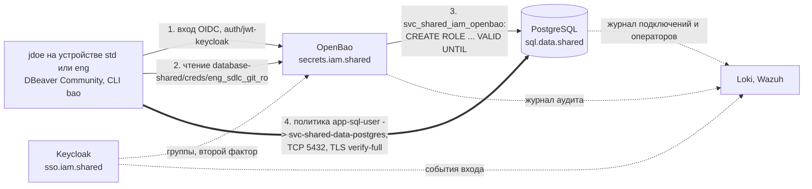

[English](README.md) | **Русский** | [简体中文](README.zh-CN.md)

# Типовая архитектура: data-sql-access

Доступ людей к PostgreSQL в mess.systems. Человек входит в OpenBao через Keycloak, получает временного пользователя базы данных с коротким сроком жизни и подключается через сеть NetBird с проверкой TLS. Каждый оператор связывается с человеком по трём журналам. Эта типовая архитектура фиксирует путь запроса, имена, аутентификацию и учётные данные, права, сеть, TLS, аудит, развёртывание, известные проблемы, альтернативы и открытые вопросы.

**Статус:** черновик, развивается. Создано 2026-10-31. Перевод информативный; нормативный текст [английский](README.md). Все конфигурации — примеры с вымышленными именами в домене `mess.systems`, а не работающая система.

**Коды возможностей.** База данных — `sql` в домене `data` [стандарта именования](https://github.com/mess-systems/naming-standard/blob/main/i18n/ru/01-naming-conventions.md#43-коды-возможностей-уникальны-во-всех-доменах), имя сервиса `sql.data.shared`. Хранилище секретов, которое выдаёт учётные данные и сертификаты, — `secrets` (домен `iam`), поставщик идентичностей — `sso` (домен `iam`), сеть — `mesh` (домен `net`), журналы — `logs` (домен `obs`), SIEM — `siem` (домен `sec`).

## 1. Границы

| Входит | Не входит |
|---|---|
| Интерактивный доступ людей к базам PostgreSQL: вход, временные пользователи, права | Доступ приложений к своим базам: статические пользователи приложений `svc_<plane>_<domain>_<product>` |
| Политики сети и правила межсетевого экрана хоста для TCP 5432 | Сама сеть: см. типовую архитектуру [`net-mesh`](../net-mesh/) |
| Серверные сертификаты и настройки TLS клиента | Внутренний УЦ в целом: возможность `pki` |
| Цепочка атрибуции от строки журнала базы до входа человека | Хранение журналов и сроки хранения: возможности `logs` и `siem` |
| Порядок изменений и матрица проверок | Базовая конфигурация устройств и CLI `bao` на них: см. типовую архитектуру [`endpoint`](../endpoint/) |

## 2. Состав

| Часть | Роль | Продукт | Радар |
|---|---|---|---|
| Поставщик идентичностей | Вход людей со вторым фактором, утверждение (claim) с группами | Keycloak | [Adopt](https://github.com/mess-systems/tech-radar/blob/main/technologies/keycloak.md) |
| Протокол входа | Вход людей в OpenBao | OpenID Connect | [Adopt](https://github.com/mess-systems/tech-radar/blob/main/technologies/oidc.md) (спецификация) |
| Секреты | Метод аутентификации JWT/OIDC, механизм секретов баз данных, PKI для серверных сертификатов, журнал аудита | OpenBao | [Adopt](https://github.com/mess-systems/tech-radar/blob/main/technologies/openbao.md) |
| Сеть | Политики от группы к группе, раздельный DNS для `svc.mess.systems` | NetBird | [Adopt](https://github.com/mess-systems/tech-radar/blob/main/technologies/netbird.md) |
| Туннель | Шифрованный транспорт между узлами | WireGuard (внутри NetBird) | [Adopt](https://github.com/mess-systems/tech-radar/blob/main/technologies/wireguard.md) |
| База данных | Групповые роли, временные пользователи, журналы подключений и операторов | PostgreSQL | [Adopt](https://github.com/mess-systems/tech-radar/blob/main/technologies/postgresql.md) |
| Межсетевой экран хоста | Правила вне сети | nftables | [Adopt](https://github.com/mess-systems/tech-radar/blob/main/technologies/nftables.md) |
| Клиент базы данных | Настольный клиент людей | DBeaver Community | [Adopt](https://github.com/mess-systems/tech-radar/blob/main/technologies/dbeaver.md) |
| Доступ как код | Роли и политики OpenBao, политики сети | OpenTofu | [Adopt](https://github.com/mess-systems/tech-radar/blob/main/technologies/opentofu.md) |
| Конфигурация хостов | Настройки PostgreSQL, групповые роли, межсетевой экран хоста | Ansible | [Adopt](https://github.com/mess-systems/tech-radar/blob/main/technologies/ansible.md) |
| Ревью | Репозитории кода выше, pull request | Forgejo | [Adopt](https://github.com/mess-systems/tech-radar/blob/main/technologies/forgejo.md) |
| Журналы и SIEM | Центральное хранилище трёх журналов, корреляция | Loki, Wazuh | [Loki](https://github.com/mess-systems/tech-radar/blob/main/technologies/loki.md), [Wazuh](https://github.com/mess-systems/tech-radar/blob/main/technologies/wazuh.md): Adopt |

## 3. Путь запроса



1. **Вход.** Человек входит в OpenBao командой `bao login -method=oidc` через точку монтирования `auth/jwt-keycloak`. Keycloak запрашивает второй фактор и помещает группы в токен.
2. **Учётные данные.** Человек читает `database-shared/creds/eng_sdlc_git_ro`. OpenBao создаёт временного пользователя и возвращает его имя и пароль.
3. **Временный пользователь.** OpenBao подключается к PostgreSQL как `svc_shared_iam_openbao` и создаёт пользователя членом групповой роли `eng_sdlc_git_ro` с атрибутом `NOLOGIN`. По окончании аренды (lease) OpenBao завершает сеансы пользователя и удаляет его.
4. **Подключение.** Клиент подключается по имени сервиса `sql.data.shared.svc.mess.systems` через сеть. TCP 5432 открывает только политика от группы человека к группе узлов базы.

Имя, устройство или сетевое расположение доступа не дают: доступ дают группа Keycloak, политика OpenBao и права роли в базе (принцип I3 [соглашений об идентичностях](https://github.com/mess-systems/naming-standard/blob/main/i18n/ru/04-identity-conventions.md#1-применяемые-принципы)).

## 4. Имена

У каждого имени ниже есть форма в стандарте именования. Имён без формы нет.

| Объект | Имя | Правило |
|---|---|---|
| Кластер PostgreSQL, внутреннее имя | `sql.data.shared.svc.mess.systems` | [Грамматика A: внутренняя](https://github.com/mess-systems/naming-standard/blob/main/i18n/ru/01-naming-conventions.md#31-грамматика-a-внутренняя) |
| Приложение кластера, `service_name` в Loki | `shared-data-postgres` | [Объекты PostgreSQL](https://github.com/mess-systems/naming-standard/blob/main/i18n/ru/08-operations-objects.md#7-объекты-postgresql), [формы объектов](https://github.com/mess-systems/naming-standard/blob/main/i18n/ru/01-naming-conventions.md#5-формы-объектов) |
| Хост кластера | `dc1-shared-data-postgres-prd-01` | [Формы объектов](https://github.com/mess-systems/naming-standard/blob/main/i18n/ru/01-naming-conventions.md#5-формы-объектов) |
| База в примерах | `eng_sdlc_git_prd` (база git-сервера) | [Объекты PostgreSQL](https://github.com/mess-systems/naming-standard/blob/main/i18n/ru/08-operations-objects.md#7-объекты-postgresql) |
| Групповые роли базы | `eng_sdlc_git_ro`, `eng_sdlc_git_rw`, `eng_sdlc_git_owner` | [Роли баз данных](https://github.com/mess-systems/naming-standard/blob/main/i18n/ru/04-identity-conventions.md#11-роли-баз-данных) |
| Служебная учётная запись OpenBao в PostgreSQL | `svc_shared_iam_openbao` | [Роли баз данных](https://github.com/mess-systems/naming-standard/blob/main/i18n/ru/04-identity-conventions.md#11-роли-баз-данных) |
| Локальный аварийный администратор | роль базы `breakglass_sql`, учётная запись `breakglass-sql-01` | [Роли баз данных](https://github.com/mess-systems/naming-standard/blob/main/i18n/ru/04-identity-conventions.md#11-роли-баз-данных), [виды идентичностей](https://github.com/mess-systems/naming-standard/blob/main/i18n/ru/04-identity-conventions.md#2-виды-идентичностей) |
| Временный пользователь | `v_<auth>_<identity>_<role>_<ts>_<rand6>`, например `v_oidc_jdoe_eng_sdlc_git_ro_20261031t020000z_k7m2qa` | [Временные пользователи баз данных](https://github.com/mess-systems/naming-standard/blob/main/i18n/ru/04-identity-conventions.md#111-временные-пользователи-баз-данных) |
| Группы Keycloak | чтение `app-sql-user`, запись `app-sql-editor` (по умолчанию выключена), администрирование `tier-t1-platform-ops` | [Группы приложений](https://github.com/mess-systems/naming-standard/blob/main/i18n/ru/04-identity-conventions.md#33-группы-приложений-доступ-к-одной-возможности), [группы](https://github.com/mess-systems/naming-standard/blob/main/i18n/ru/04-identity-conventions.md#3-группы) |
| OpenBao | `secrets.iam.shared.svc.mess.systems`, приложение `shared-iam-openbao` | [Соглашения о секретах](https://github.com/mess-systems/naming-standard/blob/main/i18n/ru/03-secrets-conventions.md), [формы объектов](https://github.com/mess-systems/naming-standard/blob/main/i18n/ru/01-naming-conventions.md#5-формы-объектов) |
| Точка монтирования аутентификации и роль входа | `auth/jwt-keycloak`, роль `app-sql-user` | [Точки монтирования](https://github.com/mess-systems/naming-standard/blob/main/i18n/ru/03-secrets-conventions.md#2-точки-монтирования), [роли аутентификации и токены](https://github.com/mess-systems/naming-standard/blob/main/i18n/ru/03-secrets-conventions.md#6-роли-аутентификации-и-токены) |
| Политика OpenBao | `app-sql-user` | [Политики](https://github.com/mess-systems/naming-standard/blob/main/i18n/ru/03-secrets-conventions.md#5-политики) |
| Механизм секретов баз данных | точка монтирования `database-shared/`, подключение `shared-data-postgres`, роль `eng_sdlc_git_ro` | [Механизмы, отличные от kv](https://github.com/mess-systems/naming-standard/blob/main/i18n/ru/03-secrets-conventions.md#21-механизмы-отличные-от-kv) |
| PKI | точка монтирования `pki-int/`, издатель `mess-systems-int-2026`, роль выпуска `data-shared` | [Механизмы, отличные от kv](https://github.com/mess-systems/naming-standard/blob/main/i18n/ru/03-secrets-conventions.md#21-механизмы-отличные-от-kv) |
| Клиент OpenBao в Keycloak | приложение `shared-iam-openbao`, провайдер `shared-iam-openbao-oidc`, маппер `shared-iam-openbao-groups` | [Объекты IdP](https://github.com/mess-systems/naming-standard/blob/main/i18n/ru/04-identity-conventions.md#6-объекты-idp) |
| Keycloak | `sso.iam.shared.svc.mess.systems`, realm `mess-systems`; публичное исключение `sso.mess.systems` | [Разобранные примеры кодирования](https://github.com/mess-systems/naming-standard/blob/main/i18n/ru/01-naming-conventions.md#11-разобранные-примеры-кодирования), [объекты IdP](https://github.com/mess-systems/naming-standard/blob/main/i18n/ru/04-identity-conventions.md#6-объекты-idp) |
| Группы узлов сервисов в сети | `svc-shared-data-postgres`, `svc-shared-iam-openbao` | [Группы mesh VPN](https://github.com/mess-systems/naming-standard/blob/main/i18n/ru/04-identity-conventions.md#4-группы-mesh-vpn) |
| Политики, правило и проверка состояния сети | `app-sql-user -> svc-shared-data-postgres`, правило `postgresql`, `posture-client-current` | [Политики, правила и проверки состояния mesh](https://github.com/mess-systems/naming-standard/blob/main/i18n/ru/04-identity-conventions.md#41-политики-правила-и-проверки-состояния-mesh) |
| Группа DNS-серверов сети | `svc-mess-systems-dc1` (зона `svc.mess.systems`) | [DNS в mesh](https://github.com/mess-systems/naming-standard/blob/main/i18n/ru/04-identity-conventions.md#43-dns-в-mesh) |
| Снимок перед изменением | `shared-data-postgres-prd-20261031t020000z` | [Резервные копии и снимки](https://github.com/mess-systems/naming-standard/blob/main/i18n/ru/08-operations-objects.md#3-резервные-копии-и-снимки) |
| Человек в примерах | `jdoe`, учётная запись администратора `jdoe-adm` | [Виды идентичностей](https://github.com/mess-systems/naming-standard/blob/main/i18n/ru/04-identity-conventions.md#2-виды-идентичностей) |

## 5. Аутентификация и учётные данные

### 5.1 Требования

1. **Люди входят только через поставщика идентичностей.** У человека никогда нет статического пароля к базе. Статические пользователи есть только у приложений и у аварийного доступа.
2. **Каждый сеанс человека в базе принадлежит одному временному пользователю.** Пользователь создаётся в момент запроса, содержит идентификатор человека в имени и истекает сам.
3. **Служебная учётная запись OpenBao может выдать роль, но не может ею воспользоваться.** Она создаёт и удаляет временных пользователей и никогда не используется для чтения или изменения данных.
4. **Время в имени указано в UTC.** Время выдачи `<ts>` совпадает со временем записи в журнале аудита OpenBao; см. 5.3.
5. **Действующий доступ — это пересечение трёх слоёв:** группа Keycloak, политика OpenBao и права групповой роли в базе. Изменение одного слоя не расширяет доступ без ревью двух других.

### 5.2 Выдача

1. Роль входа `app-sql-user` на `auth/jwt-keycloak`: `bound_claims` на группу Keycloak с тем же идентификатором, `user_claim = preferred_username`, TTL токена 8 часов ([роли аутентификации и токены](https://github.com/mess-systems/naming-standard/blob/main/i18n/ru/03-secrets-conventions.md#6-роли-аутентификации-и-токены)).
2. Политика `app-sql-user` разрешает только `read` на `database-shared/creds/eng_sdlc_git_ro`. Прав на `database-shared/config/*`, `database-shared/roles/*`, `database-shared/rotate-root/*` и `sys/leases/*` у неё нет.
3. Служебная учётная запись `svc_shared_iam_openbao`: `LOGIN CREATEROLE NOSUPERUSER NOCREATEDB NOREPLICATION NOBYPASSRLS`. На каждую групповую роль она получает `GRANT eng_sdlc_git_ro TO svc_shared_iam_openbao WITH ADMIN TRUE, INHERIT FALSE, SET FALSE` (PostgreSQL 16 и новее): может выдать роль, но не может действовать от её имени. Она входит в `pg_signal_backend`, чтобы завершать сеансы, и не владеет объектами баз.
4. Операторы создания для роли `eng_sdlc_git_ro`:

   ```sql
   CREATE ROLE "{{name}}" WITH LOGIN PASSWORD '{{password}}' VALID UNTIL '{{expiration}}';
   GRANT eng_sdlc_git_ro TO "{{name}}";
   ```

   Операторы отзыва:

   ```sql
   SELECT pg_terminate_backend(pid) FROM pg_stat_activity WHERE usename = '{{name}}';
   DROP ROLE IF EXISTS "{{name}}";
   ```

5. Имя пользователя: форма [временных пользователей баз данных](https://github.com/mess-systems/naming-standard/blob/main/i18n/ru/04-identity-conventions.md#111-временные-пользователи-баз-данных), задаётся в `username_template` подключения `shared-data-postgres`.
6. Срок жизни: `default_ttl = 8h`, `max_ttl = 24h`. По окончании аренды OpenBao выполняет операторы отзыва. `VALID UNTIL` отклоняет новый вход, даже если OpenBao ещё не отозвал пользователя.
7. Ротация: `rotate-root` для `svc_shared_iam_openbao` выполняется отдельным шагом после проверки выдачи, учётной записью `jdoe-adm` с устройства `paw` или конвейером. После этого пароль знает только OpenBao; для аварий остаётся `breakglass-sql-01` (принцип I6 [соглашений об идентичностях](https://github.com/mess-systems/naming-standard/blob/main/i18n/ru/04-identity-conventions.md#1-применяемые-принципы)).

### 5.3 Время выдачи

OpenBao вычисляет функцию шаблона `timestamp` в локальном часовом поясе своего процесса, а записи аудита пишет в UTC. На хосте с поясом, отличным от UTC, суффикс `z` в `<ts>` становится ложным, и строка журнала указывает не на тот час.

1. OpenBao работает с переменной окружения `TZ=UTC`: drop-in systemd или окружение контейнера ([`examples/openbao-tz-utc.example.conf`](examples/openbao-tz-utc.example.conf)). Настройка не зависит от пояса хоста и от наличия данных о часовых поясах в образе.
2. PostgreSQL пишет журнал в UTC: `log_timezone = 'UTC'`, а `log_line_prefix` начинается с `%m`, где указан пояс.
3. Хосты трёх систем синхронизируют часы по NTP. Время сужает поиск; доказательство — цепочка идентификаторов в [аудите](#9-аудит).
4. Проверка после каждой смены хоста или образа OpenBao: выдать пользователя и сравнить `<ts>` в его имени с полем `time` записи аудита о выдаче. Разница составляет секунды, а не часы.

## 6. Права

| Слой | Отвечает на вопрос | Где | Пример |
|---|---|---|---|
| Группа Keycloak | кто | Keycloak, OpenTofu | `app-sql-user` |
| Роль входа и политика OpenBao | какой путь выдаёт учётные данные | OpenBao, OpenTofu | роль и политика `app-sql-user` → `database-shared/creds/eng_sdlc_git_ro` |
| Права групповой роли в базе | что можно делать в базе | PostgreSQL, Ansible или миграции | `GRANT SELECT` на таблицы схем `eng_sdlc_git_prd` для `eng_sdlc_git_ro` |

- **По умолчанию только чтение.** У роли `eng_sdlc_git_ro` есть только `SELECT`. Она не владеет схемами и не имеет `CREATE` ни в одной схеме.
- **Запись по умолчанию выключена.** Роли `database-shared/roles/eng_sdlc_git_rw` нет. Включение записи — одно изменение в коде из трёх частей: группа Keycloak `app-sql-editor`; роль входа и политика с тем же идентификатором, которые разрешают только `read` на `database-shared/creds/eng_sdlc_git_rw`; права `eng_sdlc_git_rw` на перечисленные схемы (`SELECT, INSERT, UPDATE, DELETE`, без `TRUNCATE`, без DDL). Права на всю базу или на всю схему `public` не выдаются.
- **DDL выполняется через конвейер** от роли `<…>_owner`, никогда от временного пользователя.
- **Удаление базы.** `DROP DATABASE` разрешён только владельцу (`eng_sdlc_git_owner`) и суперпользователю. Ни `ro`, ни `rw` к ним не относятся. От удаления строк под `rw` защищают узкие права на схемы и снимок перед изменением.
- **Администрирование.** `tier-t1-platform-ops` достигает кластера только с устройств `paw` через политику сети с проверкой состояния; администрирование базы тоже идёт через временного пользователя своей роли.

## 7. Сеть

- **Политики.** Политики сети односторонние, правило `postgresql` (TCP 5432), описаны в OpenTofu ([`examples/opentofu-netbird-sql.example.tf`](examples/opentofu-netbird-sql.example.tf)):
  - `svc-shared-iam-openbao -> svc-shared-data-postgres`;
  - `app-sql-user -> svc-shared-data-postgres`;
  - `tier-t1-platform-ops -> svc-shared-data-postgres` с проверкой состояния `posture-client-current`.

  Группа All никогда не бывает ни источником, ни назначением ([группы и политики](../net-mesh/README.ru.md#6-группы-и-политики) в `net-mesh`).
- **OpenBao — отдельный узел сети** в `svc-shared-iam-openbao`, а не сервис за маршрутизирующим узлом. За `router-dc1` с маскарадингом PostgreSQL видел бы адрес маршрутизатора, и `pg_hba.conf` не смог бы привязаться к источнику ([подключение узлов](../net-mesh/README.ru.md#7-подключение-узлов) в `net-mesh`).
- **Имена.** Клиент использует `sql.data.shared.svc.mess.systems`, которое разрешается в частной зоне через группу DNS-серверов `svc-mess-systems-dc1`. Имена и адреса узлов сети в настройках клиента не используются.
- **Межсетевой экран хоста.** Таблица хоста на `dc1-shared-data-postgres-prd-01` (nftables, роль Ansible) фильтрует только LAN и прямой порт WireGuard; трафик интерфейса сети фильтруют политики сети ([межсетевой экран хоста](../net-mesh/README.ru.md#8-межсетевой-экран-хоста) в `net-mesh`). Таблица разрешает TCP 5432 из LAN только перечисленным в ней сборщикам площадки. Пример: [`net-mesh/examples/nftables-hostfw.example.nft`](../net-mesh/examples/nftables-hostfw.example.nft).
- **Блокировка входящих.** Узел базы подключается к сети с `--block-inbound`. Блокировка снимается только после применения таблицы хоста и прохождения строк матрицы для LAN ([порядок изменений](#101-порядок-изменений)).
- **Адреса прослушивания.** PostgreSQL слушает адрес в LAN и интерфейс сети; `pg_hba.conf` задаёт правила по роли и источнику.
- **Сборщики площадки** журналов и метрик не зависят ни от сети, ни от интернета.

## 8. TLS

1. Серверный сертификат выпускает PKI OpenBao: точка монтирования `pki-int/`, издатель `mess-systems-int-2026`, роль выпуска `data-shared`. Одна роль на зону `data.shared.svc.mess.systems`: `allowed_domains` равно зоне, `allow_subdomains = true`, `allow_bare_domains = false`, `allow_wildcard_certificates = false`, `allow_ip_sans = false`. SAN сертификата только `sql.data.shared.svc.mess.systems`.
2. Сервер: в `pg_hba.conf` только строки `hostssl`; `hostnossl` для всех — `reject` ([`examples/pg-hba.example.conf`](examples/pg-hba.example.conf)).
3. Клиент: `sslmode=verify-full`, `sslrootcert` — цепочка корневого УЦ mess.systems, которую доставляет профиль `endpoint`. Режимы `require` и `verify-ca` не допускаются: они не проверяют имя.

## 9. Аудит

Кто что сделал, доказывает цепочка из трёх журналов:

| Шаг | Журнал | Показывает | Связь со следующим шагом |
|---|---|---|---|
| 1 | PostgreSQL | Временный пользователь, оператор, время, сеанс | Имя пользователя |
| 2 | Аудит OpenBao | Кто и когда получил этого пользователя: аренда на `database-shared/creds/eng_sdlc_git_ro`, сущность и псевдоним `jdoe` | ID сущности и сеанс IdP |
| 3 | События Keycloak | Вход `jdoe` со вторым фактором | — |

Требования:

1. У OpenBao есть хотя бы одно устройство аудита (`bao audit list` не пуст); рекомендуются два, чтобы отказ одного не останавливал OpenBao. На точке монтирования `database-shared/` ключ `username` исключён из HMAC: `bao secrets tune -audit-non-hmac-response-keys=username database-shared/`. Иначе имя в журнале хешируется, и найти его можно только через `sys/audit-hash`.
2. PostgreSQL: `log_connections = on`, `log_disconnections = on`, `log_statement = 'ddl'` или pgaudit (`pgaudit.log = 'ddl, role'`), `log_timezone = 'UTC'`, а `log_line_prefix` содержит время, пользователя, базу, адрес клиента и ID сеанса (`%m %u %d %r %c`) ([`examples/postgresql-logging.example.conf`](examples/postgresql-logging.example.conf)).
3. Keycloak хранит события входа и события администрирования.
4. Три журнала попадают в Loki (`service_name` = `shared-data-postgres`, `shared-iam-openbao`, `shared-iam-keycloak`) и в Wazuh. Срок хранения не меньше срока расследования инцидента.
5. Если одно звено отсутствует, атрибуция держится только на имени пользователя. Имя формирует OpenBao, но без журналов это утверждение нельзя подтвердить. Такое развёртывание не соответствует этой типовой архитектуре.

## 10. Развёртывание

- **Как код.** Группы Keycloak, роли аутентификации, политики, подключения и роли баз в OpenBao, роли PKI и политики сети описаны в OpenTofu; настройки PostgreSQL, групповые роли и таблица хоста описаны в Ansible. Изменения проходят ревью в Forgejo.
- **Привилегированные шаги.** Применение планов, применение роли Ansible на хосте базы и `rotate-root` выполняются учётной записью `-adm` с устройства `paw` ([пути запросов](../net-mesh/README.ru.md#4-пути-запросов) в `net-mesh`) или конвейером после слияния.
- **Ручное изменение переносится в код.** Изменение, сделанное в консоли или на хосте, переносится в OpenTofu или Ansible в том же изменении, иначе следующее применение его откатит. Объект, который код перезаписывает целиком, описывается полной копией живого объекта; для клиента `shared-iam-openbao-oidc` — это адреса перенаправления, аудитории и маппер `shared-iam-openbao-groups`. Сначала живой объект импортируется, и план без изменений подтверждает описание.
- **Временные послабления.** Послабление оформляется задачей в Forgejo с группой-владельцем ([владельцы](https://github.com/mess-systems/naming-standard/blob/main/i18n/ru/04-identity-conventions.md#5-владельцы)), сроком и условием отмены. Изменение не завершено, пока у него есть открытые послабления.
- **Периметры организаций.** У одного периметра организации свои установки Keycloak, OpenBao и сети ([периметры организаций](../net-mesh/README.ru.md#10-периметры-организаций) в `net-mesh`). Политик между периметрами нет, и учётные данные одного периметра никогда не выдаются в другом.

### 10.1 Порядок изменений

| # | Шаг | Где |
|---|---|---|
| 1 | Цель, откат для каждого шага, задача в Forgejo | ревью |
| 2 | Доступ к каждому затронутому хосту и API проверен до начала работ; отсутствие доступа останавливает работу | `eng` |
| 3 | Роль Ansible с таблицей хоста и настройками PostgreSQL, план OpenTofu для OpenBao и политик сети; ревью | `eng`, Forgejo |
| 4 | Снимок `shared-data-postgres-prd-<ts>`; применение таблицы хоста; запись `nft list ruleset`; строки матрицы для LAN | `paw` или конвейер |
| 5 | Применение OpenBao и политик сети; снятие `--block-inbound`; полная матрица; повторный `nft list ruleset` после перезапуска клиента NetBird | `paw` или конвейер |
| 6 | `rotate-root`; повторная проверка выдачи | `paw` или конвейер |
| 7 | Код совпадает с живым состоянием; послабления записаны; приёмка или откат | ревью |

### 10.2 Матрица проверок

Каждый шаг, меняющий доступ, проверяется по матрице. В каждой строке указано правило nftables, политика сети или право в базе, которое дало результат.

| Источник | Цель | Действие | Ожидание | Доказательство |
|---|---|---|---|---|
| `svc-shared-iam-openbao` | `svc-shared-data-postgres` | TCP 5432 | разрешено | политика сети |
| `app-sql-user` | `svc-shared-data-postgres` | TCP 5432 | разрешено | политика сети |
| `tier-t1-platform-ops` с `paw` | `svc-shared-data-postgres` | TCP 5432 | разрешено | политика сети с проверкой состояния |
| `role-developers` без `app-sql-user` | `svc-shared-data-postgres` | TCP 5432 | запрещено | нет политики |
| `svc-shared-data-postgres` | `svc-shared-iam-openbao` | любой порт | запрещено | односторонняя политика |
| Сборщик площадки из списка разрешённых | хост базы через LAN | TCP 5432 | разрешено | правило таблицы хоста |
| Хост LAN вне списка | хост базы через LAN | TCP 5432 | запрещено | политика drop цепочки |
| `jdoe` в `app-sql-user` | OpenBao | `bao read database-shared/creds/eng_sdlc_git_ro` | выдано | журнал аудита OpenBao |
| Пользователь вне группы | OpenBao | то же | запрещено (403) | политика OpenBao |
| `jdoe` в `app-sql-user` | OpenBao | `bao read database-shared/creds/eng_sdlc_git_rw` | запрещено (403): запись выключена | политика OpenBao |
| Временный пользователь `ro` | `eng_sdlc_git_prd` | `CREATE TABLE` | запрещено (`permission denied`) | права роли |
| Временный пользователь `ro` | `eng_sdlc_git_prd` | `DROP DATABASE eng_sdlc_git_prd` | запрещено (`must be owner`) | права роли |
| `svc_shared_iam_openbao` | `eng_sdlc_git_prd` | `CREATE TABLE`, `SELECT` из таблиц | запрещено | права учётной записи |
| Временный пользователь после TTL | `sql.data.shared` | вход | запрещено | `DROP ROLE` в журнале |
| Временный пользователь | его имя | длина и форма [временных пользователей баз данных](https://github.com/mess-systems/naming-standard/blob/main/i18n/ru/04-identity-conventions.md#111-временные-пользователи-баз-данных) | не больше 63, содержит `oidc`, `jdoe`, роль | `pg_roles` |
| Временный пользователь | `<ts>` в его имени | сравнение с `time` записи аудита о выдаче | разница в секундах, не в часах | запись аудита, `TZ=UTC` в окружении OpenBao |
| Клиент, `sslmode=verify-full` | `sql.data.shared.svc.mess.systems` | вход | разрешено, TLS | `pg_stat_ssl` |
| Клиент, `sslmode=verify-full` | хост базы по имени или адресу узла сети | вход | запрещено: имя не совпадает с сертификатом | ошибка клиента |
| Клиент, `sslmode=disable` | `sql.data.shared.svc.mess.systems` | вход | запрещено | строка `hostnossl … reject` |
| Администратор | `pki-int/issue/data-shared` | выпуск `*.data.shared.svc.mess.systems`, `data.shared.svc.mess.systems`, имени вне зоны | запрещено | настройки роли PKI |
| Администратор | OpenBao | `bao audit list` | хотя бы одно устройство | вывод команды |
| Администратор | журнал аудита OpenBao | поиск выдачи по имени временного пользователя | найдено, `username` не хеширован | запись аудита |
| Администратор | Loki и Wazuh | поиск отказа `CREATE TABLE` по имени временного пользователя | найдено в обоих | запрос Loki, событие Wazuh |
| Администратор | события Keycloak | вход `jdoe` во время выдачи | найдено, второй фактор пройден | событие входа |

## 11. Известные проблемы

**Клиент сети вставляет свои правила.** Клиент NetBird держит собственную таблицу nftables, вставляет правило accept для своего интерфейса в чужие базовые цепочки с хуками input и forward и восстанавливает его при изменении таблиц. Удаление этого правила скриптом оставляет окно до следующего восстановления. Поэтому таблица хоста не фильтрует интерфейс сети, а политики сети являются критичным средством контроля: они описаны в коде и входят в матрицу.

**`--block-inbound` и порядок изменений.** Снятие блокировки входящих до применения таблицы хоста открывает базу всем узлам, которых пропускает политика, без фильтра LAN. Порядок из раздела [порядок изменений](#101-порядок-изменений) обязателен.

**Токен в окружении.** Устаревший токен в `BAO_TOKEN` или `VAULT_TOKEN` имеет приоритет над помощником токенов (token helper) CLI `bao` и вызывает ошибки 403, похожие на отсутствие прав. Перед разбором прав переменную нужно очистить.

**В DBeaver Community нет интеграции с менеджерами секретов.** Человек вставляет выданные имя пользователя и пароль в настройки подключения. Платные редакции DBeaver (Lite, Enterprise, Ultimate) читают параметры подключения из хранилища, совместимого с Vault; чтение ими динамических учётных данных механизма баз данных OpenBao не подтверждено. DataGrip читает их через сторонний плагин.

**Часовой пояс процесса OpenBao.** Без `TZ=UTC` время в имени пользователя следует поясу хоста, см. [время выдачи](#53-время-выдачи).

**Хешированное имя пользователя в журнале аудита.** Без `-audit-non-hmac-response-keys=username` имя в журнале аудита OpenBao записано как HMAC, и прямой поиск по нему невозможен.

## 12. Рассмотренные альтернативы

| Вариант | Радар | Почему не сейчас |
|---|---|---|
| Teleport | [Hold](https://github.com/mess-systems/tech-radar/blob/main/technologies/teleport.md) | Радар откладывает новое внедрение; ещё один прокси со своей моделью учётных записей |
| Pomerium | [Trial](https://github.com/mess-systems/tech-radar/blob/main/technologies/pomerium.md) | Контекстный доступ к HTTP-приложениям; для TCP к базе добавляет второй путь рядом с NetBird |
| StrongDM | [Hold](https://github.com/mess-systems/tech-radar/blob/main/technologies/strongdm.md) | Управляющий слой — сервис, размещённый у поставщика: пользователи, политики и журналы доступа покидают периметр организации |
| DataGrip, платные редакции DBeaver | [DataGrip Assess](https://github.com/mess-systems/tech-radar/blob/main/technologies/datagrip.md), [DBeaver](https://github.com/mess-systems/tech-radar/blob/main/technologies/dbeaver.md) | Коммерческие лицензии; совместимы с этой схемой, вариант на будущее |
| SPIFFE / SPIRE | [SPIFFE Adopt](https://github.com/mess-systems/tech-radar/blob/main/technologies/spiffe.md), [SPIRE Trial](https://github.com/mess-systems/tech-radar/blob/main/technologies/spire.md) | Доступ сервисов к сервисам (`auth/jwt-spire`), а не доступ людей |
| Статические личные пользователи базы | — | Долгоживущие пароли, нет срока действия, нет связи со входом со вторым фактором |

**Решение.** Keycloak, OpenBao и NetBird: все три находятся в кольце Adopt и уже работают в общей плоскости, поэтому схема не добавляет новых серверных компонентов. SPIRE рассматривается позже для доступа сервисов к сервисам.

## 13. Примеры

| Файл | Показывает |
|---|---|
| [`examples/opentofu-openbao-sql.example.tf`](examples/opentofu-openbao-sql.example.tf) | Роль входа JWT/OIDC с привязкой к группе Keycloak, политика только на чтение, механизм секретов баз данных с подключением, шаблоном имени пользователя и ролью чтения, роль выпуска PKI для зоны |
| [`examples/opentofu-netbird-sql.example.tf`](examples/opentofu-netbird-sql.example.tf) | Односторонние политики сети к группе узлов базы на TCP 5432, проверка состояния на пути администратора |
| [`examples/postgresql-roles.example.sql`](examples/postgresql-roles.example.sql) | Групповые роли, права на чтение, служебная учётная запись OpenBao, которая может выдать роль, но не может ею воспользоваться |
| [`examples/pg-hba.example.conf`](examples/pg-hba.example.conf) | Правила доступа только по TLS, `hostnossl` отклоняется |
| [`examples/postgresql-logging.example.conf`](examples/postgresql-logging.example.conf) | Журнал подключений и операторов в UTC, префикс строки журнала |
| [`examples/openbao-tz-utc.example.conf`](examples/openbao-tz-utc.example.conf) | `TZ=UTC` для процесса OpenBao как drop-in systemd и как настройка контейнера |

Файлы OpenTofu проходят `tofu validate`. Пример межсетевого экрана хоста общий с `net-mesh`.

## 14. Открытые вопросы

1. Значения TTL (8 часов, не больше 24 часов) — отправная точка; их нужно подстроить под реальные сеансы.
2. Запись по базам: `app-sql-editor` — одна группа на всю возможность `sql`. В стандарте именования нет формы группы с базой или схемой; она понадобится, если запись нужно разделить по базам.
3. Стандарт именования указывает, что `<ts>` в UTC, но не требует `TZ=UTC` для OpenBao. Изменение раздела о временных пользователях баз данных предлагается отдельно.
4. Служба времени: в стандарте именования нет кода возможности для NTP, а в радаре нет записи для демона времени.
5. pgaudit вместо `log_statement = 'ddl'`: аудит на уровне объектов нужен, когда в базах появятся персональные данные, и тогда литералы операторов попадают в журнал.

## Источники

- OpenBao, механизм секретов баз данных: https://openbao.org/docs/secrets/databases/
- OpenBao, плагин баз данных PostgreSQL: https://openbao.org/docs/secrets/databases/postgresql/
- OpenBao, шаблоны имён пользователей: https://openbao.org/docs/concepts/username-templating/
- OpenBao, метод аутентификации JWT/OIDC: https://openbao.org/docs/auth/jwt/
- OpenBao, механизм секретов PKI: https://openbao.org/docs/secrets/pki/
- OpenBao, устройства аудита: https://openbao.org/docs/audit/
- Исходный код OpenBao, функция шаблона `timestamp` (локальное время) и время аудита (UTC): https://github.com/openbao/openbao/blob/main/sdk/helper/template/funcs.go, https://github.com/openbao/openbao/blob/main/internal/audit/format.go
- Go, `time.Local` и переменная `TZ`: https://pkg.go.dev/time#Location
- PostgreSQL, `CREATE ROLE` и `VALID UNTIL`: https://www.postgresql.org/docs/current/sql-createrole.html
- PostgreSQL, `GRANT` с параметрами `ADMIN`, `INHERIT` и `SET`: https://www.postgresql.org/docs/current/sql-grant.html
- PostgreSQL, сообщения об ошибках и журналирование: https://www.postgresql.org/docs/current/runtime-config-logging.html
- PostgreSQL, `pg_hba.conf`: https://www.postgresql.org/docs/current/auth-pg-hba-conf.html
- PostgreSQL, поддержка SSL и `sslmode`: https://www.postgresql.org/docs/current/libpq-ssl.html
- pgaudit: https://github.com/pgaudit/pgaudit
- NetBird, управление доступом и политики: https://docs.netbird.io/manage/access-control
- Клиент NetBird, менеджер nftables: https://github.com/netbirdio/netbird/tree/main/client/firewall/nftables
- DBeaver, управление секретами (платные редакции): https://dbeaver.com/docs/dbeaver/Secret-Providers/
- datagrip-vault-plugin: https://github.com/premium-minds/datagrip-vault-plugin
- Стандарт именования mess.systems: https://github.com/mess-systems/naming-standard/blob/main/README.ru.md
- Технологический радар mess.systems: https://github.com/mess-systems/tech-radar
