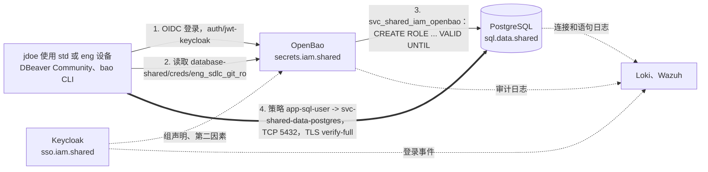

[English](README.md) | [Русский](README.ru.md) | **简体中文**

# 参考架构：data-sql-access

mess.systems 中人员对 PostgreSQL 的访问。人员通过 Keycloak 登录 OpenBao，获得一个短期有效的临时数据库用户，并通过 NetBird 网状网络以校验过的 TLS 连接。每条语句都可以通过三份日志追溯到具体人员。本参考架构规定请求路径、名称、认证与凭据、权限、网络、TLS、审计、部署、已知问题、备选方案和未决问题。

**状态：** 草稿，持续演进。创建于 2026-10-31。译文仅供参考；规范文本为[英文版](README.md)。所有配置都是使用 `mess.systems` 下虚构名称的示例，不是运行中的系统。

**能力代码。** 数据库是[命名标准](https://github.com/mess-systems/naming-standard/blob/main/i18n/zh-CN/01-naming-conventions.md#43-能力代码在所有域中唯一)中域 `data` 下的 `sql`，服务名 `sql.data.shared`。签发凭据和证书的密钥库是 `secrets`（域 `iam`），身份提供方是 `sso`（域 `iam`），网状网络是 `mesh`（域 `net`），日志是 `logs`（域 `obs`），SIEM 是 `siem`（域 `sec`）。

## 1. 范围

| 包含 | 不包含 |
|---|---|
| 人员对 PostgreSQL 数据库的交互式访问：登录、临时用户、权限 | 应用对自身数据库的访问：每个应用的静态用户 `svc_<plane>_<domain>_<product>` |
| 针对 TCP 5432 的网状网络策略和主机防火墙规则 | 网状网络本身：见 [`net-mesh`](../net-mesh/) 参考架构 |
| 服务器证书和客户端 TLS 设置 | 整个内部 CA：能力 `pki` |
| 从数据库日志行到人员登录的归因链 | 日志的存储与保留：能力 `logs` 和 `siem` |
| 变更顺序和验证矩阵 | 设备基线及设备上的 `bao` CLI：见 [`endpoint`](../endpoint/) 参考架构 |

## 2. 组成

| 部分 | 作用 | 产品 | 雷达 |
|---|---|---|---|
| 身份提供方 | 人员以第二因素登录，提供组声明（claim） | Keycloak | [Adopt](https://github.com/mess-systems/tech-radar/blob/main/technologies/keycloak.md) |
| 登录协议 | 人员登录 OpenBao | OpenID Connect | [Adopt](https://github.com/mess-systems/tech-radar/blob/main/technologies/oidc.md)（规范） |
| 密钥 | JWT/OIDC 认证方法、数据库密钥引擎、服务器证书的 PKI、审计日志 | OpenBao | [Adopt](https://github.com/mess-systems/tech-radar/blob/main/technologies/openbao.md) |
| 网状网络 | 组到组的策略，`svc.mess.systems` 的分离 DNS | NetBird | [Adopt](https://github.com/mess-systems/tech-radar/blob/main/technologies/netbird.md) |
| 隧道 | 节点之间的加密传输 | WireGuard（NetBird 内置） | [Adopt](https://github.com/mess-systems/tech-radar/blob/main/technologies/wireguard.md) |
| 数据库 | 组角色、临时用户、连接和语句日志 | PostgreSQL | [Adopt](https://github.com/mess-systems/tech-radar/blob/main/technologies/postgresql.md) |
| 主机防火墙 | 网状网络之外的规则 | nftables | [Adopt](https://github.com/mess-systems/tech-radar/blob/main/technologies/nftables.md) |
| 数据库客户端 | 人员使用的桌面客户端 | DBeaver Community | [Adopt](https://github.com/mess-systems/tech-radar/blob/main/technologies/dbeaver.md) |
| 访问即代码 | OpenBao 角色和策略、网状网络策略 | OpenTofu | [Adopt](https://github.com/mess-systems/tech-radar/blob/main/technologies/opentofu.md) |
| 主机配置 | PostgreSQL 设置、组角色、主机防火墙 | Ansible | [Adopt](https://github.com/mess-systems/tech-radar/blob/main/technologies/ansible.md) |
| 评审 | 上述代码的仓库、pull request | Forgejo | [Adopt](https://github.com/mess-systems/tech-radar/blob/main/technologies/forgejo.md) |
| 日志与 SIEM | 三份日志的集中存储与关联 | Loki、Wazuh | [Loki](https://github.com/mess-systems/tech-radar/blob/main/technologies/loki.md)、[Wazuh](https://github.com/mess-systems/tech-radar/blob/main/technologies/wazuh.md)：Adopt |

## 3. 请求路径



1. **登录。** 人员在挂载点 `auth/jwt-keycloak` 上用 `bao login -method=oidc` 登录 OpenBao。Keycloak 要求第二因素，并把组声明放入令牌。
2. **凭据。** 人员读取 `database-shared/creds/eng_sdlc_git_ro`。OpenBao 创建临时用户并返回其名称和密码。
3. **临时用户。** OpenBao 以 `svc_shared_iam_openbao` 身份连接 PostgreSQL，并把用户创建为 `NOLOGIN` 组角色 `eng_sdlc_git_ro` 的成员。租约（lease）结束时，OpenBao 终止该用户的会话并删除该用户。
4. **连接。** 客户端通过网状网络按服务名 `sql.data.shared.svc.mess.systems` 连接。只有从人员所在组到数据库节点组的策略才开放 TCP 5432。

名称、设备或网络位置都不授予访问：访问来自 Keycloak 组、OpenBao 策略和数据库角色的权限（[身份约定](https://github.com/mess-systems/naming-standard/blob/main/i18n/zh-CN/04-identity-conventions.md#1-所采用的原则)的原则 I3）。

## 4. 名称

下列每个名称在命名标准中都有对应形式。没有无形式的名称。

| 对象 | 名称 | 规则 |
|---|---|---|
| PostgreSQL 集群，内部名称 | `sql.data.shared.svc.mess.systems` | [语法 A：内部](https://github.com/mess-systems/naming-standard/blob/main/i18n/zh-CN/01-naming-conventions.md#31-语法-a内部) |
| 集群应用，Loki 中的 `service_name` | `shared-data-postgres` | [PostgreSQL 对象](https://github.com/mess-systems/naming-standard/blob/main/i18n/zh-CN/08-operations-objects.md#7-postgresql-对象)、[对象形式](https://github.com/mess-systems/naming-standard/blob/main/i18n/zh-CN/01-naming-conventions.md#5-对象形式) |
| 集群主机 | `dc1-shared-data-postgres-prd-01` | [对象形式](https://github.com/mess-systems/naming-standard/blob/main/i18n/zh-CN/01-naming-conventions.md#5-对象形式) |
| 示例数据库 | `eng_sdlc_git_prd`（git 代码托管平台的数据库） | [PostgreSQL 对象](https://github.com/mess-systems/naming-standard/blob/main/i18n/zh-CN/08-operations-objects.md#7-postgresql-对象) |
| 数据库组角色 | `eng_sdlc_git_ro`、`eng_sdlc_git_rw`、`eng_sdlc_git_owner` | [数据库角色](https://github.com/mess-systems/naming-standard/blob/main/i18n/zh-CN/04-identity-conventions.md#11-数据库角色) |
| OpenBao 在 PostgreSQL 中的服务账号 | `svc_shared_iam_openbao` | [数据库角色](https://github.com/mess-systems/naming-standard/blob/main/i18n/zh-CN/04-identity-conventions.md#11-数据库角色) |
| 本地应急（break-glass）管理员 | 数据库角色 `breakglass_sql`，账号 `breakglass-sql-01` | [数据库角色](https://github.com/mess-systems/naming-standard/blob/main/i18n/zh-CN/04-identity-conventions.md#11-数据库角色)、[身份类型](https://github.com/mess-systems/naming-standard/blob/main/i18n/zh-CN/04-identity-conventions.md#2-身份类型) |
| 临时用户 | `v_<auth>_<identity>_<role>_<ts>_<rand6>`，例如 `v_oidc_jdoe_eng_sdlc_git_ro_20261031t020000z_k7m2qa` | [临时数据库用户](https://github.com/mess-systems/naming-standard/blob/main/i18n/zh-CN/04-identity-conventions.md#111-临时数据库用户) |
| Keycloak 组 | 读取 `app-sql-user`，写入 `app-sql-editor`（默认关闭），管理 `tier-t1-platform-ops` | [应用组](https://github.com/mess-systems/naming-standard/blob/main/i18n/zh-CN/04-identity-conventions.md#33-应用组对单个能力的访问)、[组](https://github.com/mess-systems/naming-standard/blob/main/i18n/zh-CN/04-identity-conventions.md#3-组) |
| OpenBao | `secrets.iam.shared.svc.mess.systems`，应用 `shared-iam-openbao` | [密钥约定](https://github.com/mess-systems/naming-standard/blob/main/i18n/zh-CN/03-secrets-conventions.md)、[对象形式](https://github.com/mess-systems/naming-standard/blob/main/i18n/zh-CN/01-naming-conventions.md#5-对象形式) |
| 认证挂载点和登录角色 | `auth/jwt-keycloak`，角色 `app-sql-user` | [挂载点](https://github.com/mess-systems/naming-standard/blob/main/i18n/zh-CN/03-secrets-conventions.md#2-挂载点)、[认证角色与令牌](https://github.com/mess-systems/naming-standard/blob/main/i18n/zh-CN/03-secrets-conventions.md#6-认证角色与令牌) |
| OpenBao 策略 | `app-sql-user` | [策略](https://github.com/mess-systems/naming-standard/blob/main/i18n/zh-CN/03-secrets-conventions.md#5-策略) |
| 数据库密钥引擎 | 挂载点 `database-shared/`，连接 `shared-data-postgres`，角色 `eng_sdlc_git_ro` | [kv 以外的引擎](https://github.com/mess-systems/naming-standard/blob/main/i18n/zh-CN/03-secrets-conventions.md#21-kv-以外的引擎) |
| PKI | 挂载点 `pki-int/`，签发者 `mess-systems-int-2026`，签发角色 `data-shared` | [kv 以外的引擎](https://github.com/mess-systems/naming-standard/blob/main/i18n/zh-CN/03-secrets-conventions.md#21-kv-以外的引擎) |
| Keycloak 中的 OpenBao 客户端 | 应用 `shared-iam-openbao`，提供方 `shared-iam-openbao-oidc`，映射器 `shared-iam-openbao-groups` | [IdP 对象](https://github.com/mess-systems/naming-standard/blob/main/i18n/zh-CN/04-identity-conventions.md#6-idp-对象) |
| Keycloak | `sso.iam.shared.svc.mess.systems`，realm `mess-systems`；公共例外 `sso.mess.systems` | [编码示例](https://github.com/mess-systems/naming-standard/blob/main/i18n/zh-CN/01-naming-conventions.md#11-编码示例)、[IdP 对象](https://github.com/mess-systems/naming-standard/blob/main/i18n/zh-CN/04-identity-conventions.md#6-idp-对象) |
| 服务的网状网络节点组 | `svc-shared-data-postgres`、`svc-shared-iam-openbao` | [网状 VPN 组](https://github.com/mess-systems/naming-standard/blob/main/i18n/zh-CN/04-identity-conventions.md#4-网状-vpn-组) |
| 网状网络策略、规则、状态检查 | `app-sql-user -> svc-shared-data-postgres`，规则 `postgresql`，`posture-client-current` | [网状网络策略、规则与状态检查](https://github.com/mess-systems/naming-standard/blob/main/i18n/zh-CN/04-identity-conventions.md#41-网状网络策略规则与状态检查) |
| 网状网络域名服务器组 | `svc-mess-systems-dc1`（区域 `svc.mess.systems`） | [网状网络 DNS](https://github.com/mess-systems/naming-standard/blob/main/i18n/zh-CN/04-identity-conventions.md#43-网状网络-dns) |
| 变更前快照 | `shared-data-postgres-prd-20261031t020000z` | [备份与快照](https://github.com/mess-systems/naming-standard/blob/main/i18n/zh-CN/08-operations-objects.md#3-备份与快照) |
| 示例中的人员 | `jdoe`，管理员账号 `jdoe-adm` | [身份类型](https://github.com/mess-systems/naming-standard/blob/main/i18n/zh-CN/04-identity-conventions.md#2-身份类型) |

## 5. 认证与凭据

### 5.1 要求

1. **人员只通过身份提供方登录。** 人员从不持有静态数据库密码。静态用户只用于应用和应急访问。
2. **人员的每个数据库会话都属于一个临时用户。** 该用户在请求时创建，名称中包含人员的 ID，并自动过期。
3. **OpenBao 的服务账号可以授予角色，但不能使用角色。** 它创建和删除临时用户，从不用于读取或更改数据。
4. **名称中的时间为 UTC。** 签发时间 `<ts>` 必须与 OpenBao 审计条目的时间一致；见 5.3。
5. **有效访问是三层的交集：** Keycloak 组、OpenBao 策略和数据库组角色的权限。更改其中一层而不评审另外两层，不会扩大访问。

### 5.2 签发

1. `auth/jwt-keycloak` 上的登录角色 `app-sql-user`：`bound_claims` 绑定到同一 ID 的 Keycloak 组，`user_claim = preferred_username`，令牌 TTL 为 8 小时（[认证角色与令牌](https://github.com/mess-systems/naming-standard/blob/main/i18n/zh-CN/03-secrets-conventions.md#6-认证角色与令牌)）。
2. 策略 `app-sql-user` 只允许对 `database-shared/creds/eng_sdlc_git_ro` 执行 `read`。它对 `database-shared/config/*`、`database-shared/roles/*`、`database-shared/rotate-root/*` 和 `sys/leases/*` 没有权限。
3. 服务账号 `svc_shared_iam_openbao`：`LOGIN CREATEROLE NOSUPERUSER NOCREATEDB NOREPLICATION NOBYPASSRLS`。对每个组角色，它获得 `GRANT eng_sdlc_git_ro TO svc_shared_iam_openbao WITH ADMIN TRUE, INHERIT FALSE, SET FALSE`（PostgreSQL 16 及更高版本）：可以授予该角色，但不能以该角色行事。它是 `pg_signal_backend` 的成员，用于结束会话，且不拥有任何数据库对象。
4. 角色 `eng_sdlc_git_ro` 的创建语句：

   ```sql
   CREATE ROLE "{{name}}" WITH LOGIN PASSWORD '{{password}}' VALID UNTIL '{{expiration}}';
   GRANT eng_sdlc_git_ro TO "{{name}}";
   ```

   撤销语句：

   ```sql
   SELECT pg_terminate_backend(pid) FROM pg_stat_activity WHERE usename = '{{name}}';
   DROP ROLE IF EXISTS "{{name}}";
   ```

5. 用户名：[临时数据库用户](https://github.com/mess-systems/naming-standard/blob/main/i18n/zh-CN/04-identity-conventions.md#111-临时数据库用户)的形式，在连接 `shared-data-postgres` 的 `username_template` 中设置。
6. 有效期：`default_ttl = 8h`，`max_ttl = 24h`。租约结束时，OpenBao 执行撤销语句。即使 OpenBao 尚未撤销用户，`VALID UNTIL` 也会拒绝新的登录。
7. 轮换：`svc_shared_iam_openbao` 的 `rotate-root` 在签发验证通过后作为单独步骤执行，由 `jdoe-adm` 在 `paw` 设备上或由流水线执行。此后只有 OpenBao 知道密码；`breakglass-sql-01` 留作应急（[身份约定](https://github.com/mess-systems/naming-standard/blob/main/i18n/zh-CN/04-identity-conventions.md#1-所采用的原则)的原则 I6）。

### 5.3 签发时间

OpenBao 以其进程的本地时区计算模板函数 `timestamp`，而审计条目以 UTC 写入。在时区不是 UTC 的主机上，`<ts>` 中的后缀 `z` 就是错误的，日志行会指向错误的小时。

1. OpenBao 以环境变量 `TZ=UTC` 运行：systemd drop-in 或容器环境（[`examples/openbao-tz-utc.example.conf`](examples/openbao-tz-utc.example.conf)）。该设置不依赖主机时区，也不依赖镜像中的时区数据。
2. PostgreSQL 以 UTC 写日志：`log_timezone = 'UTC'`，且 `log_line_prefix` 以带时区的 `%m` 开头。
3. 三个系统的主机通过 NTP 同步时钟。时间用于缩小搜索范围；证据是[审计](#9-审计)中的标识符链。
4. 每次更换 OpenBao 主机或镜像后检查：签发一个用户，把其名称中的 `<ts>` 与该签发审计条目的 `time` 字段比较。差值是几秒，而不是几小时。

## 6. 权限

| 层 | 回答 | 位置 | 示例 |
|---|---|---|---|
| Keycloak 组 | 谁 | Keycloak、OpenTofu | `app-sql-user` |
| OpenBao 登录角色和策略 | 哪个路径签发凭据 | OpenBao、OpenTofu | 角色和策略 `app-sql-user` → `database-shared/creds/eng_sdlc_git_ro` |
| 数据库组角色的权限 | 在数据库中可以做什么 | PostgreSQL、Ansible 或迁移 | 对 `eng_sdlc_git_prd` 各 schema 的表向 `eng_sdlc_git_ro` 执行 `GRANT SELECT` |

- **默认只读。** 角色 `eng_sdlc_git_ro` 只有 `SELECT`。它不拥有任何 schema，在任何 schema 中都没有 `CREATE`。
- **写入默认关闭。** 不存在角色 `database-shared/roles/eng_sdlc_git_rw`。开启写入是代码中的一次变更，包含三部分：Keycloak 组 `app-sql-editor`；同一 ID 的登录角色和策略，只允许对 `database-shared/creds/eng_sdlc_git_rw` 执行 `read`；`eng_sdlc_git_rw` 对指定 schema 的权限（`SELECT, INSERT, UPDATE, DELETE`，不含 `TRUNCATE`，不含 DDL）。不授予整个数据库或整个 `public` 的权限。
- **DDL 通过流水线执行**，使用 `<…>_owner` 角色，从不使用临时用户。
- **删除数据库。** `DROP DATABASE` 只允许所有者（`eng_sdlc_git_owner`）和超级用户执行。`ro` 和 `rw` 都不属于两者。针对 `rw` 下删除行的风险，依靠狭窄的 schema 权限和变更前快照防护。
- **管理。** `tier-t1-platform-ops` 只能从 `paw` 设备、通过带状态检查的网状网络策略访问集群；数据库管理同样使用其自身角色的临时用户。

## 7. 网络

- **策略。** 网状网络策略是单向的，规则 `postgresql`（TCP 5432），在 OpenTofu 中描述（[`examples/opentofu-netbird-sql.example.tf`](examples/opentofu-netbird-sql.example.tf)）：
  - `svc-shared-iam-openbao -> svc-shared-data-postgres`；
  - `app-sql-user -> svc-shared-data-postgres`；
  - `tier-t1-platform-ops -> svc-shared-data-postgres`，带状态检查 `posture-client-current`。

  All 组从不作为源或目标（`net-mesh` 中的[组与策略](../net-mesh/README.zh-CN.md#6-组与策略)）。
- **OpenBao 是独立节点**，位于 `svc-shared-iam-openbao`，而不是路由节点后面的服务。如果位于做地址伪装（masquerade）的 `router-dc1` 后面，PostgreSQL 看到的是路由器地址，`pg_hba.conf` 无法绑定到来源（`net-mesh` 中的[节点接入](../net-mesh/README.zh-CN.md#7-节点接入)）。
- **名称。** 客户端使用 `sql.data.shared.svc.mess.systems`，通过域名服务器组 `svc-mess-systems-dc1` 在私有区域中解析。客户端设置中不使用网状网络节点的名称和地址。
- **主机防火墙。** `dc1-shared-data-postgres-prd-01` 上的主机表（nftables，Ansible 角色）只过滤 LAN 和直连的 WireGuard 端口；网状网络接口的流量由网状网络策略过滤（`net-mesh` 中的[主机防火墙](../net-mesh/README.zh-CN.md#8-主机防火墙)）。该表只允许其中列出的站点采集器从 LAN 访问 TCP 5432。示例：[`net-mesh/examples/nftables-hostfw.example.nft`](../net-mesh/examples/nftables-hostfw.example.nft)。
- **入站阻止。** 数据库节点以 `--block-inbound` 加入网状网络。只有在主机表已应用、且 LAN 相关的矩阵行通过之后才解除阻止（[变更顺序](#101-变更顺序)）。
- **监听地址。** PostgreSQL 监听 LAN 地址和网状网络接口；`pg_hba.conf` 按角色和来源设置规则。
- **站点采集器**采集日志和指标，不依赖网状网络或互联网。

## 8. TLS

1. 服务器证书来自 OpenBao PKI：挂载点 `pki-int/`，签发者 `mess-systems-int-2026`，签发角色 `data-shared`。每个区域 `data.shared.svc.mess.systems` 一个角色：`allowed_domains` 为该区域，`allow_subdomains = true`，`allow_bare_domains = false`，`allow_wildcard_certificates = false`，`allow_ip_sans = false`。证书的 SAN 只有 `sql.data.shared.svc.mess.systems`。
2. 服务器：`pg_hba.conf` 只有 `hostssl` 行；所有人的 `hostnossl` 均为 `reject`（[`examples/pg-hba.example.conf`](examples/pg-hba.example.conf)）。
3. 客户端：`sslmode=verify-full`，`sslrootcert` 是由 `endpoint` 配置文件下发的 mess.systems 根 CA 链。不允许 `require` 和 `verify-ca` 模式：它们不校验名称。

## 9. 审计

谁做了什么，由三份日志组成的链来证明：

| 步骤 | 日志 | 显示内容 | 与下一步的关联 |
|---|---|---|---|
| 1 | PostgreSQL | 临时用户、语句、时间、会话 | 用户名 |
| 2 | OpenBao 审计 | 谁在何时获得了该用户：`database-shared/creds/eng_sdlc_git_ro` 上的租约，实体和别名 `jdoe` | 实体 ID 和 IdP 会话 |
| 3 | Keycloak 事件 | `jdoe` 以第二因素登录 | — |

要求：

1. OpenBao 至少有一个审计设备（`bao audit list` 不为空）；建议两个，以免一个故障导致 OpenBao 停止。在挂载点 `database-shared/` 上，键 `username` 不做 HMAC：`bao secrets tune -audit-non-hmac-response-keys=username database-shared/`。否则日志中的名称是哈希值，只能通过 `sys/audit-hash` 查找。
2. PostgreSQL：`log_connections = on`、`log_disconnections = on`、`log_statement = 'ddl'` 或 pgaudit（`pgaudit.log = 'ddl, role'`）、`log_timezone = 'UTC'`，且 `log_line_prefix` 包含时间、用户、数据库、客户端地址和会话 ID（`%m %u %d %r %c`）（[`examples/postgresql-logging.example.conf`](examples/postgresql-logging.example.conf)）。
3. Keycloak 保存登录事件和管理事件。
4. 三份日志进入 Loki（`service_name` = `shared-data-postgres`、`shared-iam-openbao`、`shared-iam-keycloak`）和 Wazuh。保留期不短于事件调查所需的时间。
5. 如果缺少任何一环，归因只能依赖用户名。名称由 OpenBao 生成，但没有日志就无法证实。这样的部署不符合本参考架构。

## 10. 部署

- **即代码。** Keycloak 组、OpenBao 认证角色、策略、数据库连接和角色、PKI 角色以及网状网络策略在 OpenTofu 中；PostgreSQL 设置、组角色和主机表在 Ansible 中。变更在 Forgejo 中经过评审。
- **特权步骤。** 应用计划、在数据库主机上应用 Ansible 角色以及 `rotate-root`，由 `-adm` 账号在 `paw` 设备上执行（`net-mesh` 中的[请求路径](../net-mesh/README.zh-CN.md#4-请求路径)），或在合并后由流水线执行。
- **手工变更写回代码。** 在控制台或主机上做的变更，要在同一次变更中写入 OpenTofu 或 Ansible，否则下一次应用会将其还原。代码整体覆盖的对象要描述为在线对象的完整副本；对客户端 `shared-iam-openbao-oidc` 而言，就是重定向 URI、受众（audience）和映射器 `shared-iam-openbao-groups`。先导入在线对象，无变更的计划确认描述正确。
- **临时放宽。** 每项放宽都是 Forgejo 中的一个问题单，带有所有者组（[所有者](https://github.com/mess-systems/naming-standard/blob/main/i18n/zh-CN/04-identity-conventions.md#5-所有者)）、截止日期和撤销条件。存在未关闭的放宽时，变更不算完成。
- **组织边界。** 一个组织边界拥有自己的 Keycloak、OpenBao 和网状网络安装（`net-mesh` 中的[组织边界](../net-mesh/README.zh-CN.md#10-组织边界)）。边界之间没有策略，一个边界的凭据从不在另一个边界签发。

### 10.1 变更顺序

| # | 步骤 | 位置 |
|---|---|---|
| 1 | 目标、每一步的回滚方案、Forgejo 中的问题单 | 评审 |
| 2 | 开始前检查对每个受影响主机和 API 的访问；缺少访问则停止工作 | `eng` |
| 3 | 含主机表和 PostgreSQL 设置的 Ansible 角色，OpenBao 和网状网络策略的 OpenTofu 计划；评审 | `eng`、Forgejo |
| 4 | 快照 `shared-data-postgres-prd-<ts>`；应用主机表；记录 `nft list ruleset`；LAN 相关的矩阵行 | `paw` 或流水线 |
| 5 | 应用 OpenBao 和网状网络策略；解除 `--block-inbound`；完整矩阵；重启 NetBird 客户端后再次 `nft list ruleset` | `paw` 或流水线 |
| 6 | `rotate-root`；再次检查签发 | `paw` 或流水线 |
| 7 | 代码与在线状态一致；放宽已记录；验收或回滚 | 评审 |

### 10.2 验证矩阵

每个改变访问的步骤都按矩阵检查。每一行注明产生该结果的 nftables 规则、网状网络策略或数据库权限。

| 来源 | 目标 | 操作 | 预期 | 证据 |
|---|---|---|---|---|
| `svc-shared-iam-openbao` | `svc-shared-data-postgres` | TCP 5432 | 允许 | 网状网络策略 |
| `app-sql-user` | `svc-shared-data-postgres` | TCP 5432 | 允许 | 网状网络策略 |
| 来自 `paw` 的 `tier-t1-platform-ops` | `svc-shared-data-postgres` | TCP 5432 | 允许 | 带状态检查的网状网络策略 |
| 不在 `app-sql-user` 中的 `role-developers` | `svc-shared-data-postgres` | TCP 5432 | 拒绝 | 无策略 |
| `svc-shared-data-postgres` | `svc-shared-iam-openbao` | 任意端口 | 拒绝 | 单向策略 |
| 允许列表中的站点采集器 | 经 LAN 访问数据库主机 | TCP 5432 | 允许 | 主机表规则 |
| 允许列表之外的 LAN 主机 | 经 LAN 访问数据库主机 | TCP 5432 | 拒绝 | 链的 drop 策略 |
| `app-sql-user` 中的 `jdoe` | OpenBao | `bao read database-shared/creds/eng_sdlc_git_ro` | 已签发 | OpenBao 审计日志 |
| 组外用户 | OpenBao | 同上 | 拒绝（403） | OpenBao 策略 |
| `app-sql-user` 中的 `jdoe` | OpenBao | `bao read database-shared/creds/eng_sdlc_git_rw` | 拒绝（403）：写入关闭 | OpenBao 策略 |
| `ro` 的临时用户 | `eng_sdlc_git_prd` | `CREATE TABLE` | 拒绝（`permission denied`） | 角色权限 |
| `ro` 的临时用户 | `eng_sdlc_git_prd` | `DROP DATABASE eng_sdlc_git_prd` | 拒绝（`must be owner`） | 角色权限 |
| `svc_shared_iam_openbao` | `eng_sdlc_git_prd` | `CREATE TABLE`、从表中 `SELECT` | 拒绝 | 账号权限 |
| TTL 之后的临时用户 | `sql.data.shared` | 登录 | 拒绝 | 日志中的 `DROP ROLE` |
| 临时用户 | 其名称 | [临时数据库用户](https://github.com/mess-systems/naming-standard/blob/main/i18n/zh-CN/04-identity-conventions.md#111-临时数据库用户)的长度和形式 | 不超过 63，包含 `oidc`、`jdoe`、角色 | `pg_roles` |
| 临时用户 | 其名称中的 `<ts>` | 与签发审计条目的 `time` 比较 | 相差数秒，而非数小时 | 审计条目，OpenBao 环境中的 `TZ=UTC` |
| 客户端，`sslmode=verify-full` | `sql.data.shared.svc.mess.systems` | 登录 | 允许，TLS | `pg_stat_ssl` |
| 客户端，`sslmode=verify-full` | 按网状网络节点名称或地址访问数据库主机 | 登录 | 拒绝：名称与证书不符 | 客户端错误 |
| 客户端，`sslmode=disable` | `sql.data.shared.svc.mess.systems` | 登录 | 拒绝 | `hostnossl … reject` 行 |
| 管理员 | `pki-int/issue/data-shared` | 签发 `*.data.shared.svc.mess.systems`、`data.shared.svc.mess.systems`、区域外名称 | 拒绝 | PKI 角色设置 |
| 管理员 | OpenBao | `bao audit list` | 至少一个设备 | 命令输出 |
| 管理员 | OpenBao 审计日志 | 按临时用户名查找签发 | 找到，`username` 未哈希 | 审计条目 |
| 管理员 | Loki 和 Wazuh | 按临时用户名查找 `CREATE TABLE` 拒绝 | 两处均找到 | Loki 查询、Wazuh 事件 |
| 管理员 | Keycloak 事件 | 签发时 `jdoe` 的登录 | 找到，第二因素已通过 | 登录事件 |

## 11. 已知问题

**网状网络客户端插入自己的规则。** NetBird 客户端维护自己的 nftables 表，向其他带 input 和 forward 钩子的基础链插入针对其接口的 accept 规则，并在表变化时恢复该规则。用脚本删除该规则会留下直到下次恢复为止的窗口。因此主机表不过滤网状网络接口，网状网络策略是关键控制：它们在代码中，也在矩阵中。

**`--block-inbound` 与变更顺序。** 在应用主机表之前解除入站阻止，会在没有 LAN 过滤的情况下把数据库暴露给策略放行的所有节点。[变更顺序](#101-变更顺序)中的顺序是强制的。

**环境中的令牌。** `BAO_TOKEN` 或 `VAULT_TOKEN` 中过期的令牌优先于 `bao` CLI 的令牌助手（token helper），导致看起来像缺少权限的 403 错误。排查权限前先清除该变量。

**DBeaver Community 没有密钥管理器集成。** 人员把签发的用户名和密码粘贴到连接设置中。DBeaver 付费版（Lite、Enterprise、Ultimate）从兼容 Vault 的存储读取连接参数；用它们读取 OpenBao 数据库引擎的动态凭据尚未得到确认。DataGrip 通过第三方插件读取。

**OpenBao 进程的时区。** 没有 `TZ=UTC` 时，用户名中的时间跟随主机时区，见[签发时间](#53-签发时间)。

**审计日志中的用户名被哈希。** 没有 `-audit-non-hmac-response-keys=username` 时，OpenBao 审计日志中的名称是 HMAC，无法直接搜索。

## 12. 考虑过的备选方案

| 方案 | 雷达 | 暂不采用的原因 |
|---|---|---|
| Teleport | [Hold](https://github.com/mess-systems/tech-radar/blob/main/technologies/teleport.md) | 雷达暂缓新的采用；又一个带有自身账号模型的访问代理 |
| Pomerium | [Trial](https://github.com/mess-systems/tech-radar/blob/main/technologies/pomerium.md) | 面向 HTTP 应用的上下文感知访问；对数据库的 TCP 访问会在 NetBird 之外再增加一条路径 |
| StrongDM | [Hold](https://github.com/mess-systems/tech-radar/blob/main/technologies/strongdm.md) | 控制平面是托管服务：用户、策略和访问日志离开组织边界 |
| DataGrip、DBeaver 付费版 | [DataGrip Assess](https://github.com/mess-systems/tech-radar/blob/main/technologies/datagrip.md)、[DBeaver](https://github.com/mess-systems/tech-radar/blob/main/technologies/dbeaver.md) | 商业许可；与本设计兼容，可作为以后的选项 |
| SPIFFE / SPIRE | [SPIFFE Adopt](https://github.com/mess-systems/tech-radar/blob/main/technologies/spiffe.md)、[SPIRE Trial](https://github.com/mess-systems/tech-radar/blob/main/technologies/spire.md) | 服务到服务的访问（`auth/jwt-spire`），不是人员访问 |
| 静态的个人数据库用户 | — | 长期有效的密码，没有过期，与带第二因素的登录无关联 |

**决定。** Keycloak、OpenBao 和 NetBird：三者都处于 Adopt 环，并已在共享平面中运行，因此本设计不新增服务器组件。SPIRE 以后用于服务到服务的访问时再考虑。

## 13. 示例

| 文件 | 展示 |
|---|---|
| [`examples/opentofu-openbao-sql.example.tf`](examples/opentofu-openbao-sql.example.tf) | 绑定到 Keycloak 组的 JWT/OIDC 登录角色、只读策略、带连接、用户名模板和只读角色的数据库密钥引擎、该区域的 PKI 签发角色 |
| [`examples/opentofu-netbird-sql.example.tf`](examples/opentofu-netbird-sql.example.tf) | 到数据库节点组 TCP 5432 的单向网状网络策略，管理路径上的状态检查 |
| [`examples/postgresql-roles.example.sql`](examples/postgresql-roles.example.sql) | 组角色、读取权限、可以授予但不能使用角色的 OpenBao 服务账号 |
| [`examples/pg-hba.example.conf`](examples/pg-hba.example.conf) | 仅 TLS 的访问规则，拒绝 `hostnossl` |
| [`examples/postgresql-logging.example.conf`](examples/postgresql-logging.example.conf) | 以 UTC 记录连接和语句，日志行前缀 |
| [`examples/openbao-tz-utc.example.conf`](examples/openbao-tz-utc.example.conf) | OpenBao 进程的 `TZ=UTC`，分别以 systemd drop-in 和容器设置给出 |

OpenTofu 文件通过 `tofu validate`。主机防火墙示例与 `net-mesh` 共用。

## 14. 未决问题

1. TTL 值（8 小时，最多 24 小时）是起点；需按实际会话调整。
2. 按数据库划分写入：`app-sql-editor` 是整个 `sql` 能力的一个组。命名标准中没有包含数据库或 schema 的组形式；如果写入需要按数据库划分，就需要这样的形式。
3. 命名标准规定 `<ts>` 为 UTC，但没有要求 OpenBao 使用 `TZ=UTC`。对临时数据库用户一节的修改另行提出。
4. 时间服务：命名标准没有 NTP 的能力代码，雷达也没有时间守护进程的条目。
5. 用 pgaudit 代替 `log_statement = 'ddl'`：当数据库中出现个人数据时需要对象级审计，届时语句中的字面量会进入日志。

## 参考资料

- OpenBao，数据库密钥引擎：https://openbao.org/docs/secrets/databases/
- OpenBao，PostgreSQL 数据库插件：https://openbao.org/docs/secrets/databases/postgresql/
- OpenBao，用户名模板：https://openbao.org/docs/concepts/username-templating/
- OpenBao，JWT/OIDC 认证方法：https://openbao.org/docs/auth/jwt/
- OpenBao，PKI 密钥引擎：https://openbao.org/docs/secrets/pki/
- OpenBao，审计设备：https://openbao.org/docs/audit/
- OpenBao 源代码，模板函数 `timestamp`（本地时间）和审计时间（UTC）：https://github.com/openbao/openbao/blob/main/sdk/helper/template/funcs.go、https://github.com/openbao/openbao/blob/main/internal/audit/format.go
- Go，`time.Local` 与 `TZ` 变量：https://pkg.go.dev/time#Location
- PostgreSQL，`CREATE ROLE` 与 `VALID UNTIL`：https://www.postgresql.org/docs/current/sql-createrole.html
- PostgreSQL，带 `ADMIN`、`INHERIT` 和 `SET` 选项的 `GRANT`：https://www.postgresql.org/docs/current/sql-grant.html
- PostgreSQL，错误报告与日志：https://www.postgresql.org/docs/current/runtime-config-logging.html
- PostgreSQL，`pg_hba.conf`：https://www.postgresql.org/docs/current/auth-pg-hba-conf.html
- PostgreSQL，SSL 支持与 `sslmode`：https://www.postgresql.org/docs/current/libpq-ssl.html
- pgaudit：https://github.com/pgaudit/pgaudit
- NetBird，访问控制与策略：https://docs.netbird.io/manage/access-control
- NetBird 客户端，nftables 管理器：https://github.com/netbirdio/netbird/tree/main/client/firewall/nftables
- DBeaver，密钥管理（付费版）：https://dbeaver.com/docs/dbeaver/Secret-Providers/
- datagrip-vault-plugin：https://github.com/premium-minds/datagrip-vault-plugin
- mess.systems 命名标准：https://github.com/mess-systems/naming-standard/blob/main/README.zh-CN.md
- mess.systems 技术雷达：https://github.com/mess-systems/tech-radar
