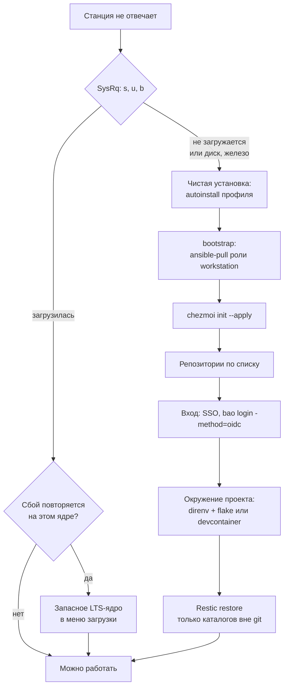

**Русский** (английская и китайская версии ещё не написаны)

# Типовая архитектура: device-workstation-stages

Рабочая станция сотрудника mess.systems как код. Документ отвечает на вопросы, которые не решает [`endpoint`](https://github.com/mess-systems/blueprints/blob/main/endpoint/README.ru.md): какая ОС стандарт для каждого профиля и почему, как станция собирается из чистой установки, где живут инструменты разработчика и администратора, что копируется в резервные копии и что пересобирается, за сколько минут человек возвращается к работе, какие страховки держат станцию при сбое ядра и памяти и как это проверяется учениями. Эта типовая архитектура фиксирует границы, состав по этапам, путь восстановления, имена, учётные данные, права, сеть, шифрование, аудит, развёртывание, известные проблемы, альтернативы и открытые вопросы.

**Статус:** черновик типовой архитектуры. Создано 2026-11-15. Нормативный английский текст ещё не написан. Компания mess.systems выдумана, это модельный состав, а не отчёт о внедрении. Имена ниже являются примерами в домене `mess.systems` и не относятся к работающей системе. Факты о продуктах сверены с официальными источниками на 2026-11-15. Замеров ещё нет: прототип окружений на Nix идёт, места для цифр оставлены в [10.3](#103-замеры-и-учения).

**Коды возможностей.** `endpoint` в домене `device` [стандарта именования](https://github.com/mess-systems/naming-standard/blob/main/i18n/ru/01-naming-conventions.md#43-коды-возможностей-уникальны-во-всех-доменах). Новый код не вводится. Рядом стоят резервное копирование `backup` и вычисления `compute` (домен `infra`), секреты `secrets` и вход `sso` (домен `iam`), сеть `mesh` (домен `net`), метрики `metrics` и алерты `alerts` (домен `obs`), удалённые рабочие места `vdi` (домен `device`), реестр образов `oci` и пакеты `packages` (домен `sdlc`).

**Плоскость.** `corp`, плоскость домена `device` по умолчанию. Отдельная плоскость не вводится.

**Связанные типовые архитектуры.** Состав агентов и приложений устройства, профили `std`, `eng`, `paw`: [`endpoint`](https://github.com/mess-systems/blueprints/blob/main/endpoint/README.ru.md). Кеши зависимостей и bootstrap клиентов сборки: отдельная типовая архитектура (готовится). Раннеры CI и сборка образов: [`sdlc-ci-runners`](https://github.com/mess-systems/blueprints/blob/main/sdlc-ci-runners/README.ru.md). Сама сеть: [`net-mesh`](https://github.com/mess-systems/blueprints/blob/main/net-mesh/README.ru.md). Форма этапов: [`data-platform-stages`](https://github.com/mess-systems/blueprints/blob/main/data-platform-stages/README.ru.md).

## 1. Границы

| Входит | Не входит |
|---|---|
| Стандарт ОС по профилям и этапам | Резидентные агенты и стандартные приложения: см. [`endpoint`](../endpoint/README.ru.md) |
| Сборка станции: установка, bootstrap, конфигурация, dotfiles, репозитории, вход в секреты | Сама сеть, группы и политики: см. [`net-mesh`](../net-mesh/) |
| Окружения разработчика: Nix поверх ОС, Dev Containers, одноразовые VM на NixOS | Кеши пакетов и образов: отдельная типовая архитектура (готовится) |
| Инструменты администратора на станции привилегированного доступа | Раннеры CI и сборка образов dev-контейнеров: см. [`sdlc-ci-runners`](../sdlc-ci-runners/README.ru.md) |
| Резервное копирование состояния, которое нельзя пересобрать | Резервное копирование серверов и баз данных |
| Время возврата к работе (RTO) и допустимая потеря данных (RPO) рабочего места | Телефоны и планшеты |
| Страховки при сбое ядра и памяти, наблюдаемость станции, учения | Выбор и закупка железа |

## 2. Состав

В легенде компания сокращается: станции должны быть дешёвыми в содержании, один человек должен уметь пересобрать любую из них по описанию в репозитории.

| Часть | Роль | Продукт | Радар |
|---|---|---|---|
| ОС | База станций `std`, `eng`, `paw` на Linux | Ubuntu 26.04 LTS | [Adopt](https://github.com/mess-systems/tech-radar/blob/main/technologies/ubuntu-lts.md) |
| ОС вне стандарта | Лабораторное исключение на отдельных станциях `eng` | CachyOS | [Hold](https://github.com/mess-systems/tech-radar/blob/main/technologies/cachyos.md) |
| ОС-кандидат на 2027 | Лаборатория и личные устройства сейчас; стандарт `eng` только при выполнении условий [2.3](#23-omarchy-кандидат-на-2027) | Omarchy | [Assess](https://github.com/mess-systems/tech-radar/blob/main/technologies/omarchy.md) |
| Установка | Установка без участия человека | Ubuntu autoinstall | входит в Ubuntu |
| Конфигурация | Приведение станции к описанию профиля | Ansible, `ansible-pull` | [Adopt](https://github.com/mess-systems/tech-radar/blob/main/technologies/ansible.md) |
| Настройки пользователя | Dotfiles, шаблоны с секретами из менеджера | chezmoi | [Trial](https://github.com/mess-systems/tech-radar/blob/main/technologies/chezmoi.md) |
| Секреты | Вход по SSO, без долгоживущих токенов на диске | OpenBao, CLI `bao` | [Adopt](https://github.com/mess-systems/tech-radar/blob/main/technologies/openbao.md) |
| Окружение разработчика, вариант A | Окружение проекта поверх любой ОС: flakes и direnv | Nix (Determinate Nix, установщик Determinate Nix Installer), direnv | Nix [Assess](https://github.com/mess-systems/tech-radar/blob/main/technologies/nix.md), установщик [Assess](https://github.com/mess-systems/tech-radar/blob/main/technologies/determinate-nix-installer.md) |
| Окружение разработчика, вариант B | Окружение в контейнере для удалённой IDE и CI | Dev Containers на rootless Podman | [Trial](https://github.com/mess-systems/tech-radar/blob/main/technologies/dev-containers.md); [Podman Trial](https://github.com/mess-systems/tech-radar/blob/main/technologies/podman.md) |
| Кеш сборок Nix | Двоичный кеш Nix на серверах компании | Attic | [Assess](https://github.com/mess-systems/tech-radar/blob/main/technologies/attic.md); пока дизайн |
| Языковые зависимости | npm, PyPI, Maven и другие через внутренний кеш | NORA | [Adopt](https://github.com/mess-systems/tech-radar/blob/main/technologies/nora.md) |
| Одноразовые среды | Изолированные VM на NixOS из flake | NixOS на Proxmox VE | [Assess](https://github.com/mess-systems/tech-radar/blob/main/technologies/nix.md); [Proxmox VE Adopt](https://github.com/mess-systems/tech-radar/blob/main/technologies/proxmox-ve.md) |
| Удалённые среды (целевой этап) | Среды разработки и агентов на серверах компании | Coder | [Assess](https://github.com/mess-systems/tech-radar/blob/main/technologies/coder.md); выбран для удалённой разработки на целевом этапе; рядом [Kasm Workspaces Adopt](https://github.com/mess-systems/tech-radar/blob/main/technologies/kasm-workspaces.md) |
| Резервное копирование | Копии состояния, которого нет в git и в описании станции | Restic → объектное хранилище S3 | [Trial](https://github.com/mess-systems/tech-radar/blob/main/technologies/restic.md); [RustFS Adopt](https://github.com/mess-systems/tech-radar/blob/main/technologies/rustfs.md) |
| Управление | Инвентарь, политики, эскроу ключей шифрования | Fleet | [Trial](https://github.com/mess-systems/tech-radar/blob/main/technologies/fleet.md) |
| Наблюдаемость | Алерт «высокая нагрузка и заблокированные процессы» | Prometheus, node_exporter, Alertmanager | [Prometheus Adopt](https://github.com/mess-systems/tech-radar/blob/main/technologies/prometheus.md), [Alertmanager](https://github.com/mess-systems/tech-radar/blob/main/technologies/alertmanager.md) |
| Учения | Пересборка станции на чистой VM | Proxmox VE | [Adopt](https://github.com/mess-systems/tech-radar/blob/main/technologies/proxmox-ve.md) |

macOS и Windows 11 Pro остаются платформами там, где они уже есть ([`endpoint`](../endpoint/README.ru.md#2-профили-формы-и-платформы)); для них работают части «Окружение разработчика» (Nix на macOS, WSL 2 на Windows), «Настройки пользователя» и «Резервное копирование». Ниже разобран Linux.

### 2.1 Цель и задачи по частям

| Часть | Цель | Задачи | Готово, когда |
|---|---|---|---|
| ОС | Одна предсказуемая база с длинной поддержкой | Ubuntu 26.04 LTS, шифрование диска при установке, автоматические обновления безопасности | Станция профиля ставится по одному описанию, шифрование включено |
| Установка | Ноль ручных ответов | Файл autoinstall по профилю | Установка проходит без ввода, кроме пароля шифрования там, где он нужен |
| Конфигурация | Любая станция профиля сходится к описанию | Роль `workstation` по профилям, `ansible-pull` по таймеру | Повторный прогон роли ничего не меняет |
| Настройки пользователя | Привычная среда за одну команду | chezmoi, секреты только из менеджера | `chezmoi apply` на чистой станции даёт рабочую оболочку и git |
| Секреты | Секреты не живут на диске | Вход `bao` через OIDC, короткие токены | На диске нет токенов OpenBao с долгим сроком жизни |
| Окружение, вариант A | Окружение проекта воспроизводится и удаляется | `flake.nix` и `flake.lock` в репозитории, `.envrc` с `use flake`, зависимости языков через NORA | `cd` в репозиторий даёт окружение, `flake.lock` закреплён |
| Окружение, вариант B | Окружение для удалённой IDE и CI | `devcontainer.json` в репозитории, образ в реестре компании | Контейнер собирается одинаково на станции и в CI |
| Кеш Nix | Сборки Nix не повторяются на каждой станции | Дизайн Attic на объектном хранилище | Не начато: дизайн |
| Одноразовые среды | Рискованная работа не трогает станцию | Образ VM из flake, запуск на Proxmox VE, удаление после работы | VM создаётся из образа и удаляется без следов на станции |
| Резервное копирование | Нет единственной копии на станции | Restic по списку каталогов, ключ отдельно от хранилища | Восстановление в пустой каталог даёт те же файлы |
| Страховки | Сбой части стоит минуты, а не hard reset | SysRq, детектор зависших задач, лимит coredump, earlyoom, запасное ядро | Каждая настройка видна в проверках 10.2 |
| Наблюдаемость | Зависание видно до того, как человек жмёт reset | Алерт по нагрузке и числу заблокированных процессов | Алерт срабатывает на учении |
| Учения | RTO измерен, а не обещан | Пересборка на чистой VM по расписанию | В журнале учений есть время каждого шага |

### 2.2 Состав по этапам

| Роль | Простой (до ~10 станций, один человек на ИТ) | Средний (~10–50, платформенная команда) | Целевой (50+, рост) |
|---|---|---|---|
| ОС `std` | Ubuntu 26.04 LTS; macOS и Windows 11 Pro там, где уже есть | То же; переход LTS → LTS по плану | То же |
| ОС `eng` | Ubuntu 26.04 LTS; CachyOS и Omarchy только как лабораторные исключения | Ubuntu 26.04 LTS; Omarchy на лабораторных станциях по условиям [2.3](#23-omarchy-кандидат-на-2027) | Ubuntu LTS или Omarchy, если выполнены условия 2.3; образная ОС (Fedora Atomic через bootc) только при выполнении условия ниже |
| ОС `paw` | Ubuntu 26.04 LTS, минимум ПО | То же, отдельные устройства | Кандидат на образную read-only ОС при том же условии |
| Установка | Ручная установка и один bootstrap | Ubuntu autoinstall | autoinstall или свой подписанный образ |
| Конфигурация | Роль `workstation`, `ansible-pull` | То же и политики Fleet по профилям | То же |
| Настройки пользователя | chezmoi | chezmoi, общий шаблон компании | То же |
| Окружение разработчика | Вариант B (Dev Containers) для всех; вариант A (Nix поверх ОС) в прототипе с замерами | Вариант A по умолчанию для локальной работы, если прототип прошёл; вариант B там, где удалённой IDE или CI нужен контейнер | То же; тяжёлая и рискованная работа и AI-агенты в удалённых средах |
| Кеш Nix | Нет: публичный кеш Nix и NORA для языков | Attic (Assess → Trial) на объектном хранилище | Attic с разделением кешей по командам |
| Одноразовые среды | По запросу: VM на NixOS на Proxmox VE из flake | Набор образов VM из одного flake | Coder (Assess → Trial) |
| Инструменты администратора | На `paw` браузер, менеджер паролей, CLI администрирования | CLI в окружении, описанном кодом (flake или Toolbx) | Сессии через `vdi` с журналом |
| Резервное копирование | Restic: только каталоги вне git и описания станции | Restic в объектное хранилище S3, ежедневно, ключ отдельно | То же; правило «на станции нет единственной копии» проверяется политикой |
| Шифрование | LUKS2; на Ubuntu 26.04 TPM-backed FDE | Эскроу ключей в Fleet Premium | То же |
| Патчи | Автоматические обновления безопасности | Минимальная версия ОС как политика Fleet | То же; для образной ОС обновление образом и откат |
| Страховки | SysRq, hung_task, coredump ≤2 ГБ, earlyoom, запасное ядро в загрузчике | То же в роли Ansible | То же |
| Наблюдаемость | Fleet (osquery), алерт Prometheus | Дашборд парка, отчёт по политикам | То же и журнал учений |
| RTO «можно работать» | ≤30 мин на том же железе | ≤30 мин; ≤1 ч на подменном ноутбуке из резерва | ≤15 мин до работы в удалённой среде с любого управляемого устройства |
| Учения | Ежемесячно на VM в Proxmox VE | Ежеквартально на реальном железе по каждому профилю | Выдача новой станции сотруднику считается учением |

**Когда переходить к среднему этапу.** Больше ~10 станций; второй человек в ИТ; требование показывать аудитору шифрование и патчи (тогда нужен эскроу ключей и Fleet Premium); прототип окружений на Nix дал замеры (время первого входа в окружение, время повторного, объём загрузок) и они лучше варианта B.

**Когда переходить к целевому этапу.** Онбординг разработчика дольше одного рабочего дня; повторяющиеся расхождения окружений между людьми; AI-агентам нужны изолированные среды на постоянной основе; две и более регрессии ОС за квартал на `eng`. Образная ОС для `eng` и `paw` рассматривается только после того, как Fleet начнёт поддерживать системы на rpm-ostree: на 2026-11-15 агент Fleet на них не устанавливается ([известные проблемы](#11-известные-проблемы)).

### 2.3 Omarchy: кандидат на 2027

**Позиция владельца (15.11.2026).** В 2027 году Omarchy рассматривается как целевая ОС и для личных устройств и лаборатории, и для станций `eng` компании. За проектом следим пристально; на одной старой машине Mac он работает год. Это кандидат, а не решение: стандарт он займёт только при выполнении условий ниже.

**Что это.** Omarchy — «omakase»-дистрибутив Linux на базе Arch с тайловым композитором Hyprland и оболочкой на Quickshell, автор DHH; лицензия MIT; репозиторий `omacom/omarchy` (раньше `basecamp/omarchy`). Развитие финансирует некоммерческий фонд Omacom Foundation. 37signals перевела на Omarchy весь технический отдел.

**Почему он вообще кандидат, если CachyOS в Hold.** База та же — rolling Arch, и это ровно тот класс риска, на котором случился инцидент. Отличаются механизмы, которые этот риск закрывают, и их можно проверить:

| Механизм | Omarchy (по официальной документации) | Что это даёт против инцидента |
|---|---|---|
| Канал stable | Канал stable идёт за официальными релизами и зеркалом Arch, которое отстаёт от последних пакетов на месяц | Регрессии свежих пакетов чаще ловят до нас |
| Снимки при каждом обновлении | Snapper на Btrfs, снимок перед каждым обновлением, загрузка снимка из загрузчика Limine и восстановление | Откат плохого обновления без пересборки |
| Защита от обхода | Прямой `pacman -Syu` останавливается и отправляется в `omarchy update` (снимок + миграции) | Обновление не проходит мимо снимка |
| Запасное ядро | Своё ядро `linux-omarchy`, рядом можно держать штатное `linux`, выбор в меню загрузки | Та же страховка, что у нас в 10.2 |
| Шифрование | LUKS по умолчанию при установке | Совпадает с требованием `endpoint` |
| Установка без участия человека | ISO берёт конфигурацию с диска с меткой `cidata` (метка cloud-init NoCloud), пример для Proxmox в документации | Учения на VM и выдача станций по описанию |
| Fleet | Omarchy в списке поддерживаемых ОС Fleet, пакет `pkg.tar.zst`; эскроу ключей LUKS запланирован в Fleet 4.95 | Управляемость, без которой ОС не становится стандартом |

CachyOS в Hold не из-за ядра как такового. Его заявленная цель — производительность: сборки под x86-64-v3/v4 и Zen 4, LTO, PGO и BOLT, своё ядро с выбором планировщика. Задержка обновлений для парка и обязательный снимок перед каждым обновлением в его карточке не оценивались, и для компании мы его не выбираем. Напряжение при этом честное: оба — rolling Arch, и Omarchy получает шанс только потому, что его страховки можно проверить и измерить на нашем стенде. Если не пройдут, он останется в Assess на тех же основаниях, что CachyOS в Hold.

**Риски.**

- Rolling-база: все проблемы раздела 11 про свежие ядра и модули остаются; снимок откатывает систему, но не исправляет баг ядра.
- Установщик требует выключить Secure Boot и TPM. Это расходится с TPM-backed FDE на Ubuntu 26.04 и требует отдельного решения в `endpoint`.
- Снимки не покрывают `/home`, включая `~/.config` и записи Omarchy о выполненных миграциях; после отката возможны расхождения конфигурации. Снимки работают только с Limine.
- Пароль шифрования при загрузке нельзя ввести с Bluetooth-клавиатуры.
- Fleet: эскроу ключей LUKS на Omarchy пока не работает (задача #55069 открыта, веха 4.95.0; последний выпуск Fleet на 2026-11-15 — 4.94.0); задача проверки поддержки #53002 открыта; Fleet Desktop официально поддержан на GNOME и KDE Plasma, а в Omarchy Hyprland.
- Высокий темп: 4.5 — более 740 влитых PR от 180+ участников за двенадцать недель; поведение по умолчанию меняется часто.
- Есть опции, недопустимые для станции компании без политики: постоянный sudo без пароля, каналы edge и dev.
- Mac: Mac на Intel поддерживается, но только как единственная ОС; у моделей с T1 и T2 известные ограничения. Apple Silicon M1–M3 и Neo — через установщик Omarchy M рядом с macOS, M4 и новее в работе; ARM-сборка для NVIDIA — предварительная.

**Условия, чтобы принять Omarchy стандартом `eng`.** Все пункты, не часть:

1. Fleet: поддержка Omarchy проверена (задача #53002 закрыта) и эскроу ключей LUKS работает (#55069 в выпущенной версии Fleet); на нашем стенде ключ депонирован и восстановлен.
2. Откат проверен: обновление → поломка → загрузка снимка из Limine → восстановление, с замером времени; описано, что делать с `/home` и миграциями.
3. Машина как код: установка через `cidata`, затем та же роль `workstation` и chezmoi; RTO «можно работать» ≤30 мин измерен на VM в Proxmox VE и на реальном железе.
4. Роль `workstation` уживается с обновлениями Omarchy: не вызывает `pacman -Syu` напрямую, обновляет только через `omarchy update`.
5. Решение по Secure Boot и TPM принято в `endpoint`: компенсирующие меры или поддержка подписанной загрузки.
6. Политика: только канал stable, sudo без пароля только временно, запасное ядро в меню загрузки, страховки из 10.2.
7. Не меньше шести месяцев на лабораторных станциях без hard reset из-за обновления; журнал регрессий ведётся.

Пока условия не выполнены, Omarchy — лабораторная ОС и ОС личных устройств; стандарт `eng` — Ubuntu 26.04 LTS. Подробный разбор Omarchy — отдельным материалом позже.

## 3. Путь восстановления

1. **Мягкий выход.** Если станция не отвечает, SysRq по очереди синхронизирует файловые системы (`s`), перемонтирует их только на чтение (`u`) и перезагружает (`b`). Это заменяет hard reset.
2. **Запасное ядро.** Если сбой повторяется на текущем ядре, в меню загрузки выбирается долгосрочное ядро. Возврат к работе занимает минуты, расследование идёт потом.
3. **Пересборка.** Если станция не загружается или заменено железо: установка по файлу autoinstall профиля, затем `ansible-pull` применяет роль `workstation`, chezmoi разворачивает настройки пользователя, скрипт клонирует репозитории из списка.
4. **Вход.** Пользователь входит через SSO; CLI `bao` получает короткий токен через OIDC.
5. **Окружение проекта.** В репозитории direnv поднимает окружение из `flake.nix` (вариант A) или IDE открывает dev-контейнер (вариант B). Зависимости языков приходят через NORA.
6. **Данные.** Restic восстанавливает только каталоги из списка; код уже в git.
7. **Проверка «можно работать».** SSO, сеть, репозитории, IDE и агенты, доступ к секретам. Время каждого шага пишется в журнал учений; сумма шагов есть RTO.

RPO: код — с последнего `git push`; каталоги из списка Restic — не больше суток на среднем этапе; данные, которые есть только на станции, считаются ошибкой описания.

## 4. Имена

| Объект | Имя | Правило |
|---|---|---|
| Станция | `<profile>-<form>-<asset-id>`, например `eng-lt-k7m2qa` | [06 Соглашения для конечных устройств](https://github.com/mess-systems/naming-standard/blob/main/i18n/ru/06-endpoint-conventions.md) |
| Репозиторий описания станций | организация `corp`, репозиторий `device-workstation` | [Формы объектов](https://github.com/mess-systems/naming-standard/blob/main/i18n/ru/01-naming-conventions.md#5-формы-объектов) |
| Роль Ansible | `workstation`, переменная профиля `endpoint_profile` (`std`, `eng`, `paw`) | [Формы объектов](https://github.com/mess-systems/naming-standard/blob/main/i18n/ru/01-naming-conventions.md#5-формы-объектов) |
| Группа инвентаря | `corp_device` | [Формы объектов](https://github.com/mess-systems/naming-standard/blob/main/i18n/ru/01-naming-conventions.md#5-формы-объектов) |
| Метки Fleet | `capability=endpoint`, `endpoint-profile`, `device-form` | [Метки и теги](https://github.com/mess-systems/naming-standard/blob/main/i18n/ru/05-labels-and-tags.md) |
| Хранилище резервных копий | `corp-infra-backup-endpoint` | [Резервные копии и снимки](https://github.com/mess-systems/naming-standard/blob/main/i18n/ru/08-operations-objects.md#3-резервные-копии-и-снимки) |
| Снимок Restic | хост снимка = `asset-id`, теги `capability=endpoint`, `endpoint-profile=<profile>`, `kind=incr`, `retention=daily` | [Резервные копии и снимки](https://github.com/mess-systems/naming-standard/blob/main/i18n/ru/08-operations-objects.md#3-резервные-копии-и-снимки); имя пользователя и имя хоста в теги не попадают |
| Ключ шифрования резервных копий | по грамматике путей секретов для `infra/backup` | [Грамматика путей](https://github.com/mess-systems/naming-standard/blob/main/i18n/ru/03-secrets-conventions.md#3-грамматика-путей) |
| Образ dev-контейнера | `oci.sdlc.eng.svc.mess.systems/corp-device/devcontainer-<stack>:<версия>` | [Формы объектов](https://github.com/mess-systems/naming-standard/blob/main/i18n/ru/01-naming-conventions.md#5-формы-объектов) |
| Одноразовая VM на NixOS | `dc1-corp-device-nixos-dev-<NN>` | [Формы объектов](https://github.com/mess-systems/naming-standard/blob/main/i18n/ru/01-naming-conventions.md#5-формы-объектов) |
| Кеш Nix | не назначено: решается вместе с дизайном Attic | [открытые вопросы](#14-открытые-вопросы) |

## 5. Аутентификация и учётные данные

### 5.1 Требования

1. **Нет долгоживущих токенов на диске.** CLI `bao` входит через OIDC и получает короткий токен; токен не пишется в dotfiles и не попадает в chezmoi.
2. **Секреты в шаблонах только по ссылке.** chezmoi получает значения из менеджера во время `apply`; в репозитории dotfiles лежат шаблоны, а не значения.
3. **Ключ резервных копий отдельно от хранилища.** Пароль репозитория Restic хранится в OpenBao, не на том же хранилище и не в репозитории описания станций.
4. **Ключ восстановления диска не только у пользователя.** На среднем этапе ключ LUKS эскроуится в Fleet Premium.
5. **Ключи провайдеров AI не попадают на станцию.** AI-клиенты ходят через AI-шлюз, как описано в [`endpoint`](../endpoint/README.ru.md#6-обоснование).
6. **Учётные данные кешей.** Клиенты сборки получают учётные данные кешей по правилам типовой архитектуры кешей зависимостей (готовится), не из этого документа.

### 5.2 chezmoi и OpenBao

chezmoi поддерживает Vault через CLI: функция шаблона `vault` вызывает `<vault.command> kv get -format=json <ключ>` и разбирает JSON; команда задаётся параметром `vault.command`. CLI OpenBao (`bao`) поддерживает `kv get -format=json` и читает переменные `BAO_*`, а при их отсутствии `VAULT_*`. По документации обеих сторон `vault.command = "bao"` совместим по форме, но chezmoi не заявляет поддержку OpenBao официально. До проверки на стенде это помечено «проверить»; запасной путь — функция `output` с вызовом `bao kv get -field=<поле>`.

### 5.3 Nix

Установщик Determinate Nix Installer по умолчанию ставит Determinate Nix с включёнными flakes. Установку upstream Nix он поддерживает флагом `--prefer-upstream-nix`, но называет это неподдерживаемой конфигурацией. Установщик хранит квитанцию установки и удаляет Nix командой `/nix/nix-installer uninstall`. Решение: стандарт — Determinate Nix. Доверенные ключи двоичных кешей задаются в `/etc/nix/nix.conf` ролью Ansible; пользователь не добавляет кеши сам.

### 5.4 Что не кладётся на станцию и в репозитории

Токены OpenBao, пароль репозитория Restic, ключи провайдеров AI, ключи подписи кеша Nix, учётные данные робот-аккаунтов реестров, реальные адреса серверов в dotfiles.

## 6. Права

| Слой | Отвечает на вопрос | Где | Пример |
|---|---|---|---|
| Профиль | Что вообще установлено | Роль `workstation`, переменная `endpoint_profile` | На `paw` нет Nix, dev-контейнеров и AI-клиентов |
| Пользователь ОС | Может ли пользователь менять систему | sudoers в роли | На `std` нет постоянного sudo; на `eng` Podman работает без root |
| Окружение проекта | Что доступно в проекте | `flake.nix`, `devcontainer.json` | Окружение одного проекта не видит инструменты другого |
| Одноразовая VM | Что может рискованная работа | Отдельная VM, без доступа к секретам станции | Эксперимент с агентом не трогает домашний каталог |
| Секреты | Что пользователь может прочитать | Политики OpenBao | Пользователь читает только свои пути |

## 7. Сеть

Восстановление не зависит от той сети, которую только что потеряли. Установка, bootstrap и Restic работают через обычный выход в интернет; внутренние кеши зависимостей ускоряют, но не обязательны для первого входа. Mesh-клиент NetBird ставится ролью и включается после входа ([`net-mesh`](../net-mesh/)). Отказ сетевого модуля ядра разобран в [известных проблемах](#11-известные-проблемы).

## 8. TLS и шифрование

1. **Диск.** LUKS2. На Ubuntu 26.04 LTS доступно TPM-backed full disk encryption (общая доступность с 26.04): ключ хранится в TPM, диск открывается автоматически, если прошивка проверена; можно добавить PIN или пароль. Требования: UEFI 2.5 и новее, TPM 2.0, Secure Boot в режиме Deployed Mode.
2. **Резервные копии.** Restic шифрует репозиторий; ключ хранится отдельно (5.1).
3. **В канале.** Кеши, реестр и OpenBao доступны только по TLS; сертификаты по правилам [стандарта именования](https://github.com/mess-systems/naming-standard/blob/main/i18n/ru/01-naming-conventions.md).

## 9. Аудит

| Журнал | Что видно | Где хранится |
|---|---|---|
| Прогоны `ansible-pull` | Когда станция применила роль и что изменилось | Журнал systemd станции, сводка в Fleet |
| Политики Fleet | Шифрование, версия ОС, страховки включены или нет | Fleet |
| Снимки Restic | Когда сделана копия, сколько данных | Хранилище резервных копий |
| Журнал учений | Время каждого шага пути восстановления, итоговый RTO | Репозиторий `corp/device-workstation`, задача на учение |
| `flake.lock` и `devcontainer.json` | Точные версии окружения проекта | Репозиторий проекта |

Fleet не собирает инвентарь пакетов Nix, установленного поверх другой ОС; источник версий окружения тогда `flake.lock` в репозитории проекта.

## 10. Развёртывание

- **Описание как код.** Файлы autoinstall, роль `workstation`, шаблоны chezmoi, список репозиториев, правила Restic и алерт лежат в репозитории `corp/device-workstation`; изменения проходят ревью.
- **Pull, а не push.** `ansible-pull` запускается на станции по таймеру и забирает роль из репозитория: станция может быть вне сети в момент изменения.
- **Окружения в репозиториях проектов.** `flake.nix`, `flake.lock`, `.envrc` и `.devcontainer/` живут рядом с кодом.
- **Одноразовые VM.** Образ собирается из того же flake командой `nixos-rebuild build-image --image-variant proxmox --flake .#<имя>`; Proxmox VE создаёт VM из образа, после работы VM удаляется.

### 10.1 Порядок изменений

| # | Шаг | Где | Откат |
|---|---|---|---|
| 1 | Цель, откат для каждого шага, задача | ревью | — |
| 2 | Роль `workstation` и файл autoinstall профиля | репозиторий `corp/device-workstation` | предыдущий тег роли |
| 3 | Пилот на одной станции | станция-пилот | пересборка с предыдущего тега |
| 4 | Учение на чистой VM в Proxmox VE, замер RTO | Proxmox VE | удаление VM |
| 5 | Политики Fleet по профилю | Fleet | отключение политики |
| 6 | Раскатка на профиль целиком через `ansible-pull` | станции профиля | предыдущий тег роли |
| 7 | Полная матрица; приёмка или откат | ревью | — |

### 10.2 Матрица проверок

| Источник | Цель | Действие | Ожидание | Доказательство |
|---|---|---|---|---|
| Чистая VM профиля `eng` | путь восстановления | установка → bootstrap → вход → окружение | «можно работать» ≤30 мин | журнал учения |
| Станция после прогона роли | роль `workstation` | повторный `ansible-pull` | 0 изменений | журнал прогона |
| Станция | ядро | `sysctl kernel.sysrq` | разрешены sync, remount, reboot | политика Fleet |
| Станция | ядро | `sysctl kernel.hung_task_timeout_secs` | 120 | политика Fleet |
| Станция | systemd-coredump | `ProcessSizeMax` | ≤2G | политика Fleet |
| Станция | загрузчик | список ядер | есть долгосрочное ядро | политика Fleet |
| Станция | диск | состояние шифрования | зашифрован; на среднем этапе ключ в Fleet | Fleet |
| Станция | OpenBao | поиск токенов в домашнем каталоге | долгоживущих токенов нет | запрос osquery |
| Репозиторий dotfiles | chezmoi | поиск значений секретов | только шаблоны | ревью, сканер секретов |
| Restic | хранилище | восстановление в пустой каталог | файлы совпадают | журнал учения |
| Пользователь | хранилище | чтение репозитория Restic без пароля | запрещено | ответ Restic |
| Репозиторий проекта | окружение A | `cd` в каталог, `direnv allow` | окружение из `flake.lock` | вывод `nix flake metadata` |
| Станция | Nix | `/nix/nix-installer uninstall` на пилоте | Nix удалён, ОС работает | журнал пилота |
| Репозиторий проекта | окружение B | сборка dev-контейнера на станции и в CI | одинаковый результат | журнал CI |
| Flake | одноразовая VM | сборка образа, создание VM, удаление | VM удалена, на станции изменений нет | журнал Proxmox VE |
| Учебная нагрузка | Prometheus | рост нагрузки и заблокированных процессов | алерт сработал | Alertmanager |
| Станция `paw` | профиль | список ПО | нет Nix, dev-контейнеров и AI-клиентов | Fleet |

### 10.3 Замеры и учения

Замеров нет. Идёт прототип окружений на Nix поверх ОС. Что мерим и куда впишем цифры:

| Замер | Вариант A (Nix поверх ОС) | Вариант B (Dev Containers) | Дата |
|---|---|---|---|
| Первый вход в окружение проекта на чистой станции | — | — | — |
| Повторный вход в окружение | — | — | — |
| Объём загрузок при первом входе | — | — | — |
| Время установки и удаления самого инструмента | — | — | — |
| RTO на чистой VM, по шагам пути восстановления | — | — | — |

Учения: на простом этапе ежемесячно на чистой VM в Proxmox VE, результат пишется в журнал учений.

## 11. Известные проблемы

**Rolling-дистрибутив и свежее ядро.** На Arch и CachyOS ядро и внеядерные модули обновляются быстро: исправления приходят быстро, регрессии тоже. Сбой ядра в сетевом модуле может подвесить всю станцию: процессы уходят в D-state, новые не стартуют. Поэтому CachyOS вне стандарта, а на станциях-исключениях обязательны запасное ядро и страховки из 10.2.

**Omarchy: эскроу шифрования и проверка в Fleet не завершены.** Omarchy в списке поддерживаемых ОС Fleet, но эскроу ключей LUKS на нём пока не работает: задача Fleet #55069 открыта (веха 4.95.0), задача проверки #53002 открыта. Установщик Omarchy требует выключить Secure Boot и TPM. Снимки откатывают корень, но не `/home`. Подробнее в [2.3](#23-omarchy-кандидат-на-2027).

**Fleet не устанавливается на системы с rpm-ostree.** По документации Fleet агент не ставится на Fedora Atomic Desktops (Silverblue, Kinoite и другие), Bluefin, Aurora и Bazzite: ОС только для чтения. Поддержка отслеживается в задаче Fleet #48694. Пока задача не закрыта, образная ОС на `eng` и `paw` не переходит из оценки.

**Fleet не видит пакеты Nix поверх другой ОС.** Fleet собирает пакеты Nix только на NixOS; Nix, установленный на другой дистрибутив, в инвентарь не попадает. Источник версий тогда `flake.lock` в репозитории проекта; уязвимости в окружениях Nix этим путём не проверяются, не решено.

**Принудительное шифрование в Fleet на Linux ограничено.** Принудительное шифрование и эскроу ключей доступны в Fleet Premium и на Linux только для Ubuntu, Kubuntu и Fedora; диск шифруется при установке ОС, для эскроу пользователь вводит пароль диска. Настройки Linux Fleet применяет скриптами, не профилями.

**Ограничения TPM-backed FDE на Ubuntu 26.04.** Перешифрование диска не поддерживается; из внешних драйверов DKMS поддержан только NVIDIA; часть систем может ошибочно определяться как неподходящие.

**Attic в статусе раннего прототипа.** Так его описывает README проекта. Кеш Nix остаётся дизайном, на критический путь восстановления не ставится. Harbor для этого не подходит: двоичный кеш Nix не является реестром OCI.

**nixos-generators устарел.** Проект помечен как deprecated: с NixOS 25.05 большая часть перенесена в nixpkgs, образы собираются командой `nixos-rebuild build-image`; вариант `proxmox` поддерживается.

**Determinate Nix, а не upstream Nix.** Установщик по умолчанию ставит Determinate Nix; upstream Nix он ставит только как неподдерживаемую конфигурацию. Решение: стандарт — Determinate Nix через Determinate Nix Installer; при смене дистрибутива Nix станции пересобираются по описанию.

**chezmoi и OpenBao.** Совместимость по документации, без официального заявления chezmoi (5.2); требует проверки на стенде.

**Откат образа не переносит `/etc`.** У bootc при откате изменения в `/etc` возвращаются к состоянию отката. Это важно для целевого этапа с образной ОС.

## 12. Рассмотренные альтернативы

| Вариант | Радар | Почему не сейчас |
|---|---|---|
| Fedora Workstation | — | Поддержка релиза около 13 месяцев; апгрейд раз в год на каждой станции |
| Fedora Atomic Desktops (Silverblue, Kinoite) | [Assess](https://github.com/mess-systems/tech-radar/blob/main/technologies/fedora-atomic.md) | Откат и единый образ — сильная сторона, но агент Fleet на rpm-ostree не устанавливается; цикл около 13 месяцев |
| Bluefin | в карточке Fedora Atomic | Образ на bootc для разработчиков, но три семейства образов, переход между Bluefin и Bluefin Classic не поддерживается, Fleet не устанавливается |
| NixOS как ОС станции | [Assess](https://github.com/mess-systems/tech-radar/blob/main/technologies/nix.md) | Максимальная воспроизводимость, но релиз поддерживается около 7 месяцев, эскроу шифрования в Fleet нет; на десктопе высокий риск для GUI, IDE и GPU. NixOS используется для одноразовых VM |
| Debian 13 | — | Долгая поддержка (LTS до 2030-06-30), но шифрование с эскроу в Fleet недоступно |
| Arch Linux, CachyOS | [Hold](https://github.com/mess-systems/tech-radar/blob/main/technologies/cachyos.md) для CachyOS | Rolling: подходит лаборатории, не парку |
| Omarchy | [Assess](https://github.com/mess-systems/tech-radar/blob/main/technologies/omarchy.md) | Кандидат на 2027 ([2.3](#23-omarchy-кандидат-на-2027)): канал stable с задержкой зеркала, снимки при обновлении, LUKS по умолчанию, поддержка в Fleet заявлена; эскроу ключей в Fleet ещё нет, Secure Boot и TPM при установке выключаются |
| Windows 11 + WSL 2 как база `eng` | — | Возможна там, где уже есть Windows; лицензии и MDM Microsoft вне набора компании |
| Toolbx и Distrobox | [Assess](https://github.com/mess-systems/tech-radar/blob/main/technologies/toolbx-distrobox.md) | Хороши на образной ОС; на Ubuntu с Nix и Dev Containers дают третий способ окружений |
| Devbox | в карточке Nix | Окружения на Nix через собственный файл; flakes и direnv дают то же без ещё одного инструмента |
| DevPod | — | Последний релиз v0.6.15 от 2025-03-10 |
| Резервная копия всего диска | — | Отвечает на вопрос «сохранить данные», а не «вернуться к работе»; восстанавливает и сломанное состояние |

**Решение.** Ubuntu 26.04 LTS как база Linux-станций всех профилей (Adopt). Окружения разработчика вне ОС: Dev Containers (Trial) для всех и Nix поверх ОС (Assess) в прототипе с замерами; NixOS только для одноразовых VM. CachyOS — Hold для станций компании. Omarchy — Assess, кандидат на стандарт `eng` в 2027 при выполнении условий 2.3. Пересборка по описанию вместо резервной копии всего диска; Restic только для состояния вне git.

## 13. Примеры

Файлы в [examples/](examples/) — **только примеры**: заготовки с условными значениями, которые показывают форму настройки. Это не конфигурация работающей системы.

| Файл | Что показывает |
|---|---|
| [bootstrap.example.sh](examples/bootstrap.example.sh) | Один вход после чистой установки: Ansible, `ansible-pull`, chezmoi, репозитории |
| [ansible-pull.example.service](examples/ansible-pull.example.service), [ansible-pull.example.timer](examples/ansible-pull.example.timer) | Роль применяется по таймеру со станции |
| [workstation-role.example.yml](examples/workstation-role.example.yml) | Задачи роли `workstation`: страховки, ядро, Nix по профилю |
| [sysctl-workstation.example.conf](examples/sysctl-workstation.example.conf) | SysRq и детектор зависших задач |
| [coredump.example.conf](examples/coredump.example.conf) | Лимит coredump |
| [chezmoi.example.toml](examples/chezmoi.example.toml) | chezmoi с `bao` вместо `vault` (проверить) |
| [repos.example.txt](examples/repos.example.txt) | Список репозиториев для клонирования |
| [flake.example.nix](examples/flake.example.nix), [envrc.example](examples/envrc.example) | Окружение проекта и одноразовая VM на NixOS из одного flake |
| [devcontainer.example.json](examples/devcontainer.example.json) | Dev-контейнер для удалённой IDE и CI |
| [restic-backup.example.service](examples/restic-backup.example.service), [restic-backup.example.timer](examples/restic-backup.example.timer), [restic-include.example.txt](examples/restic-include.example.txt) | Копия только каталогов вне git |
| [prometheus-workstation.example.yaml](examples/prometheus-workstation.example.yaml) | Алерт «нагрузка и заблокированные процессы» |
| [autoinstall.example.yaml](examples/autoinstall.example.yaml) | Установка Ubuntu без участия человека |

## 14. Открытые вопросы

Решено 2026-11-15: дистрибутив Nix — Determinate Nix; OOM-демон в стандарте — earlyoom; удалённая разработка на целевом этапе — Coder; Omarchy — лабораторное исключение в [`endpoint`](../endpoint/README.ru.md) и кандидат на 2027 по условиям [2.3](#23-omarchy-кандидат-на-2027).

1. Кеш Nix: Attic после выхода из раннего прототипа или другой сервер двоичного кеша; имя сервиса и код возможности.
2. Замеры прототипа Nix против Dev Containers ([10.3](#103-замеры-и-учения)).
3. Детектор зависших задач: собраны ли ядра дистрибутива с `CONFIG_DETECT_HUNG_TASK`; проверить для Ubuntu 26.04.
4. chezmoi с `vault.command = "bao"`: проверить на стенде.
5. Образная ОС для `eng` и `paw`: возвращаемся после закрытия задачи Fleet #48694.
6. Имя снимка Restic: допустим ли `asset-id` как хост снимка по правилам раздела 08 стандарта.
7. Omarchy: решение по Secure Boot и TPM в `endpoint`; срок проверки условий 2.3 в 2027 году; работает ли эскроу Fleet без Fleet Desktop на Hyprland.

## Источники

Проверено 2026-11-15.

- Ubuntu, цикл выпусков: https://ubuntu.com/about/release-cycle
- Ubuntu 26.04 LTS, сводка для пользователей LTS (TPM-backed FDE): https://documentation.ubuntu.com/release-notes/26.04/summary-for-lts-users/
- Ubuntu 26.04 LTS, безопасность: https://ubuntu.com/blog/ubuntu-26-04-lts-security-updates
- Ubuntu, требования TPM/FDE: https://ubuntu.com/desktop/docs/en/26.04/reference/hardware-backed-disk-encryption-requirements/
- Ubuntu, autoinstall: https://canonical-subiquity.readthedocs-hosted.com/en/latest/intro-to-autoinstall.html
- Fedora, жизненный цикл: https://docs.fedoraproject.org/en-US/releases/lifecycle/
- Fedora Silverblue: https://fedoraproject.org/atomic-desktops/silverblue/
- bootc: https://bootc-dev.github.io/bootc/ ; откат: https://bootc-dev.github.io/bootc/man/bootc-rollback.8.html
- Bluefin, образы: https://docs.projectbluefin.io/images
- NixOS 26.05: https://nixos.org/blog/announcements/2026/nixos-2605/
- NixOS, сборка образов `nixos-rebuild build-image`: https://nixos.org/manual/nixos/stable/#sec-image-nixos-rebuild-build-image
- nixos-generators (deprecated): https://github.com/nix-community/nixos-generators
- Determinate Nix Installer: https://github.com/DeterminateSystems/nix-installer
- nix-direnv: https://github.com/nix-community/nix-direnv ; direnv: https://direnv.net/
- Attic: https://github.com/zhaofengli/attic ; документация: https://docs.attic.rs/
- Debian LTS: https://wiki.debian.org/LTS
- Arch Linux: https://wiki.archlinux.org/title/Arch_Linux ; ядра: https://wiki.archlinux.org/title/Kernel
- CachyOS: https://cachyos.org/
- Omarchy: https://omarchy.org/ ; руководство: https://omarchy.org/manual/ ; репозиторий: https://github.com/omacom/omarchy
- Omarchy, обновления и каналы: https://omarchy.org/manual/updates/ ; снимки: https://omarchy.org/manual/system-snapshots/ ; безопасность: https://omarchy.org/manual/security/
- Omarchy, установка: https://omarchy.org/manual/getting-started/ ; без участия человека: https://omarchy.org/manual/unattended-installs/ ; Mac: https://omarchy.org/manual/mac-support/
- Omarchy 4.5: https://omarchy.org/news/2026/11/omarchy-4-5/
- 37signals и Omarchy: https://world.hey.com/dhh/all-in-on-omarchy-at-37signals-68162450 ; https://omarchy.org/news/2026/08/1password-and-37signals-become-distinguished-corporate-patrons/
- Fleet, Omarchy: эскроу https://github.com/fleetdm/fleet/issues/55069 ; проверка https://github.com/fleetdm/fleet/issues/53002 ; пакеты fleetd: https://fleetdm.com/guides/enroll-hosts
- kernel.org, выпуски: https://www.kernel.org/category/releases.html
- Fleet, FAQ (поддерживаемые ОС): https://fleetdm.com/docs/get-started/faq
- Fleet, справочник инвентаря ПО (rpm-ostree, Nix): https://fleetdm.com/guides/software-inventory-reference
- Fleet, задача rpm-ostree: https://github.com/fleetdm/fleet/issues/48694
- Fleet, шифрование дисков: https://fleetdm.com/guides/enforce-disk-encryption ; цены: https://fleetdm.com/pricing
- Dev Containers: https://containers.dev/
- Devbox: https://www.jetify.com/docs/devbox/
- Toolbx: https://containertoolbx.org/ ; Distrobox: https://distrobox.it/
- Coder: https://coder.com/docs
- DevPod: https://github.com/loft-sh/devpod
- chezmoi, Vault: https://www.chezmoi.io/user-guide/password-managers/vault/ ; функция `vault`: https://www.chezmoi.io/reference/templates/vault-functions/vault/
- OpenBao, CLI и переменные окружения: https://openbao.org/docs/commands/ ; `kv get`: https://openbao.org/docs/commands/kv/get/
- Ansible, `ansible-pull`: https://docs.ansible.com/ansible/latest/cli/ansible-pull.html
- Restic: https://restic.net/
- earlyoom: https://github.com/rfjakob/earlyoom
- Ядро Linux, SysRq: https://docs.kernel.org/admin-guide/sysrq.html ; sysctl kernel: https://docs.kernel.org/admin-guide/sysctl/kernel.html
- systemd, coredump.conf: https://www.freedesktop.org/software/systemd/man/latest/coredump.conf.html
