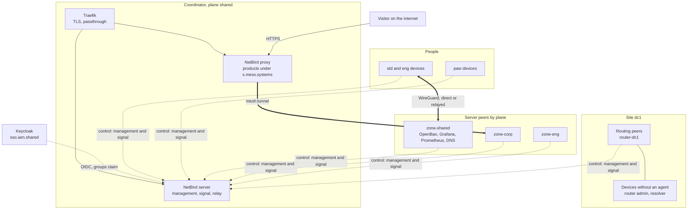
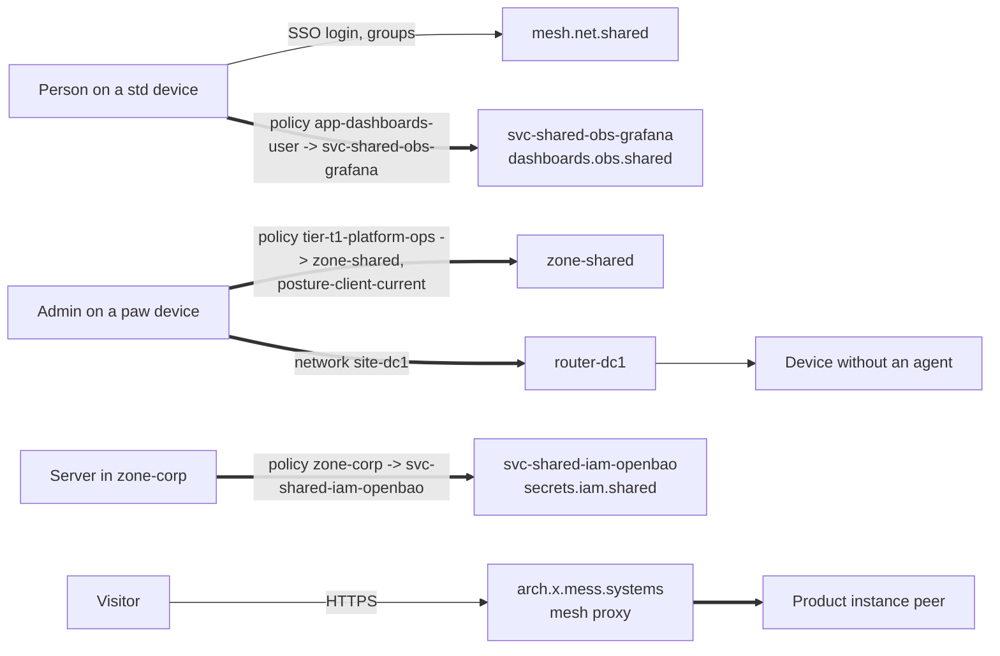

**English** | [Русский](README.ru.md) | [简体中文](README.zh-CN.md)

# Blueprint: net-mesh

The private network of mess.systems on NetBird: how people, servers, site devices and products are connected. Reachability comes from groups in the identity provider and policies in the mesh, never from a network location or a name. This blueprint fixes the topology, request paths, names and DNS, groups and policies, enrolment, host firewall, product publishing, organization boundaries, deployment, known issues and open questions.

**Status:** draft, evolving. Created 2026-10-31. All configurations are examples with fictional names under `mess.systems`, not a running system.

**Capability codes.** The mesh coordinator is `mesh` in the domain `net` of the [naming standard](https://github.com/mess-systems/naming-standard/blob/main/01-naming-conventions.md#43-capability-codes-unique-across-all-domains), service name `mesh.net.shared`. Egress gateways are `egress` (domain `net`), internal DNS is `dns` (domain `net`), the identity provider is `sso` (domain `iam`) and the secrets vault is `secrets` (domain `iam`).

## 1. Scope

| In scope | Out of scope |
|---|---|
| The mesh coordinator: management, signal, relay, its names, deployment and backup | Endpoint agents and device baselines: see the [`endpoint`](../endpoint/) blueprint |
| Connection of people's devices, servers and site devices without an agent | The identity provider itself: capability `sso` |
| Groups, policies, posture checks and split DNS of the mesh | Internal DNS zones and records: capability `dns` |
| Host firewall rules that coexist with the mesh client | Edge and ingress for public product traffic other than the mesh proxy: capability `ingress` |
| Publishing product instances through the mesh reverse proxy | Agent access to tools over MCP: see the [`obs-mcp-readonly`](../obs-mcp-readonly/) blueprint |

## 2. Composition

| Part | Role | Product | Radar |
|---|---|---|---|
| Mesh | Coordinator (management, signal, relay), client on every peer, policies, reverse proxy | NetBird | [Adopt](https://github.com/mess-systems/tech-radar/blob/main/technologies/netbird.md) |
| Tunnel | Encrypted peer-to-peer transport | WireGuard (inside NetBird) | |
| Identity provider | Sign-in of people, groups claim for the mesh | Keycloak | [Adopt](https://github.com/mess-systems/tech-radar/blob/main/technologies/keycloak.md) |
| Secrets | Access token of the mesh service user, state encryption key | OpenBao | [Adopt](https://github.com/mess-systems/tech-radar/blob/main/technologies/openbao.md) |
| Front proxy | TLS in front of the coordinator, TLS passthrough to the mesh proxy | Traefik | [Adopt](https://github.com/mess-systems/tech-radar/blob/main/technologies/traefik.md) |
| Certificates | Public certificates for the coordinator and published products | ACME (Let's Encrypt) | [Adopt](https://github.com/mess-systems/tech-radar/blob/main/technologies/acme.md) |
| Mesh as code | Groups, policies, networks, DNS, account settings | OpenTofu with the `netbirdio/netbird` provider | [Adopt](https://github.com/mess-systems/tech-radar/blob/main/technologies/opentofu.md) |
| Host configuration | Client install, server enrolment, host firewall | Ansible | [Adopt](https://github.com/mess-systems/tech-radar/blob/main/technologies/ansible.md) |
| Host firewall | Rules outside the mesh | nftables | |
| Monitoring | Metrics of the coordinator and the proxy | Prometheus, Grafana | [Prometheus](https://github.com/mess-systems/tech-radar/blob/main/technologies/prometheus.md), [Grafana](https://github.com/mess-systems/tech-radar/blob/main/technologies/grafana.md): Adopt |
| Site routers | Underlay at sites, devices without an agent behind a routing peer | MikroTik, Keenetic | [MikroTik](https://github.com/mess-systems/tech-radar/blob/main/technologies/mikrotik.md), [Keenetic](https://github.com/mess-systems/tech-radar/blob/main/technologies/keenetic.md): Adopt |
| Public DNS and IP reputation | Wildcard record for published products, blocklists on the mesh proxy | Organization's public DNS, CrowdSec | |

## 3. Topology

- Every peer keeps a control connection to the coordinator. Data goes peer to peer, directly when NAT allows it and through the relay otherwise.
- The coordinator distributes only what policies allow. A peer that matches no policy sees no other peer.
- The coordinator is the only part with a public name. Servers, sites and published products have no public IP address and no inbound ports.

## 4. Request paths

- **Person to a service.** The person signs in on the NetBird client through Keycloak. The groups claim places the peer in `role-*`, `tier-*` and `app-*` groups. A policy from the app group to the service peer group opens one port of one service, not a plane.
- **Admin to a control surface.** Admin paths start from `tier-*` groups. Only `-adm` accounts are members, and they sign in only on `paw` devices. The policy also carries a posture check.
- **Server to server.** Servers join zone and service groups through setup key auto-groups. Policies between service groups are one-way and name the port.
- **Person to a device without an agent.** A routing peer of the site forwards to single addresses published as network resources. A resource is unreachable until a policy names it.
- **Visitor to a product.** The mesh proxy terminates HTTPS for product names under `x.mess.systems` and sends the request through the mesh to the instance peer. See [publishing products](#9-publishing-products).

## 5. Names and DNS

| Object | Name | Rule |
|---|---|---|
| Coordinator, internal | `mesh.net.shared.svc.mess.systems` | Grammar A of the naming standard |
| Coordinator, public | `netbird.mess.systems` | A recorded exception in `catalog/dns-exceptions.yaml` of the naming standard: the coordinator must be reachable before the mesh is up |
| Product coordinator, if split | `mesh.net.platform.prd.svc.mess.systems` | [Product platform and corporate services](https://github.com/mess-systems/naming-standard/blob/main/07-deployment-and-tenants.md#124-product-platform-and-corporate-services) |
| Published products | `<product>.x.mess.systems`, surfaces `<surface>.<product>.x.mess.systems` | The showcase sub-zone, [grammar B: public](https://github.com/mess-systems/naming-standard/blob/main/01-naming-conventions.md#32-grammar-b-public) |
| Server hosts | `<site>-<plane>-<domain>-<product>-<env>-<nn>` | [Object forms](https://github.com/mess-systems/naming-standard/blob/main/01-naming-conventions.md#5-object-forms). The host name grants nothing; groups do |
| Devices of people | `<profile>-<form>-<asset-id>` | Endpoint naming, see the `endpoint` blueprint |

- **Split DNS.** One nameserver group per site (`svc-mess-systems-dc1`, [mesh DNS](https://github.com/mess-systems/naming-standard/blob/main/04-identity-conventions.md#43-mesh-dns)) with the match domain `svc.mess.systems` sends internal names to the internal resolver (`dns.net.shared`). Other names keep the device's own resolver. Search domains stay off, so short names do not resolve.
- **One source of records.** Service records live in the internal DNS zone, not in NetBird custom zones. A custom zone is used only for a short-lived environment that has no internal DNS. It must not overlap `svc.mess.systems` or the peer domain.
- **Peer names.** Peers keep NetBird's own peer domain. Devices of people get no records in `svc.mess.systems`.
- **Internal certificates.** Services behind the mesh use certificates from the internal CA (`pki.iam.shared`) through ACME. The mesh does not replace TLS.

## 6. Groups and policies

Group forms follow [mesh VPN groups](https://github.com/mess-systems/naming-standard/blob/main/04-identity-conventions.md#4-mesh-vpn-groups) of the naming standard; policy, rule and posture check names follow [mesh policies, rules and posture checks](https://github.com/mess-systems/naming-standard/blob/main/04-identity-conventions.md#41-mesh-policies-rules-and-posture-checks).

| Group | Contains | Comes from |
|---|---|---|
| `tier-*`, `role-*`, `app-<capability>-<access>`, `app-<product>-<access>` | Peers of people | Keycloak groups claim (JWT group sync) |
| `zone-<plane>` | Server peers and network resources of a plane | Setup key auto-groups, resource groups |
| `svc-<application>` | Peers of one service | Setup key auto-groups |
| `site-<code>` | Peers at one location | Setup key auto-groups |
| `egress-<plane>` | Exit nodes of a plane | Set in OpenTofu |
| `router-<site-code>` | Routing peers of a site | Set in OpenTofu |

Policy rules:

- A policy is named `<subject-group> -> <target-group>`, one policy per pair of groups, for example `tier-t1-platform-ops -> zone-shared`. When a pair needs two protocols, the name ends in ` (udp)` or ` (tcp)`: `role-developers -> svc-shared-net-dns (udp)`. A policy names protocol and ports; `all` is not used outside the coordinator plane.
- A rule is named by the IANA service names of its ports (`ssh-https`, `domain`), or `<protocol>-<port>` when the port has no such name (`tcp-8200`). A posture check is named `posture-<what>-<condition>`: `posture-client-current`.
- The account's Default policy (All to All) keeps its product name and is switched off. The group All is never a source or a destination.
- People reach services through app groups and the service peer group. Planes (`zone-*`) are destinations only for `tier-*` admin groups.
- Policies are one-way. A two-way rule is allowed only when both sides start connections.
- Admin policies carry posture checks: client version at least, OS version where it matters.
- A label is never an authorization input. A device name, host name or tag does not open a path.

## 7. Enrolment

| Peer | How it joins | Session |
|---|---|---|
| Device of a person | NetBird client, SSO login through Keycloak | Peer login expires after 24 hours; the person signs in again |
| Server | Ansible creates a one-off setup key named after the host, the client joins, the key is deleted | Not expired: setup key peers are exempt from login expiry |
| Routing peer | Same as a server, plus membership in `router-<site-code>` | Same as a server |
| Short-lived CI or test peer | Ephemeral setup key | Removed by management after 10 minutes offline |

- Setup keys are one-off and are created on demand. Reusable keys are not kept.
- Revoking a setup key does not disconnect peers that already joined. Removal of a server is a peer deletion, recorded in the change log.
- Auto-groups apply only to peers that join after the key was created. Moving a server to another zone is a group change in OpenTofu.
- A setup key takes the host name it is issued for, such as `dc1-shared-data-postgres-prd-01`. An ephemeral key for a group of short-lived peers is `<application>-<env>-ephemeral` ([mesh networks, resources and keys](https://github.com/mess-systems/naming-standard/blob/main/04-identity-conventions.md#42-mesh-networks-resources-and-keys)).
- The personal access token used by OpenTofu and Ansible belongs to the NetBird service user `svc-shared-net-iac`, named after the infrastructure-as-code repository of the mesh. It lives in OpenBao and reaches the run as an environment variable.
- Servers that authenticate to OpenBao by source address must reach it directly as peers. A routing peer with masquerade hides the real source: OpenBao then sees the router's address.

## 8. Host firewall

- The NetBird client keeps its own nftables table `netbird`. It inserts accept rules for its interface into other base chains with input and forward hooks and restores them when tables change.
- The organization's host rules live in a separate table delivered by Ansible. The file never runs `flush ruleset`.
- Mesh traffic is filtered by mesh policies. The host table covers the LAN, the direct WireGuard port (UDP 51820), break-glass SSH from the site management LAN and the site collectors that scrape metrics over the LAN.
- Example: [`examples/nftables-hostfw.example.nft`](examples/nftables-hostfw.example.nft).

## 9. Publishing products

Product instances are published by the mesh reverse proxy of the same installation. NetBird Cloud is not used.

| Instance | Access | How |
|---|---|---|
| `arch.x.mess.systems` | Public demo, read only | Proxy service without authentication; service paths blocked |
| `app.arch.x.mess.systems` | Staff only | NetBird-only access by the [product access group](https://github.com/mess-systems/naming-standard/blob/main/04-identity-conventions.md#34-product-access-groups) `app-arch-user`, or SSO through Keycloak by the same group |

`arch` stands for a product of the showcase, the set of products published in the sub-zone `x.mess.systems`.

- DNS: a wildcard `*.arch.x.mess.systems` per product, and one per non-production env, CNAME to the proxy, DNS only (no CDN proxying); the product apex `arch.x.mess.systems` is its own record. A wildcard covers one label only ([DNS records](https://github.com/mess-systems/naming-standard/blob/main/08-operations-objects.md#6-dns-records)). The showcase site `x.mess.systems` is published separately.
- Certificates: ACME with `tls-alpn-01`, `http-01` as fallback. A CDN in front of the proxy may strip `acme-tls/1`.
- Every instance is a separate proxy service that targets one peer or one network resource. The instance host has no public address and no inbound ports. Only the proxy listens on 443 and 80.
- NetBird-only access needs a proxy cluster with the private capability and excludes SSO, password, PIN and header authentication on the same service. The backend receives `X-NetBird-User` and `X-NetBird-Groups`.
- SSO on the proxy signs in through Keycloak at `sso.mess.systems`, a recorded exception in `catalog/dns-exceptions.yaml` of the naming standard; its canonical name stays `sso.iam.shared.svc.mess.systems`.
- Optional restrictions on a service: address ranges, countries, CrowdSec IP reputation.

## 10. Organization boundaries

- One organization boundary, one installation: the boundary of one organization's data, network and accounts ([two contours](https://github.com/mess-systems/naming-standard/blob/main/07-deployment-and-tenants.md#1-two-contours)). The boundary never goes into a name.
- The first installation is corporate (`mesh.net.shared`). Products of the showcase use it while one installation serves both contours: it keeps its corporate name and the product refers to it.
- When product cells need their own coordinator, a second installation takes the product name `mesh.net.platform.prd.svc.mess.systems`. Groups, policies and code are copied by stack, not shared.
- A customer organization with its own instance of a product gets its own installation on its side, named by the customer's own standard.

## 11. Deployment

- **Installation.** One Linux VM in the shared plane with the combined NetBird server container behind Traefik. Public ports: TCP 80 and 443, UDP 3478. Keycloak is the identity provider; local users are kept only for break-glass accounts (`breakglass-mesh-01`).
- **As code.** Groups, policies, posture checks, networks, nameserver groups and account settings live in an OpenTofu stack. State and plans are encrypted with an OpenBao transit key. Resource labels are snake_case, as [infrastructure as code and runners](https://github.com/mess-systems/naming-standard/blob/main/07-deployment-and-tenants.md#127-infrastructure-as-code-and-runners) requires. The transit key takes the application name, `shared-net-netbird`. Changes go through review; the dashboard is read only for daily work.
- **Hosts.** Ansible installs the client from the package repository, enrols servers and delivers the host firewall.
- **Backup and restore.** The management database and keys are the only state that cannot be regenerated. They are backed up daily with the configuration files; restore is rehearsed on a clean VM. Losing them means every client enrols again.
- **Upgrade.** One release at a time, after reading the release notes, with a backup first. Clients are updated by Ansible and by the device management of the `endpoint` blueprint.
- **Monitoring.** Site collectors do not depend on the mesh: Prometheus at the site scrapes node exporters, the server (port 9090) and the proxy (port 8080) over the site LAN, not through `wt0`, so an outage of the mesh stays visible. The metrics have no authentication; the host firewall admits them only from the collector range. There is no mesh policy for monitoring. Grafana uses the dashboards published by NetBird.
- **Edition.** The open-source edition covers networking, policies and routing. The commercial license adds peer approval, SCIM, EDR and MDM posture, traffic logs, event streaming and active-active management. See open questions.

## 12. Known issues

**Routing peer and the services on it.** A network resource policy covers traffic forwarded through the routing peer. A service that runs on the routing peer itself needs a peer-to-peer policy; userspace clients also need local forwarding enabled.

**Failover, not load balancing.** Two routing peers in one group give failover. With masquerade on, a switch resets TCP connections. Masquerade can be turned off only on Linux and needs a return route to the mesh range on the LAN.

**Split DNS support.** Match domains work natively on macOS, Windows 10 and later, and Linux with systemd-resolved. Other systems use the NetBird forwarder.

**JWT allow groups.** A wrong claim name or allow list locks everyone out, including admins. Check the groups claim on a test account first; keep a break-glass local user.

**Posture by public address.** A check on the peer's public address works only when the front proxy passes the client address and the coordinator trusts that proxy.

**Signal and relay restart together.** In the combined server container a signal restart also restarts the relay. Direct connections survive; relayed ones drop.

**Reverse proxy is beta.** Behaviour and configuration of the proxy may change between releases.

## 13. Examples

| File | Shows |
|---|---|
| [`examples/opentofu-providers.example.tf`](examples/opentofu-providers.example.tf) | Provider pin, management URL, state and plan encryption with an OpenBao transit key |
| [`examples/opentofu-groups-policies.example.tf`](examples/opentofu-groups-policies.example.tf) | IdP groups read by name, zone, site, service and router groups, posture check, Default policy off, admin, user and service policies |
| [`examples/opentofu-networks-dns.example.tf`](examples/opentofu-networks-dns.example.tf) | Site network with a routing peer group, narrow resources, resolver policies per group, split DNS for `svc.mess.systems`, account settings |
| [`examples/ansible-netbird-server-peer.example.yml`](examples/ansible-netbird-server-peer.example.yml) | Client install and server enrolment with a one-off setup key that is deleted after use |
| [`examples/nftables-hostfw.example.nft`](examples/nftables-hostfw.example.nft) | Host firewall table next to the NetBird table, site collectors over the LAN, no `flush ruleset` |

The OpenTofu files pass `tofu validate` with provider 0.0.11. The playbook passes `ansible-playbook --syntax-check` and `ansible-lint`. The nftables file passes `nft -c`.

## 14. Open questions

1. Edition: is the open-source edition enough, or are peer approval, EDR posture from device management and traffic logs needed? The commercial license is priced per year.
2. Device posture from device management (Fleet in the `endpoint` blueprint) is an EDR integration of the commercial edition. Without it, posture is limited to client version, OS version, location, address range and process checks.
3. The certificate posture check is not exposed by the OpenTofu provider yet.
4. Lazy connections: on for people's devices, off for servers and routing peers?
5. When the product contour gets its own coordinator, and how policies are kept in step between installations.
6. High availability of the coordinator in the open-source edition: today it is backup and restore only.

## Sources

- NetBird, self-hosting quickstart: https://docs.netbird.io/selfhosted/selfhosted-quickstart
- NetBird, Keycloak with self-hosted NetBird (groups claim): https://docs.netbird.io/selfhosted/identity-providers/keycloak
- NetBird, backup and restore of a self-hosted installation: https://docs.netbird.io/selfhosted/maintenance/backup
- NetBird, external reverse proxy: https://docs.netbird.io/selfhosted/external-reverse-proxy
- NetBird, self-hosted enterprise license: https://docs.netbird.io/selfhosted/enterprise
- NetBird, networks: https://docs.netbird.io/manage/networks
- NetBird, access control and policies: https://docs.netbird.io/manage/access-control
- NetBird, posture checks: https://docs.netbird.io/manage/access-control/posture-checks
- NetBird, nameserver groups: https://docs.netbird.io/manage/dns/nameserver-groups
- NetBird, setup keys: https://docs.netbird.io/manage/peers/register-machines-using-setup-keys
- NetBird, reverse proxy custom domains: https://docs.netbird.io/manage/reverse-proxy/custom-domains
- NetBird, reverse proxy authentication: https://docs.netbird.io/manage/reverse-proxy/authentication
- NetBird, setup keys API: https://docs.netbird.io/api/resources/setup-keys
- NetBird, Linux install: https://docs.netbird.io/get-started/install/linux
- NetBird client, nftables manager: https://github.com/netbirdio/netbird/tree/main/client/firewall/nftables
- NetBird provider for OpenTofu and Terraform: https://github.com/netbirdio/terraform-provider-netbird
- OpenTofu, state and plan encryption: https://opentofu.org/docs/language/state/encryption/
- mess.systems naming standard: https://github.com/mess-systems/naming-standard
- mess.systems tech radar, NetBird: https://github.com/mess-systems/tech-radar/blob/main/technologies/netbird.md
