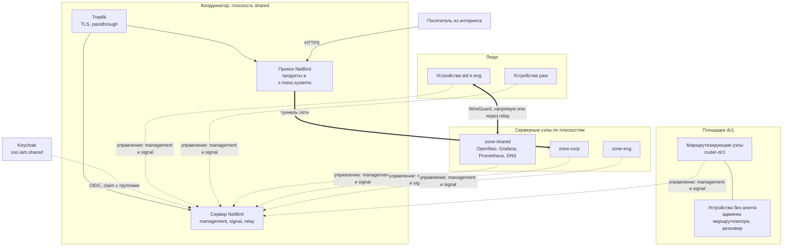
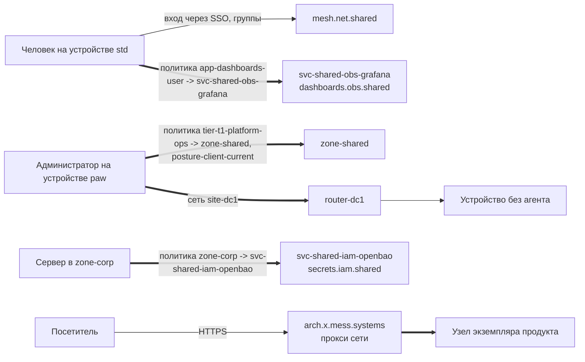

[English](README.md) | **Русский** | [简体中文](README.zh-CN.md)

# Типовая архитектура: net-mesh

Частная сеть mess.systems на NetBird: как связаны люди, серверы, устройства площадок и продукты. Доступность задают группы в поставщике идентичностей и политики сети, а не место в сети и не имя. Эта типовая архитектура фиксирует топологию, пути запросов, имена и DNS, группы и политики, подключение узлов, межсетевой экран хоста, публикацию продуктов, периметры организаций, развёртывание, известные проблемы и открытые вопросы.

**Статус:** черновик, развивается. Создано 2026-10-31. Перевод информативный; нормативный текст [английский](README.md). Все конфигурации это примеры с вымышленными именами в домене `mess.systems`, а не работающая система.

**Коды возможностей.** Координатор сети это `mesh` в домене `net` [стандарта именования](https://github.com/mess-systems/naming-standard/blob/main/i18n/ru/01-naming-conventions.md#43-коды-возможностей-уникальны-во-всех-доменах), имя сервиса `mesh.net.shared`. Шлюзы выхода в интернет это `egress` (домен `net`), внутренний DNS это `dns` (домен `net`), поставщик идентичностей (identity provider) это `sso` (домен `iam`), хранилище секретов это `secrets` (домен `iam`).

## 1. Границы

| Входит | Не входит |
|---|---|
| Координатор сети: management, signal, relay, его имена, развёртывание и резервное копирование | Агенты рабочих мест и базовые настройки устройств: см. типовую архитектуру [`endpoint`](../endpoint/) |
| Подключение устройств людей, серверов и устройств площадок без агента | Сам поставщик идентичностей: возможность `sso` |
| Группы, политики, проверки состояния устройства (posture checks) и раздельный DNS (split DNS) сети | Внутренние зоны и записи DNS: возможность `dns` |
| Правила межсетевого экрана хоста, которые уживаются с клиентом сети | Граница и входящий трафик продуктов кроме прокси сети: возможность `ingress` |
| Публикация экземпляров продуктов через обратный прокси сети | Доступ агентов к инструментам по MCP: см. типовую архитектуру [`obs-mcp-readonly`](../obs-mcp-readonly/) |

## 2. Состав

| Часть | Роль | Продукт | Радар |
|---|---|---|---|
| Сеть | Координатор (management, signal, relay), клиент на каждом узле, политики, обратный прокси | NetBird | [Adopt](https://github.com/mess-systems/tech-radar/blob/main/technologies/netbird.md) |
| Туннель | Шифрованный транспорт между узлами | WireGuard (внутри NetBird) | |
| Поставщик идентичностей | Вход людей, утверждение (claim) с группами для сети | Keycloak | [Adopt](https://github.com/mess-systems/tech-radar/blob/main/technologies/keycloak.md) |
| Секреты | Токен служебного пользователя сети, ключ шифрования состояния | OpenBao | [Adopt](https://github.com/mess-systems/tech-radar/blob/main/technologies/openbao.md) |
| Фронтальный прокси | TLS перед координатором, сквозной TLS (passthrough) к прокси сети | Traefik | [Adopt](https://github.com/mess-systems/tech-radar/blob/main/technologies/traefik.md) |
| Сертификаты | Публичные сертификаты координатора и опубликованных продуктов | ACME (Let's Encrypt) | [Adopt](https://github.com/mess-systems/tech-radar/blob/main/technologies/acme.md) |
| Сеть как код | Группы, политики, сети, DNS, настройки учётной записи | OpenTofu с провайдером `netbirdio/netbird` | [Adopt](https://github.com/mess-systems/tech-radar/blob/main/technologies/opentofu.md) |
| Настройка хостов | Установка клиента, подключение серверов, межсетевой экран хоста | Ansible | [Adopt](https://github.com/mess-systems/tech-radar/blob/main/technologies/ansible.md) |
| Межсетевой экран хоста | Правила вне сети | nftables | |
| Мониторинг | Метрики координатора и прокси | Prometheus, Grafana | [Prometheus](https://github.com/mess-systems/tech-radar/blob/main/technologies/prometheus.md), [Grafana](https://github.com/mess-systems/tech-radar/blob/main/technologies/grafana.md): Adopt |
| Маршрутизаторы площадок | Нижележащая сеть площадок, устройства без агента за маршрутизирующим узлом | MikroTik, Keenetic | [MikroTik](https://github.com/mess-systems/tech-radar/blob/main/technologies/mikrotik.md), [Keenetic](https://github.com/mess-systems/tech-radar/blob/main/technologies/keenetic.md): Adopt |
| Публичный DNS и репутация адресов | Wildcard-запись для опубликованных продуктов, списки блокировки на прокси сети | Публичный DNS организации, CrowdSec | |

## 3. Топология

- Каждый узел держит управляющее соединение с координатором. Данные идут от узла к узлу: напрямую, если позволяет NAT, иначе через relay.
- Координатор раздаёт только то, что разрешают политики. Узел, не попавший ни в одну политику, не видит других узлов.
- Публичное имя есть только у координатора. У серверов, площадок и опубликованных продуктов нет публичного IP-адреса и входящих портов.

## 4. Пути запросов

- **Человек к сервису.** Человек входит в клиент NetBird через Keycloak. Claim с группами помещает узел в группы `role-*`, `tier-*` и `app-*`. Политика от группы приложения к группе узлов сервиса открывает один порт одного сервиса, а не плоскость.
- **Администратор к поверхности управления.** Административные пути начинаются от групп `tier-*`. В них состоят только учётные записи `-adm`, и входят они только с устройств `paw`. Политика также несёт проверку состояния устройства.
- **Сервер к серверу.** Серверы попадают в группы зоны и сервиса через автогруппы ключа подключения (setup key). Политики между группами сервисов односторонние и называют порт.
- **Человек к устройству без агента.** Маршрутизирующий узел площадки пересылает трафик на отдельные адреса, опубликованные как сетевые ресурсы. Ресурс недоступен, пока его не назовёт политика.
- **Посетитель к продукту.** Прокси сети завершает HTTPS для имён продуктов в `x.mess.systems` и передаёт запрос через сеть узлу экземпляра. См. [публикацию продуктов](#9-публикация-продуктов).

## 5. Имена и DNS

| Объект | Имя | Правило |
|---|---|---|
| Координатор, внутреннее имя | `mesh.net.shared.svc.mess.systems` | Грамматика A стандарта именования |
| Координатор, публичное имя | `netbird.mess.systems` | Записанное исключение в `catalog/dns-exceptions.yaml` стандарта именования: координатор должен быть доступен до подъёма сети |
| Координатор продукта, если его выделят | `mesh.net.platform.prd.svc.mess.systems` | [Платформа продукта и корпоративные сервисы](https://github.com/mess-systems/naming-standard/blob/main/i18n/ru/07-deployment-and-tenants.md#124-платформа-продукта-и-корпоративные-сервисы) |
| Опубликованные продукты | `<product>.x.mess.systems`, поверхности `<surface>.<product>.x.mess.systems` | Подзона витрины, [грамматика B: публичная](https://github.com/mess-systems/naming-standard/blob/main/i18n/ru/01-naming-conventions.md#32-грамматика-b-публичная) |
| Серверы | `<site>-<plane>-<domain>-<product>-<env>-<nn>` | [Формы объектов](https://github.com/mess-systems/naming-standard/blob/main/i18n/ru/01-naming-conventions.md#5-формы-объектов). Имя хоста ничего не даёт; права дают группы |
| Устройства людей | `<profile>-<form>-<asset-id>` | Имена рабочих мест, см. типовую архитектуру `endpoint` |

- **Раздельный DNS.** Одна группа серверов имён (nameserver group) на площадку (`svc-mess-systems-dc1`, [DNS в mesh](https://github.com/mess-systems/naming-standard/blob/main/i18n/ru/04-identity-conventions.md#43-dns-в-mesh)) с доменом сопоставления `svc.mess.systems` отправляет внутренние имена во внутренний резолвер (`dns.net.shared`). Остальные имена разрешает собственный резолвер устройства. Домены поиска выключены, короткие имена не разрешаются.
- **Один источник записей.** Записи сервисов живут во внутренней зоне DNS, а не в собственных зонах (custom zones) NetBird. Собственная зона допустима только для короткоживущей среды без внутреннего DNS. Она не должна пересекаться с `svc.mess.systems` и с доменом узлов.
- **Имена узлов.** Узлы остаются в собственном домене узлов NetBird. Устройства людей не получают записей в `svc.mess.systems`.
- **Внутренние сертификаты.** Сервисы за сетью получают сертификаты внутреннего УЦ (`pki.iam.shared`) по ACME. Сеть не заменяет TLS.

## 6. Группы и политики

Формы групп следуют разделу [группы mesh VPN](https://github.com/mess-systems/naming-standard/blob/main/i18n/ru/04-identity-conventions.md#4-группы-mesh-vpn) стандарта именования; имена политик, правил и проверок состояния следуют разделу [политики, правила и проверки состояния mesh](https://github.com/mess-systems/naming-standard/blob/main/i18n/ru/04-identity-conventions.md#41-политики-правила-и-проверки-состояния-mesh).

| Группа | Содержит | Откуда берётся |
|---|---|---|
| `tier-*`, `role-*`, `app-<capability>-<access>`, `app-<product>-<access>` | Узлы людей | Claim с группами из Keycloak (синхронизация групп из JWT) |
| `zone-<plane>` | Серверные узлы и сетевые ресурсы плоскости | Автогруппы ключа подключения, группы ресурсов |
| `svc-<application>` | Узлы одного сервиса | Автогруппы ключа подключения |
| `site-<code>` | Узлы одной площадки | Автогруппы ключа подключения |
| `egress-<plane>` | Выходные узлы (exit nodes) плоскости | Задаются в OpenTofu |
| `router-<site-code>` | Маршрутизирующие узлы площадки | Задаются в OpenTofu |

Правила политик:

- Политика называется `<subject-group> -> <target-group>`, одна политика на пару групп, например `tier-t1-platform-ops -> zone-shared`. Если паре нужны два протокола, имя заканчивается на ` (udp)` или ` (tcp)`: `role-developers -> svc-shared-net-dns (udp)`. Политика называет протокол и порты; `all` не используется вне плоскости координатора.
- Правило называется именами служб IANA своих портов (`ssh-https`, `domain`) или `<protocol>-<port>`, если у порта такого имени нет (`tcp-8200`). Проверка состояния называется `posture-<what>-<condition>`: `posture-client-current`.
- Политика учётной записи Default (All к All) сохраняет имя продукта и выключена. Группа All никогда не бывает ни источником, ни назначением.
- Люди попадают к сервисам через группы приложений и группу узлов сервиса. Плоскости (`zone-*`) бывают назначением только для административных групп `tier-*`.
- Политики односторонние. Двусторонняя политика допустима, только когда соединения открывают обе стороны.
- Административные политики несут проверки состояния: минимальная версия клиента, версия ОС там, где это важно.
- Метка никогда не бывает входом авторизации. Имя устройства, имя хоста или тег не открывают путь.

## 7. Подключение узлов

| Узел | Как подключается | Сессия |
|---|---|---|
| Устройство человека | Клиент NetBird, вход через SSO в Keycloak | Вход узла истекает через 24 часа; человек входит снова |
| Сервер | Ansible создаёт одноразовый ключ подключения с именем хоста, клиент подключается, ключ удаляется | Не истекает: узлы с ключом подключения не подпадают под истечение входа |
| Маршрутизирующий узел | Как сервер, плюс членство в `router-<site-code>` | Как у сервера |
| Короткоживущий узел CI или тестов | Эфемерный ключ подключения | Management удаляет его через 10 минут без связи |

- Ключи подключения одноразовые и создаются по запросу. Многоразовые ключи не хранятся.
- Отзыв ключа подключения не отключает уже подключённые узлы. Вывод сервера из сети это удаление узла с записью в журнале изменений.
- Автогруппы применяются только к узлам, подключившимся после создания ключа. Перенос сервера в другую зону это изменение групп в OpenTofu.
- Ключ подключения называется именем хоста, для которого выпущен, например `dc1-shared-data-postgres-prd-01`. Эфемерный ключ для группы короткоживущих узлов называется `<application>-<env>-ephemeral` ([сети, ресурсы и ключи mesh](https://github.com/mess-systems/naming-standard/blob/main/i18n/ru/04-identity-conventions.md#42-сети-ресурсы-и-ключи-mesh)).
- Персональный токен доступа (personal access token) для OpenTofu и Ansible принадлежит служебному пользователю NetBird `svc-shared-net-iac`, названному по репозиторию инфраструктуры как кода сети. Токен хранится в OpenBao и попадает в запуск переменной окружения.
- Серверы, которые аутентифицируются в OpenBao по адресу источника, должны обращаться к нему напрямую как узлы сети. Маршрутизирующий узел с маскарадингом (masquerade) скрывает настоящий источник: OpenBao видит адрес маршрутизатора.

## 8. Межсетевой экран хоста

- Клиент NetBird держит собственную таблицу nftables `netbird`. Он вставляет разрешающие правила для своего интерфейса в чужие базовые цепочки с хуками input и forward и восстанавливает их при изменении таблиц.
- Правила хоста организации живут в отдельной таблице, которую доставляет Ansible. Файл никогда не выполняет `flush ruleset`.
- Трафик сети фильтруют политики сети. Таблица хоста отвечает за LAN, прямой порт WireGuard (UDP 51820), аварийный SSH из сети управления площадки и сборщики площадки, которые снимают метрики по LAN.
- Пример: [`examples/nftables-hostfw.example.nft`](examples/nftables-hostfw.example.nft).

## 9. Публикация продуктов

Экземпляры продуктов публикует обратный прокси сети той же установки. NetBird Cloud не используется.

| Экземпляр | Доступ | Как |
|---|---|---|
| `arch.x.mess.systems` | Публичное демо, только чтение | Сервис прокси без аутентификации; служебные пути закрыты |
| `app.arch.x.mess.systems` | Только сотрудники | Доступ только из сети NetBird по [группе доступа продукта](https://github.com/mess-systems/naming-standard/blob/main/i18n/ru/04-identity-conventions.md#34-группы-доступа-продукта) `app-arch-user` или SSO через Keycloak по той же группе |

`arch` здесь обозначает продукт витрины, то есть совокупности продуктов, публикуемых в подзоне `x.mess.systems`.

- DNS: wildcard-запись `*.arch.x.mess.systems` на каждый продукт и ещё одна на каждую непродуктивную среду, типа CNAME на прокси, только DNS (без проксирования CDN); вершина домена продукта `arch.x.mess.systems` получает отдельную запись. Wildcard покрывает ровно одну метку ([записи DNS](https://github.com/mess-systems/naming-standard/blob/main/i18n/ru/08-operations-objects.md#6-записи-dns)). Сайт витрины `x.mess.systems` публикуется отдельно.
- Сертификаты: ACME с `tls-alpn-01`, запасной вариант `http-01`. CDN перед прокси может срезать `acme-tls/1`.
- Каждый экземпляр это отдельный сервис прокси, нацеленный на один узел или один сетевой ресурс. У хоста экземпляра нет публичного адреса и входящих портов. Порты 443 и 80 слушает только прокси.
- Доступ только из сети NetBird требует кластера прокси с возможностью private и исключает SSO, пароль, PIN и аутентификацию заголовком на том же сервисе. Бэкенд получает `X-NetBird-User` и `X-NetBird-Groups`.
- SSO на прокси выполняет вход через Keycloak по имени `sso.mess.systems`, записанному исключению в `catalog/dns-exceptions.yaml` стандарта именования; каноническое имя остаётся `sso.iam.shared.svc.mess.systems`.
- Необязательные ограничения сервиса: диапазоны адресов, страны, репутация адресов CrowdSec.

## 10. Периметры организаций

- Один периметр организации, одна установка: граница данных, сети и учётных записей одной организации ([два контура](https://github.com/mess-systems/naming-standard/blob/main/i18n/ru/07-deployment-and-tenants.md#1-два-контура)). Периметр никогда не попадает в имя.
- Первая установка корпоративная (`mesh.net.shared`). Продукты витрины пользуются ею, пока одна установка обслуживает оба контура: она сохраняет корпоративное имя, а продукт ссылается на неё.
- Когда ячейкам продукта понадобится свой координатор, вторая установка получает продуктовое имя `mesh.net.platform.prd.svc.mess.systems`. Группы, политики и код копируются стеком, а не разделяются.
- Организация-заказчик со своим экземпляром продукта получает свою установку на своей стороне, названную по собственному стандарту заказчика.

## 11. Развёртывание

- **Установка.** Одна Linux-ВМ в плоскости shared с объединённым контейнером сервера NetBird за Traefik. Публичные порты: TCP 80 и 443, UDP 3478. Поставщик идентичностей Keycloak; локальные пользователи остаются только для аварийных учётных записей (`breakglass-mesh-01`).
- **Как код.** Группы, политики, проверки состояния, сети, группы серверов имён и настройки учётной записи живут в стеке OpenTofu. Состояние и планы шифруются ключом transit в OpenBao. Метки ресурсов в snake_case, как требует раздел [инфраструктура как код и раннеры](https://github.com/mess-systems/naming-standard/blob/main/i18n/ru/07-deployment-and-tenants.md#127-инфраструктура-как-код-и-раннеры). Ключ transit называется по имени приложения, `shared-net-netbird`. Изменения проходят ревью; веб-консоль в повседневной работе только для чтения.
- **Хосты.** Ansible ставит клиент из репозитория пакетов, подключает серверы и доставляет межсетевой экран хоста.
- **Резервное копирование и восстановление.** База management и ключи это единственное состояние, которое нельзя создать заново. Они копируются ежедневно вместе с файлами конфигурации; восстановление отрабатывается на чистой ВМ. Их потеря означает повторное подключение всех клиентов.
- **Обновление.** По одному релизу, после чтения примечаний к выпуску, с предварительной резервной копией. Клиенты обновляет Ansible и управление устройствами из типовой архитектуры `endpoint`.
- **Мониторинг.** Сборщики площадки не зависят от сети: Prometheus площадки снимает метрики node exporter, сервера (порт 9090) и прокси (порт 8080) по LAN площадки, а не через `wt0`, поэтому отказ сети остаётся видимым. Метрики без аутентификации; межсетевой экран хоста пускает к ним только диапазон сборщиков. Политики сети для мониторинга нет. Grafana использует дашборды, опубликованные NetBird.
- **Редакция.** Открытая редакция покрывает сеть, политики и маршрутизацию. Коммерческая лицензия добавляет одобрение узлов, SCIM, проверки состояния из EDR и MDM, журнал трафика, потоковую выгрузку событий и active-active management. См. открытые вопросы.

## 12. Известные проблемы

**Маршрутизирующий узел и сервисы на нём.** Политика сетевого ресурса покрывает трафик, пересылаемый через маршрутизирующий узел. Сервису, который работает на самом маршрутизирующем узле, нужна политика между узлами; клиентам в пользовательском режиме (userspace) нужно ещё включить локальную пересылку.

**Отказоустойчивость, а не балансировка.** Два маршрутизирующих узла в одной группе дают переключение при отказе. С включённым маскарадингом переключение сбрасывает TCP-соединения. Выключить маскарадинг можно только на Linux, и тогда в LAN нужен обратный маршрут к диапазону сети.

**Поддержка раздельного DNS.** Домены сопоставления работают штатно в macOS, Windows 10 и новее и в Linux с systemd-resolved. Остальные системы используют пересылку DNS NetBird.

**Разрешённые группы JWT.** Неверное имя claim или список разрешённых групп закрывает вход всем, включая администраторов. Сначала проверить claim с группами на тестовой учётной записи; держать аварийного локального пользователя.

**Проверка по публичному адресу.** Проверка публичного адреса узла работает, только когда фронтальный прокси передаёт адрес клиента и координатор доверяет этому прокси.

**Signal и relay перезапускаются вместе.** В объединённом контейнере сервера перезапуск signal перезапускает и relay. Прямые соединения сохраняются, соединения через relay обрываются.

**Обратный прокси в бете.** Поведение и настройки прокси могут меняться между релизами.

## 13. Примеры

| Файл | Что показывает |
|---|---|
| [`examples/opentofu-providers.example.tf`](examples/opentofu-providers.example.tf) | Закрепление версии провайдера, адрес management, шифрование состояния и планов ключом transit в OpenBao |
| [`examples/opentofu-groups-policies.example.tf`](examples/opentofu-groups-policies.example.tf) | Группы IdP по имени, группы зон, площадок, сервисов и маршрутизаторов, проверка состояния, выключенная политика Default, политики администраторов, пользователей и сервисов |
| [`examples/opentofu-networks-dns.example.tf`](examples/opentofu-networks-dns.example.tf) | Сеть площадки с группой маршрутизирующих узлов, узкие ресурсы, политики к резолверу по группам, раздельный DNS для `svc.mess.systems`, настройки учётной записи |
| [`examples/ansible-netbird-server-peer.example.yml`](examples/ansible-netbird-server-peer.example.yml) | Установка клиента и подключение сервера одноразовым ключом, который удаляется после использования |
| [`examples/nftables-hostfw.example.nft`](examples/nftables-hostfw.example.nft) | Таблица межсетевого экрана хоста рядом с таблицей NetBird, сборщики площадки по LAN, без `flush ruleset` |

Файлы OpenTofu проходят `tofu validate` с провайдером 0.0.11. Плейбук проходит `ansible-playbook --syntax-check` и `ansible-lint`. Файл nftables проходит `nft -c`.

## 14. Открытые вопросы

1. Редакция: хватит ли открытой редакции, или нужны одобрение узлов, проверки состояния из управления устройствами и журнал трафика? Коммерческая лицензия оплачивается за год.
2. Проверки состояния из управления устройствами (Fleet в типовой архитектуре `endpoint`) это интеграция EDR коммерческой редакции. Без неё проверки ограничены версией клиента, версией ОС, местоположением, диапазоном адресов и процессами.
3. Проверка состояния по сертификату пока не поддерживается провайдером OpenTofu.
4. Ленивые соединения (lazy connections): включать на устройствах людей и выключать на серверах и маршрутизирующих узлах?
5. Когда продуктовому контуру выделять свой координатор и как держать политики двух установок согласованными.
6. Высокая доступность координатора в открытой редакции: сейчас только резервное копирование и восстановление.

## Источники

- NetBird, быстрый старт self-hosted: https://docs.netbird.io/selfhosted/selfhosted-quickstart
- NetBird, Keycloak с self-hosted NetBird (claim с группами): https://docs.netbird.io/selfhosted/identity-providers/keycloak
- NetBird, резервное копирование и восстановление self-hosted установки: https://docs.netbird.io/selfhosted/maintenance/backup
- NetBird, внешний обратный прокси: https://docs.netbird.io/selfhosted/external-reverse-proxy
- NetBird, корпоративная лицензия self-hosted: https://docs.netbird.io/selfhosted/enterprise
- NetBird, сети (networks): https://docs.netbird.io/manage/networks
- NetBird, управление доступом и политики: https://docs.netbird.io/manage/access-control
- NetBird, проверки состояния устройства: https://docs.netbird.io/manage/access-control/posture-checks
- NetBird, группы серверов имён: https://docs.netbird.io/manage/dns/nameserver-groups
- NetBird, ключи подключения: https://docs.netbird.io/manage/peers/register-machines-using-setup-keys
- NetBird, собственные домены обратного прокси: https://docs.netbird.io/manage/reverse-proxy/custom-domains
- NetBird, аутентификация в обратном прокси: https://docs.netbird.io/manage/reverse-proxy/authentication
- NetBird, API ключей подключения: https://docs.netbird.io/api/resources/setup-keys
- NetBird, установка на Linux: https://docs.netbird.io/get-started/install/linux
- Клиент NetBird, менеджер nftables: https://github.com/netbirdio/netbird/tree/main/client/firewall/nftables
- Провайдер NetBird для OpenTofu и Terraform: https://github.com/netbirdio/terraform-provider-netbird
- OpenTofu, шифрование состояния и планов: https://opentofu.org/docs/language/state/encryption/
- Стандарт именования mess.systems: https://github.com/mess-systems/naming-standard
- Технологический радар mess.systems, NetBird: https://github.com/mess-systems/tech-radar/blob/main/technologies/netbird.md
