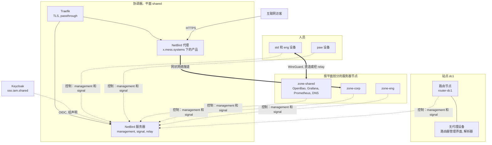
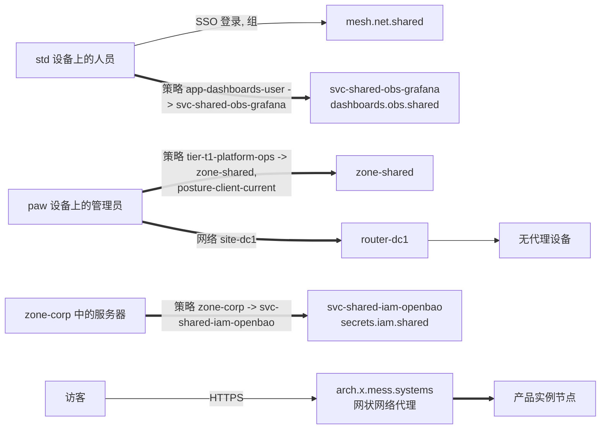

[English](README.md) | [Русский](README.ru.md) | **简体中文**

# 参考架构：net-mesh

mess.systems 基于 NetBird 的私有网络：人员、服务器、站点设备和产品如何相互连接。可达性来自身份提供方中的组和网状网络中的策略，而不是网络位置或名称。本参考架构规定拓扑、请求路径、名称与 DNS、组与策略、节点接入、主机防火墙、产品发布、组织边界、部署、已知问题和未决问题。

**状态：** 草稿，持续演进。创建于 2026-10-31。译文仅供参考；规范文本为[英文版](README.md)。所有配置都是使用 `mess.systems` 下虚构名称的示例，不是运行中的系统。

**能力代码。** 网状网络协调器是[命名标准](https://github.com/mess-systems/naming-standard/blob/main/i18n/zh-CN/01-naming-conventions.md#43-能力代码在所有域中唯一)中域 `net` 下的 `mesh`，服务名 `mesh.net.shared`。出口网关是 `egress`（域 `net`），内部 DNS 是 `dns`（域 `net`），身份提供方是 `sso`（域 `iam`），密钥库是 `secrets`（域 `iam`）。

## 1. 范围

| 包含 | 不包含 |
|---|---|
| 网状网络协调器：management、signal、relay，及其名称、部署和备份 | 终端代理和设备基线：见 [`endpoint`](../endpoint/) 参考架构 |
| 人员设备、服务器和无代理站点设备的接入 | 身份提供方本身：能力 `sso` |
| 网状网络的组、策略、状态检查（posture checks）和分离 DNS（split DNS） | 内部 DNS 区域和记录：能力 `dns` |
| 与网状网络客户端共存的主机防火墙规则 | 网状网络代理之外的公共产品流量的边缘与入口：能力 `ingress` |
| 通过网状网络反向代理发布产品实例 | 代理（agent）通过 MCP 访问工具：见 [`obs-mcp-readonly`](../obs-mcp-readonly/) 参考架构 |

## 2. 组成

| 部分 | 作用 | 产品 | 雷达 |
|---|---|---|---|
| 网状网络 | 协调器（management、signal、relay）、每个节点上的客户端、策略、反向代理 | NetBird | [Adopt](https://github.com/mess-systems/tech-radar/blob/main/technologies/netbird.md) |
| 隧道 | 节点之间的加密传输 | WireGuard（NetBird 内置） | |
| 身份提供方 | 人员登录，为网状网络提供组声明（claim） | Keycloak | [Adopt](https://github.com/mess-systems/tech-radar/blob/main/technologies/keycloak.md) |
| 密钥 | 网状网络服务用户的访问令牌、状态加密密钥 | OpenBao | [Adopt](https://github.com/mess-systems/tech-radar/blob/main/technologies/openbao.md) |
| 前置代理 | 协调器前的 TLS，到网状网络代理的 TLS 直通（passthrough） | Traefik | [Adopt](https://github.com/mess-systems/tech-radar/blob/main/technologies/traefik.md) |
| 证书 | 协调器和已发布产品的公共证书 | ACME（Let's Encrypt） | [Adopt](https://github.com/mess-systems/tech-radar/blob/main/technologies/acme.md) |
| 网状网络即代码 | 组、策略、网络、DNS、账户设置 | OpenTofu 与 `netbirdio/netbird` provider | [Adopt](https://github.com/mess-systems/tech-radar/blob/main/technologies/opentofu.md) |
| 主机配置 | 客户端安装、服务器接入、主机防火墙 | Ansible | [Adopt](https://github.com/mess-systems/tech-radar/blob/main/technologies/ansible.md) |
| 主机防火墙 | 网状网络之外的规则 | nftables | |
| 监控 | 协调器和代理的指标 | Prometheus、Grafana | [Prometheus](https://github.com/mess-systems/tech-radar/blob/main/technologies/prometheus.md)、[Grafana](https://github.com/mess-systems/tech-radar/blob/main/technologies/grafana.md)：Adopt |
| 站点路由器 | 站点的底层网络，路由节点后面的无代理设备 | MikroTik、Keenetic | [MikroTik](https://github.com/mess-systems/tech-radar/blob/main/technologies/mikrotik.md)、[Keenetic](https://github.com/mess-systems/tech-radar/blob/main/technologies/keenetic.md)：Adopt |
| 公共 DNS 与 IP 信誉 | 已发布产品的通配符记录，网状网络代理上的阻止列表 | 组织的公共 DNS、CrowdSec | |

## 3. 拓扑

- 每个节点都与协调器保持控制连接。数据在节点之间传输：NAT 允许时直连，否则经由 relay。
- 协调器只分发策略允许的内容。不匹配任何策略的节点看不到其他节点。
- 只有协调器有公共名称。服务器、站点和已发布产品没有公网 IP 地址，也没有入站端口。

## 4. 请求路径

- **人员到服务。** 人员通过 Keycloak 在 NetBird 客户端上登录。组声明把节点放入 `role-*`、`tier-*` 和 `app-*` 组。从应用组到服务节点组的策略开放一个服务的一个端口，而不是整个平面。
- **管理员到控制面。** 管理路径从 `tier-*` 组开始。只有 `-adm` 账户是其成员，并且只在 `paw` 设备上登录。策略还带有状态检查。
- **服务器到服务器。** 服务器通过设置密钥（setup key）的自动组加入区域组和服务组。服务组之间的策略是单向的，并写明端口。
- **人员到无代理设备。** 站点的路由节点把流量转发到作为网络资源发布的单个地址。在有策略指名之前，资源不可达。
- **访客到产品。** 网状网络代理为 `x.mess.systems` 下的产品名称终止 HTTPS，并通过网状网络把请求发送到实例节点。见[发布产品](#9-发布产品)。

## 5. 名称与 DNS

| 对象 | 名称 | 规则 |
|---|---|---|
| 协调器，内部 | `mesh.net.shared.svc.mess.systems` | 命名标准的语法 A |
| 协调器，公共 | `netbird.mess.systems` | 命名标准 `catalog/dns-exceptions.yaml` 中登记的例外：协调器必须在网状网络建立之前即可访问 |
| 产品协调器（如拆分） | `mesh.net.platform.prd.svc.mess.systems` | [产品平台与企业服务](https://github.com/mess-systems/naming-standard/blob/main/i18n/zh-CN/07-deployment-and-tenants.md#124-产品平台与企业服务) |
| 已发布产品 | `<product>.x.mess.systems`，界面 `<surface>.<product>.x.mess.systems` | 展示区子区域，[语法 B：公共](https://github.com/mess-systems/naming-standard/blob/main/i18n/zh-CN/01-naming-conventions.md#32-语法-b公共) |
| 服务器主机 | `<site>-<plane>-<domain>-<product>-<env>-<nn>` | [对象形式](https://github.com/mess-systems/naming-standard/blob/main/i18n/zh-CN/01-naming-conventions.md#5-对象形式)。主机名不授予任何权限；授予权限的是组 |
| 人员设备 | `<profile>-<form>-<asset-id>` | 终端命名，见 `endpoint` 参考架构 |

- **分离 DNS。** 每个站点一个名称服务器组（`svc-mess-systems-dc1`，[网状网络 DNS](https://github.com/mess-systems/naming-standard/blob/main/i18n/zh-CN/04-identity-conventions.md#43-网状网络-dns)），匹配域为 `svc.mess.systems`，把内部名称发送到内部解析器（`dns.net.shared`）。其他名称仍由设备自己的解析器处理。搜索域保持关闭，因此短名称不会被解析。
- **单一记录来源。** 服务记录位于内部 DNS 区域中，而不是 NetBird 自定义区域（custom zones）中。自定义区域只用于没有内部 DNS 的短期环境，且不得与 `svc.mess.systems` 或节点域重叠。
- **节点名称。** 节点保留 NetBird 自己的节点域。人员设备在 `svc.mess.systems` 中没有记录。
- **内部证书。** 网状网络后面的服务通过 ACME 使用内部 CA（`pki.iam.shared`）签发的证书。网状网络不替代 TLS。

## 6. 组与策略

组的形式遵循命名标准的[网状 VPN 组](https://github.com/mess-systems/naming-standard/blob/main/i18n/zh-CN/04-identity-conventions.md#4-网状-vpn-组)；策略、规则和状态检查的名称遵循[网状网络策略、规则与状态检查](https://github.com/mess-systems/naming-standard/blob/main/i18n/zh-CN/04-identity-conventions.md#41-网状网络策略规则与状态检查)。

| 组 | 包含 | 来源 |
|---|---|---|
| `tier-*`、`role-*`、`app-<capability>-<access>`、`app-<product>-<access>` | 人员的节点 | Keycloak 组声明（JWT 组同步） |
| `zone-<plane>` | 一个平面的服务器节点和网络资源 | 设置密钥自动组、资源组 |
| `svc-<application>` | 一个服务的节点 | 设置密钥自动组 |
| `site-<code>` | 一个地点的节点 | 设置密钥自动组 |
| `egress-<plane>` | 一个平面的出口节点 | 在 OpenTofu 中设置 |
| `router-<site-code>` | 一个站点的路由节点 | 在 OpenTofu 中设置 |

策略规则：

- 策略命名为 `<subject-group> -> <target-group>`，每对组一条策略，例如 `tier-t1-platform-ops -> zone-shared`。当一对组需要两种协议时，名称以 ` (udp)` 或 ` (tcp)` 结尾：`role-developers -> svc-shared-net-dns (udp)`。策略写明协议和端口；除协调器平面外不使用 `all`。
- 规则以其端口的 IANA 服务名命名（`ssh-https`、`domain`），端口没有此类名称时用 `<protocol>-<port>`（`tcp-8200`）。状态检查命名为 `posture-<what>-<condition>`：`posture-client-current`。
- 账户的 Default 策略（All 到 All）保留产品名称并被关闭。All 组从不作为来源或目标。
- 人员通过应用组和服务节点组访问服务。平面（`zone-*`）只作为 `tier-*` 管理组的目标。
- 策略是单向的。只有双方都发起连接时才允许双向规则。
- 管理策略带有状态检查：最低客户端版本，必要时加上操作系统版本。
- 标签从不作为授权输入。设备名、主机名或标记（tag）都不会开放路径。

## 7. 节点接入

| 节点 | 接入方式 | 会话 |
|---|---|---|
| 人员的设备 | NetBird 客户端，通过 Keycloak 进行 SSO 登录 | 节点登录 24 小时后过期；人员重新登录 |
| 服务器 | Ansible 创建一个以主机名命名的一次性设置密钥，客户端接入，然后删除密钥 | 不过期：使用设置密钥接入的节点不受登录过期约束 |
| 路由节点 | 与服务器相同，另加入 `router-<site-code>` | 与服务器相同 |
| 短期 CI 或测试节点 | 临时（ephemeral）设置密钥 | 离线 10 分钟后由 management 删除 |

- 设置密钥是一次性的，按需创建。不保留可重复使用的密钥。
- 撤销设置密钥不会断开已接入的节点。移除服务器即删除节点，并记录在变更日志中。
- 自动组只作用于密钥创建之后接入的节点。把服务器移到另一个区域是在 OpenTofu 中修改组。
- 设置密钥采用其签发对象的主机名，例如 `dc1-shared-data-postgres-prd-01`。用于一组短期节点的临时密钥为 `<application>-<env>-ephemeral`（[网状网络的网络、资源与密钥](https://github.com/mess-systems/naming-standard/blob/main/i18n/zh-CN/04-identity-conventions.md#42-网状网络的网络资源与密钥)）。
- OpenTofu 和 Ansible 使用的个人访问令牌（personal access token）属于 NetBird 服务用户 `svc-shared-net-iac`，以网状网络的基础设施即代码仓库命名。它保存在 OpenBao 中，以环境变量的形式传入运行。
- 按源地址向 OpenBao 认证的服务器必须作为节点直接访问它。启用伪装（masquerade）的路由节点会隐藏真实来源：OpenBao 看到的是路由器的地址。

## 8. 主机防火墙

- NetBird 客户端维护自己的 nftables 表 `netbird`。它把针对自身接口的放行规则插入其他带 input 和 forward 钩子的基础链中，并在表发生变化时恢复这些规则。
- 组织的主机规则位于由 Ansible 下发的独立表中。该文件从不执行 `flush ruleset`。
- 网状网络流量由网状网络策略过滤。主机表负责 LAN、WireGuard 直连端口（UDP 51820）、来自站点管理 LAN 的应急（break-glass）SSH，以及通过 LAN 抓取指标的站点采集器。
- 示例：[`examples/nftables-hostfw.example.nft`](examples/nftables-hostfw.example.nft)。

## 9. 发布产品

产品实例由同一安装中的网状网络反向代理发布。不使用 NetBird Cloud。

| 实例 | 访问 | 方式 |
|---|---|---|
| `arch.x.mess.systems` | 公开演示，只读 | 无认证的代理服务；服务路径被屏蔽 |
| `app.arch.x.mess.systems` | 仅限员工 | 按[产品访问组](https://github.com/mess-systems/naming-standard/blob/main/i18n/zh-CN/04-identity-conventions.md#34-产品访问组) `app-arch-user` 仅允许 NetBird 访问，或按同一组通过 Keycloak 进行 SSO |

此处 `arch` 代表展示区中的一个产品；展示区是在子区域 `x.mess.systems` 中发布的产品集合。

- DNS：每个产品一条通配符记录 `*.arch.x.mess.systems`，每个非生产环境再各一条，以 CNAME 指向代理，仅 DNS（不经 CDN 代理）；产品域顶点 `arch.x.mess.systems` 有单独的记录。通配符只覆盖一个标签（[DNS 记录](https://github.com/mess-systems/naming-standard/blob/main/i18n/zh-CN/08-operations-objects.md#6-dns-记录)）。展示区网站 `x.mess.systems` 单独发布。
- 证书：ACME 使用 `tls-alpn-01`，`http-01` 作为备选。代理前的 CDN 可能会剥离 `acme-tls/1`。
- 每个实例都是一个独立的代理服务，指向一个节点或一个网络资源。实例主机没有公网地址，也没有入站端口。只有代理监听 443 和 80。
- 仅限 NetBird 的访问需要具备 private 能力的代理集群，并且在同一服务上排除 SSO、密码、PIN 和请求头认证。后端会收到 `X-NetBird-User` 和 `X-NetBird-Groups`。
- 代理上的 SSO 通过 Keycloak 在 `sso.mess.systems` 登录，该名称是命名标准 `catalog/dns-exceptions.yaml` 中登记的例外；其规范名称仍为 `sso.iam.shared.svc.mess.systems`。
- 服务的可选限制：地址范围、国家、CrowdSec IP 信誉。

## 10. 组织边界

- 一个组织边界，一个安装：一个组织的数据、网络和账户的边界（[两个轮廓](https://github.com/mess-systems/naming-standard/blob/main/i18n/zh-CN/07-deployment-and-tenants.md#1-两个轮廓)）。边界从不进入名称。
- 第一个安装是企业安装（`mesh.net.shared`）。当一个安装同时服务两个轮廓时，展示区的产品使用它：它保留企业名称，由产品引用它。
- 当产品单元需要自己的协调器时，第二个安装采用产品名称 `mesh.net.platform.prd.svc.mess.systems`。组、策略和代码按栈复制，而不是共享。
- 拥有自己产品实例的客户组织在其自身一侧拥有自己的安装，按客户自己的标准命名。

## 11. 部署

- **安装。** 共享平面中的一台 Linux 虚拟机，运行合并的 NetBird 服务器容器，前面是 Traefik。公共端口：TCP 80 和 443，UDP 3478。身份提供方为 Keycloak；本地用户只保留给应急账户（`breakglass-mesh-01`）。
- **即代码。** 组、策略、状态检查、网络、名称服务器组和账户设置位于一个 OpenTofu 栈中。状态和计划用 OpenBao 的 transit 密钥加密。资源标签使用 snake_case，符合[基础设施即代码与运行器](https://github.com/mess-systems/naming-standard/blob/main/i18n/zh-CN/07-deployment-and-tenants.md#127-基础设施即代码与运行器)的要求。transit 密钥采用应用名称 `shared-net-netbird`。变更需经过评审；日常工作中控制台只读。
- **主机。** Ansible 从软件包仓库安装客户端、接入服务器并下发主机防火墙。
- **备份与恢复。** management 数据库和密钥是唯一无法重新生成的状态。它们与配置文件一起每天备份；恢复在干净的虚拟机上演练。丢失它们意味着所有客户端都要重新接入。
- **升级。** 每次一个版本，先阅读发行说明，并先做备份。客户端由 Ansible 以及 `endpoint` 参考架构中的设备管理更新。
- **监控。** 站点采集器不依赖网状网络：站点的 Prometheus 通过站点 LAN 而不是 `wt0` 抓取 node exporter、服务器（端口 9090）和代理（端口 8080）的指标，因此网状网络故障仍然可见。这些指标没有认证；主机防火墙只允许采集器地址范围访问。监控没有网状网络策略。Grafana 使用 NetBird 发布的仪表板。
- **版本。** 开源版涵盖网络、策略和路由。商业许可增加节点审批、SCIM、EDR 和 MDM 状态检查、流量日志、事件流以及 active-active management。见未决问题。

## 12. 已知问题

**路由节点及其上的服务。** 网络资源策略覆盖经路由节点转发的流量。运行在路由节点自身上的服务需要节点到节点的策略；用户态（userspace）客户端还需要启用本地转发。

**故障切换，而非负载均衡。** 同一组中的两个路由节点提供故障切换。启用伪装时，切换会重置 TCP 连接。只有在 Linux 上才能关闭伪装，并且 LAN 上需要一条到网状网络地址范围的回程路由。

**分离 DNS 支持。** 匹配域在 macOS、Windows 10 及更高版本以及带 systemd-resolved 的 Linux 上原生可用。其他系统使用 NetBird 转发器。

**JWT 允许组。** 错误的声明名称或允许列表会把所有人锁在外面，包括管理员。先在测试账户上检查组声明；保留一个应急本地用户。

**基于公网地址的状态检查。** 只有当前置代理传递客户端地址且协调器信任该代理时，基于节点公网地址的检查才有效。

**Signal 与 relay 一起重启。** 在合并的服务器容器中，重启 signal 也会重启 relay。直连保持不变；经 relay 的连接会断开。

**反向代理处于 beta 阶段。** 代理的行为和配置可能在版本之间变化。

## 13. 示例

| 文件 | 展示内容 |
|---|---|
| [`examples/opentofu-providers.example.tf`](examples/opentofu-providers.example.tf) | provider 版本固定、management URL、使用 OpenBao transit 密钥加密状态和计划 |
| [`examples/opentofu-groups-policies.example.tf`](examples/opentofu-groups-policies.example.tf) | 按名称读取的 IdP 组，区域、站点、服务和路由器组，状态检查，关闭的 Default 策略，管理员、用户和服务策略 |
| [`examples/opentofu-networks-dns.example.tf`](examples/opentofu-networks-dns.example.tf) | 带路由节点组的站点网络、窄范围资源、按组划分的解析器策略、`svc.mess.systems` 的分离 DNS、账户设置 |
| [`examples/ansible-netbird-server-peer.example.yml`](examples/ansible-netbird-server-peer.example.yml) | 客户端安装，以及使用后即删除的一次性设置密钥接入服务器 |
| [`examples/nftables-hostfw.example.nft`](examples/nftables-hostfw.example.nft) | 与 NetBird 表并存的主机防火墙表、通过 LAN 的站点采集器、不使用 `flush ruleset` |

OpenTofu 文件在 provider 0.0.11 下通过 `tofu validate`。playbook 通过 `ansible-playbook --syntax-check` 和 `ansible-lint`。nftables 文件通过 `nft -c`。

## 14. 未决问题

1. 版本：开源版是否足够，还是需要节点审批、来自设备管理的 EDR 状态检查和流量日志？商业许可按年计价。
2. 来自设备管理（`endpoint` 参考架构中的 Fleet）的设备状态检查属于商业版的 EDR 集成。没有它时，状态检查仅限于客户端版本、操作系统版本、位置、地址范围和进程检查。
3. OpenTofu provider 尚未提供证书状态检查。
4. 延迟连接（lazy connections）：人员设备上开启，服务器和路由节点上关闭？
5. 产品轮廓何时拥有自己的协调器，以及如何让两个安装之间的策略保持同步。
6. 开源版中协调器的高可用：目前只有备份与恢复。

## 参考资料

- NetBird，自托管快速入门：https://docs.netbird.io/selfhosted/selfhosted-quickstart
- NetBird，自托管 NetBird 与 Keycloak（组声明）：https://docs.netbird.io/selfhosted/identity-providers/keycloak
- NetBird，自托管安装的备份与恢复：https://docs.netbird.io/selfhosted/maintenance/backup
- NetBird，外部反向代理：https://docs.netbird.io/selfhosted/external-reverse-proxy
- NetBird，自托管企业许可：https://docs.netbird.io/selfhosted/enterprise
- NetBird，网络（networks）：https://docs.netbird.io/manage/networks
- NetBird，访问控制与策略：https://docs.netbird.io/manage/access-control
- NetBird，状态检查：https://docs.netbird.io/manage/access-control/posture-checks
- NetBird，名称服务器组：https://docs.netbird.io/manage/dns/nameserver-groups
- NetBird，设置密钥：https://docs.netbird.io/manage/peers/register-machines-using-setup-keys
- NetBird，反向代理自定义域名：https://docs.netbird.io/manage/reverse-proxy/custom-domains
- NetBird，反向代理认证：https://docs.netbird.io/manage/reverse-proxy/authentication
- NetBird，设置密钥 API：https://docs.netbird.io/api/resources/setup-keys
- NetBird，Linux 安装：https://docs.netbird.io/get-started/install/linux
- NetBird 客户端，nftables 管理器：https://github.com/netbirdio/netbird/tree/main/client/firewall/nftables
- 适用于 OpenTofu 和 Terraform 的 NetBird provider：https://github.com/netbirdio/terraform-provider-netbird
- OpenTofu，状态与计划加密：https://opentofu.org/docs/language/state/encryption/
- mess.systems 命名标准：https://github.com/mess-systems/naming-standard
- mess.systems 技术雷达，NetBird：https://github.com/mess-systems/tech-radar/blob/main/technologies/netbird.md
