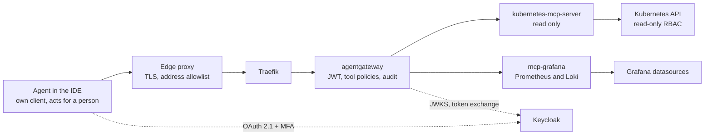

**English** | [Русский](README.ru.md) | [简体中文](README.zh-CN.md)

# Blueprint: obs-mcp-readonly

Read-only access for AI agents to Kubernetes, metrics and logs over MCP. Every call is made by a named agent on behalf of a named person, passes through the AI gateway and is audited with both names. This blueprint fixes the request path, authentication, permissions, deployment, known issues and open questions.

**Status:** draft, evolving. Created 2026-10-26. All configurations are examples with fictional names under `mess.systems`, not a running system.

**Capability codes.** The gateway is `gateway` in the domain `ai` of the [naming standard](https://github.com/mess-systems/naming-standard/blob/main/01-naming-conventions.md#43-capability-codes-unique-across-all-domains), service name `gateway.ai.corp`. MCP targets are named by the capability they expose: `k8s` (domain `infra`) for the Kubernetes API and `dashboards` (domain `obs`) for Grafana datasources. The identity provider is `sso` (domain `iam`).

## 1. Scope

| In scope | Out of scope |
|---|---|
| Agent access to Kubernetes resources, events and pod logs, read only | Any change to cluster state: deploys, scaling, restarts, `exec` |
| PromQL and LogQL queries through Grafana datasources | Writing dashboards, alerts or annotations |
| Authentication of the person and of the agent, delegation, tool authorization, audit | The gateway as a whole: see the `ai-gateway` blueprint |
| Deployment of the MCP servers and gateway policies through GitOps | Storage and retention of metrics and logs: capabilities `metrics` and `logs` |

## 2. Composition

| Part | Role | Product | Radar |
|---|---|---|---|
| Protocol | Tool calls from agents | Model Context Protocol | [Adopt](https://github.com/mess-systems/tech-radar/blob/main/technologies/mcp.md) |
| Edge proxy | TLS termination, source address allowlist | Organization's edge proxy | |
| Ingress controller | Routing to the gateway | Traefik | [Adopt](https://github.com/mess-systems/tech-radar/blob/main/technologies/traefik.md) |
| Gateway | JWT validation, token exchange, tool authorization, audit | agentgateway | [Adopt](https://github.com/mess-systems/tech-radar/blob/main/technologies/agentgateway.md) |
| Identity provider | OAuth 2.1 login with MFA, agent clients, token exchange | Keycloak | [Adopt](https://github.com/mess-systems/tech-radar/blob/main/technologies/keycloak.md) |
| Kubernetes MCP server | Read-only Kubernetes tools | kubernetes-mcp-server | [Trial](https://github.com/mess-systems/tech-radar/blob/main/technologies/kubernetes-mcp-server.md) |
| Grafana MCP server | PromQL and LogQL queries | mcp-grafana | [Trial](https://github.com/mess-systems/tech-radar/blob/main/technologies/mcp-grafana.md) |
| Cluster | Source of resources, events and logs | Kubernetes | [Adopt](https://github.com/mess-systems/tech-radar/blob/main/technologies/kubernetes.md) |
| Metrics and logs | Datasources behind Grafana | Grafana, Prometheus, Loki | [Grafana](https://github.com/mess-systems/tech-radar/blob/main/technologies/grafana.md), [Prometheus](https://github.com/mess-systems/tech-radar/blob/main/technologies/prometheus.md), [Loki](https://github.com/mess-systems/tech-radar/blob/main/technologies/loki.md): Adopt |
| Delivery | Declarative deployment from Git | Argo CD | [Adopt](https://github.com/mess-systems/tech-radar/blob/main/technologies/argo-cd.md) |

## 3. Request path

- An agent never connects to an MCP server directly. Every call passes the edge proxy and the gateway.
- The gateway decides who the caller is and which tools the caller may use.
- The MCP servers are reachable only from the gateway.

## 4. Authentication and delegation

- Login is OAuth 2.1 against Keycloak with mandatory MFA.
- Access is granted to a group named by the [identity conventions](https://github.com/mess-systems/naming-standard/blob/main/04-identity-conventions.md#33-app-groups-access-to-one-capability), form `app-<capability>-<access>`.
- An agent acts for the person who started it, under its own identity. The model is delegation, not impersonation: every token and every audit record names both the person and the agent.

### 4.1 Requirements

1. **The person and the agent are always distinguishable.** The person is `sub`. The agent is `act.client_id` in a delegated token, or `azp` in the fallback described below. A token that names only the person is not accepted as a way to call tools, because the gateway and the audit log then cannot tell the person from the agent.
2. **Each agent has its own client in Keycloak.** A confidential client per agent, with an ID of the [identity kind](https://github.com/mess-systems/naming-standard/blob/main/04-identity-conventions.md#2-identity-kinds) `agent-<name>` (or `user-<handle>-<tool>` for a tool a person runs). There are no shared clients or shared service accounts for agents. Clients authenticate with a signed client assertion (`private_key_jwt`) rather than a long-lived shared secret.
3. **Each agent run has an instance or session ID** that reaches the audit log. Section 6 describes what is available today and what remains a requirement.
4. **The incoming token never reaches an MCP server.** The MCP authorization specification forbids token passthrough. The gateway exchanges the token at Keycloak (RFC 8693) for a token whose audience is the one MCP server behind the target, or authenticates to the MCP server with its own credential where such an exchange is not possible.
5. **Effective rights are the intersection** of the rights of the person and of the agent, see 4.4.

### 4.2 Recommended: delegation with the `act` claim

The person delegates to a named agent client, and the agent obtains a token that carries both identities (RFC 8693, section 4.1).

1. The client calls the MCP endpoint without a token and receives `401` with `WWW-Authenticate`.
2. The gateway serves protected resource metadata per RFC 9728 at `/.well-known/oauth-protected-resource`, naming the authorization server.
3. The client fetches authorization server metadata (RFC 8414 or OIDC discovery). The person logs in with MFA through a client that requests the scope `delegation:client:<agent client_id>` and approves the delegation on a consent screen. The person's token then carries `may_act` with the agent's `sub` and `client_id`.
4. The agent client exchanges the person's token (`subject_token`) together with its own `client_credentials` token (`actor_token`). The delegated token carries `sub` (the person) and `act` (the agent's service account and `client_id`). Its audience and scopes come from the agent client's configuration, which names only the gateway.
5. The gateway validates the JWT against JWKS: signature, `iss`, `aud`, expiry. It reads `sub` and `act.client_id` for authorization and audit.

Keycloak status and prerequisites (Keycloak 26.8):

- Token exchange delegation is a **preview** feature, disabled by default. It is enabled with `--features=token-exchange-delegation,parameterized-scopes`.
- The client that requests the delegation scope must have **Consent required** enabled. The consent is not stored, so the person approves the delegation on every login session.
- A fine-grained admin permissions (FGAP V2) permission with the `delegate` scope must allow the agent client. Without it Keycloak silently drops the scope and the token has no `may_act`.
- The agent client is confidential, has a service account and has Standard token exchange enabled.
- The `may-act` client policy executor rejects a `may_act` claim that did not come from the delegation scopes, for example from a hardcoded claim mapper.
- The delegated token is issued in a transient session: no refresh token and no session identifier (`sid`).

Gap, recorded as a requirement: a standard exchange in Keycloak rejects a subject token that carries `act` or `may_act`, and a delegated exchange requires `may_act`, which a delegated token does not have. The gateway therefore cannot exchange a delegated token again for an MCP server audience. Until this is possible, the gateway authenticates to the MCP servers with its own credential, never forwards the delegated token, and the person and agent are attributed in the gateway audit.

### 4.3 Fallback: standard token exchange and `azp`

Where delegation is not enabled, the standard token exchange of Keycloak is used. It is fully supported since Keycloak 26.2.

1. Steps 1 to 3 as above, without the delegation scope. The person logs in through the agent's own client, so the token carries `sub` (the person) and `azp` (the agent's `client_id`). An audience mapper adds the gateway to `aud`.
2. The gateway validates the JWT and records `azp` as the agent identity.
3. For each MCP target, the gateway exchanges the token at Keycloak with agentgateway `backendAuth.oauthTokenExchange`, requesting the MCP server's client as `audience`. The exchanged token is limited to that one server, keeps `sub`, and has the gateway's client as `azp`. The agent's identity is therefore recorded by the gateway, not carried to the MCP server.

Keycloak details for this path:

- The gateway's client (`svc-corp-ai-agentgateway`) is confidential and has Standard token exchange enabled. The person's token must list it in `aud`.
- The `audience` parameter keeps only the requested audience and its client roles. It does not add audiences: the MCP server's client must already reach the token through the client scopes of the gateway client, for example with an audience mapper. The `resource` parameter (RFC 8707) is not supported by Keycloak yet, so the example uses `audience`.
- By default the exchange can request scopes and audiences that the incoming token does not have. The `downscope-assertion-grant-enforcer` client policy executor allows only downscoping, so the exchanged token cannot exceed the incoming one.

Whether the MCP servers in use validate the audience of the exchanged token, as the MCP specification requires of a resource server, must be checked for each server version.

agentgateway has a built-in `keycloak` provider. It adapts the gateway to Keycloak behaviour that differs from what the MCP authorization specification expects, for example the non-standard signing key endpoint `{issuer}/protocol/openid-connect/certs`. agentgateway can also send an `actor_token` in an exchange and, with `enforceMayAct`, check the subject's `may_act` before exchanging. Token validation stays with `mcpAuthentication`; the exchange only reads the token. Configuration: [`examples/agentgateway-mcp-readonly.example.yaml`](examples/agentgateway-mcp-readonly.example.yaml).

### 4.4 Effective rights

A call succeeds only if every layer allows it:

1. **The person:** membership in `app-<capability>-<access>`, mapped to roles.
2. **The agent client:** its role scope mappings, with Full Scope Allowed switched off. Keycloak puts into a token only the roles that are both assigned to the person and in the client's role scope. In delegation, the audience and scopes of the delegated token come from the agent client.
3. **The gateway:** the tool allowlist per target in `mcpAuthorization`. Rules can also use `jwt.act.client_id` or `jwt.azp` to restrict an agent to a subset of tools.
4. **The MCP server:** read-only mode and read-only RBAC, see section 5.

The credentials that the MCP servers themselves use for Kubernetes and Grafana are kept in the secret store and delivered to the pods by an operator. Agents never see them and cannot obtain them through any tool.

## 5. Permissions

| Allowed | Denied |
|---|---|
| Read resources and events | Any write operation |
| Read pod logs | Reading `Secret` objects |
| Run PromQL and LogQL queries | Grafana write tools and raw SQL query tools |

`Secret` objects are denied in three independent layers, so a mistake in one layer does not open access:

1. The gateway policy allows only read tools and rejects requests for `Secret`.
2. kubernetes-mcp-server runs in read-only mode with `Secret` in `denied_resources`.
3. The server's ServiceAccount has a read-only ClusterRole that does not list `secrets`.

**Gateway rules and tool arguments.** In agentgateway `mcpAuthorization`, tool arguments are not available: rules see the tool (`mcp.tool.name`, `mcp.tool.target`) and the token claims (`jwt`), but not `mcp.tool.arguments`. Therefore:

- `mcpAuthorization` holds the allowlist of read tools per target;
- checks on arguments (for example `kind: Secret`) belong in a route-level `authorization` policy, which can read `mcp.tool.arguments`.

Tool names in the examples follow the server READMEs. Check them against `tools/list` of the server versions in use.

**kubernetes-mcp-server.** Current versions take runtime settings from a TOML file, not from command-line flags. Configuration: [`examples/kubernetes-mcp-server.example.toml`](examples/kubernetes-mcp-server.example.toml).

**mcp-grafana.** Read-only mode is enabled with `--disable-write`. It also removes raw SQL query tools, which could write through datasource credentials. Disable every tool category except Prometheus and Loki.

**RBAC.** The ClusterRole lists resources explicitly instead of `*`, so `Secret` cannot be added by accident: [`examples/clusterrole-mcp-readonly.example.yaml`](examples/clusterrole-mcp-readonly.example.yaml). `configmaps` is in the list by choice. ConfigMaps can also hold sensitive data; remove the resource where that is the case.

## 6. Audit

Each call is recorded with the fields below. agentgateway adds fields to its access log with CEL expressions (`frontendPolicies.accessLog.add`). The `jwt` variable holds the claims of the token validated on the route, including nested claims such as `act`.

| Field | Source | Status |
|---|---|---|
| Person | `jwt.sub` | available |
| Agent client | `jwt.act.client_id` (delegation), otherwise `jwt.azp` | available |
| Login session | `jwt.sid` (fallback path) | available in the fallback; a delegated token has no `sid`: requirement |
| Agent instance or session | `request.agent.session`, detected from client headers such as `x-session-id` | available, but asserted by the client and not authenticated: an attested instance ID is a requirement |
| Target and tool | `mcp.*` fields of the MCP log line | available |
| Time and authorization decision | access log | available; denials must also be recorded, see section 10 |
| Result hash | not provided by the gateway | requirement |

The result hash is an architectural requirement of this blueprint, not an optional feature. The result itself is not stored; the hash allows a later check of exactly what the agent received. agentgateway provides a `sha256.encode` CEL function, but it has not been confirmed that the access log context holds the complete MCP result, including streamed responses. Until that is confirmed, a separate component in the request path records the hash. A deployment without the result hash does not meet this blueprint.

The access log shows the claims of the incoming token. Recording the claims of the exchanged token sent to the MCP server is a requirement, not a confirmed feature.

These fields cover the minimum audit content listed in the IETF WIMSE working group draft on AI agent identity (`draft-ietf-wimse-aims-00`, work in progress): agent identifier, delegated subject, resource or tool, action and decision, time and a correlation identifier.

## 7. Deployment

- Both MCP servers, the gateway and its policies are described in Git and deployed by Argo CD. No manual changes in the cluster.
- An exception to these rules is recorded as a technical debt issue with a due date, so it does not become permanent.
- Resource requests are small. As a rough guide, both MCP servers together fit in about 150m CPU and 256Mi memory. Size them for the actual load.

## 8. Known issues

**`X-Forwarded-Proto` behind a TLS proxy.** TLS terminates on the edge proxy, and requests reach Traefik and the gateway over HTTP. If the `X-Forwarded-Proto` header is lost or Traefik does not trust it, the gateway builds `http://` URLs in its metadata and the client's OAuth flow fails. Fixes:

- trust forwarded headers from the edge proxy (`forwardedHeaders.trustedIPs` on the Traefik entrypoint);
- or set the header explicitly with a middleware: [`examples/traefik-forwarded-proto.example.yaml`](examples/traefik-forwarded-proto.example.yaml).

**RFC 9207 and the `iss` parameter.** RFC 9207 adds the `iss` parameter to the authorization response to protect against authorization server mix-up. With the `keycloak` provider, the gateway presents itself as the issuer, while the authorization response comes directly from Keycloak with Keycloak's `iss`. Clients that enforce RFC 9207 reject the login. The fix in agentgateway is not merged yet ([issue #3635](https://github.com/agentgateway/agentgateway/issues/3635), [issue #3668](https://github.com/agentgateway/agentgateway/issues/3668), [pull request #3637](https://github.com/agentgateway/agentgateway/pull/3637)). Workaround: register clients directly in the identity provider.

**Cloud-hosted agents and the address allowlist.** Cloud-hosted agents connect from provider addresses and do not pass the edge allowlist. They are allowed only through the person's workstation.

## 9. Examples

| File | Shows |
|---|---|
| [`examples/agentgateway-mcp-readonly.example.yaml`](examples/agentgateway-mcp-readonly.example.yaml) | MCP authentication with Keycloak, allowlist of read tools per target, token exchange per target, audit fields |
| [`examples/kubernetes-mcp-server.example.toml`](examples/kubernetes-mcp-server.example.toml) | Read-only mode, `core` toolset, `Secret` denied |
| [`examples/clusterrole-mcp-readonly.example.yaml`](examples/clusterrole-mcp-readonly.example.yaml) | Read-only ClusterRole without `secrets` |
| [`examples/traefik-forwarded-proto.example.yaml`](examples/traefik-forwarded-proto.example.yaml) | Middleware that sets `X-Forwarded-Proto` |

## 10. Open questions

1. Log redaction that fails closed: a response is refused when the redactor cannot confirm it contains no secrets.
2. Authorization denials must reach the audit log too, not only successful calls.
3. Move the identity provider configuration to [OpenTofu](https://github.com/mess-systems/tech-radar/blob/main/technologies/opentofu.md) (Adopt).
4. RFC 9207: wait for the gateway fix or for client changes.
5. High availability of the gateway and the MCP servers.
6. Keycloak token exchange delegation leaving preview. Until then, decide per environment whether the preview feature is acceptable or the fallback with `azp` is used.
7. An exchange of a delegated token for an MCP server audience, so that the MCP servers receive a token that names both the person and the agent.
8. An attested agent instance ID in the token. Related work: `draft-mcguinness-oauth-ai-agent-instance-00`, an individual draft, not adopted by a working group.

## Sources

- kubernetes-mcp-server, README and configuration reference: https://github.com/containers/kubernetes-mcp-server
- mcp-grafana, README (`--disable-write`, tool categories): https://github.com/grafana/mcp-grafana
- agentgateway, MCP authentication: https://agentgateway.dev/docs/standalone/latest/documentation/configuration/security/mcp-authn/
- agentgateway, Keycloak: https://agentgateway.dev/docs/standalone/latest/integrations/auth/keycloak/
- agentgateway, MCP authorization and CEL variables: https://agentgateway.dev/docs/standalone/latest/documentation/configuration/security/mcp-authz/
- RFC 9728, OAuth 2.0 Protected Resource Metadata: https://www.rfc-editor.org/rfc/rfc9728
- RFC 8414, OAuth 2.0 Authorization Server Metadata: https://www.rfc-editor.org/rfc/rfc8414
- RFC 9207, OAuth 2.0 Authorization Server Issuer Identification: https://www.rfc-editor.org/rfc/rfc9207
- Traefik, headers middleware: https://doc.traefik.io/traefik/middlewares/http/headers/
- Keycloak, token exchange (standard exchange, delegation, `may-act` executor): https://www.keycloak.org/securing-apps/token-exchange
- Keycloak 26.8.0 release notes (delegation in preview): https://www.keycloak.org/2026/10/keycloak-2680-released
- Keycloak, role scope mappings: https://www.keycloak.org/docs/latest/server_admin/#_role_scope_mappings
- agentgateway, token exchange: https://agentgateway.dev/docs/standalone/latest/documentation/configuration/security/backend-authn/token-exchange/
- agentgateway, standard token exchange and actor tokens: https://agentgateway.dev/docs/standalone/latest/documentation/configuration/security/backend-authn/token-exchange/standard/
- agentgateway, access logs: https://agentgateway.dev/docs/standalone/latest/documentation/observability/access-logs/view/
- agentgateway, CEL variables (`jwt`, `request.agent.session`): https://agentgateway.dev/docs/standalone/latest/reference/cel/variables/
- MCP specification 2026-07-28, authorization (token passthrough): https://modelcontextprotocol.io/specification/2026-07-28/basic/authorization
- MCP security best practices (token passthrough): https://modelcontextprotocol.io/docs/tutorials/security/security_best_practices
- RFC 8693, OAuth 2.0 Token Exchange: https://www.rfc-editor.org/rfc/rfc8693
- draft-ietf-wimse-aims, AI Identity Management System (work in progress): https://datatracker.ietf.org/doc/draft-ietf-wimse-aims/
- draft-mcguinness-oauth-ai-agent-instance, OAuth 2.0 AI Agent Instance Profile (individual draft): https://datatracker.ietf.org/doc/draft-mcguinness-oauth-ai-agent-instance/
