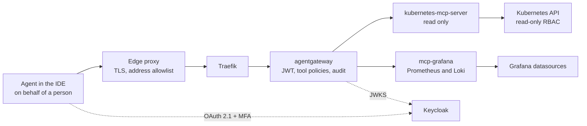

**English** | [Русский](README.ru.md) | [简体中文](README.zh-CN.md)

# Blueprint: obs-mcp-readonly

Read-only access for AI agents to Kubernetes, metrics and logs over MCP. Every call is made on behalf of a named person, passes through the AI gateway and is audited. This blueprint fixes the request path, authentication, permissions, deployment, known issues and open questions.

**Status:** draft, evolving. Created 2026-10-26. All configurations are examples with fictional names under `mess.systems`, not a running system.

**Capability codes.** The gateway is `gateway` in the domain `ai` of the [naming standard](https://github.com/mess-systems/naming-standard/blob/main/01-naming-conventions.md#43-capability-codes-unique-across-all-domains), service name `gateway.ai.corp`. MCP targets are named by the capability they expose: `k8s` (domain `infra`) for the Kubernetes API and `dashboards` (domain `obs`) for Grafana datasources. The identity provider is `sso` (domain `iam`).

## 1. Scope

| In scope | Out of scope |
|---|---|
| Agent access to Kubernetes resources, events and pod logs, read only | Any change to cluster state: deploys, scaling, restarts, `exec` |
| PromQL and LogQL queries through Grafana datasources | Writing dashboards, alerts or annotations |
| Authentication of the person behind the agent, tool authorization, audit | The gateway as a whole: see the `ai-gateway` blueprint |
| Deployment of the MCP servers and gateway policies through GitOps | Storage and retention of metrics and logs: capabilities `metrics` and `logs` |

## 2. Composition

| Part | Role | Product | Radar |
|---|---|---|---|
| Protocol | Tool calls from agents | Model Context Protocol | [Adopt](https://github.com/mess-systems/tech-radar/blob/main/technologies/mcp.md) |
| Edge proxy | TLS termination, source address allowlist | Organization's edge proxy | |
| Ingress controller | Routing to the gateway | Traefik | [Adopt](https://github.com/mess-systems/tech-radar/blob/main/technologies/traefik.md) |
| Gateway | JWT validation, tool authorization, audit | agentgateway | [Adopt](https://github.com/mess-systems/tech-radar/blob/main/technologies/agentgateway.md) |
| Identity provider | OAuth 2.1 login with MFA | Keycloak | [Adopt](https://github.com/mess-systems/tech-radar/blob/main/technologies/keycloak.md) |
| Kubernetes MCP server | Read-only Kubernetes tools | kubernetes-mcp-server | [Trial](https://github.com/mess-systems/tech-radar/blob/main/technologies/kubernetes-mcp-server.md) |
| Grafana MCP server | PromQL and LogQL queries | mcp-grafana | [Trial](https://github.com/mess-systems/tech-radar/blob/main/technologies/mcp-grafana.md) |
| Cluster | Source of resources, events and logs | Kubernetes | [Adopt](https://github.com/mess-systems/tech-radar/blob/main/technologies/kubernetes.md) |
| Metrics and logs | Datasources behind Grafana | Grafana, Prometheus, Loki | [Grafana](https://github.com/mess-systems/tech-radar/blob/main/technologies/grafana.md), [Prometheus](https://github.com/mess-systems/tech-radar/blob/main/technologies/prometheus.md), [Loki](https://github.com/mess-systems/tech-radar/blob/main/technologies/loki.md): Adopt |
| Delivery | Declarative deployment from Git | Argo CD | [Adopt](https://github.com/mess-systems/tech-radar/blob/main/technologies/argo-cd.md) |

## 3. Request path

- An agent never connects to an MCP server directly. Every call passes the edge proxy and the gateway.
- The gateway decides who the caller is and which tools the caller may use.
- The MCP servers are reachable only from the gateway.

## 4. Authentication

- Login is OAuth 2.1 against Keycloak with mandatory MFA.
- Access is granted to a group named by the [identity conventions](https://github.com/mess-systems/naming-standard/blob/main/04-identity-conventions.md#33-app-groups-access-to-one-capability), form `app-<capability>-<access>`.
- An agent always acts on behalf of the person who started it. There are no shared service accounts for agents, so the audit log always names the person who asked.

Flow:

1. The client calls the MCP endpoint without a token and receives `401` with `WWW-Authenticate`.
2. The gateway serves protected resource metadata per RFC 9728 at `/.well-known/oauth-protected-resource`, naming the authorization server.
3. The client fetches authorization server metadata (RFC 8414 or OIDC discovery) and completes the Keycloak login with MFA.
4. The gateway validates the JWT against JWKS: signature, `iss`, `aud`, expiry.

agentgateway has a built-in `keycloak` provider. It adapts the gateway to Keycloak behaviour that differs from what the MCP authorization specification expects, for example the non-standard signing key endpoint `{issuer}/protocol/openid-connect/certs`. Configuration: [`examples/agentgateway-mcp-readonly.example.yaml`](examples/agentgateway-mcp-readonly.example.yaml).

The credentials that the MCP servers themselves use for Kubernetes and Grafana are kept in the secret store and delivered to the pods by an operator. Agents never see them and cannot obtain them through any tool.

## 5. Permissions

| Allowed | Denied |
|---|---|
| Read resources and events | Any write operation |
| Read pod logs | Reading `Secret` objects |
| Run PromQL and LogQL queries | Grafana write tools and raw SQL query tools |

`Secret` objects are denied in three independent layers, so a mistake in one layer does not open access:

1. The gateway policy allows only read tools and rejects requests for `Secret`.
2. kubernetes-mcp-server runs in read-only mode with `Secret` in `denied_resources`.
3. The server's ServiceAccount has a read-only ClusterRole that does not list `secrets`.

**Gateway rules and tool arguments.** In agentgateway `mcpAuthorization`, tool arguments are not available: rules see only `mcp.tool.name` and `mcp.tool.target`. Therefore:

- `mcpAuthorization` holds the allowlist of read tools per target;
- checks on arguments (for example `kind: Secret`) belong in a route-level `authorization` policy, which can read `mcp.tool.arguments`.

Tool names in the examples follow the server READMEs. Check them against `tools/list` of the server versions in use.

**kubernetes-mcp-server.** Current versions take runtime settings from a TOML file, not from command-line flags. Configuration: [`examples/kubernetes-mcp-server.example.toml`](examples/kubernetes-mcp-server.example.toml).

**mcp-grafana.** Read-only mode is enabled with `--disable-write`. It also removes raw SQL query tools, which could write through datasource credentials. Disable every tool category except Prometheus and Loki.

**RBAC.** The ClusterRole lists resources explicitly instead of `*`, so `Secret` cannot be added by accident: [`examples/clusterrole-mcp-readonly.example.yaml`](examples/clusterrole-mcp-readonly.example.yaml). `configmaps` is in the list by choice. ConfigMaps can also hold sensitive data; remove the resource where that is the case.

## 6. Audit

Each call is recorded with:

- the person (`sub` of the JWT) and the client;
- the target and the tool;
- the time and the authorization decision;
- a hash of the result.

The result hash is an architectural requirement of this blueprint, not an optional feature. The result itself is not stored; the hash allows a later check of exactly what the agent received. If the chosen gateway cannot record the hash in its access log, a separate component in the request path records it. A deployment without the result hash does not meet this blueprint.

## 7. Deployment

- Both MCP servers, the gateway and its policies are described in Git and deployed by Argo CD. No manual changes in the cluster.
- An exception to these rules is recorded as a technical debt issue with a due date, so it does not become permanent.
- Resource requests are small. As a rough guide, both MCP servers together fit in about 150m CPU and 256Mi memory. Size them for the actual load.

## 8. Known issues

**`X-Forwarded-Proto` behind a TLS proxy.** TLS terminates on the edge proxy, and requests reach Traefik and the gateway over HTTP. If the `X-Forwarded-Proto` header is lost or Traefik does not trust it, the gateway builds `http://` URLs in its metadata and the client's OAuth flow fails. Fixes:

- trust forwarded headers from the edge proxy (`forwardedHeaders.trustedIPs` on the Traefik entrypoint);
- or set the header explicitly with a middleware: [`examples/traefik-forwarded-proto.example.yaml`](examples/traefik-forwarded-proto.example.yaml).

**RFC 9207 and the `iss` parameter.** RFC 9207 adds the `iss` parameter to the authorization response to protect against authorization server mix-up. With the `keycloak` provider, the gateway presents itself as the issuer, while the authorization response comes directly from Keycloak with Keycloak's `iss`. Clients that enforce RFC 9207 reject the login. The fix in agentgateway is not merged yet ([issue #3635](https://github.com/agentgateway/agentgateway/issues/3635), [issue #3668](https://github.com/agentgateway/agentgateway/issues/3668), [pull request #3637](https://github.com/agentgateway/agentgateway/pull/3637)). Workaround: register clients directly in the identity provider.

**Cloud-hosted agents and the address allowlist.** Cloud-hosted agents connect from provider addresses and do not pass the edge allowlist. They are allowed only through the person's workstation.

## 9. Examples

| File | Shows |
|---|---|
| [`examples/agentgateway-mcp-readonly.example.yaml`](examples/agentgateway-mcp-readonly.example.yaml) | MCP authentication with Keycloak, allowlist of read tools per target |
| [`examples/kubernetes-mcp-server.example.toml`](examples/kubernetes-mcp-server.example.toml) | Read-only mode, `core` toolset, `Secret` denied |
| [`examples/clusterrole-mcp-readonly.example.yaml`](examples/clusterrole-mcp-readonly.example.yaml) | Read-only ClusterRole without `secrets` |
| [`examples/traefik-forwarded-proto.example.yaml`](examples/traefik-forwarded-proto.example.yaml) | Middleware that sets `X-Forwarded-Proto` |

## 10. Open questions

1. Log redaction that fails closed: a response is refused when the redactor cannot confirm it contains no secrets.
2. Authorization denials must reach the audit log too, not only successful calls.
3. Move the identity provider configuration to [OpenTofu](https://github.com/mess-systems/tech-radar/blob/main/technologies/opentofu.md) (Adopt).
4. RFC 9207: wait for the gateway fix or for client changes.
5. High availability of the gateway and the MCP servers.

## Sources

- kubernetes-mcp-server, README and configuration reference: https://github.com/containers/kubernetes-mcp-server
- mcp-grafana, README (`--disable-write`, tool categories): https://github.com/grafana/mcp-grafana
- agentgateway, MCP authentication: https://agentgateway.dev/docs/standalone/latest/documentation/configuration/security/mcp-authn/
- agentgateway, Keycloak: https://agentgateway.dev/docs/standalone/latest/integrations/auth/keycloak/
- agentgateway, MCP authorization and CEL variables: https://agentgateway.dev/docs/standalone/latest/documentation/configuration/security/mcp-authz/
- RFC 9728, OAuth 2.0 Protected Resource Metadata: https://www.rfc-editor.org/rfc/rfc9728
- RFC 8414, OAuth 2.0 Authorization Server Metadata: https://www.rfc-editor.org/rfc/rfc8414
- RFC 9207, OAuth 2.0 Authorization Server Issuer Identification: https://www.rfc-editor.org/rfc/rfc9207
- Traefik, headers middleware: https://doc.traefik.io/traefik/middlewares/http/headers/
