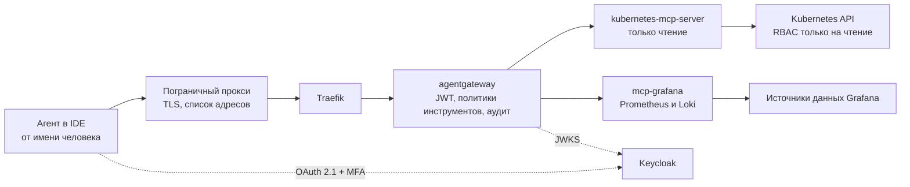

[English](README.md) | **Русский** | [简体中文](README.zh-CN.md)

# Типовая архитектура: obs-mcp-readonly

Доступ AI-агентов к Kubernetes, метрикам и логам по MCP только на чтение. Каждый вызов выполняется от имени конкретного человека, проходит через AI-шлюз и записывается в журнал аудита. Эта типовая архитектура фиксирует путь запроса, аутентификацию, права, развёртывание, известные проблемы и открытые вопросы.

**Статус:** черновик, развивается. Создано 2026-10-26. Перевод информативный; нормативный текст [английский](README.md). Все конфигурации это примеры с вымышленными именами в домене `mess.systems`, а не работающая система.

**Коды возможностей.** Шлюз это `gateway` в домене `ai` [стандарта именования](https://github.com/mess-systems/naming-standard/blob/main/i18n/ru/01-naming-conventions.md), имя сервиса `gateway.ai.corp`. Цели MCP (MCP targets) называются по возможности, которую они открывают: `k8s` (домен `infra`) для Kubernetes API и `dashboards` (домен `obs`) для источников данных Grafana. Поставщик идентичностей (identity provider) это `sso` (домен `iam`).

## 1. Границы

| Входит | Не входит |
|---|---|
| Чтение агентом ресурсов, событий и логов подов Kubernetes | Любое изменение состояния кластера: развёртывание, масштабирование, перезапуск, `exec` |
| Запросы PromQL и LogQL через источники данных Grafana | Запись дашбордов, правил оповещений и аннотаций |
| Аутентификация человека, от имени которого работает агент, авторизация инструментов, аудит | Шлюз целиком: см. типовую архитектуру `ai-gateway` |
| Развёртывание MCP-серверов и политик шлюза через GitOps | Хранение метрик и логов: возможности `metrics` и `logs` |

## 2. Состав

| Часть | Роль | Продукт | Радар |
|---|---|---|---|
| Протокол | Вызовы инструментов агентами | Model Context Protocol | [Adopt](https://github.com/mess-systems/tech-radar/blob/main/technologies/mcp.md) |
| Пограничный прокси | Завершение TLS, список разрешённых адресов источника | Пограничный прокси организации | |
| Контроллер входящего трафика | Маршрутизация к шлюзу | Traefik | [Adopt](https://github.com/mess-systems/tech-radar/blob/main/technologies/traefik.md) |
| Шлюз | Проверка JWT, авторизация инструментов, аудит | agentgateway | [Adopt](https://github.com/mess-systems/tech-radar/blob/main/technologies/agentgateway.md) |
| Поставщик идентичностей | Вход по OAuth 2.1 с MFA | Keycloak | [Adopt](https://github.com/mess-systems/tech-radar/blob/main/technologies/keycloak.md) |
| MCP-сервер Kubernetes | Инструменты Kubernetes только на чтение | kubernetes-mcp-server | [Trial](https://github.com/mess-systems/tech-radar/blob/main/technologies/kubernetes-mcp-server.md) |
| MCP-сервер Grafana | Запросы PromQL и LogQL | mcp-grafana | [Trial](https://github.com/mess-systems/tech-radar/blob/main/technologies/mcp-grafana.md) |
| Кластер | Источник ресурсов, событий и логов | Kubernetes | [Adopt](https://github.com/mess-systems/tech-radar/blob/main/technologies/kubernetes.md) |
| Метрики и логи | Источники данных за Grafana | Grafana, Prometheus, Loki | [Grafana](https://github.com/mess-systems/tech-radar/blob/main/technologies/grafana.md), [Prometheus](https://github.com/mess-systems/tech-radar/blob/main/technologies/prometheus.md), [Loki](https://github.com/mess-systems/tech-radar/blob/main/technologies/loki.md): Adopt |
| Доставка | Декларативное развёртывание из Git | Argo CD | [Adopt](https://github.com/mess-systems/tech-radar/blob/main/technologies/argo-cd.md) |

## 3. Путь запроса

- Агент никогда не обращается к MCP-серверу напрямую. Каждый вызов проходит через пограничный прокси и шлюз.
- Шлюз определяет, кто вызывает, и какие инструменты этому вызывающему разрешены.
- MCP-серверы доступны только со шлюза.

## 4. Аутентификация

- Вход выполняется по OAuth 2.1 через Keycloak с обязательной MFA.
- Доступ выдаётся группе, названной по [соглашениям об идентичностях](https://github.com/mess-systems/naming-standard/blob/main/i18n/ru/04-identity-conventions.md) (группа приложений), форма `app-<capability>-<access>`.
- Агент всегда работает от имени человека, который его запустил. Общих сервисных учётных записей для агентов нет, поэтому в журнале аудита всегда указан человек, который сделал запрос.

Порядок:

1. Клиент обращается к MCP без токена и получает `401` с заголовком `WWW-Authenticate`.
2. Шлюз отдаёт метаданные защищённого ресурса по RFC 9728 по адресу `/.well-known/oauth-protected-resource`, в них указан сервер авторизации.
3. Клиент получает метаданные сервера авторизации (RFC 8414 или OIDC discovery) и проходит вход в Keycloak с MFA.
4. Шлюз проверяет JWT по JWKS: подпись, `iss`, `aud`, срок действия.

В agentgateway есть встроенный провайдер `keycloak`. Он учитывает отличия Keycloak от того, что ожидает спецификация авторизации MCP, например нестандартный адрес ключей подписи `{issuer}/protocol/openid-connect/certs`. Конфигурация: [`examples/agentgateway-mcp-readonly.example.yaml`](examples/agentgateway-mcp-readonly.example.yaml).

Учётные данные, с которыми сами MCP-серверы обращаются к Kubernetes и Grafana, хранятся в хранилище секретов и передаются в поды оператором. Агенты их не видят и не могут получить ни через один инструмент.

## 5. Права

| Разрешено | Запрещено |
|---|---|
| Чтение ресурсов и событий | Любые операции записи |
| Чтение логов подов | Чтение объектов `Secret` |
| Запросы PromQL и LogQL | Инструменты записи Grafana и инструменты произвольных SQL-запросов |

Чтение `Secret` запрещено на трёх независимых уровнях, чтобы ошибка на одном уровне не открывала доступ:

1. Политика шлюза разрешает только инструменты чтения и отклоняет запросы к `Secret`.
2. kubernetes-mcp-server работает в режиме только чтения, `Secret` указан в `denied_resources`.
3. У ServiceAccount сервера ClusterRole только на чтение, в которой нет `secrets`.

**Правила шлюза и аргументы инструментов.** В `mcpAuthorization` у agentgateway аргументы инструмента недоступны: правила видят только `mcp.tool.name` и `mcp.tool.target`. Поэтому:

- в `mcpAuthorization` задаётся список разрешённых инструментов чтения для каждой цели;
- проверки по аргументам (например, `kind: Secret`) выполняет политика `authorization` уровня маршрута, которой доступна переменная `mcp.tool.arguments`.

Имена инструментов в примерах взяты из README серверов. Сверяйте их с ответом `tools/list` для используемых версий серверов.

**kubernetes-mcp-server.** Текущие версии берут настройки времени выполнения из файла TOML, а не из параметров командной строки. Конфигурация: [`examples/kubernetes-mcp-server.example.toml`](examples/kubernetes-mcp-server.example.toml).

**mcp-grafana.** Режим только чтения включается параметром `--disable-write`. Он также отключает инструменты произвольных SQL-запросов, которые могли бы выполнять запись через учётные данные источника данных. Все категории инструментов, кроме Prometheus и Loki, отключаются.

**RBAC.** В ClusterRole ресурсы перечислены явно, а не через `*`, чтобы `Secret` не попал туда случайно: [`examples/clusterrole-mcp-readonly.example.yaml`](examples/clusterrole-mcp-readonly.example.yaml). `configmaps` включён в список осознанно. В ConfigMap тоже бывают чувствительные данные; там, где это так, ресурс убирается из списка.

## 6. Аудит

Для каждого вызова записываются:

- человек (`sub` из JWT) и клиент;
- цель и инструмент;
- время и решение авторизации;
- хеш результата.

Хеш результата является архитектурным требованием, а не необязательной функцией. Сам результат не сохраняется; хеш позволяет позже проверить, что именно получил агент. Если выбранный шлюз не может записать хеш в журнал доступа, его записывает отдельный компонент на пути запроса. Развёртывание без хеша результата не соответствует этой типовой архитектуре.

## 7. Развёртывание

- Оба MCP-сервера, шлюз и его политики описаны в Git и развёртываются через Argo CD. Ручные изменения в кластере не допускаются.
- Исключение из этих правил оформляется как задача технического долга со сроком, чтобы оно не стало постоянным.
- Запросы ресурсов небольшие. Ориентир: оба MCP-сервера вместе укладываются примерно в 150m CPU и 256Mi памяти. Размер подбирается под фактическую нагрузку.

## 8. Известные проблемы

**`X-Forwarded-Proto` за TLS-прокси.** TLS завершается на пограничном прокси, до Traefik и шлюза запрос доходит по HTTP. Если заголовок `X-Forwarded-Proto` теряется или Traefik ему не доверяет, шлюз указывает в метаданных адреса с `http://`, и вход клиента по OAuth не проходит. Решения:

- доверять заголовкам от пограничного прокси (`forwardedHeaders.trustedIPs` на точке входа Traefik);
- или явно задать заголовок через middleware: [`examples/traefik-forwarded-proto.example.yaml`](examples/traefik-forwarded-proto.example.yaml).

**RFC 9207 и параметр `iss`.** RFC 9207 добавляет параметр `iss` в ответ авторизации для защиты от подмены сервера авторизации (mix-up). С провайдером `keycloak` шлюз объявляет издателем себя, а ответ авторизации приходит напрямую от Keycloak с его собственным `iss`. Клиенты, которые строго проверяют RFC 9207, отклоняют вход. Исправление в agentgateway пока не принято ([issue #3635](https://github.com/agentgateway/agentgateway/issues/3635), [issue #3668](https://github.com/agentgateway/agentgateway/issues/3668), [pull request #3637](https://github.com/agentgateway/agentgateway/pull/3637)). Обходной путь: регистрировать клиентов напрямую в поставщике идентичностей.

**Облачные агенты и список разрешённых адресов.** Агенты, работающие в облаке, подключаются с адресов провайдера и не проходят список разрешённых адресов на пограничном прокси. Они допускаются только через рабочую станцию человека.

## 9. Примеры

| Файл | Что показывает |
|---|---|
| [`examples/agentgateway-mcp-readonly.example.yaml`](examples/agentgateway-mcp-readonly.example.yaml) | Аутентификация MCP через Keycloak, список разрешённых инструментов чтения для каждой цели |
| [`examples/kubernetes-mcp-server.example.toml`](examples/kubernetes-mcp-server.example.toml) | Режим только чтения, набор инструментов `core`, запрет `Secret` |
| [`examples/clusterrole-mcp-readonly.example.yaml`](examples/clusterrole-mcp-readonly.example.yaml) | ClusterRole только на чтение без `secrets` |
| [`examples/traefik-forwarded-proto.example.yaml`](examples/traefik-forwarded-proto.example.yaml) | Middleware, который задаёт `X-Forwarded-Proto` |

## 10. Открытые вопросы

1. Маскирование секретов в логах с отказом по умолчанию (fail-closed): ответ не выдаётся, если механизм маскирования не может подтвердить, что в нём нет секретов.
2. В журнал аудита должны попадать и отказы авторизации, а не только успешные вызовы.
3. Перенести настройки поставщика идентичностей в [OpenTofu](https://github.com/mess-systems/tech-radar/blob/main/technologies/opentofu.md) (Adopt).
4. RFC 9207: ждать исправления в шлюзе или изменений в клиентах.
5. Отказоустойчивость шлюза и MCP-серверов.

## Источники

- kubernetes-mcp-server, README и справочник по настройке: https://github.com/containers/kubernetes-mcp-server
- mcp-grafana, README (`--disable-write`, категории инструментов): https://github.com/grafana/mcp-grafana
- agentgateway, аутентификация MCP: https://agentgateway.dev/docs/standalone/latest/documentation/configuration/security/mcp-authn/
- agentgateway, Keycloak: https://agentgateway.dev/docs/standalone/latest/integrations/auth/keycloak/
- agentgateway, авторизация MCP и переменные CEL: https://agentgateway.dev/docs/standalone/latest/documentation/configuration/security/mcp-authz/
- RFC 9728, OAuth 2.0 Protected Resource Metadata: https://www.rfc-editor.org/rfc/rfc9728
- RFC 8414, OAuth 2.0 Authorization Server Metadata: https://www.rfc-editor.org/rfc/rfc8414
- RFC 9207, OAuth 2.0 Authorization Server Issuer Identification: https://www.rfc-editor.org/rfc/rfc9207
- Traefik, middleware headers: https://doc.traefik.io/traefik/middlewares/http/headers/
