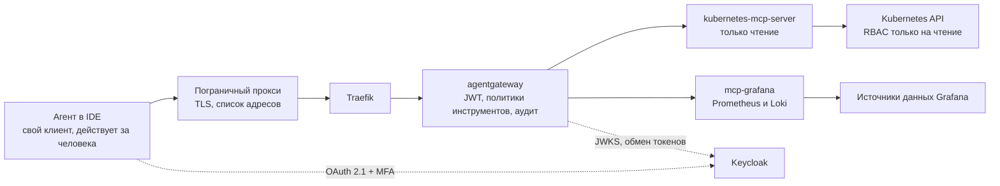

[English](README.md) | **Русский** | [简体中文](README.zh-CN.md)

# Типовая архитектура: obs-mcp-readonly

Доступ AI-агентов к Kubernetes, метрикам и логам по MCP только на чтение. Каждый вызов выполняет конкретный агент от имени конкретного человека; вызов проходит через AI-шлюз и записывается в журнал аудита с указанием обоих. Эта типовая архитектура фиксирует путь запроса, аутентификацию, права, развёртывание, известные проблемы и открытые вопросы.

**Статус:** черновик, развивается. Создано 2026-10-26. Перевод информативный; нормативный текст [английский](README.md). Все конфигурации это примеры с вымышленными именами в домене `mess.systems`, а не работающая система.

**Коды возможностей.** Шлюз это `gateway` в домене `ai` [стандарта именования](https://github.com/mess-systems/naming-standard/blob/main/i18n/ru/01-naming-conventions.md), имя сервиса `gateway.ai.corp`. Цели MCP (MCP targets) называются по возможности, которую они открывают: `k8s` (домен `infra`) для Kubernetes API и `dashboards` (домен `obs`) для источников данных Grafana. Поставщик идентичностей (identity provider) это `sso` (домен `iam`).

## 1. Границы

| Входит | Не входит |
|---|---|
| Чтение агентом ресурсов, событий и логов подов Kubernetes | Любое изменение состояния кластера: развёртывание, масштабирование, перезапуск, `exec` |
| Запросы PromQL и LogQL через источники данных Grafana | Запись дашбордов, правил оповещений и аннотаций |
| Аутентификация человека и агента, делегирование, авторизация инструментов, аудит | Шлюз целиком: см. типовую архитектуру `ai-gateway` |
| Развёртывание MCP-серверов и политик шлюза через GitOps | Хранение метрик и логов: возможности `metrics` и `logs` |

## 2. Состав

| Часть | Роль | Продукт | Радар |
|---|---|---|---|
| Протокол | Вызовы инструментов агентами | Model Context Protocol | [Adopt](https://github.com/mess-systems/tech-radar/blob/main/technologies/mcp.md) |
| Пограничный прокси | Завершение TLS, список разрешённых адресов источника | Пограничный прокси организации | |
| Контроллер входящего трафика | Маршрутизация к шлюзу | Traefik | [Adopt](https://github.com/mess-systems/tech-radar/blob/main/technologies/traefik.md) |
| Шлюз | Проверка JWT, обмен токенов, авторизация инструментов, аудит | agentgateway | [Adopt](https://github.com/mess-systems/tech-radar/blob/main/technologies/agentgateway.md) |
| Поставщик идентичностей | Вход по OAuth 2.1 с MFA, клиенты агентов, обмен токенов | Keycloak | [Adopt](https://github.com/mess-systems/tech-radar/blob/main/technologies/keycloak.md) |
| MCP-сервер Kubernetes | Инструменты Kubernetes только на чтение | kubernetes-mcp-server | [Trial](https://github.com/mess-systems/tech-radar/blob/main/technologies/kubernetes-mcp-server.md) |
| MCP-сервер Grafana | Запросы PromQL и LogQL | mcp-grafana | [Trial](https://github.com/mess-systems/tech-radar/blob/main/technologies/mcp-grafana.md) |
| Кластер | Источник ресурсов, событий и логов | Kubernetes | [Adopt](https://github.com/mess-systems/tech-radar/blob/main/technologies/kubernetes.md) |
| Метрики и логи | Источники данных за Grafana | Grafana, Prometheus, Loki | [Grafana](https://github.com/mess-systems/tech-radar/blob/main/technologies/grafana.md), [Prometheus](https://github.com/mess-systems/tech-radar/blob/main/technologies/prometheus.md), [Loki](https://github.com/mess-systems/tech-radar/blob/main/technologies/loki.md): Adopt |
| Доставка | Декларативное развёртывание из Git | Argo CD | [Adopt](https://github.com/mess-systems/tech-radar/blob/main/technologies/argo-cd.md) |

## 3. Путь запроса

- Агент никогда не обращается к MCP-серверу напрямую. Каждый вызов проходит через пограничный прокси и шлюз.
- Шлюз определяет, кто вызывает, и какие инструменты этому вызывающему разрешены.
- MCP-серверы доступны только со шлюза.

## 4. Аутентификация и делегирование

- Вход выполняется по OAuth 2.1 через Keycloak с обязательной MFA.
- Доступ выдаётся группе, названной по [соглашениям об идентичностях](https://github.com/mess-systems/naming-standard/blob/main/i18n/ru/04-identity-conventions.md) (группа приложений), форма `app-<capability>-<access>`.
- Агент действует за человека, который его запустил, но под собственной идентичностью. Модель это делегирование, а не олицетворение (impersonation): в каждом токене и в каждой записи аудита указаны и человек, и агент.

### 4.1 Требования

1. **Человек и агент всегда различимы.** Человек это `sub`. Агент это `act.client_id` в делегированном токене или `azp` в запасном варианте, описанном ниже. Токен, в котором указан только человек, не принимается для вызова инструментов: по нему ни шлюз, ни журнал аудита не могут отличить человека от агента.
2. **У каждого агента свой клиент в Keycloak.** Конфиденциальный клиент на каждого агента с идентификатором [вида](https://github.com/mess-systems/naming-standard/blob/main/i18n/ru/04-identity-conventions.md) `agent-<name>` (или `user-<handle>-<tool>` для инструмента, который запускает человек). Общих клиентов и общих сервисных учётных записей для агентов нет. Клиенты аутентифицируются подписанным утверждением (`private_key_jwt`), а не долгоживущим общим секретом.
3. **У каждого запуска агента есть идентификатор экземпляра или сессии**, который попадает в журнал аудита. Что доступно сейчас и что остаётся требованием, описано в разделе 6.
4. **Входящий токен никогда не доходит до MCP-сервера.** Спецификация авторизации MCP запрещает передачу токена дальше (token passthrough). Шлюз обменивает токен в Keycloak (RFC 8693) на токен, аудитория которого это один MCP-сервер за целью, или, если такой обмен невозможен, обращается к MCP-серверу со своими учётными данными.
5. **Действующие права это пересечение** прав человека и прав агента, см. 4.4.

### 4.2 Рекомендуемый путь: делегирование с утверждением `act`

Человек делегирует полномочия названному клиенту агента, и агент получает токен, в котором есть обе идентичности (RFC 8693, раздел 4.1).

1. Клиент обращается к MCP без токена и получает `401` с заголовком `WWW-Authenticate`.
2. Шлюз отдаёт метаданные защищённого ресурса по RFC 9728 по адресу `/.well-known/oauth-protected-resource`, в них указан сервер авторизации.
3. Клиент получает метаданные сервера авторизации (RFC 8414 или OIDC discovery). Человек входит с MFA через клиент, который запрашивает область `delegation:client:<agent client_id>`, и подтверждает делегирование на экране согласия. В токене человека появляется `may_act` с `sub` и `client_id` агента.
4. Клиент агента обменивает токен человека (`subject_token`) вместе со своим токеном `client_credentials` (`actor_token`). В делегированном токене есть `sub` (человек) и `act` (сервисная учётная запись и `client_id` агента). Аудитория и области берутся из настроек клиента агента, в которых указан только шлюз.
5. Шлюз проверяет JWT по JWKS: подпись, `iss`, `aud`, срок действия. Для авторизации и аудита он читает `sub` и `act.client_id`.

Состояние и предварительные условия в Keycloak (Keycloak 26.8):

- Делегирование при обмене токенов это функция в статусе **preview**, по умолчанию выключена. Включается параметром `--features=token-exchange-delegation,parameterized-scopes`.
- У клиента, который запрашивает область делегирования, должно быть включено **Consent required**. Согласие не сохраняется, поэтому человек подтверждает делегирование в каждой сессии входа.
- Разрешение fine-grained admin permissions (FGAP V2) с областью `delegate` должно разрешать клиент агента. Без него Keycloak молча отбрасывает область, и в токене нет `may_act`.
- Клиент агента конфиденциальный, у него есть сервисная учётная запись и включён Standard token exchange.
- Исполнитель клиентской политики `may-act` отклоняет `may_act`, полученный не из областей делегирования, например из жёстко заданного маппера утверждений.
- Делегированный токен выдаётся во временной сессии: без refresh token и без идентификатора сессии (`sid`).

Пробел, зафиксированный как требование: стандартный обмен в Keycloak отклоняет исходный токен с `act` или `may_act`, а делегированный обмен требует `may_act`, которого в делегированном токене нет. Поэтому шлюз не может повторно обменять делегированный токен на токен с аудиторией MCP-сервера. Пока это невозможно, шлюз обращается к MCP-серверам со своими учётными данными, никогда не передаёт делегированный токен дальше, а человек и агент фиксируются в аудите шлюза.

### 4.3 Запасной вариант: стандартный обмен токенов и `azp`

Если делегирование не включено, используется стандартный обмен токенов Keycloak. Он полностью поддерживается начиная с Keycloak 26.2.

1. Шаги 1, 2 и 3 как выше, без области делегирования. Человек входит через собственный клиент агента, поэтому в токене есть `sub` (человек) и `azp` (`client_id` агента). Маппер аудитории добавляет шлюз в `aud`.
2. Шлюз проверяет JWT и записывает `azp` как идентичность агента.
3. Для каждой цели MCP шлюз обменивает токен в Keycloak через `backendAuth.oauthTokenExchange` в agentgateway и запрашивает клиент MCP-сервера в параметре `audience`. Полученный токен ограничен одним сервером, сохраняет `sub`, а в `azp` у него клиент шлюза. Поэтому идентичность агента фиксирует шлюз, до MCP-сервера она не доходит.

Особенности Keycloak на этом пути:

- Клиент шлюза (`svc-corp-ai-agentgateway`) конфиденциальный, у него включён Standard token exchange. В `aud` токена человека должен быть указан этот клиент.
- Параметр `audience` оставляет только запрошенную аудиторию и её клиентские роли. Новых аудиторий он не добавляет: клиент MCP-сервера уже должен попадать в токен через клиентские области клиента шлюза, например через маппер аудитории. Параметр `resource` (RFC 8707) Keycloak пока не поддерживает, поэтому в примере используется `audience`.
- По умолчанию при обмене можно запросить области и аудитории, которых нет во входящем токене. Исполнитель клиентской политики `downscope-assertion-grant-enforcer` разрешает только сужение, и полученный токен не может быть шире входящего.

Проверяют ли используемые MCP-серверы аудиторию полученного токена, как спецификация MCP требует от сервера ресурсов, нужно сверить для каждой версии сервера.

В agentgateway есть встроенный провайдер `keycloak`. Он учитывает отличия Keycloak от того, что ожидает спецификация авторизации MCP, например нестандартный адрес ключей подписи `{issuer}/protocol/openid-connect/certs`. agentgateway также умеет передавать при обмене `actor_token` и с `enforceMayAct` проверять `may_act` исходного токена перед обменом. Проверка токена остаётся за `mcpAuthentication`; обмен токен только читает. Конфигурация: [`examples/agentgateway-mcp-readonly.example.yaml`](examples/agentgateway-mcp-readonly.example.yaml).

### 4.4 Действующие права

Вызов проходит, только если его разрешают все уровни:

1. **Человек:** членство в `app-<capability>-<access>`, сопоставленное с ролями.
2. **Клиент агента:** его сопоставления областей ролей (role scope mappings), Full Scope Allowed выключен. Keycloak помещает в токен только роли, которые одновременно назначены человеку и входят в область ролей клиента. При делегировании аудитория и области делегированного токена берутся из клиента агента.
3. **Шлюз:** список разрешённых инструментов для каждой цели в `mcpAuthorization`. Правила могут также использовать `jwt.act.client_id` или `jwt.azp`, чтобы ограничить агента частью инструментов.
4. **MCP-сервер:** режим только чтения и RBAC только на чтение, см. раздел 5.

Учётные данные, с которыми сами MCP-серверы обращаются к Kubernetes и Grafana, хранятся в хранилище секретов и передаются в поды оператором. Агенты их не видят и не могут получить ни через один инструмент.

## 5. Права

| Разрешено | Запрещено |
|---|---|
| Чтение ресурсов и событий | Любые операции записи |
| Чтение логов подов | Чтение объектов `Secret` |
| Запросы PromQL и LogQL | Инструменты записи Grafana и инструменты произвольных SQL-запросов |

Чтение `Secret` запрещено на трёх независимых уровнях, чтобы ошибка на одном уровне не открывала доступ:

1. Политика шлюза разрешает только инструменты чтения и отклоняет запросы к `Secret`.
2. kubernetes-mcp-server работает в режиме только чтения, `Secret` указан в `denied_resources`.
3. У ServiceAccount сервера ClusterRole только на чтение, в которой нет `secrets`.

**Правила шлюза и аргументы инструментов.** В `mcpAuthorization` у agentgateway аргументы инструмента недоступны: правила видят инструмент (`mcp.tool.name`, `mcp.tool.target`) и утверждения токена (`jwt`), но не `mcp.tool.arguments`. Поэтому:

- в `mcpAuthorization` задаётся список разрешённых инструментов чтения для каждой цели;
- проверки по аргументам (например, `kind: Secret`) выполняет политика `authorization` уровня маршрута, которой доступна переменная `mcp.tool.arguments`.

Имена инструментов в примерах взяты из README серверов. Сверяйте их с ответом `tools/list` для используемых версий серверов.

**kubernetes-mcp-server.** Текущие версии берут настройки времени выполнения из файла TOML, а не из параметров командной строки. Конфигурация: [`examples/kubernetes-mcp-server.example.toml`](examples/kubernetes-mcp-server.example.toml).

**mcp-grafana.** Режим только чтения включается параметром `--disable-write`. Он также отключает инструменты произвольных SQL-запросов, которые могли бы выполнять запись через учётные данные источника данных. Все категории инструментов, кроме Prometheus и Loki, отключаются.

**RBAC.** В ClusterRole ресурсы перечислены явно, а не через `*`, чтобы `Secret` не попал туда случайно: [`examples/clusterrole-mcp-readonly.example.yaml`](examples/clusterrole-mcp-readonly.example.yaml). `configmaps` включён в список осознанно. В ConfigMap тоже бывают чувствительные данные; там, где это так, ресурс убирается из списка.

## 6. Аудит

Для каждого вызова записываются поля из таблицы ниже. agentgateway добавляет поля в журнал доступа выражениями CEL (`frontendPolicies.accessLog.add`). Переменная `jwt` содержит утверждения токена, проверенного на маршруте, включая вложенные, такие как `act`.

| Поле | Источник | Статус |
|---|---|---|
| Человек | `jwt.sub` | доступно |
| Клиент агента | `jwt.act.client_id` (делегирование), иначе `jwt.azp` | доступно |
| Сессия входа | `jwt.sid` (запасной вариант) | доступно в запасном варианте; в делегированном токене `sid` нет: требование |
| Экземпляр или сессия агента | `request.agent.session`, определяется по заголовкам клиента, например `x-session-id` | доступно, но значение заявляет клиент и оно не аутентифицировано: подтверждённый (attested) идентификатор экземпляра это требование |
| Цель и инструмент | поля `mcp.*` в строке журнала MCP | доступно |
| Время и решение авторизации | журнал доступа | доступно; отказы тоже должны записываться, см. раздел 10 |
| Хеш результата | шлюз не предоставляет | требование |

Хеш результата является архитектурным требованием этой типовой архитектуры, а не необязательной функцией. Сам результат не сохраняется; хеш позволяет позже проверить, что именно получил агент. В agentgateway есть функция CEL `sha256.encode`, но не подтверждено, что в контексте журнала доступа доступен полный результат MCP, включая потоковые ответы. Пока это не подтверждено, хеш записывает отдельный компонент на пути запроса. Развёртывание без хеша результата не соответствует этой типовой архитектуре.

В журнале доступа видны утверждения входящего токена. Запись утверждений полученного при обмене токена, который уходит на MCP-сервер, это требование, а не подтверждённая функция.

Эти поля покрывают минимальный состав аудита из черновика рабочей группы IETF WIMSE об идентичности AI-агентов (`draft-ietf-wimse-aims-00`, работа в процессе): идентификатор агента, субъект делегирования, ресурс или инструмент, действие и решение, время и идентификатор корреляции.

## 7. Развёртывание

- Оба MCP-сервера, шлюз и его политики описаны в Git и развёртываются через Argo CD. Ручные изменения в кластере не допускаются.
- Исключение из этих правил оформляется как задача технического долга со сроком, чтобы оно не стало постоянным.
- Запросы ресурсов небольшие. Ориентир: оба MCP-сервера вместе укладываются примерно в 150m CPU и 256Mi памяти. Размер подбирается под фактическую нагрузку.

## 8. Известные проблемы

**`X-Forwarded-Proto` за TLS-прокси.** TLS завершается на пограничном прокси, до Traefik и шлюза запрос доходит по HTTP. Если заголовок `X-Forwarded-Proto` теряется или Traefik ему не доверяет, шлюз указывает в метаданных адреса с `http://`, и вход клиента по OAuth не проходит. Решения:

- доверять заголовкам от пограничного прокси (`forwardedHeaders.trustedIPs` на точке входа Traefik);
- или явно задать заголовок через middleware: [`examples/traefik-forwarded-proto.example.yaml`](examples/traefik-forwarded-proto.example.yaml).

**RFC 9207 и параметр `iss`.** RFC 9207 добавляет параметр `iss` в ответ авторизации для защиты от подмены сервера авторизации (mix-up). С провайдером `keycloak` шлюз объявляет издателем себя, а ответ авторизации приходит напрямую от Keycloak с его собственным `iss`. Клиенты, которые строго проверяют RFC 9207, отклоняют вход. Исправление в agentgateway пока не принято ([issue #3635](https://github.com/agentgateway/agentgateway/issues/3635), [issue #3668](https://github.com/agentgateway/agentgateway/issues/3668), [pull request #3637](https://github.com/agentgateway/agentgateway/pull/3637)). Обходной путь: регистрировать клиентов напрямую в поставщике идентичностей.

**Облачные агенты и список разрешённых адресов.** Агенты, работающие в облаке, подключаются с адресов провайдера и не проходят список разрешённых адресов на пограничном прокси. Они допускаются только через рабочую станцию человека.

## 9. Примеры

| Файл | Что показывает |
|---|---|
| [`examples/agentgateway-mcp-readonly.example.yaml`](examples/agentgateway-mcp-readonly.example.yaml) | Аутентификация MCP через Keycloak, список разрешённых инструментов чтения для каждой цели, обмен токенов для каждой цели, поля аудита |
| [`examples/kubernetes-mcp-server.example.toml`](examples/kubernetes-mcp-server.example.toml) | Режим только чтения, набор инструментов `core`, запрет `Secret` |
| [`examples/clusterrole-mcp-readonly.example.yaml`](examples/clusterrole-mcp-readonly.example.yaml) | ClusterRole только на чтение без `secrets` |
| [`examples/traefik-forwarded-proto.example.yaml`](examples/traefik-forwarded-proto.example.yaml) | Middleware, который задаёт `X-Forwarded-Proto` |

## 10. Открытые вопросы

1. Маскирование секретов в логах с отказом по умолчанию (fail-closed): ответ не выдаётся, если механизм маскирования не может подтвердить, что в нём нет секретов.
2. В журнал аудита должны попадать и отказы авторизации, а не только успешные вызовы.
3. Перенести настройки поставщика идентичностей в [OpenTofu](https://github.com/mess-systems/tech-radar/blob/main/technologies/opentofu.md) (Adopt).
4. RFC 9207: ждать исправления в шлюзе или изменений в клиентах.
5. Отказоустойчивость шлюза и MCP-серверов.
6. Выход делегирования при обмене токенов в Keycloak из preview. До этого для каждой среды решается, допустима ли функция preview или используется запасной вариант с `azp`.
7. Обмен делегированного токена на токен с аудиторией MCP-сервера, чтобы MCP-серверы получали токен, в котором указаны и человек, и агент.
8. Подтверждённый идентификатор экземпляра агента в токене. Связанная работа: `draft-mcguinness-oauth-ai-agent-instance-00`, индивидуальный черновик, не принятый рабочей группой.

## Источники

- kubernetes-mcp-server, README и справочник по настройке: https://github.com/containers/kubernetes-mcp-server
- mcp-grafana, README (`--disable-write`, категории инструментов): https://github.com/grafana/mcp-grafana
- agentgateway, аутентификация MCP: https://agentgateway.dev/docs/standalone/latest/documentation/configuration/security/mcp-authn/
- agentgateway, Keycloak: https://agentgateway.dev/docs/standalone/latest/integrations/auth/keycloak/
- agentgateway, авторизация MCP и переменные CEL: https://agentgateway.dev/docs/standalone/latest/documentation/configuration/security/mcp-authz/
- RFC 9728, OAuth 2.0 Protected Resource Metadata: https://www.rfc-editor.org/rfc/rfc9728
- RFC 8414, OAuth 2.0 Authorization Server Metadata: https://www.rfc-editor.org/rfc/rfc8414
- RFC 9207, OAuth 2.0 Authorization Server Issuer Identification: https://www.rfc-editor.org/rfc/rfc9207
- Traefik, middleware headers: https://doc.traefik.io/traefik/middlewares/http/headers/
- Keycloak, обмен токенов (стандартный обмен, делегирование, исполнитель `may-act`): https://www.keycloak.org/securing-apps/token-exchange
- Keycloak 26.8.0, заметки о выпуске (делегирование в preview): https://www.keycloak.org/2026/10/keycloak-2680-released
- Keycloak, сопоставления областей ролей: https://www.keycloak.org/docs/latest/server_admin/#_role_scope_mappings
- agentgateway, обмен токенов: https://agentgateway.dev/docs/standalone/latest/documentation/configuration/security/backend-authn/token-exchange/
- agentgateway, стандартный обмен токенов и токены актора: https://agentgateway.dev/docs/standalone/latest/documentation/configuration/security/backend-authn/token-exchange/standard/
- agentgateway, журналы доступа: https://agentgateway.dev/docs/standalone/latest/documentation/observability/access-logs/view/
- agentgateway, переменные CEL (`jwt`, `request.agent.session`): https://agentgateway.dev/docs/standalone/latest/reference/cel/variables/
- Спецификация MCP 2026-07-28, авторизация (передача токена дальше): https://modelcontextprotocol.io/specification/2026-07-28/basic/authorization
- MCP, рекомендации по безопасности (передача токена дальше): https://modelcontextprotocol.io/docs/tutorials/security/security_best_practices
- RFC 8693, OAuth 2.0 Token Exchange: https://www.rfc-editor.org/rfc/rfc8693
- draft-ietf-wimse-aims, AI Identity Management System (работа в процессе): https://datatracker.ietf.org/doc/draft-ietf-wimse-aims/
- draft-mcguinness-oauth-ai-agent-instance, OAuth 2.0 AI Agent Instance Profile (индивидуальный черновик): https://datatracker.ietf.org/doc/draft-mcguinness-oauth-ai-agent-instance/
