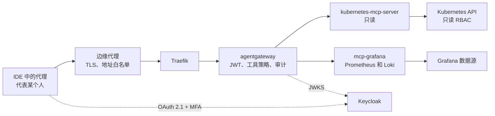

[English](README.md) | [Русский](README.ru.md) | **简体中文**

# 参考架构：obs-mcp-readonly

AI 代理通过 MCP 以只读方式访问 Kubernetes、指标和日志。每次调用都代表一个具体的人执行，经过 AI 网关并记入审计日志。本参考架构规定请求路径、认证、权限、部署、已知问题和未决问题。

**状态：** 草稿，持续演进。创建于 2026-10-26。译文仅供参考；规范文本为[英文版](README.md)。所有配置都是使用 `mess.systems` 下虚构名称的示例，不是运行中的系统。

**能力代码。** 网关是[命名标准](https://github.com/mess-systems/naming-standard/blob/main/i18n/zh-CN/01-naming-conventions.md)中域 `ai` 下的 `gateway`，服务名 `gateway.ai.corp`。MCP 目标（MCP targets）以其公开的能力命名：Kubernetes API 为 `k8s`（域 `infra`），Grafana 数据源为 `dashboards`（域 `obs`）。身份提供方（identity provider）为 `sso`（域 `iam`）。

## 1. 范围

| 包含 | 不包含 |
|---|---|
| 代理只读访问 Kubernetes 资源、事件和 Pod 日志 | 任何集群状态变更：部署、扩缩容、重启、`exec` |
| 通过 Grafana 数据源执行 PromQL 和 LogQL 查询 | 写入仪表盘、告警规则或注释 |
| 代理背后的人的认证、工具授权、审计 | 网关整体：见 `ai-gateway` 参考架构 |
| 通过 GitOps 部署 MCP 服务器和网关策略 | 指标和日志的存储与保留：能力 `metrics` 和 `logs` |

## 2. 组成

| 部分 | 作用 | 产品 | 雷达 |
|---|---|---|---|
| 协议 | 代理调用工具 | Model Context Protocol | [Adopt](https://github.com/mess-systems/tech-radar/blob/main/technologies/mcp.md) |
| 边缘代理 | TLS 终止、来源地址白名单 | 组织的边缘代理 | |
| 入口控制器 | 路由到网关 | Traefik | [Adopt](https://github.com/mess-systems/tech-radar/blob/main/technologies/traefik.md) |
| 网关 | JWT 校验、工具授权、审计 | agentgateway | [Adopt](https://github.com/mess-systems/tech-radar/blob/main/technologies/agentgateway.md) |
| 身份提供方 | 带 MFA 的 OAuth 2.1 登录 | Keycloak | [Adopt](https://github.com/mess-systems/tech-radar/blob/main/technologies/keycloak.md) |
| Kubernetes MCP 服务器 | 只读 Kubernetes 工具 | kubernetes-mcp-server | [Trial](https://github.com/mess-systems/tech-radar/blob/main/technologies/kubernetes-mcp-server.md) |
| Grafana MCP 服务器 | PromQL 和 LogQL 查询 | mcp-grafana | [Trial](https://github.com/mess-systems/tech-radar/blob/main/technologies/mcp-grafana.md) |
| 集群 | 资源、事件和日志的来源 | Kubernetes | [Adopt](https://github.com/mess-systems/tech-radar/blob/main/technologies/kubernetes.md) |
| 指标和日志 | Grafana 背后的数据源 | Grafana、Prometheus、Loki | [Grafana](https://github.com/mess-systems/tech-radar/blob/main/technologies/grafana.md)、[Prometheus](https://github.com/mess-systems/tech-radar/blob/main/technologies/prometheus.md)、[Loki](https://github.com/mess-systems/tech-radar/blob/main/technologies/loki.md)：Adopt |
| 交付 | 从 Git 声明式部署 | Argo CD | [Adopt](https://github.com/mess-systems/tech-radar/blob/main/technologies/argo-cd.md) |

## 3. 请求路径

- 代理从不直接连接 MCP 服务器。每次调用都经过边缘代理和网关。
- 网关判断调用者是谁以及调用者可以使用哪些工具。
- MCP 服务器只能从网关访问。

## 4. 认证

- 通过 Keycloak 进行 OAuth 2.1 登录，必须使用 MFA。
- 访问权限授予按[身份约定](https://github.com/mess-systems/naming-standard/blob/main/i18n/zh-CN/04-identity-conventions.md)命名的应用组，形式为 `app-<capability>-<access>`。
- 代理始终代表启动它的人工作。代理没有共享服务账户，因此审计日志中始终能看到发起请求的人。

流程：

1. 客户端不带令牌调用 MCP 端点，收到带 `WWW-Authenticate` 的 `401`。
2. 网关按 RFC 9728 在 `/.well-known/oauth-protected-resource` 提供受保护资源元数据，其中指明授权服务器。
3. 客户端获取授权服务器元数据（RFC 8414 或 OIDC discovery），并在 Keycloak 完成带 MFA 的登录。
4. 网关通过 JWKS 校验 JWT：签名、`iss`、`aud`、有效期。

agentgateway 内置 `keycloak` 提供方。它使网关适配 Keycloak 与 MCP 授权规范预期不同的行为，例如非标准的签名密钥端点 `{issuer}/protocol/openid-connect/certs`。配置：[`examples/agentgateway-mcp-readonly.example.yaml`](examples/agentgateway-mcp-readonly.example.yaml)。

MCP 服务器自身访问 Kubernetes 和 Grafana 所用的凭据保存在密钥存储中，由 operator 注入 Pod。代理看不到这些凭据，也无法通过任何工具获取。

## 5. 权限

| 允许 | 禁止 |
|---|---|
| 读取资源和事件 | 任何写操作 |
| 读取 Pod 日志 | 读取 `Secret` 对象 |
| 执行 PromQL 和 LogQL 查询 | Grafana 写工具和原始 SQL 查询工具 |

`Secret` 在三个相互独立的层面被禁止，因此一层出错不会放开访问：

1. 网关策略只允许读工具，并拒绝针对 `Secret` 的请求。
2. kubernetes-mcp-server 以只读模式运行，`Secret` 列在 `denied_resources` 中。
3. 服务器的 ServiceAccount 只有只读 ClusterRole，其中不包含 `secrets`。

**网关规则与工具参数。** 在 agentgateway 的 `mcpAuthorization` 中无法获取工具参数：规则只能看到 `mcp.tool.name` 和 `mcp.tool.target`。因此：

- `mcpAuthorization` 为每个目标维护只读工具白名单；
- 基于参数的检查（例如 `kind: Secret`）放在路由级 `authorization` 策略中，该策略可以读取 `mcp.tool.arguments`。

示例中的工具名称取自各服务器的 README。请对照所用服务器版本的 `tools/list` 进行核对。

**kubernetes-mcp-server。** 当前版本从 TOML 文件读取运行时设置，而不是命令行参数。配置：[`examples/kubernetes-mcp-server.example.toml`](examples/kubernetes-mcp-server.example.toml)。

**mcp-grafana。** 使用 `--disable-write` 启用只读模式。它还会移除原始 SQL 查询工具，这些工具可能借助数据源凭据执行写入。除 Prometheus 和 Loki 外，禁用所有工具类别。

**RBAC。** ClusterRole 显式列出资源而不是使用 `*`，以免 `Secret` 被意外加入：[`examples/clusterrole-mcp-readonly.example.yaml`](examples/clusterrole-mcp-readonly.example.yaml)。`configmaps` 是有意列入的。ConfigMap 中也可能含有敏感数据；遇到这种情况时应移除该资源。

## 6. 审计

每次调用记录：

- 人（JWT 中的 `sub`）和客户端；
- 目标和工具；
- 时间和授权决定；
- 结果的哈希。

结果哈希是本参考架构的架构要求，而不是可选功能。结果本身不保存；通过哈希可以事后核对代理究竟收到了什么。如果所选网关无法在访问日志中记录该哈希，则由请求路径上的单独组件记录。不记录结果哈希的部署不符合本参考架构。

## 7. 部署

- 两个 MCP 服务器、网关及其策略都在 Git 中描述，并由 Argo CD 部署。不允许在集群中手工修改。
- 对这些规则的例外以带截止日期的技术债务 issue 记录，以免成为永久状态。
- 资源请求很小。粗略参考：两个 MCP 服务器合计约 150m CPU 和 256Mi 内存。请按实际负载确定规格。

## 8. 已知问题

**TLS 代理后的 `X-Forwarded-Proto`。** TLS 在边缘代理终止，请求以 HTTP 到达 Traefik 和网关。如果 `X-Forwarded-Proto` 头丢失或 Traefik 不信任它，网关会在元数据中生成 `http://` 地址，客户端的 OAuth 流程随之失败。解决方法：

- 信任来自边缘代理的转发头（Traefik 入口点上的 `forwardedHeaders.trustedIPs`）；
- 或通过 middleware 显式设置该头：[`examples/traefik-forwarded-proto.example.yaml`](examples/traefik-forwarded-proto.example.yaml)。

**RFC 9207 与 `iss` 参数。** RFC 9207 在授权响应中加入 `iss` 参数，以防范授权服务器混淆（mix-up）。使用 `keycloak` 提供方时，网关将自身声明为签发者，而授权响应直接来自 Keycloak，携带 Keycloak 自己的 `iss`。严格执行 RFC 9207 的客户端会拒绝登录。agentgateway 中的修复尚未合并（[issue #3635](https://github.com/agentgateway/agentgateway/issues/3635)、[issue #3668](https://github.com/agentgateway/agentgateway/issues/3668)、[pull request #3637](https://github.com/agentgateway/agentgateway/pull/3637)）。临时方案：直接在身份提供方中注册客户端。

**云端代理与地址白名单。** 云端运行的代理从服务商地址连接，无法通过边缘代理的地址白名单。它们只能经由本人的工作站接入。

## 9. 示例

| 文件 | 展示内容 |
|---|---|
| [`examples/agentgateway-mcp-readonly.example.yaml`](examples/agentgateway-mcp-readonly.example.yaml) | 基于 Keycloak 的 MCP 认证，按目标的只读工具白名单 |
| [`examples/kubernetes-mcp-server.example.toml`](examples/kubernetes-mcp-server.example.toml) | 只读模式、`core` 工具集、禁止 `Secret` |
| [`examples/clusterrole-mcp-readonly.example.yaml`](examples/clusterrole-mcp-readonly.example.yaml) | 不含 `secrets` 的只读 ClusterRole |
| [`examples/traefik-forwarded-proto.example.yaml`](examples/traefik-forwarded-proto.example.yaml) | 设置 `X-Forwarded-Proto` 的 middleware |

## 10. 未决问题

1. 失败即关闭（fail-closed）的日志脱敏：当脱敏机制无法确认响应中不含密钥时，拒绝返回该响应。
2. 授权拒绝也必须进入审计日志，而不仅是成功的调用。
3. 将身份提供方的配置迁移到 [OpenTofu](https://github.com/mess-systems/tech-radar/blob/main/technologies/opentofu.md)（Adopt）。
4. RFC 9207：等待网关修复或客户端改动。
5. 网关和 MCP 服务器的高可用。

## 参考资料

- kubernetes-mcp-server，README 和配置参考：https://github.com/containers/kubernetes-mcp-server
- mcp-grafana，README（`--disable-write`、工具类别）：https://github.com/grafana/mcp-grafana
- agentgateway，MCP 认证：https://agentgateway.dev/docs/standalone/latest/documentation/configuration/security/mcp-authn/
- agentgateway，Keycloak：https://agentgateway.dev/docs/standalone/latest/integrations/auth/keycloak/
- agentgateway，MCP 授权与 CEL 变量：https://agentgateway.dev/docs/standalone/latest/documentation/configuration/security/mcp-authz/
- RFC 9728，OAuth 2.0 Protected Resource Metadata：https://www.rfc-editor.org/rfc/rfc9728
- RFC 8414，OAuth 2.0 Authorization Server Metadata：https://www.rfc-editor.org/rfc/rfc8414
- RFC 9207，OAuth 2.0 Authorization Server Issuer Identification：https://www.rfc-editor.org/rfc/rfc9207
- Traefik，headers middleware：https://doc.traefik.io/traefik/middlewares/http/headers/
