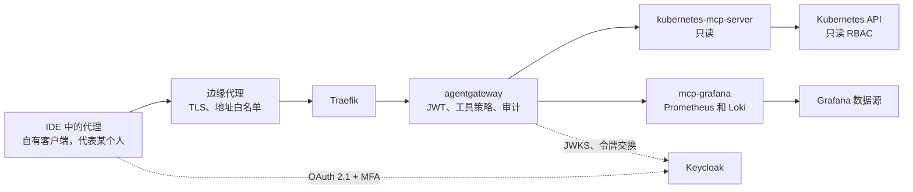

[English](README.md) | [Русский](README.ru.md) | **简体中文**

# 参考架构：obs-mcp-readonly

AI 代理通过 MCP 以只读方式访问 Kubernetes、指标和日志。每次调用都由一个具名代理代表一个具体的人执行，经过 AI 网关，并在审计日志中同时记录两者。本参考架构规定请求路径、认证、权限、部署、已知问题和未决问题。

**状态：** 草稿，持续演进。创建于 2026-10-26。译文仅供参考；规范文本为[英文版](README.md)。所有配置都是使用 `mess.systems` 下虚构名称的示例，不是运行中的系统。

**能力代码。** 网关是[命名标准](https://github.com/mess-systems/naming-standard/blob/main/i18n/zh-CN/01-naming-conventions.md)中域 `ai` 下的 `gateway`，服务名 `gateway.ai.corp`。MCP 目标（MCP targets）以其公开的能力命名：Kubernetes API 为 `k8s`（域 `infra`），Grafana 数据源为 `dashboards`（域 `obs`）。身份提供方（identity provider）为 `sso`（域 `iam`）。

## 1. 范围

| 包含 | 不包含 |
|---|---|
| 代理只读访问 Kubernetes 资源、事件和 Pod 日志 | 任何集群状态变更：部署、扩缩容、重启、`exec` |
| 通过 Grafana 数据源执行 PromQL 和 LogQL 查询 | 写入仪表盘、告警规则或注释 |
| 人和代理的认证、委托、工具授权、审计 | 网关整体：见 `ai-gateway` 参考架构 |
| 通过 GitOps 部署 MCP 服务器和网关策略 | 指标和日志的存储与保留：能力 `metrics` 和 `logs` |

## 2. 组成

| 部分 | 作用 | 产品 | 雷达 |
|---|---|---|---|
| 协议 | 代理调用工具 | Model Context Protocol | [Adopt](https://github.com/mess-systems/tech-radar/blob/main/technologies/mcp.md) |
| 边缘代理 | TLS 终止、来源地址白名单 | 组织的边缘代理 | |
| 入口控制器 | 路由到网关 | Traefik | [Adopt](https://github.com/mess-systems/tech-radar/blob/main/technologies/traefik.md) |
| 网关 | JWT 校验、令牌交换、工具授权、审计 | agentgateway | [Adopt](https://github.com/mess-systems/tech-radar/blob/main/technologies/agentgateway.md) |
| 身份提供方 | 带 MFA 的 OAuth 2.1 登录、代理客户端、令牌交换 | Keycloak | [Adopt](https://github.com/mess-systems/tech-radar/blob/main/technologies/keycloak.md) |
| Kubernetes MCP 服务器 | 只读 Kubernetes 工具 | kubernetes-mcp-server | [Trial](https://github.com/mess-systems/tech-radar/blob/main/technologies/kubernetes-mcp-server.md) |
| Grafana MCP 服务器 | PromQL 和 LogQL 查询 | mcp-grafana | [Trial](https://github.com/mess-systems/tech-radar/blob/main/technologies/mcp-grafana.md) |
| 集群 | 资源、事件和日志的来源 | Kubernetes | [Adopt](https://github.com/mess-systems/tech-radar/blob/main/technologies/kubernetes.md) |
| 指标和日志 | Grafana 背后的数据源 | Grafana、Prometheus、Loki | [Grafana](https://github.com/mess-systems/tech-radar/blob/main/technologies/grafana.md)、[Prometheus](https://github.com/mess-systems/tech-radar/blob/main/technologies/prometheus.md)、[Loki](https://github.com/mess-systems/tech-radar/blob/main/technologies/loki.md)：Adopt |
| 交付 | 从 Git 声明式部署 | Argo CD | [Adopt](https://github.com/mess-systems/tech-radar/blob/main/technologies/argo-cd.md) |

## 3. 请求路径

- 代理从不直接连接 MCP 服务器。每次调用都经过边缘代理和网关。
- 网关判断调用者是谁以及调用者可以使用哪些工具。
- MCP 服务器只能从网关访问。

## 4. 认证与委托

- 通过 Keycloak 进行 OAuth 2.1 登录，必须使用 MFA。
- 访问权限授予按[身份约定](https://github.com/mess-systems/naming-standard/blob/main/i18n/zh-CN/04-identity-conventions.md)命名的应用组，形式为 `app-<capability>-<access>`。
- 代理代表启动它的人工作，但使用自己的身份。模型是委托（delegation），而不是冒充（impersonation）：每个令牌和每条审计记录都同时指明人和代理。

### 4.1 要求

1. **人和代理始终可区分。** 人是 `sub`。代理在委托令牌中是 `act.client_id`，在下文的备用方案中是 `azp`。只指明人的令牌不能用于调用工具，因为网关和审计日志都无法据此区分人和代理。
2. **每个代理在 Keycloak 中有自己的客户端。** 每个代理一个机密客户端，ID 采用[身份类型](https://github.com/mess-systems/naming-standard/blob/main/i18n/zh-CN/04-identity-conventions.md) `agent-<name>`（由人运行的工具则为 `user-<handle>-<tool>`）。代理没有共享客户端，也没有共享服务账户。客户端使用签名的客户端断言（`private_key_jwt`）认证，而不是长期有效的共享密钥。
3. **每次代理运行都有实例或会话 ID**，并写入审计日志。哪些现在可用、哪些仍是要求，见第 6 节。
4. **传入的令牌永远不会到达 MCP 服务器。** MCP 授权规范禁止令牌透传（token passthrough）。网关在 Keycloak 中交换令牌（RFC 8693），得到受众仅为该目标背后那一个 MCP 服务器的令牌；无法进行这种交换时，网关用自己的凭据访问 MCP 服务器。
5. **有效权限是交集**：人的权限与代理的权限的交集，见 4.4。

### 4.2 推荐方案：带 `act` 声明的委托

人把权限委托给一个具名的代理客户端，代理获得一个同时包含两个身份的令牌（RFC 8693 第 4.1 节）。

1. 客户端不带令牌调用 MCP 端点，收到带 `WWW-Authenticate` 的 `401`。
2. 网关按 RFC 9728 在 `/.well-known/oauth-protected-resource` 提供受保护资源元数据，其中指明授权服务器。
3. 客户端获取授权服务器元数据（RFC 8414 或 OIDC discovery）。人通过一个请求 `delegation:client:<agent client_id>` 范围的客户端完成带 MFA 的登录，并在同意页面上批准委托。此后人的令牌中带有 `may_act`，其中是代理的 `sub` 和 `client_id`。
4. 代理客户端用人的令牌（`subject_token`）加上自己的 `client_credentials` 令牌（`actor_token`）进行交换。委托令牌带有 `sub`（人）和 `act`（代理的服务账户和 `client_id`）。其受众和范围来自代理客户端的配置，其中只指明网关。
5. 网关通过 JWKS 校验 JWT：签名、`iss`、`aud`、有效期。网关读取 `sub` 和 `act.client_id` 用于授权和审计。

Keycloak 中的状态和前提条件（Keycloak 26.8）：

- 令牌交换委托是 **preview** 功能，默认关闭。通过 `--features=token-exchange-delegation,parameterized-scopes` 启用。
- 请求委托范围的客户端必须启用 **Consent required**。同意不会被保存，因此人在每个登录会话中都要批准委托。
- 必须有一条带 `delegate` 范围的细粒度管理权限（FGAP V2）允许该代理客户端。没有它，Keycloak 会静默丢弃该范围，令牌中也不会有 `may_act`。
- 代理客户端是机密客户端，有服务账户，并启用了 Standard token exchange。
- 客户端策略执行器 `may-act` 会拒绝不是来自委托范围的 `may_act`，例如来自硬编码声明映射器的值。
- 委托令牌在临时会话中签发：没有 refresh token，也没有会话标识符（`sid`）。

缺口，作为要求记录：Keycloak 的标准交换会拒绝带 `act` 或 `may_act` 的主体令牌，而委托交换需要 `may_act`，委托令牌中没有它。因此网关无法把委托令牌再次交换为受众是 MCP 服务器的令牌。在这一点可行之前，网关用自己的凭据访问 MCP 服务器，从不转发委托令牌，人和代理记录在网关审计中。

### 4.3 备用方案：标准令牌交换和 `azp`

未启用委托时，使用 Keycloak 的标准令牌交换。它自 Keycloak 26.2 起得到完整支持。

1. 步骤 1 到 3 同上，但不请求委托范围。人通过代理自己的客户端登录，因此令牌带有 `sub`（人）和 `azp`（代理的 `client_id`）。受众映射器把网关加入 `aud`。
2. 网关校验 JWT，并把 `azp` 记录为代理身份。
3. 对每个 MCP 目标，网关通过 agentgateway 的 `backendAuth.oauthTokenExchange` 在 Keycloak 中交换令牌，用 `audience` 参数请求 MCP 服务器的客户端。交换得到的令牌只限于这一个服务器，保留 `sub`，其 `azp` 是网关的客户端。因此代理身份由网关记录，不会传到 MCP 服务器。

此方案中 Keycloak 的细节：

- 网关的客户端（`svc-corp-ai-agentgateway`）是机密客户端，并启用了 Standard token exchange。人的令牌的 `aud` 中必须包含该客户端。
- `audience` 参数只保留所请求的受众及其客户端角色。它不会添加受众：MCP 服务器的客户端必须已经通过网关客户端的客户端范围进入令牌，例如通过受众映射器。Keycloak 尚不支持 `resource` 参数（RFC 8707），因此示例使用 `audience`。
- 默认情况下，交换可以请求传入令牌中没有的范围和受众。客户端策略执行器 `downscope-assertion-grant-enforcer` 只允许缩小范围，因此交换得到的令牌不会超出传入令牌。

所用 MCP 服务器是否按 MCP 规范对资源服务器的要求校验交换后令牌的受众，需要针对每个服务器版本核实。

agentgateway 内置 `keycloak` 提供方。它使网关适配 Keycloak 与 MCP 授权规范预期不同的行为，例如非标准的签名密钥端点 `{issuer}/protocol/openid-connect/certs`。agentgateway 还可以在交换中发送 `actor_token`，并通过 `enforceMayAct` 在交换前检查主体令牌的 `may_act`。令牌校验仍由 `mcpAuthentication` 负责；交换只读取令牌。配置：[`examples/agentgateway-mcp-readonly.example.yaml`](examples/agentgateway-mcp-readonly.example.yaml)。

### 4.4 有效权限

只有每一层都允许时，调用才会成功：

1. **人：** `app-<capability>-<access>` 组成员身份，映射为角色。
2. **代理客户端：** 其角色范围映射（role scope mappings），并关闭 Full Scope Allowed。Keycloak 只把既分配给人、又在客户端角色范围内的角色放入令牌。在委托中，委托令牌的受众和范围来自代理客户端。
3. **网关：** `mcpAuthorization` 中按目标的工具白名单。规则还可以使用 `jwt.act.client_id` 或 `jwt.azp`，把某个代理限制在部分工具上。
4. **MCP 服务器：** 只读模式和只读 RBAC，见第 5 节。

MCP 服务器自身访问 Kubernetes 和 Grafana 所用的凭据保存在密钥存储中，由 operator 注入 Pod。代理看不到这些凭据，也无法通过任何工具获取。

## 5. 权限

| 允许 | 禁止 |
|---|---|
| 读取资源和事件 | 任何写操作 |
| 读取 Pod 日志 | 读取 `Secret` 对象 |
| 执行 PromQL 和 LogQL 查询 | Grafana 写工具和原始 SQL 查询工具 |

`Secret` 在三个相互独立的层面被禁止，因此一层出错不会放开访问：

1. 网关策略只允许读工具，并拒绝针对 `Secret` 的请求。
2. kubernetes-mcp-server 以只读模式运行，`Secret` 列在 `denied_resources` 中。
3. 服务器的 ServiceAccount 只有只读 ClusterRole，其中不包含 `secrets`。

**网关规则与工具参数。** 在 agentgateway 的 `mcpAuthorization` 中无法获取工具参数：规则能看到工具（`mcp.tool.name`、`mcp.tool.target`）和令牌声明（`jwt`），但看不到 `mcp.tool.arguments`。因此：

- `mcpAuthorization` 为每个目标维护只读工具白名单；
- 基于参数的检查（例如 `kind: Secret`）放在路由级 `authorization` 策略中，该策略可以读取 `mcp.tool.arguments`。

示例中的工具名称取自各服务器的 README。请对照所用服务器版本的 `tools/list` 进行核对。

**kubernetes-mcp-server。** 当前版本从 TOML 文件读取运行时设置，而不是命令行参数。配置：[`examples/kubernetes-mcp-server.example.toml`](examples/kubernetes-mcp-server.example.toml)。

**mcp-grafana。** 使用 `--disable-write` 启用只读模式。它还会移除原始 SQL 查询工具，这些工具可能借助数据源凭据执行写入。除 Prometheus 和 Loki 外，禁用所有工具类别。

**RBAC。** ClusterRole 显式列出资源而不是使用 `*`，以免 `Secret` 被意外加入：[`examples/clusterrole-mcp-readonly.example.yaml`](examples/clusterrole-mcp-readonly.example.yaml)。`configmaps` 是有意列入的。ConfigMap 中也可能含有敏感数据；遇到这种情况时应移除该资源。

## 6. 审计

每次调用都记录下表中的字段。agentgateway 用 CEL 表达式向访问日志添加字段（`frontendPolicies.accessLog.add`）。变量 `jwt` 包含路由上已校验令牌的声明，包括 `act` 这样的嵌套声明。

| 字段 | 来源 | 状态 |
|---|---|---|
| 人 | `jwt.sub` | 可用 |
| 代理客户端 | `jwt.act.client_id`（委托），否则 `jwt.azp` | 可用 |
| 登录会话 | `jwt.sid`（备用方案） | 备用方案中可用；委托令牌没有 `sid`：要求 |
| 代理实例或会话 | `request.agent.session`，根据客户端请求头（例如 `x-session-id`）识别 | 可用，但由客户端声明，未经认证：经证明（attested）的实例 ID 是要求 |
| 目标和工具 | MCP 日志行中的 `mcp.*` 字段 | 可用 |
| 时间和授权决定 | 访问日志 | 可用；拒绝也必须记录，见第 10 节 |
| 结果的哈希 | 网关不提供 | 要求 |

结果的哈希是本参考架构的架构要求，而不是可选功能。结果本身不保存；哈希用于事后核实代理究竟收到了什么。agentgateway 提供 CEL 函数 `sha256.encode`，但尚未确认访问日志上下文中能拿到完整的 MCP 结果，包括流式响应。在确认之前，由请求路径上的独立组件记录哈希。没有结果哈希的部署不符合本参考架构。

访问日志显示的是传入令牌的声明。记录发往 MCP 服务器的交换后令牌的声明是要求，而不是已确认的功能。

这些字段覆盖了 IETF WIMSE 工作组关于 AI 代理身份的草案（`draft-ietf-wimse-aims-00`，进行中的工作）列出的最低审计内容：代理标识符、被委托的主体、资源或工具、操作和决定、时间和关联标识符。

## 7. 部署

- 两个 MCP 服务器、网关及其策略都在 Git 中描述，并由 Argo CD 部署。不允许在集群中手工修改。
- 对这些规则的例外以带截止日期的技术债务 issue 记录，以免成为永久状态。
- 资源请求很小。粗略参考：两个 MCP 服务器合计约 150m CPU 和 256Mi 内存。请按实际负载确定规格。

## 8. 已知问题

**TLS 代理后的 `X-Forwarded-Proto`。** TLS 在边缘代理终止，请求以 HTTP 到达 Traefik 和网关。如果 `X-Forwarded-Proto` 头丢失或 Traefik 不信任它，网关会在元数据中生成 `http://` 地址，客户端的 OAuth 流程随之失败。解决方法：

- 信任来自边缘代理的转发头（Traefik 入口点上的 `forwardedHeaders.trustedIPs`）；
- 或通过 middleware 显式设置该头：[`examples/traefik-forwarded-proto.example.yaml`](examples/traefik-forwarded-proto.example.yaml)。

**RFC 9207 与 `iss` 参数。** RFC 9207 在授权响应中加入 `iss` 参数，以防范授权服务器混淆（mix-up）。使用 `keycloak` 提供方时，网关将自身声明为签发者，而授权响应直接来自 Keycloak，携带 Keycloak 自己的 `iss`。严格执行 RFC 9207 的客户端会拒绝登录。agentgateway 中的修复尚未合并（[issue #3635](https://github.com/agentgateway/agentgateway/issues/3635)、[issue #3668](https://github.com/agentgateway/agentgateway/issues/3668)、[pull request #3637](https://github.com/agentgateway/agentgateway/pull/3637)）。临时方案：直接在身份提供方中注册客户端。

**云端代理与地址白名单。** 云端运行的代理从服务商地址连接，无法通过边缘代理的地址白名单。它们只能经由本人的工作站接入。

## 9. 示例

| 文件 | 展示内容 |
|---|---|
| [`examples/agentgateway-mcp-readonly.example.yaml`](examples/agentgateway-mcp-readonly.example.yaml) | 基于 Keycloak 的 MCP 认证，按目标的只读工具白名单，按目标的令牌交换，审计字段 |
| [`examples/kubernetes-mcp-server.example.toml`](examples/kubernetes-mcp-server.example.toml) | 只读模式、`core` 工具集、禁止 `Secret` |
| [`examples/clusterrole-mcp-readonly.example.yaml`](examples/clusterrole-mcp-readonly.example.yaml) | 不含 `secrets` 的只读 ClusterRole |
| [`examples/traefik-forwarded-proto.example.yaml`](examples/traefik-forwarded-proto.example.yaml) | 设置 `X-Forwarded-Proto` 的 middleware |

## 10. 未决问题

1. 失败即关闭（fail-closed）的日志脱敏：当脱敏机制无法确认响应中不含密钥时，拒绝返回该响应。
2. 授权拒绝也必须进入审计日志，而不仅是成功的调用。
3. 将身份提供方的配置迁移到 [OpenTofu](https://github.com/mess-systems/tech-radar/blob/main/technologies/opentofu.md)（Adopt）。
4. RFC 9207：等待网关修复或客户端改动。
5. 网关和 MCP 服务器的高可用。
6. Keycloak 令牌交换委托脱离 preview。在此之前，按环境决定是否接受 preview 功能，或使用基于 `azp` 的备用方案。
7. 把委托令牌交换为受众是 MCP 服务器的令牌，使 MCP 服务器收到同时指明人和代理的令牌。
8. 令牌中经证明的代理实例 ID。相关工作：`draft-mcguinness-oauth-ai-agent-instance-00`，个人草案，未被工作组采纳。

## 参考资料

- kubernetes-mcp-server，README 和配置参考：https://github.com/containers/kubernetes-mcp-server
- mcp-grafana，README（`--disable-write`、工具类别）：https://github.com/grafana/mcp-grafana
- agentgateway，MCP 认证：https://agentgateway.dev/docs/standalone/latest/documentation/configuration/security/mcp-authn/
- agentgateway，Keycloak：https://agentgateway.dev/docs/standalone/latest/integrations/auth/keycloak/
- agentgateway，MCP 授权与 CEL 变量：https://agentgateway.dev/docs/standalone/latest/documentation/configuration/security/mcp-authz/
- RFC 9728，OAuth 2.0 Protected Resource Metadata：https://www.rfc-editor.org/rfc/rfc9728
- RFC 8414，OAuth 2.0 Authorization Server Metadata：https://www.rfc-editor.org/rfc/rfc8414
- RFC 9207，OAuth 2.0 Authorization Server Issuer Identification：https://www.rfc-editor.org/rfc/rfc9207
- Traefik，headers middleware：https://doc.traefik.io/traefik/middlewares/http/headers/
- Keycloak，令牌交换（标准交换、委托、`may-act` 执行器）：https://www.keycloak.org/securing-apps/token-exchange
- Keycloak 26.8.0 发布说明（委托为 preview）：https://www.keycloak.org/2026/10/keycloak-2680-released
- Keycloak，角色范围映射：https://www.keycloak.org/docs/latest/server_admin/#_role_scope_mappings
- agentgateway，令牌交换：https://agentgateway.dev/docs/standalone/latest/documentation/configuration/security/backend-authn/token-exchange/
- agentgateway，标准令牌交换与 actor 令牌：https://agentgateway.dev/docs/standalone/latest/documentation/configuration/security/backend-authn/token-exchange/standard/
- agentgateway，访问日志：https://agentgateway.dev/docs/standalone/latest/documentation/observability/access-logs/view/
- agentgateway，CEL 变量（`jwt`、`request.agent.session`）：https://agentgateway.dev/docs/standalone/latest/reference/cel/variables/
- MCP 规范 2026-07-28，授权（令牌透传）：https://modelcontextprotocol.io/specification/2026-07-28/basic/authorization
- MCP 安全最佳实践（令牌透传）：https://modelcontextprotocol.io/docs/tutorials/security/security_best_practices
- RFC 8693，OAuth 2.0 Token Exchange：https://www.rfc-editor.org/rfc/rfc8693
- draft-ietf-wimse-aims，AI Identity Management System（进行中的工作）：https://datatracker.ietf.org/doc/draft-ietf-wimse-aims/
- draft-mcguinness-oauth-ai-agent-instance，OAuth 2.0 AI Agent Instance Profile（个人草案）：https://datatracker.ietf.org/doc/draft-mcguinness-oauth-ai-agent-instance/
