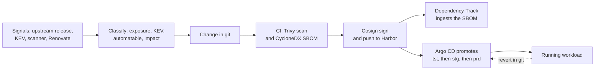

**Русский** (английская и китайская версии ещё не написаны)

# Типовая архитектура: patch-management

Как вымышленная компания mess.systems, которая собирает свою инфраструктуру из открытого программного обеспечения, держит это программное обеспечение актуальным. Обновление зависимости, образа или пакета начинается с сигнала (релиз Upstream, запись в публичном каталоге, находка сканера) и заканчивается работающей нагрузкой в нужном окружении. По дороге изменение проходит через git, проверку в CI, подпись артефакта, внутренний реестр и GitOps. Срок берётся не из одной шкалы CVSS, а из сочетания публичной доступности актива, факта известной эксплуатации и свойств самой уязвимости. Инвентарь компонентов ведётся как набор SBOM, а не как таблица, которую заполняют вручную. Эта типовая архитектура фиксирует состав, путь обновления, имена, аутентификацию, права, сеть, TLS, аудит, развёртывание, известные проблемы, альтернативы и открытые вопросы.

**Статус:** черновик для частного просмотра. Создано 2026-11-24. Не публиковать, не переносить в публичный репозиторий типовых архитектур и не открывать pull request, пока не будет прямого согласия. Нормативный английский текст ещё не написан. Компания mess.systems и её руководители выдуманы. Это модельный состав, не отчёт о внедрении. Все конфигурации являются примерами с вымышленными именами в домене `mess.systems`, а не работающей системой. Факты о продуктах и публичных методиках сверены с официальной документацией 2026-11-24: [CISA BOD 26-04](https://www.cisa.gov/news-events/directives/bod-26-04-prioritizing-security-updates-based-risk) и [каталог KEV](https://www.cisa.gov/known-exploited-vulnerabilities-catalog), [FIRST CVSS](https://www.first.org/cvss/v3.1/user-guide) и [EPSS](https://www.first.org/epss/faq), [NIST SP 800-40 Rev. 4](https://csrc.nist.gov/pubs/sp/800/40/r4/final), [Renovate](https://docs.renovatebot.com/), [Trivy](https://www.trivy.dev/docs/latest/guide/supply-chain/sbom/), [OWASP Dependency-Track](https://dependencytrack.org/features/), [Cosign / Sigstore](https://docs.sigstore.dev/cosign/signing/overview/), [Harbor](https://goharbor.io/docs/main/working-with-projects/project-configuration/implementing-content-trust/), [Argo CD](https://argo-cd.readthedocs.io/en/stable/user-guide/auto_sync/).

**Коды возможностей.** Отдельный код на эту типовую архитектуру пока не вводится. Используются уже известные коды: учёт уязвимостей `vuln` и сканирование `scan` (домен `sec`); непрерывная интеграция `ci`, реестр образов `oci`, пакеты `packages`, GitOps `gitops` (домен `sdlc`). Изменение в продуктивном окружении рассматривается как реализация возможности `change` (домен `itsm`), но носителем изменения является pull request и манифест в git, а не отдельная система заявок. Инвентарь компонентов не кладётся в `cmdb`: его несёт набор SBOM. Имя сервиса инвентаря — `vuln.sec.eng`. Вопрос о регистрации отдельного кода (например `patch`) вынесен в [открытые вопросы](#14-открытые-вопросы).

**Плоскость.** Предварительное решение: `eng`, плоскость домена `sdlc` по умолчанию. Отдельная плоскость не вводится. Сами обновляемые продукты живут в своих плоскостях; инструменты этой типовой архитектуры общие.

**Связанные типовые архитектуры.** Self-hosted раннеры CI: [`sdlc-ci-runners`](https://github.com/mess-systems/blueprints/blob/main/sdlc-ci-runners/README.ru.md). Рабочее устройство: [`endpoint`](https://github.com/mess-systems/blueprints/blob/main/endpoint/README.ru.md). Сеть: [`net-mesh`](https://github.com/mess-systems/blueprints/blob/main/net-mesh/README.ru.md). Реестр образов и кеш пакетов описаны карточками [Harbor](https://github.com/mess-systems/tech-radar/blob/main/technologies/harbor.md) и [NORA](https://github.com/mess-systems/tech-radar/blob/main/technologies/nora.md); эта типовая архитектура на них опирается и не повторяет устройство кешей.

## 1. Границы

| Входит | Не входит |
|---|---|
| Обновление зависимостей приложений, контейнерных образов и пакетов, из которых собираются сервисы компании | Полный цикл обновления операционных систем на рабочих устройствах: это связано с [`endpoint`](https://github.com/mess-systems/blueprints/blob/main/endpoint/README.ru.md) и с [Fleet](https://github.com/mess-systems/tech-radar/blob/main/technologies/fleet.md) (кольцо Trial) и здесь только обозначено как соседняя граница |
| Сигналы об обновлениях и уязвимостях, классификация срока, проверка, подпись, продвижение по окружениям, откат | Разработка собственного сканера уязвимостей и собственной базы CVE |
| Инвентарь компонентов как SBOM (CycloneDX) и его непрерывный разбор | Ручной реестр программного обеспечения как единственный источник правды; CMDB как склад версий библиотек |
| Политика исключений с ограниченным сроком и компенсирующими мерами | Аттестация по требованиям конкретного регулятора; юридическое заключение, распространяется ли на компанию какая-либо директива |
| Несколько наблюдаемых показателей пути обновления | Отдельный «процессный» тип заявки со списком обязательных полей |

Типовая архитектура описывает сервисы компании в Kubernetes и артефакты, которые в них попадают. Серверы и рабочие станции, которые живут вне этого пути, не остаются вне внимания: для них нужен свой инвентарь и свой канал обновления, но его состав здесь не фиксируется.

## 2. Состав

| Часть | Роль | Продукт | Радар |
|---|---|---|---|
| Предложение обновлений | Открывает изменения в git, когда у зависимости, образа или менеджера пакетов есть более новая версия или известная уязвимость | Renovate (открытый CLI, самостоятельное размещение) | карточки ещё нет, предлагается |
| Сканирование и SBOM | Проверка образа и файловой системы сборки, выпуск SBOM в формате CycloneDX | Trivy | [Adopt](https://github.com/mess-systems/tech-radar/blob/main/technologies/trivy.md) |
| Инвентарь компонентов | Принимает SBOM, сопоставляет компоненты с известными уязвимостями, держит историю версий проекта | OWASP Dependency-Track | карточки ещё нет, предлагается |
| Подпись артефакта | Подпись контейнерного образа и проверка подписи | Cosign (проект Sigstore) | карточки ещё нет, предлагается |
| Реестр образов | Хранение собственных образов, сканирование, политика «в проект можно забирать только подписанный образ» | Harbor | [Adopt](https://github.com/mess-systems/tech-radar/blob/main/technologies/harbor.md) |
| Пакеты и кеш публичных хабов | Внутренний источник пакетов, чтобы сборка и рабочие окружения не ходили за зависимостями напрямую | NORA | [Adopt](https://github.com/mess-systems/tech-radar/blob/main/technologies/nora.md) |
| Git | Репозитории приложений, манифестов и политики, pull request как запись изменения | Forgejo | [Adopt](https://github.com/mess-systems/tech-radar/blob/main/technologies/forgejo.md) |
| Непрерывная интеграция | Сборка, Trivy, выпуск SBOM, подпись, публикация в Harbor | self-hosted раннеры, см. `sdlc-ci-runners` | [Actions Runner Controller](https://github.com/mess-systems/tech-radar/blob/main/technologies/actions-runner-controller.md) |
| Доставка в кластер | Сравнение желаемого состояния в git с живым состоянием, синхронизация по окружениям | Argo CD | [Adopt](https://github.com/mess-systems/tech-radar/blob/main/technologies/argo-cd.md) |
| Поставщик идентичностей | Вход людей в Harbor, Dependency-Track и Argo CD | Keycloak | [Adopt](https://github.com/mess-systems/tech-radar/blob/main/technologies/keycloak.md) |
| Секреты | Учётные данные роботов, ключ подписи Cosign, если выбран вариант с собственным ключом | OpenBao | [Adopt](https://github.com/mess-systems/tech-radar/blob/main/technologies/openbao.md) |
| Сеть | Политики от группы к группе | NetBird | [Adopt](https://github.com/mess-systems/tech-radar/blob/main/technologies/netbird.md) |

Открытый Renovate распространяется под лицензией AGPL-3.0-only, это отмечено в [известных проблемах](#11-известные-проблемы). Trivy, Harbor, Argo CD, Cosign и Dependency-Track — под Apache-2.0. Forgejo — под GPL-3.0. Карточки радара для Renovate, Dependency-Track и Cosign ещё не заведены; до публикации этой типовой архитектуры они должны появиться, как требует правило репозитория типовых архитектур.

Пакеты в форматах, отличных от OCI, попадают во внутренний контур через NORA, а не через встроенный реестр пакетов кузницы git. Harbor остаётся реестром образов по карточке радара: встроенный реестр Forgejo Packages для OCI в этот состав не входит.

## 3. Путь обновления

1. **Сигнал.** Часы запускаются в более ранний из двух моментов: запись CVE появляется в [каталоге KEV](https://www.cisa.gov/known-exploited-vulnerabilities-catalog) и в инвентаре есть затронутый компонент, либо Trivy или Dependency-Track впервые показывают этот CVE на артефакте, который компания действительно собирает или запускает. Так компания повторяет логику BOD 26-04 (срок начинается, когда уязвимость попадает в KEV или когда она обнаружена на активе, что раньше), не копируя федеральную панель CDM, которой у компании нет. Помимо KEV и сканера источниками сигнала служат предложения Renovate, бюллетени производителей и, при необходимости, описания в [Банке данных угроз безопасности информации ФСТЭК России](https://bdu.fstec.ru/). БДУ используется как дополнительный публичный источник описаний, а не как таблица сроков.
2. **Классификация.** Для каждого затронутого актива срок берётся из четырёх вопросов, которые CISA с 10 июня 2026 года использует в [BOD 26-04](https://www.cisa.gov/news-events/directives/bod-26-04-prioritizing-security-updates-based-risk) вместо прежних фиксированных окон BOD 19-02 и BOD 22-01. Директива обязательна для гражданских федеральных ведомств США. Компания mess.systems к ним не относится. CISA прямо пишет, что организации вне этого круга, включая частные, могут укрепить устойчивость, если будут приоритизировать устранение записей KEV; эта типовая архитектура берёт таблицу директивы как публичный ориентир, а не как юридическую обязанность. Ответы на «есть ли CVE в KEV», «можно ли эксплуатировать автоматически» и «каков технический эффект» компания берёт из данных программы [Vulnrichment](https://www.cisa.gov/news-events/directives/bod-26-04-prioritizing-security-updates-based-risk), когда они опубликованы. «Публично доступен» означает то же, что в директиве: актив доступен неаутентифицированным или недоверенным сторонам через публичные сети, независимо от физического или логического размещения. Сервис, доступный только из внутренней сети компании, получает значение «нет».
3. **Изменение в git.** Renovate открывает pull request, либо человек готовит ветку. Для обновлений без CVE это обычное поддержание актуальности, а не «заявка на обновление». Для уязвимости в PR указываются идентификатор CVE, выбранный срок и короткое обоснование класса. Слияние в ветку манифестов ещё не есть установка в `prd`.
4. **Проверка и выпуск артефакта.** CI собирает образ, Trivy сканирует его и файловую систему сборки и записывает SBOM в JSON CycloneDX (`trivy image --format cyclonedx` или `trivy fs --format cyclonedx`, [документация Trivy](https://www.trivy.dev/docs/latest/guide/supply-chain/sbom/)). Образ подписывается Cosign и публикуется в Harbor. Harbor дополнительно сканирует артефакт встроенным Trivy. SBOM загружается в Dependency-Track по идентификатору проекта и версии, совпадающей с digest образа.
5. **Продвижение.** Argo CD забирает желаемое состояние из git. Сначала `tst`, затем `stg`, затем `prd`. В `prd` синхронизация не должна быть слепым автосинком без просмотра: см. [развёртывание](#10-развёртывание). Кластер забирает образ только из Harbor и только по неизменяемому digest.
6. **Откат.** Основной откат — возврат предыдущего digest (или манифеста) в git: Argo CD синхронизирует новое желаемое состояние. Команда `argocd app rollback` откатывает живое состояние к записи из истории и, по [официальной документации](https://argo-cd.readthedocs.io/en/stable/user-guide/auto_sync/), недоступна, пока у приложения включена автоматическая синхронизация. Поэтому она рассматривается только как аварийный приём после отключения автосинка, а не как штатный путь.

### 3.1 Сроки, заимствованные из таблицы CISA

Ниже — та же сетка, что в Table 1 директивы BOD 26-04 (официальный источник — страница директивы; дни календарные). «Полный контроль» и «частичный контроль» — это Technical Impact в смысле директивы и SSVC, а не оценка CVSS. «Исправление на плановом обновлении системы» (Fix on system upgrade) означает, что уязвимость закрывается при следующем запланированном мажорном обновлении или пересборке актива, если обстоятельства не изменились.

| Публично доступен | В KEV | Автоматически эксплуатируется | Технический эффект | Срок |
|---|---|---|---|---|
| да | да | да | полный контроль | 3 дня и проверка на компрометацию |
| да | да | да | частичный контроль | 3 дня |
| да | да | нет | полный контроль | 3 дня и проверка на компрометацию |
| да | да | нет | частичный контроль | 14 дней |
| да | нет | да | полный контроль | 3 дня |
| да | нет | да | частичный контроль | 14 дней |
| да | нет | нет | полный контроль | 14 дней |
| да | нет | нет | частичный контроль | 60 дней |
| нет | да | да | полный контроль | 3 дня и проверка на компрометацию |
| нет | да | да | частичный контроль | 14 дней |
| нет | да | нет | полный контроль | 14 дней |
| нет | да | нет | частичный контроль | 14 дней |
| нет | нет | да | полный контроль | 60 дней |
| нет | нет | да | частичный контроль | 60 дней |
| нет | нет | нет | полный контроль | на плановом обновлении |
| нет | нет | нет | частичный контроль | на плановом обновлении |

Сроки динамические, как в директиве: если актив убирают из публичной сети, значение «публично доступен» меняется на «нет», и допустимый срок может стать длиннее; если CVE добавляют в KEV, срок укорачивается. «Проверка на компрометацию» в этой типовой архитектуре — короткий осмотр затронутого актива на признаки уже случившегося проникновения (журналы, неожиданные процессы, следы эксплуатации) параллельно с обновлением. Это не копия федеральной процедуры forensic triage и не замена расследования инцидента. Если данных Vulnrichment ещё нет, способ выбрать строку таблицы остаётся [открытым вопросом](#14-открытые-вопросы).

CVSS само по себе срок не назначает. В [руководстве пользователя CVSS v3.1](https://www.first.org/cvss/v3.1/user-guide) FIRST формулирует это прямо: CVSS измеряет серьёзность уязвимости и не должен использоваться в одиночку для оценки риска; базовый балл отражает только внутренние свойства, постоянные во времени и в разных средах. [Руководство CVSS v4.0](https://www.first.org/cvss/v4.0/user-guide) описывает CVSS как открытую рамку для характеристик и серьёзности. BOD 26-04 сам соотносит Technical Impact с идеей серьёзности в базовой оценке CVSS и при этом уходит от окон «критическое за N дней по баллу». [EPSS](https://www.first.org/epss/faq) оценивает вероятность эксплуатации в дикой природе в ближайшие 30 дней и, по тому же FAQ FIRST, не является полной оценкой риска. Численного официального порога EPSS нет. В этой типовой архитектуре EPSS — дополнительный сигнал: если запись попала в класс «на плановом обновлении», а вероятность по EPSS выглядит высокой относительно остального портфеля, человек может перенести её в 60-дневный цикл и записывает решение в pull request. Автоматического порога «EPSS выше X значит срок Y» эта типовая архитектура не вводит.

### 3.2 Поддержание актуальности без CVE

Большая часть работы — обычные патчи и минорные версии, о которых NIST в [SP 800-40 Rev. 4](https://csrc.nist.gov/pubs/sp/800/40/r4/final) пишет как о текущем (routine) обновлении: его легко откладывать, и тогда аварийные обновления становятся тяжелее. Renovate предлагает такие изменения регулярно. После зелёного CI патч и минорная версия без известной уязвимости могут быть слиты по правилам репозитория. Смена мажорной версии и любое обновление, которое ломает совместимость, идут отдельным pull request и совпадают с идеей «исправление на плановом обновлении системы». Если у компонента нет запланированного окна обновления, его нужно назначить: «на плановом обновлении» не означает «когда-нибудь».

### 3.3 Когда Upstream больше не поддерживает компонент

NIST SP 800-40 Rev. 4 отдельно отмечает, что для программного обеспечения, которое достигло end-of-life, исправления уже не выйдут, и что организации нужно постоянно поддерживать инвентарь, в том числе для контейнеров; SBOM может этот инвентарь дополнять. Когда Upstream публикует дату окончания поддержки, в git открывается работа по замене или обновлению. К этой дате компонент в `prd` должен быть заменён, обновлён или выведен. Если это невозможно, действует исключение из [3.4](#34-исключения). Для публично доступного сервиса снятие с публичной сети само по себе является допустимой компенсирующей мерой и, по логике BOD 26-04, меняет классификацию оставшегося риска.

### 3.4 Исключения

Исключение — короткая запись в том же контуре git (issue или файл политики), а не молчаливый пропуск срока. В ней: актив, CVE или причина, выбранный срок, почему он не выполнен, компенсирующие меры, дата следующего пересмотра. Записи класса «3 дня» и «14 дней» пересматриваются не реже чем раз в 14 календарных дней, остальные — не реже чем раз в 30. Исключение, которое отодвигает обновление дальше ближайшего запланированного окна этого компонента, должно быть явно подтверждено снова. Для публично доступного актива с записью в KEV исключение не заменяет ни обновление, ни снятие с публичной сети.

## 4. Имена

| Объект | Имя | Правило |
|---|---|---|
| Инвентарь компонентов, внутреннее имя | `vuln.sec.eng.svc.mess.systems` | [Грамматика A: внутренняя](https://github.com/mess-systems/naming-standard/blob/main/i18n/ru/01-naming-conventions.md#31-грамматика-a-внутренняя), код `vuln` |
| Приложение инвентаря, `service_name` | `eng-sec-dependencytrack` | [Формы объектов](https://github.com/mess-systems/naming-standard/blob/main/i18n/ru/01-naming-conventions.md#5-формы-объектов) |
| Предложение обновлений | `eng-sdlc-renovate` | там же |
| Реестр образов | `oci.sdlc.eng.svc.mess.systems`, проект `<plane>-<domain>`, например `eng-sdlc` | там же |
| Образ | `oci.sdlc.eng.svc.mess.systems/<plane>-<domain>/<product>[-<component>]@sha256:<digest>` | там же; в `prd` указывается digest, а не изменяемый тег |
| GitOps | `gitops.sdlc.eng.svc.mess.systems`, приложение `eng-sdlc-argocd` | там же |
| Кузница git | `git.sdlc.eng.svc.mess.systems` | там же |
| Репозиторий политики обновлений | организация `eng`, репозиторий `sec-vuln` | там же |
| Проект Dependency-Track | `<plane>-<domain>-<product>[-<env>]`, версия — digest или git SHA | по аналогии с формой приложения; требует проверки на практике |
| Политика OpenBao | `eng-sec-vuln`, `eng-sdlc-renovate` | [Политики](https://github.com/mess-systems/naming-standard/blob/main/i18n/ru/03-secrets-conventions.md#5-политики) |
| Группы узлов в сети | инвентарь `svc-eng-sec-dependencytrack`, реестр `svc-eng-sdlc-harbor`, GitOps `svc-eng-sdlc-argocd` | [Группы mesh VPN](https://github.com/mess-systems/naming-standard/blob/main/i18n/ru/04-identity-conventions.md#4-группы-mesh-vpn) |
| Папка дашбордов | `eng-sec` | [Формы объектов](https://github.com/mess-systems/naming-standard/blob/main/i18n/ru/01-naming-conventions.md#5-формы-объектов) |

## 5. Аутентификация и учётные данные

### 5.1 Требования

Люди входят в Harbor, Dependency-Track и Argo CD через поставщика идентичностей, а не локальным паролем каждого инструмента. Роботы (Renovate, CI, загрузка SBOM, синхронизация Argo CD, робот Harbor) получают свои учётные данные из OpenBao. Секрет не хранится в репозитории и не подставляется в пример конфигурации.

### 5.2 Renovate и git

Renovate работает от отдельной учётной записи кузницы, с собственным токеном и с `gitAuthor`, совпадающим с этой учётной записью, как требует [документация Renovate](https://docs.renovatebot.com/getting-started/running/). Для Forgejo в конфигурации запуска указывается `platform=forgejo` ([официальная страница платформы](https://docs.renovatebot.com/modules/platform/forgejo/)). Если часть репозиториев живёт на GitHub, для них официально поддерживается `platform=github`. Токен не попадает в `renovate.json` репозитория.

### 5.3 Подпись и реестр

Предварительное решение: Cosign подписывает образы ключом, который хранится в OpenBao, командой вида `cosign sign --key ...`, как в [документации Sigstore](https://docs.sigstore.dev/cosign/key_management/signing_with_self-managed_keys/). Вариант без долгоживущего ключа (Fulcio и журнал Rekor) требует либо доступа к публичной инфраструктуре Sigstore, либо собственной инсталляции; это [открытый вопрос](#14-открытые-вопросы). Harbor проверяет наличие подписи Cosign при политике Deployment security проекта.

### 5.4 Dependency-Track

Загрузка SBOM идёт через автоматизационный ключ API, выданный проекту, а не через пароль человека. Люди открывают интерфейс с сессией Keycloak.

## 6. Права

Команда, которая владеет репозиторием приложения, отвечает за то, чтобы предложенное обновление было проверено и попало в манифесты своего продукта. Платформенная роль (несколько людей, не отдел «ИБ» как отдельная иерархия) поддерживает Renovate, Trivy в CI, Harbor, Dependency-Track, наблюдает за каталогом KEV и за сроками, которые уже истекли, и меняет политику. Слияние в ветку, из которой Argo CD берёт `prd`, требует просмотра человека. Робот Harbor, которым кластер забирает образы, имеет право только на чтение нужного проекта. Renovate имеет право открывать ветки и pull request, но не обходит защиту ветки `prd`.

В проектах Harbor, из которых забирают образы `stg` и `prd`, включена политика Cosign: по [документации Harbor](https://goharbor.io/docs/main/working-with-projects/project-configuration/implementing-content-trust/) при включённой политике из проекта можно забрать только проверенный (подписанный) образ.

## 7. Сеть

Инструменты этой типовой архитектуры доступны из внутренней сети компании. Кластеры `tst`, `stg` и `prd` забирают образы только из Harbor, пакеты — только из NORA. Прямая загрузка образа или пакета из публичного реестра в `prd` в этот состав не входит: публичные реестры достижимы для кеша Harbor (Proxy Cache) и для NORA, а не для рабочих нагрузок. Dependency-Track получает SBOM из CI, а не сканирует публичный интернет по своей инициативе сверх настроенных зеркал баз уязвимостей (NVD, GitHub Advisories, OSV — [документация Dependency-Track](https://docs.dependencytrack.org/analysis-types/known-vulnerabilities/)). Каталог KEV читается с официального сайта CISA.

## 8. TLS

Все перечисленные интерфейсы работают по TLS. Внутренние имена используют сертификат на пару «домен-плоскость», по [формам объектов](https://github.com/mess-systems/naming-standard/blob/main/i18n/ru/01-naming-conventions.md#5-формы-объектов), например `*.sec.eng.svc.mess.systems` и `*.sdlc.eng.svc.mess.systems`. Проверка подписи Cosign не заменяет TLS, а дополняет его: TLS защищает канал, подпись — происхождение артефакта.

## 9. Аудит

История изменения в git (pull request, автор, CVE, выбранный класс, digest до и после) считается основной записью о том, что было обновлено. К ней добавляются: журнал Harbor (публикация, забор, результат сканирования, факт подписи), журнал синхронизации Argo CD, журнал CI и журнал аудита Dependency-Track (у продукта есть постоянный экспортный след разбора находок, [описание возможностей](https://dependencytrack.org/features/)). Показатели, на которые смотрят регулярно, такие:

- число компонентов в `prd`, у которых есть CVE из каталога KEV и срок по таблице выше уже истёк (ожидаемое значение — ноль);
- медиана и 90-й процентиль времени от запуска часов до появления исправления в `prd` отдельно для классов «3 дня» и «14 дней»;
- доля образов, работающих в `prd`, которые забраны из Harbor, имеют подпись Cosign, принимаемую политикой проекта, и чей digest есть в Dependency-Track вместе с SBOM;
- доля репозиториев приложений, в которых включён Renovate;
- возраст самого старого компонента в `prd`, у которого Upstream уже закончил поддержку.

Эти величины наблюдают, а не превращают в единственный целевой процент «выполнения в срок».

## 10. Развёртывание

Порядок такой, чтобы сначала появился инвентарь и проверка, и только потом — жёсткая политика реестра.

1. На одном-двух репозиториях включить в CI Trivy и выгрузку CycloneDX в Dependency-Track.
2. Сопоставить портфель с каталогом KEV вручную или небольшим скриптом по идентификатору CVE (в актуальной документации Dependency-Track каталог KEV не перечислен среди встроенных источников; нативные возможности будущих версий — открытый вопрос).
3. Включить Renovate на тех же репозиториях.
4. Подписывать образы Cosign и включить политику Cosign на проекте Harbor, из которого читает `tst`, затем `stg`, затем `prd`.
5. Продвигать digest через Argo CD в этом же порядке окружений.
6. Только после этого считать таблицу сроков рабочей политикой, а не списком пожеланий.

В `tst` допустима автоматическая синхронизация Argo CD. В `prd` предварительное решение: синхронизация после просмотра, либо автоматическая только для заранее согласованного набора приложений. Выбор влияет на откат: при включённом автосинке `argocd app rollback` недоступен.

### 10.1 Порядок изменений

Обновление одной уязвимости не перескакивает через `stg`. Исключение — класс «3 дня», если в `stg` нет сопоставимого стенда; тогда причина записывается в pull request, а проверка в `tst` всё равно проводится. После успешной установки в `prd` в Dependency-Track отмечается новая «текущая» версия проекта. Откат идёт тем же путём в обратную сторону: предыдущий digest в git, синхронизация, проверка, что сервис отвечает.

### 10.2 Матрица проверок

| Кто | Что | Действие | Ожидание | Где видно |
|---|---|---|---|---|
| CI | образ без подписи | забор из проекта Harbor для `prd` | отказано | политика Harbor, журнал реестра |
| CI | подписанный образ, SBOM выгружен | запрос проекта в Dependency-Track по digest | SBOM на месте | Dependency-Track |
| Renovate | зависимость с известной уязвимостью | появление предложения | открыт pull request | git |
| Каталог KEV | новый CVE, компонент есть в инвентаре | классификация | срок по таблице, часы запущены | inventory + запись в git |
| Сопровождающий | публично доступный сервис, CVE в KEV, полный контроль | обновление или снятие с публичной сети | не позже 3 календарных дней | git, Argo CD, внешняя проверка доступности |
| Сопровождающий | манифест `prd` возвращён к прежнему digest | синхронизация Argo CD | работает прежняя версия | Argo CD, нагрузка |
| Администратор | `argocd app rollback` при включённом автосинке | команда отката | отказ, как в документации Argo CD | вывод Argo CD |
| Сканер | образ с известным CVE | политика проекта Dependency-Track | находка не молчит | Dependency-Track |

## 11. Известные проблемы

**Лицензия Renovate.** Открытый Renovate распространяется под AGPL-3.0-only ([документация проекта](https://docs.renovatebot.com/)). Для самостоятельного размещения это нужно явно принять. Альтернативы рассмотрены в [разделе 12](#12-рассмотренные-альтернативы).

**Откат Argo CD и автосинк.** Штатный откат через git совместим с автоматической синхронизацией. Команда `argocd app rollback` — нет. Если в `prd` включат автосинк, аварийный откат командой потребует сначала её выключить.

**Нет встроенного KEV в текущей документации Dependency-Track.** Продукт принимает CycloneDX, сравнивает компоненты с NVD, GitHub Advisories и OSV, умеет учитывать EPSS. Каталог KEV придётся сопоставлять отдельно, пока Upstream не даст официальный встроенный источник, который можно проверить по документации выбранной версии.

**Данные Vulnrichment заполнены не для всего.** Строка таблицы зависит от полей, которые публикует CISA. Правило на случай пустых полей ещё не выбрано.

**«На плановом обновлении» без плана.** Если окно никогда не назначают, класс вырождается в откладывание. Поэтому отсутствие плана само по себе является поводом его назначить.

**Рабочие станции и серверы вне Kubernetes.** Эта типовая архитектура закрывает путь образа и зависимости. Хостовые пакеты и приложения на устройствах сотрудников требуют отдельного решения, иначе они останутся вне этого пути.

**Ключ Cosign.** Долгоживущий ключ в OpenBao — это секрет, который нужно хранить и при необходимости сменять. Переход на подпись по удостоверению (keyless) меняет и сеть, и доверие, и аудит.

## 12. Рассмотренные альтернативы

**Dependabot вместо Renovate.** Dependabot встроен в GitHub и не покрывает Forgejo. Renovate официально поддерживает и Forgejo, и GitHub, и может работать самостоятельно. Поэтому для кузницы из радара выбран Renovate, несмотря на AGPL-3.0-only.

**Syft и Grype вместо Trivy.** Syft хорошо справляется с выпуском SBOM, Grype — со сканированием. В радаре уже выбран Trivy «один инструмент для образов, IaC и SBOM», и Harbor встраивает именно Trivy. Второй конвейер SBOM не вводится, пока не появится проверяемая причина (например, полнота SBOM на конкретном экосистемном стеке). Если такая причина появится, Syft можно добавить точечно, не заменяя Trivy в Harbor.

**Реестр пакетов Forgejo вместо Harbor.** В радаре Harbor — реестр OCI по умолчанию, NORA — пакеты других форматов. Менять это в типовой архитектуре обновлений нет оснований.

**Flux CD вместо Argo CD.** Оба решают GitOps. В радаре для `gitops` уже принят Argo CD.

**Сроки только по шкале CVSS.** Это привычная схема «критическое / высокое / прочее», но она расходится и с позицией FIRST (CVSS не есть оценка риска), и с действующей публичной таблицей CISA, которая с июня 2026 года строится на факте эксплуатации, автоматизации, эффекте и доступности актива. Поэтому в этой типовой архитектуре CVSS не назначает срок.

**Ручной реестр программного обеспечения как источник правды.** NIST допускает, что инвентарь может быть распределён и что полный охват трудноудерживаем; реалистичная цель — почти полный инвентарь за счёт автоматического обнаружения, а SBOM его дополняет. Dependency-Track как раз принимает машинные SBOM. Ручная таблица «название, производитель, версия» без связи с digest и составом образа быстро расходится с реальностью и здесь не является ядром.

## 13. Примеры

Файлы в `examples/` помечены как примеры и не являются работающей системой.

- `renovate.example.json` — конфигурация Renovate в репозитории, пресет `config:recommended`.
- `ci-scan.example.yml` — заготовка шага CI: Trivy, CycloneDX, загрузка в Dependency-Track, подпись Cosign, публикация в Harbor.
- `cosign-verify.example.sh` — проверка подписи перед тем, как считать образ годным к продвижению.
- `argocd-application.example.yaml` — приложение Argo CD, которое следит за манифестом и образом по digest.

## 14. Открытые вопросы

1. Регистрировать ли отдельный код возможности (например `patch`) или достаточно `vuln`.
2. Подтверждается ли плоскость `eng`.
3. Принимается ли таблица BOD 26-04 как рабочая политика компании, с явной оговоркой, что директива на компанию не распространяется.
4. Как классифицировать CVE, для которого ещё нет данных Vulnrichment: консервативно (как более срочный класс) или ждать заполнения.
5. Насколько подробной должна быть «проверка на компрометацию» в классах с пометкой CISA «forensic triage».
6. Допустима ли лицензия AGPL-3.0-only для самостоятельного размещения Renovate.
7. Когда заводить карточки радара для Renovate, Dependency-Track и Cosign.
8. Подпись Cosign своим ключом или вариант с Fulcio и Rekor.
9. Можно ли автоматически сливать патчи без CVE после зелёного CI, или каждый такой pull request смотрит человек.
10. Нужен ли отдельный контур обновления пакетов операционной системы на серверах и устройствах, и в каком документе он живёт.
11. Появится ли во выбранной версии Dependency-Track официальная поддержка каталога KEV, которую можно опереть на документацию этой версии.
12. Где именно хранить текст исключений: issue в `eng/sec-vuln` или файл политики в git.
13. Нужны ли сразу английский нормативный текст и перевод на китайский, как у опубликованных типовых архитектур.

## Источники

Проверено 2026-11-24.

- CISA, BOD 26-04 Prioritizing Security Updates Based on Risk (в том числе Table 1): https://www.cisa.gov/news-events/directives/bod-26-04-prioritizing-security-updates-based-risk
- CISA, разъяснение к BOD 26-04: https://www.cisa.gov/news-events/directives/bod-26-04-implementation-guidance-prioritizing-security-updates-based-risk
- CISA, каталог Known Exploited Vulnerabilities: https://www.cisa.gov/known-exploited-vulnerabilities-catalog
- CISA, о применении KEV организациями вне круга директивы: https://www.cisa.gov/known-exploited-vulnerabilities-catalog/reducing-significant-risk-known-exploited-vulnerabilities
- CISA, BOD 22-01 (отозвана, заменена BOD 26-04): https://www.cisa.gov/news-events/directives/bod-22-01-reducing-significant-risk-known-exploited-vulnerabilities-revoked
- CISA, BOD 19-02 (отозвана, заменена BOD 26-04): https://www.cisa.gov/news-events/directives/bod-19-02-vulnerability-remediation-requirements-internet-accessible-systems-revoked
- FIRST, CVSS v3.1 User Guide («CVSS Measures Severity, not Risk»): https://www.first.org/cvss/v3.1/user-guide
- FIRST, CVSS v4.0 User Guide: https://www.first.org/cvss/v4.0/user-guide
- FIRST, EPSS FAQ: https://www.first.org/epss/faq
- FIRST, Using EPSS: https://www.first.org/epss/using-epss
- NIST, SP 800-40 Rev. 4, Guide to Enterprise Patch Management Planning: https://csrc.nist.gov/pubs/sp/800/40/r4/final, PDF: https://nvlpubs.nist.gov/nistpubs/specialpublications/nist.sp.800-40r4.pdf
- Банк данных угроз безопасности информации ФСТЭК России: https://bdu.fstec.ru/
- Renovate, документация и лицензия AGPL-3.0-only: https://docs.renovatebot.com/
- Renovate, платформа Forgejo: https://docs.renovatebot.com/modules/platform/forgejo/
- Renovate, пресеты, включая `config:recommended`: https://docs.renovatebot.com/presets-config/
- Trivy, выпуск SBOM: https://www.trivy.dev/docs/latest/guide/supply-chain/sbom/
- Trivy, официальный сайт: https://trivy.dev/
- OWASP Dependency-Track, возможности (в том числе CycloneDX и EPSS): https://dependencytrack.org/features/
- Dependency-Track, разбор известных уязвимостей и источники (NVD, GitHub Advisories, OSV): https://docs.dependencytrack.org/analysis-types/known-vulnerabilities/
- Sigstore, обзор подписи Cosign: https://docs.sigstore.dev/cosign/signing/overview/
- Sigstore, подпись собственным ключом: https://docs.sigstore.dev/cosign/key_management/signing_with_self-managed_keys/
- Harbor, политика Deployment security и Cosign: https://goharbor.io/docs/main/working-with-projects/project-configuration/implementing-content-trust/
- Harbor, подпись артефактов Cosign или Notation: https://goharbor.io/docs/main/working-with-projects/working-with-images/sign-images/
- Harbor, сканирование уязвимостей (Trivy): https://goharbor.io/docs/main/administration/vulnerability-scanning/
- Argo CD, Automated Sync Policy (в том числе невозможность rollback при автосинке): https://argo-cd.readthedocs.io/en/stable/user-guide/auto_sync/
- Argo CD, команда `argocd app rollback`: https://argo-cd.readthedocs.io/en/stable/user-guide/commands/argocd_app_rollback/
- CycloneDX: https://cyclonedx.org/
- Syft (рассмотренная альтернатива для SBOM): https://github.com/anchore/syft
- Стандарт именования mess.systems: https://github.com/mess-systems/naming-standard/blob/main/README.ru.md
- Технологический радар mess.systems: https://github.com/mess-systems/tech-radar
- типовые архитектуры mess.systems: https://github.com/mess-systems/blueprints
