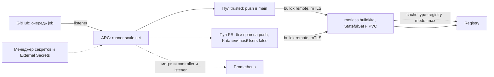

**Русский** (английская и китайская версии ещё не написаны)

# Типовая архитектура: sdlc-ci-runners

Self-hosted раннеры GitHub Actions в своём Kubernetes: одноразовые, изолированные, без privileged docker, с секретами из менеджера секретов и установкой через GitOps. Сборка образов идёт в отдельном rootless BuildKit с кэшем в registry.

**Статус:** черновик типовой архитектуры. Создано 2026-11-12 по оценке от 2026-11-11. Только открытые источники; версии сверены по GitHub Releases на 2026-11-11. Где мы не уверены, стоит пометка «проверить». Нормативный английский текст ещё не написан. Компания mess.systems выдумана, это модельный состав, а не отчёт о внедрении. Имена ниже являются примерами в домене `mess.systems` и не относятся к работающей системе.

**Коды возможностей.** CI `ci`, реестр образов `oci`, кэш `hub-cache` и GitOps `gitops` (домен `sdlc`), секреты `secrets` (домен `iam`), метрики `metrics` (домен `obs`). Отдельный код на эту типовую архитектуру не вводится.

**Связанные типовые архитектуры.** Проверки агентов в CI: [`adlc-agent-evals`](https://github.com/mess-systems/blueprints/blob/main/adlc-agent-evals/README.ru.md).

## 1. Границы

| Входит | Не входит |
|---|---|
| Раннеры GitHub Actions в своём Kubernetes | Раннеры Forgejo Actions (CI по умолчанию для внутренних репозиториев) и GitLab |
| Сборка образов без privileged и кэш слоёв | Выбор registry и облачного провайдера |
| Изоляция для недоверенного кода из pull request | Точные манифесты и размеры node pool |
| Чек-лист безопасности и пилот | Подсчёт бюджета |

## 2. Исходная картина

Небольшая платформенная команда, код в GitHub, часть репозиториев приватная, несколько образов собирается через buildx и уходит в registry. На раннерах, которые даёт GitHub, сборки медленные из-за холодного кэша, бывают сетевые сбои по дороге до registry. Хочется раннеры в своём Kubernetes. Компания в легенде сокращается, поэтому решение должно быть дешёвым в содержании: без постоянно включённых машин и без отдельной команды под CI.

## 3. Короткий ответ

**ARC (runner scale sets), rootless BuildKit как общий сервис и кэш в registry.**

- Pod раннера одноразовый и без docker.
- buildx подключается к buildkitd через драйвер `remote` по mTLS.
- Кэш слоёв лежит в registry (`type=registry,mode=max`) и на PVC BuildKit.
- Для недоверенного кода из pull request отдельный пул без прав на push и, где возможно, изоляция ядра: RuntimeClass Kata или user namespaces (`hostUsers: false`, GA в Kubernetes 1.36).

Компоненты на радаре: [Actions Runner Controller](https://github.com/mess-systems/tech-radar/blob/main/technologies/actions-runner-controller.md) (Assess), [BuildKit](https://github.com/mess-systems/tech-radar/blob/main/technologies/buildkit.md) (Assess), [Kata Containers](https://github.com/mess-systems/tech-radar/blob/main/technologies/kata-containers.md) (Assess), [Argo CD](https://github.com/mess-systems/tech-radar/blob/main/technologies/argo-cd.md) (Adopt), [OpenBao](https://github.com/mess-systems/tech-radar/blob/main/technologies/openbao.md) (Adopt), [Prometheus](https://github.com/mess-systems/tech-radar/blob/main/technologies/prometheus.md) (Adopt).

## 4. Подходы

| Вариант | Версия или статус (11.2026) | Лицензия | Комментарий |
|---|---|---|---|
| **ARC scale sets** | gha-runner-scale-set 0.15.1 (2026-10-23), runner v2.338.2 | Apache-2.0, MIT | Стандарт для Kubernetes. Режим `dind` требует privileged; режимы `kubernetes` и `kubernetes-novolume` дают раннеру RBAC на pods, их стоит брать, только если нужны `services:` |
| **GARM** | v0.2.1 | Apache-2.0 | Одноразовые VM или контейнеры через провайдеры (AWS, Azure, GCP, OpenStack, LXD и Incus, Kubernetes и другие) |
| **terraform-aws-github-runner** | v8.1.0 | MIT | Только AWS |
| **RunsOn** | v3.6.0 | Код MIT, для бизнеса платная лицензия | Только AWS |
| **actuated** | нет данных | Коммерческий | microVM на Firecracker на своих серверах, нужен KVM |
| **Kata, gVisor, Firecracker** | Kata 4.3.1, gVisor release-20261102.0, Firecracker v1.18.0 | Apache-2.0 | Изоляция ядра; Kata и gVisor подключаются как RuntimeClass, в managed Kubernetes по наличию у провайдера |
| **Раннеры на KubeVirt** | KubeVirt 1.9.1 | Apache-2.0 | Тяжело для маленькой команды, готовые обёртки незрелые |
| **Ubicloud** | нет данных | AGPL-3.0 | Managed-раннеры во внешнем облаке или self-host на bare metal |
| **WarpBuild, Namespace, Depot** | нет данных | Коммерческие | Managed: код, кэш и секреты у вендора |
| **BuildJet** | закрыт 2026-03-31 | нет данных | Нет |
| **Cirrus Runners** | новых клиентов не берут | нет данных | По открытым сообщениям, команда Cirrus Labs уходит в OpenAI |

### CubeSandbox и OpenSandbox это не CI

- **CubeSandbox** (Tencent Cloud, Apache-2.0, около 13 тысяч звёзд, v0.7.3, есть 0.8.0-rc) это песочницы для AI-агентов на RustVMM и KVM, совместимые с E2B SDK.
- **OpenSandbox** (проект Agentic AI Foundation, Apache-2.0, около 17 тысяч звёзд, 1.2.0) это песочницы для агентов: API команд и файлов, политики egress, оператор Kubernetes, Firecracker.

Ни одна из них не умеет регистрировать раннеры GitHub и масштабироваться по очереди job. Для CI ту же изоляцию проще получить через RuntimeClass Kata у pod ARC. На радаре [CubeSandbox](https://github.com/mess-systems/tech-radar/blob/main/technologies/cubesandbox.md) остаётся продуктом для `sandbox` агентов.

## 5. Сборка без privileged

| Инструмент | Статус | Комментарий |
|---|---|---|
| **BuildKit rootless** | v0.34.2 (есть v0.35.0-rc) | Официальные манифесты для Kubernetes: `rootless` (seccomp и AppArmor unconfined) и `userns` (`hostUsers: false`). Лучший кэш |
| **kaniko** | Репозиторий Google архивирован в июне 2025; форк Chainguard v1.25.22 получает только исправления безопасности, готовых образов нет | Для новых проектов не брать |
| **buildah rootless** | v1.46.0 | Работает, но в Kubernetes больше возни с fuse и seccomp |
| **Depot** | SaaS | Быстро, но в облаке вендора |

**Кэш:** registry (`mode=max`, `image-manifest=true`), локальный кэш BuildKit на PVC (StatefulSet для стабильного хэширования), S3 как альтернатива. Для `actions/cache` есть self-hosted [github-actions-cache-server](https://github.com/falcondev-oss/github-actions-cache-server) (MIT, v10.0.0, S3 или файловая система). Pull образов ускоряет [Spegel](https://github.com/spegel-org/spegel).

**Сеть:** раннеры и BuildKit ставить рядом с registry; наружу открыт только GitHub; NetworkPolicy по умолчанию запрещает всё; базовые образы идут через pull-through cache.

## 6. Безопасность: чек-лист

- Раннеры одноразовые (в ARC это поведение по умолчанию), отдельный node pool с taint, отдельные namespace для trusted и для PR.
- GitHub App для ARC, ключ из менеджера секретов через External Secrets; runner groups ограничены нужными репозиториями.
- PR из форков в приватных репозиториях выключены (по умолчанию так и есть); `pull_request_target` не запускать на self-hosted раннерах.
- OIDC вместо статических ключей к registry, если провайдер это поддерживает; иначе ротация.
- `runAsNonRoot`, `drop ALL`, без токена ServiceAccount в pod раннера.
- Метрики ARC (controller и listener) в Prometheus, дашборд очереди и времени ожидания.

## 7. Пилот на 1–2 недели

1. Node pool и секреты, GitHub App и runner group.
2. ARC через GitOps, `minRunners: 0`, NetworkPolicy, метрики.
3. Rootless buildkitd (StatefulSet и PVC, mTLS).
4. Один образ по push в main с кэшем в registry; замер холодной и тёплой сборки и числа сетевых сбоев.
5. Потом остальные образы, затем пул PR без прав на push и с усиленной изоляцией.

## 8. Открытые вопросы

- Плату GitHub $0.002 за минуту self-hosted раннеров объявили в декабре 2025 и отложили. На ноябрь 2026 она не действует, но перед расчётом бюджета это стоит проверить.
- Есть ли у выбранного провайдера Kubernetes RuntimeClass Kata или хотя бы user namespaces. Без них пул PR держится только на правах и сети.
- Хватит ли одного buildkitd на все образы или понадобится несколько с общим кэшем в registry.

## Ссылки

- ARC: <https://github.com/actions/actions-runner-controller>
- BuildKit в Kubernetes: <https://github.com/moby/buildkit/tree/master/examples/kubernetes>
- User namespaces GA: <https://kubernetes.io/blog/2026/04/23/kubernetes-v1-36-userns-ga/>
- Форк kaniko: <https://github.com/chainguard-forks/kaniko>
- CubeSandbox: <https://github.com/TencentCloud/CubeSandbox>; OpenSandbox: <https://github.com/opensandbox-group/OpenSandbox>
- GARM: <https://github.com/cloudbase/garm>
