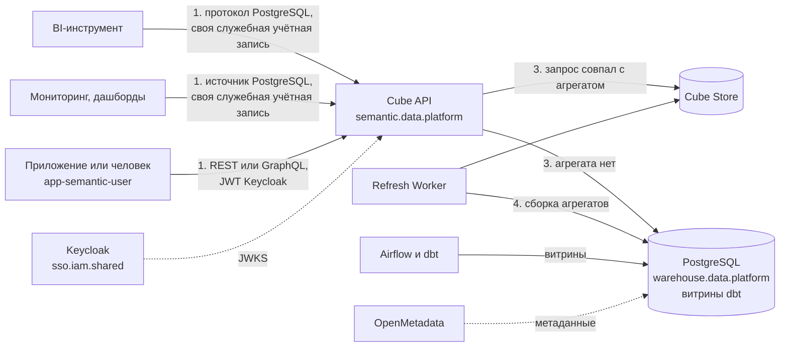

**Русский** (английская и китайская версии ещё не написаны)

# Типовая архитектура: semantic-layer-cube

Семантический слой данных в mess.systems на Cube. Меры, измерения и связи между витринами описываются один раз в коде и хранятся в git. Потребители (BI, дашборды, приложения) получают данные через интерфейс слоя: SQL API по протоколу PostgreSQL, REST API или GraphQL API. Права проверяются на слое по контексту безопасности. Предварительные агрегаты (pre-aggregations) хранятся в Cube Store и отвечают на подходящие запросы без обращения к источнику. Эта типовая архитектура фиксирует состав, путь запроса, имена, аутентификацию, права, сеть, TLS, аудит, развёртывание, известные проблемы, альтернативы и открытые вопросы.

**Статус:** черновик. Создано 2026-11-02. Нормативный английский текст ещё не написан. Все конфигурации являются примерами с вымышленными именами в домене `mess.systems`, а не работающей системой. Факты о Cube сверены с документацией docs.cube.dev и исходным кодом на 2026-11-02 (Cube v1.8.17).

**Коды возможностей.** Семантический слой получает код `semantic` в домене `data`. В [стандарте именования](https://github.com/mess-systems/naming-standard/blob/main/i18n/ru/01-naming-conventions.md#43-коды-возможностей-уникальны-во-всех-доменах) такого кода пока нет; он предложен к регистрации отдельным изменением стандарта. Имя сервиса `semantic.data.platform`. Остальные возможности: хранилище данных `warehouse`, преобразования `transform`, оркестрация `orchestrate`, каталог данных `data-catalog`, BI `bi` (все в домене `data`), дашборды `dashboards` (домен `obs`), хранилище секретов `secrets` и поставщик идентичностей `sso` (домен `iam`), сеть `mesh` (домен `net`), журналы `logs` (домен `obs`).

**Плоскость.** Предварительное решение: `platform`, плоскость домена `data` по умолчанию. Отдельная плоскость для домена `data` не вводится. Открытый вопрос: плоскость уточняется после оценки.

## 1. Границы

| Входит | Не входит |
|---|---|
| Семантическая модель: кубы (cubes), представления (views), меры, измерения, соединения | Построение витрин: dbt (`transform`) и Airflow (`orchestrate`) |
| SQL API, REST API и GraphQL API слоя | Хранилище данных, его резервные копии и права внутри него, кроме роли слоя |
| Контекст безопасности, политики доступа (access policies), фильтры строк, маскирование | Права внутри BI-инструментов: папки, дашборды, роли Superset и Grafana |
| Предварительные агрегаты в Cube Store и их обновление | Каталог данных и происхождение данных (data lineage): `data-catalog` |
| Подключение потребителей (BI, мониторинг и т. п.) к слою | Cube Cloud и функции, доступные только в нём |
| Имена, секреты, сеть, TLS, аудит, порядок изменений | Сама сеть: см. типовую архитектуру [`net-mesh`](../net-mesh/) |

## 2. Состав

| Часть | Роль | Продукт | Радар |
|---|---|---|---|
| Хранилище данных | Витрины, из которых читает слой | PostgreSQL | [Adopt](https://github.com/mess-systems/tech-radar/blob/main/technologies/postgresql.md) |
| Преобразования | Витрины dbt в хранилище данных | dbt | [Adopt](https://github.com/mess-systems/tech-radar/blob/main/technologies/dbt.md) |
| Оркестрация | Запуск dbt по расписанию | Apache Airflow | [Adopt](https://github.com/mess-systems/tech-radar/blob/main/technologies/airflow.md) |
| Каталог данных | Описание витрин, происхождение данных | OpenMetadata | [Adopt](https://github.com/mess-systems/tech-radar/blob/main/technologies/openmetadata.md) |
| Семантический слой | Модель, SQL API, REST API, GraphQL API, права, Refresh Worker | Cube (Cube Core, самостоятельное размещение) | Trial (предлагается, карточка `cube.md` в черновике) |
| Кэш агрегатов | Хранение и выполнение предварительных агрегатов | Cube Store (входит в Cube) | там же |
| BI | Исследование данных, отчёты | Apache Superset | [Adopt](https://github.com/mess-systems/tech-radar/blob/main/technologies/superset.md) |
| Дашборды | Дашборды по мерам слоя через источник данных PostgreSQL | Grafana | [Adopt](https://github.com/mess-systems/tech-radar/blob/main/technologies/grafana.md) |
| Поставщик идентичностей | Вход людей в инструменты-потребители, JWT для REST API и GraphQL API | Keycloak | [Adopt](https://github.com/mess-systems/tech-radar/blob/main/technologies/keycloak.md) |
| Секреты | Учётные данные слоя к хранилищу и пароли потребителей SQL API | OpenBao | [Adopt](https://github.com/mess-systems/tech-radar/blob/main/technologies/openbao.md) |
| Сеть | Политики от группы к группе | NetBird | [Adopt](https://github.com/mess-systems/tech-radar/blob/main/technologies/netbird.md) |
| Ревью | Репозиторий модели и конфигурации, pull request | Forgejo | [Adopt](https://github.com/mess-systems/tech-radar/blob/main/technologies/forgejo.md) |

Cube Core распространяется под лицензией Apache-2.0 (часть компонентов под MIT), Cube Store под Apache-2.0. Источник данных PostgreSQL входит в Grafana. Плагин Grafana для Cube (`grafana-cube-datasource`) в состав не входит: см. [известные проблемы](#11-известные-проблемы).

## 3. Путь запроса

1. **Подключение.** Потребители с SQL-клиентом (BI-инструмент, система мониторинга) подключаются к `semantic.data.platform.svc.mess.systems` как к базе PostgreSQL. Кубы и представления видны как таблицы, меры и измерения как столбцы; мера запрашивается функцией `MEASURE()`. Приложения и люди обращаются к REST API (`/cubejs-api/v1/load`) или к GraphQL API (`/cubejs-api/graphql`) с JWT в заголовке `Authorization`.
2. **Аутентификация и контекст.** Для SQL API функция `check_sql_auth` проверяет имя и пароль пользователя и возвращает контекст безопасности. Для REST API и GraphQL API Cube проверяет подпись JWT по JWKS Keycloak, издателя и аудиторию; утверждения (claims) токена становятся контекстом безопасности. Функция `context_to_groups` превращает контекст в группы, к которым привязаны политики доступа.
3. **Планирование.** Cube переводит запрос в SQL по модели и применяет политики доступа. Если запрос совпадает с предварительным агрегатом, ответ приходит из Cube Store. Если нет, Cube выполняет SQL к витринам в PostgreSQL. В режиме rollup-only экземпляр API отвечает только из агрегатов, а запрос без подходящего агрегата завершается ошибкой.
4. **Обновление.** Refresh Worker по ключу обновления (`refresh_key`, по умолчанию раз в час) пересобирает агрегаты из витрин и записывает их в Cube Store.

Один и тот же запрос через любой интерфейс считается по одной модели. Мера, определённая в модели, даёт одно значение у каждого потребителя SQL API и в REST API; это проверяется в [матрице](#102-матрица-проверок).

## 4. Имена

| Объект | Имя | Правило |
|---|---|---|
| Семантический слой, внутреннее имя | `semantic.data.platform.svc.mess.systems` (после регистрации кода `semantic`) | [Грамматика A: внутренняя](https://github.com/mess-systems/naming-standard/blob/main/i18n/ru/01-naming-conventions.md#31-грамматика-a-внутренняя), [коды возможностей](https://github.com/mess-systems/naming-standard/blob/main/i18n/ru/01-naming-conventions.md#43-коды-возможностей-уникальны-во-всех-доменах) |
| Приложения слоя, `service_name` в Loki | `platform-data-cube` (API и Refresh Worker), `platform-data-cubestore` (Cube Store) | [Формы объектов](https://github.com/mess-systems/naming-standard/blob/main/i18n/ru/01-naming-conventions.md#5-формы-объектов) |
| Хост слоя | `dc1-platform-data-cube-prd-01` | [Формы объектов](https://github.com/mess-systems/naming-standard/blob/main/i18n/ru/01-naming-conventions.md#5-формы-объектов) |
| Репозиторий модели и конфигурации | организация `platform`, репозиторий `data-cube` | [Формы объектов](https://github.com/mess-systems/naming-standard/blob/main/i18n/ru/01-naming-conventions.md#5-формы-объектов) |
| Образ контейнера | `oci.sdlc.eng.svc.mess.systems/platform-data/cube:v1.8.17` | [Формы объектов](https://github.com/mess-systems/naming-standard/blob/main/i18n/ru/01-naming-conventions.md#5-формы-объектов) |
| Хранилище данных | `warehouse.data.platform.svc.mess.systems`, приложение `platform-data-postgres`, база `platform_data_warehouse_prd` | [Формы объектов](https://github.com/mess-systems/naming-standard/blob/main/i18n/ru/01-naming-conventions.md#5-формы-объектов) |
| Витрины dbt | `<plane>.<domain>.<table>`, например `platform.data.catalog_coverage` | [Формы объектов](https://github.com/mess-systems/naming-standard/blob/main/i18n/ru/01-naming-conventions.md#5-формы-объектов) |
| Роли хранилища | групповая роль чтения `platform_data_warehouse_ro`, учётная запись слоя `svc_platform_data_cube` | [Роли баз данных](https://github.com/mess-systems/naming-standard/blob/main/i18n/ru/04-identity-conventions.md#11-роли-баз-данных) |
| Пользователи SQL API слоя | `svc_<plane>_<domain>_<product>` потребителя, одна учётная запись на каждого потребителя | по аналогии с [ролями баз данных](https://github.com/mess-systems/naming-standard/blob/main/i18n/ru/04-identity-conventions.md#11-роли-баз-данных) для потребителей |
| Группы Keycloak | чтение через REST и GraphQL `app-semantic-user`, администрирование `app-semantic-admin` | [Группы приложений](https://github.com/mess-systems/naming-standard/blob/main/i18n/ru/04-identity-conventions.md#33-группы-приложений-доступ-к-одной-возможности) |
| Клиент слоя в Keycloak | приложение и аудитория токена `platform-data-cube`, провайдер `platform-data-cube-oidc`, маппер `platform-data-cube-groups` | [Объекты IdP](https://github.com/mess-systems/naming-standard/blob/main/i18n/ru/04-identity-conventions.md#6-объекты-idp) |
| Секреты слоя | `platform/data/semantic/prd/db` (учётная запись к хранилищу), `platform/data/semantic/prd/clients` (пароли, выданные потребителям SQL API) | [Грамматика путей](https://github.com/mess-systems/naming-standard/blob/main/i18n/ru/03-secrets-conventions.md#3-грамматика-путей), [элементы и поля](https://github.com/mess-systems/naming-standard/blob/main/i18n/ru/03-secrets-conventions.md#4-элементы-и-поля) |
| Копии у потребителей | `<mount>/<domain>/<capability>/<env>/semantic` потребителя | [Элементы и поля](https://github.com/mess-systems/naming-standard/blob/main/i18n/ru/03-secrets-conventions.md#4-элементы-и-поля) |
| Политика OpenBao слоя | `platform-data-cube` | [Политики](https://github.com/mess-systems/naming-standard/blob/main/i18n/ru/03-secrets-conventions.md#5-политики) |
| Группы узлов в сети | слой `svc-platform-data-cube`, хранилище `svc-platform-data-postgres`, каждый потребитель `svc-<plane>-<domain>-<product>` | [Группы mesh VPN](https://github.com/mess-systems/naming-standard/blob/main/i18n/ru/04-identity-conventions.md#4-группы-mesh-vpn) |
| Правила сети | `postgresql` (SQL API и хранилище), `https` (REST API и GraphQL API) | [Политики, правила и проверки состояния mesh](https://github.com/mess-systems/naming-standard/blob/main/i18n/ru/04-identity-conventions.md#41-политики-правила-и-проверки-состояния-mesh) |
| Папка дашбордов слоя | `platform-data` | [Формы объектов](https://github.com/mess-systems/naming-standard/blob/main/i18n/ru/01-naming-conventions.md#5-формы-объектов) |

## 5. Аутентификация и учётные данные

### 5.1 Требования

1. **Режим разработки выключен.** `CUBEJS_DEV_MODE` в рабочем окружении не задан: в режиме разработки Cube не проверяет аутентификацию.
2. **У каждого потребителя своя служебная учётная запись.** BI, мониторинг и любой другой потребитель получают отдельную учётную запись; в эталонной схеме их минимум две. Общий пользователь `CUBEJS_SQL_USER` не используется: по общему пользователю слой не различает потребителей ни в правах, ни в журнале.
3. **Пароль не хранится в конфигурации.** Пароли потребителей лежат в OpenBao; `check_sql_auth` получает их при запуске экземпляра из `platform/data/semantic/prd/clients`.
4. **REST API и GraphQL API принимают только JWT Keycloak.** `CUBEJS_API_SECRET` в рабочем окружении не используется.

### 5.2 SQL API

1. SQL API в Cube Core по умолчанию выключен; его включает `CUBEJS_PG_SQL_PORT`. У порта нет значения по умолчанию; в этой архитектуре используется 5432, чтобы потребитель подключался как к обычной базе PostgreSQL.
2. `check_sql_auth` в `cube.py` (или `checkSqlAuth` в `cube.js`) по имени пользователя возвращает пароль и контекст безопасности. Контекст содержит идентификатор потребителя и его группы, например `{"sub": "svc_<plane>_<domain>_<product>", "groups": ["app-semantic-user"]}`.
3. `can_switch_sql_user` по умолчанию не разрешается никому: смена пользователя внутри сеанса позволила бы потребителю действовать от чужого имени. `CUBEJS_SQL_SUPER_USER` не задаётся. Передача контекста пользователя через SQL API (смена пользователя доверенным потребителем) включается только отдельным решением, см. [права](#6-права).
4. Имя базы данных в строке подключения может быть любым; Cube его не проверяет. В примерах используется `semantic`.
5. `CUBEJS_MAX_SESSIONS` ограничивает число сеансов SQL API.

### 5.3 REST API и GraphQL API

1. `CUBEJS_JWK_URL` указывает на JWKS realm `mess-systems` в Keycloak, `CUBEJS_JWT_ISSUER` равен издателю realm, `CUBEJS_JWT_AUDIENCE` равен `platform-data-cube`.
2. Если ключ JWKS настроен, Cube проверяет токены только по нему. Токены, подписанные `CUBEJS_API_SECRET`, отклоняются с `403 Invalid token`. Токен Keycloak должен содержать заголовок `kid`.
3. Маппер `platform-data-cube-groups` помещает группы в токен. Если утверждения лежат во вложенном объекте, их путь задаёт `CUBEJS_JWT_CLAIMS_NAMESPACE`.
4. Области API (`meta`, `data`, `graphql`, `sql`, `jobs`) задаёт `context_to_api_scopes`. Все области, кроме `jobs`, открыты по умолчанию; `jobs` получает только `app-semantic-admin`.

### 5.4 Доступ слоя к хранилищу

1. Слой подключается к PostgreSQL как `svc_platform_data_cube`, член групповой роли `platform_data_warehouse_ro`, с `sslmode=verify-full` (`CUBEJS_DB_SSL`, `CUBEJS_DB_SSL_CA`).
2. Учётная запись читает только схемы витрин. Права на сырые слои dbt у неё нет: потребитель слоя видит то же, что видит модель, и не больше.
3. Пароль учётной записи хранится в `platform/data/semantic/prd/db` и ротируется вместе с перезапуском экземпляров Cube.

## 6. Права

| Слой | Отвечает на вопрос | Где | Пример |
|---|---|---|---|
| Сеть | кто может подключиться к слою | NetBird, OpenTofu | `svc-<plane>-<domain>-<product> -> svc-platform-data-cube` |
| Учётная запись и контекст | кто подключился и какие у него группы | `check_sql_auth`, Keycloak | `svc_<plane>_<domain>_<product>` с группой `app-semantic-user` |
| Политика доступа модели | какие меры, измерения и строки он видит | `access_policy` в модели | представление `orders` для `app-semantic-user` без столбца с персональными данными |
| Права в хранилище | что может читать сам слой | PostgreSQL | `GRANT SELECT` на схемы витрин для `platform_data_warehouse_ro` |

- **Строки по умолчанию открыты.** Без политики доступа Cube отдаёт все строки куба. Поэтому каждое представление, открытое потребителям, получает `access_policy`; куб без политики потребителям не публикуется (`public: false` для кубов, доступ только через представления).
- **Политики привязаны к группам.** В Cube Core группы не приходят сами: их возвращает `context_to_groups` из контекста безопасности. Атрибуты пользователя (`userAttributes`) доступны только в Cube Cloud; в Core фильтры строк используют `securityContext`.
- **Фильтр строк и столбцы.** `row_level.filters` ограничивает строки, `member_level` с `includes` и `excludes` ограничивает меры и измерения, маскирование заменяет значение столбца.
- **Слой различает потребителей.** Каждый потребитель подключается под своей служебной учётной записью, и права слоя (политики доступа, фильтры строк) назначаются потребителю целиком.
- **Права людей.** Разграничение между людьми настраивается одним из двух способов: внутри самого инструмента-потребителя или через передачу контекста пользователя на слой. Во втором случае человек приходит со своим JWT (REST API, GraphQL API) или доверенный потребитель передаёт имя пользователя в SQL API. Если контекст пользователя не передан, слой видит потребителя, а не человека.

## 7. Сеть

- **Политики.** Политики сети односторонние и описаны в OpenTofu:
  - `svc-<plane>-<domain>-<product> -> svc-platform-data-cube`, правило `postgresql`, отдельная политика для каждого потребителя SQL API;
  - `app-semantic-user -> svc-platform-data-cube`, правило `https`;
  - `svc-platform-data-cube -> svc-platform-data-postgres`, правило `postgresql`.

  Группа All никогда не бывает ни источником, ни назначением ([группы и политики](../net-mesh/README.ru.md#6-группы-и-политики) в `net-mesh`).
- **Cube Store не выходит в сеть.** В эталонной схеме API, Refresh Worker и Cube Store работают на одном хосте, и порты Cube Store (`3030`, `9999` и порты рабочих узлов) слушают только локальный интерфейс.
- **Хранилище данных доступно только слою.** Потребители слоя не получают политики к `svc-platform-data-postgres`.

## 8. TLS

1. **REST API и GraphQL API.** Cube Core отдаёт HTTP; TLS завершает обратный прокси на хосте слоя, как в примере развёртывания из документации Cube. Сертификат выпускает PKI OpenBao: роль выпуска `data-platform`, SAN только `semantic.data.platform.svc.mess.systems`.
2. **SQL API без TLS.** SQL API отвечает отказом на запрос TLS по протоколу PostgreSQL и принимает пароль открытым текстом. Клиенты подключаются с `sslmode=disable`. Конфиденциальность пароля и данных обеспечивает только шифрованный туннель сети, поэтому SQL API доступен исключительно через политики раздела [Сеть](#7-сеть) и никогда из LAN. Это отступление от правила `sslmode=verify-full` из [`data-sql-access`](../data-sql-access/README.ru.md#8-tls) и записывается как послабление.
3. **Слой к хранилищу.** `sslmode=verify-full`, цепочка корневого УЦ mess.systems.

## 9. Аудит

| Шаг | Журнал | Показывает | Связь со следующим шагом |
|---|---|---|---|
| 1 | Cube API | Запрос, пользователь SQL API или `sub` токена, использованный агрегат или SQL к источнику | Имя пользователя или `sub` |
| 2 | PostgreSQL хранилища | Запросы `svc_platform_data_cube` к витринам | Время и текст запроса |
| 3 | События Keycloak | Выдача токена человеку или приложению | для REST и GraphQL |

1. Журналы Cube попадают в Loki с `service_name` = `platform-data-cube` и `platform-data-cubestore`.
2. Хранилище записывает подключения и запросы `svc_platform_data_cube` так же, как в [`data-sql-access`](../data-sql-access/README.ru.md#9-аудит).
3. Если контекст пользователя не передан, запрос человека через инструмент-потребитель виден в журнале слоя как запрос служебной учётной записи этого потребителя. Связь с человеком тогда дают журналы самого инструмента.

## 10. Развёртывание

- **Модель как код.** Кубы и представления описаны в YAML в `model/cubes` и `model/views` репозитория `platform/data-cube`; конфигурация (`check_sql_auth`, `context_to_groups`, `context_to_api_scopes`) в `cube.py`. Изменения проходят ревью в Forgejo.
- **Модель следует за витринами.** Изменение витрины dbt, которое меняет столбцы, используемые моделью, проходит ревью вместе с изменением модели. Конвейер проверяет, что модель компилируется против новой схемы, до слияния.
- **Состав экземпляров.** Экземпляр API, отдельный Refresh Worker (`CUBEJS_REFRESH_WORKER=true`) и Cube Store (маршрутизатор и рабочие узлы) отдельными процессами. Документация Cube требует, чтобы в рабочем окружении Cube Store работал отдельным процессом.
- **Хранение Cube Store.** Все узлы Cube Store на одном хосте используют локальный путь (`CUBESTORE_REMOTE_DIR`). Документация Cube называет надёжными постоянными хранилищами только AWS S3, Google Cloud Storage и Azure Blob Storage; другие реализации S3 API не рекомендуются из-за требований к строгой согласованности. Выбор постоянного хранилища не исследован, нагрузочного тестирования не было, компонент на оценке.
- **Ответ при недоступном источнике.** Экземпляры API работают в режиме rollup-only (`CUBEJS_ROLLUP_ONLY=true`), агрегаты собирает только Refresh Worker. Тогда при отказе PostgreSQL слой продолжает отвечать на запросы, совпадающие с агрегатами, данными последней успешной сборки. Запросы без подходящего агрегата возвращают ошибку и при работающем источнике. Поэтому каждая мера, которую используют дашборды, покрывается агрегатом, и это проверяется в матрице.
- **Проверка готовности.** `/readyz` проверяет Cube Store и, если режим rollup-only выключен, подключение к источнику. `/livez` проверяет, что процесс жив.

### 10.1 Порядок изменений

| # | Шаг | Где |
|---|---|---|
| 1 | Цель, откат для каждого шага, задача в Forgejo | ревью |
| 2 | Учётная запись `svc_platform_data_cube` и права на схемы витрин в хранилище | Ansible или миграции |
| 3 | Секреты слоя и копии у потребителей в OpenBao, клиент `platform-data-cube` в Keycloak | OpenTofu |
| 4 | Модель и `cube.py`; компиляция модели в конвейере; ревью | Forgejo |
| 5 | Запуск Cube Store, Refresh Worker и API; ожидание первой сборки агрегатов | конвейер |
| 6 | Политики сети; источники данных у потребителей | OpenTofu, конфигурация инструментов |
| 7 | Полная матрица; приёмка или откат | ревью |

### 10.2 Матрица проверок

| Источник | Цель | Действие | Ожидание | Доказательство |
|---|---|---|---|---|
| Каждый потребитель `svc-<plane>-<domain>-<product>` | `svc-platform-data-cube` | TCP 5432 | разрешено | политика сети |
| Любой потребитель | `svc-platform-data-postgres` | TCP 5432 | запрещено | нет политики |
| Хост LAN | хост слоя | TCP 5432 | запрещено | таблица хоста |
| Любой узел сети | хост слоя | порты Cube Store | запрещено | слушают только локальный интерфейс |
| Потребитель BI | SQL API | `SELECT MEASURE(count) FROM orders` | ответ | журнал Cube |
| Потребитель мониторинга, источник PostgreSQL | SQL API | та же мера за тот же период | то же значение, что у потребителя BI | сравнение ответов |
| Клиент REST с JWT `app-semantic-user` | `/cubejs-api/v1/load` | та же мера | то же значение | сравнение ответов |
| Клиент REST с токеном, подписанным `CUBEJS_API_SECRET` | `/cubejs-api/v1/load` | запрос | запрещено (403) | ответ Cube |
| Клиент REST без `app-semantic-admin` | область `jobs` | запрос | запрещено | ответ Cube |
| Учётная запись потребителя с неверным паролем | SQL API | вход | запрещено | журнал Cube |
| Учётная запись потребителя | представление вне его политики | `SELECT` | нет строк или ошибка доступа | политика доступа |
| Учётная запись одного потребителя | журнал слоя | запрос | в журнале указан именно этот потребитель | журнал Cube |
| Любой потребитель | куб, а не представление | `SELECT` | куб не виден | `public: false` |
| Хранилище остановлено | SQL API | мера, покрытая агрегатом | ответ из агрегата | журнал Cube |
| Хранилище остановлено | SQL API | мера без агрегата | ошибка | журнал Cube |
| Каждая панель дашбордов `platform-data` | SQL API | запрос панели | совпадает с агрегатом | журнал Cube |
| Администратор | рабочее окружение | `CUBEJS_DEV_MODE` | не задан | конфигурация экземпляра |

## 11. Известные проблемы

**SQL API без TLS.** SQL API отвечает на запрос TLS отказом и принимает пароль открытым текстом (протокол PostgreSQL, `AuthenticationCleartextPassword`). Без сети с шифрованием пароль и данные идут по каналу в открытом виде. См. [TLS](#8-tls).

**Плагин Grafana для Cube экспериментальный.** Плагин `grafana-cube-datasource` (AGPL-3.0, версия 0.6.5, Grafana 12.2.5 и новее) работает через REST API, но его авторы пишут, что он не предназначен для рабочего использования. Плагин сам подписывает JWT общим секретом `CUBEJS_API_SECRET` (HS256, `sub` = `grafana-cube-datasource`, без групп), а слой с JWKS Keycloak такие токены отклоняет. Чтобы принять оба вида токенов, нужна своя функция `check_auth`. Общий секрет позволяет подписать токен с любым контекстом, то есть равен полному доступу к слою. Поэтому в рабочем окружении Grafana подключается через источник PostgreSQL, а плагин используется только в окружении `dev` для оценки.

**Агрегат отвечает не на всё.** Cube Store отвечает при недоступном источнике только на запросы, которые совпадают с агрегатом по правилам сопоставления (меры, измерения, гранулярность времени, фильтры). Запрос в SQL API с произвольным SQL, который Cube выполняет как pushdown, использует агрегаты лишь частично.

**Нет репликации Cube Store.** Открытая версия Cube Store не поддерживает репликацию узлов. Если любой узел недоступен, недоступен весь кластер Cube Store. Высокая доступность в Cube Core достигается только несколькими независимыми кластерами со своими Cube Store, Refresh Worker и хранилищем, а результаты кластеров между сборками могут немного расходиться. Поведение при отказе узла Cube Store не решено, требует исследования.

**Постоянное хранилище Cube Store.** Cube Store требует строгой согласованности от распределённого хранилища. Поддержка MinIO добавлена сообществом, и документация предупреждает об ошибках согласованности. Выбор хранилища не исследован, нагрузочного тестирования не было, компонент на оценке. До исследования используется локальный путь на одном хосте.

**Группы в Core настраиваются вручную.** Без `context_to_groups` политики доступа, привязанные к группам, не применяются ни к кому.

**Без передачи контекста пользователя слой видит потребителя, а не человека.** См. [права](#6-права).

## 12. Рассмотренные альтернативы

| Вариант | Радар | Почему не сейчас |
|---|---|---|
| Метрики в каждом потребителе (наборы данных BI, запросы дашбордов) | — | Одна мера определяется несколько раз и расходится между инструментами |
| Представления и материализованные представления PostgreSQL | [PostgreSQL Adopt](https://github.com/mess-systems/tech-radar/blob/main/technologies/postgresql.md) | Дают общий SQL, но без REST и GraphQL, без политик доступа слоя и без кэша, который отвечает при недоступном источнике |
| Семантический слой dbt (MetricFlow) | [dbt Adopt](https://github.com/mess-systems/tech-radar/blob/main/technologies/dbt.md) | Сравнение по документации в [12.1](#121-сравнение-с-семантическим-слоем-dbt-metricflow); на практике не проводилось |
| Cube Cloud | — | Управляющий слой у поставщика; модель, пользователи и журналы покидают периметр организации |

**Решение.** Cube Core: открытый код, самостоятельное размещение, протокол PostgreSQL, который BI-инструменты и системы мониторинга уже понимают без плагинов. Слой добавляет новый серверный компонент, поэтому предлагается кольцо Trial.

### 12.1 Сравнение с семантическим слоем dbt (MetricFlow)

Сравнение составлено только по документации на 2026-11-02. На практике сравнение ещё не проводилось, его нужно провести до перевода Cube в кольцо Adopt.

| Критерий | Cube Core | dbt Semantic Layer и MetricFlow |
|---|---|---|
| Лицензия | Apache-2.0, часть компонентов MIT; Cube Store Apache-2.0 | MetricFlow под Apache-2.0 начиная с версии 0.209.0 (2025-10-14); ранние версии под AGPL, затем BSL |
| Где описывается модель | YAML или JavaScript в собственном репозитории слоя | YAML (семантические модели и метрики) внутри проекта dbt |
| Что работает при самостоятельном размещении | Сервер слоя с SQL API, REST API и GraphQL API, Refresh Worker, Cube Store | MetricFlow как библиотека и CLI (`mf query`), требует проекта dbt и адаптера dbt; сервера с API в открытом коде документация не описывает |
| Интерфейсы для потребителей | Протокол PostgreSQL, REST, GraphQL | JDBC (Arrow Flight SQL), GraphQL и Python SDK в dbt platform, планы Starter, Enterprise, Enterprise+ |
| Поддержка PostgreSQL | Источник данных PostgreSQL | PostgreSQL указан с пометкой «только dbt v1» |
| Кэш | Предварительные агрегаты в Cube Store, могут отвечать при недоступном источнике | Кэш результатов средствами хранилища и декларативный кэш через экспорт сохранённых запросов в хранилище, в dbt platform |
| Права | Контекст безопасности, политики доступа, фильтры строк, маскирование на слое | Сервисные токены, привязанные к учётным данным хранилища, или персональные токены с учётными данными пользователя; права определяются учётными данными хранилища |
| Связь с витринами | Отдельная модель поверх витрин dbt, изменения согласуются ревью | Метрики живут в том же проекте dbt, что и витрины |

Что нужно проверить на практике: одинаковость значений мер в обоих слоях на одних витринах, подключение потребителей с протоколом PostgreSQL без dbt platform, поведение при недоступном хранилище, разграничение прав между потребителями.

## 13. Примеры

Файлы примеров (`examples/`) ещё не написаны. Кандидаты: модель куба и представления с `access_policy` в YAML, `cube.py` с `check_sql_auth`, `context_to_groups` и `context_to_api_scopes`, Docker Compose для одного хоста с rollup-only и отдельным Refresh Worker, политики сети в OpenTofu.

## 14. Открытые вопросы

1. Код возможности `semantic` в домене `data` предложен к регистрации: сначала в каталоге возможностей, затем в таблице стандарта именования.
2. Плоскость уточняется после оценки. Предварительное решение: `platform`.
3. Отказ узла Cube Store: не решено, требует исследования.
4. Постоянное хранилище Cube Store: не исследовано, нагрузочного тестирования не было, компонент на оценке.
5. Сравнение с dbt Semantic Layer и MetricFlow на практике: не проводилось, нужно провести ([12.1](#121-сравнение-с-семантическим-слоем-dbt-metricflow)).
6. Форма имени пользователя SQL API слоя. Это не роль базы данных, а учётная запись Cube; форма `svc_<plane>_<domain>_<product>` взята по аналогии.
7. Превращать ли файл в папку `semantic-layer-cube/README.ru.md` с английским нормативным текстом и переводом на китайский, как у опубликованных типовых архитектур.

## Источники

Проверено 2026-11-02.

- Cube, обзор Cube Core: https://docs.cube.dev/cube-core
- Cube, архитектура развёртывания: https://docs.cube.dev/cube-core/architecture
- Cube, развёртывание с Docker и обратным прокси: https://docs.cube.dev/cube-core/deployment
- Cube, рабочее развёртывание, Cube Store, репликация и хранение: https://docs.cube.dev/cube-core/running-in-production
- Cube, Core Data APIs: https://docs.cube.dev/reference/core-data-apis
- Cube, SQL API: https://docs.cube.dev/reference/core-data-apis/sql-api
- Cube, аутентификация и авторизация SQL API: https://docs.cube.dev/reference/core-data-apis/sql-api/security
- Cube, REST API: https://docs.cube.dev/reference/core-data-apis/rest-api
- Cube, GraphQL API: https://docs.cube.dev/reference/core-data-apis/graphql-api
- Cube, аутентификация JWT и JWKS: https://docs.cube.dev/embedding/authentication/jwt
- Cube, параметры куба, включая `public`: https://docs.cube.dev/reference/data-modeling/cube
- Cube, параметры конфигурации (`check_sql_auth`, `can_switch_sql_user`, `context_to_groups`, `context_to_api_scopes`): https://docs.cube.dev/reference/configuration/config
- Cube, синтаксис модели данных: https://docs.cube.dev/docs/data-modeling/concepts/syntax
- Cube, политики доступа: https://docs.cube.dev/docs/data-modeling/data-access-policies
- Cube, безопасность на уровне строк: https://docs.cube.dev/docs/data-modeling/access-control/row-level-security
- Cube, использование предварительных агрегатов и режим rollup-only: https://docs.cube.dev/docs/pre-aggregations/using-pre-aggregations
- Cube, сопоставление запросов с агрегатами: https://docs.cube.dev/docs/pre-aggregations/matching-pre-aggregations
- Cube, обновление агрегатов: https://docs.cube.dev/docs/pre-aggregations/refreshing-pre-aggregations
- Cube, архитектура Cube Store: https://docs.cube.dev/docs/pre-aggregations/cube-store-architecture
- Cube, переменные окружения: https://docs.cube.dev/reference/configuration/environment-variables
- Cube, подключение Superset: https://docs.cube.dev/admin/connect-to-data/visualization-tools/superset
- Исходный код Cube, ответ SQL API на запрос TLS и метод пароля: https://github.com/cube-js/cube/blob/7e213788d0148fc576a972b7d88cbdbc017fab06/rust/cubesql/pg-srv/src/protocol.rs, https://github.com/cube-js/cube/blob/7e213788d0148fc576a972b7d88cbdbc017fab06/rust/cubesql/cubesql/src/sql/postgres/shim.rs
- Лицензия Cube: https://github.com/cube-js/cube/blob/master/LICENSE
- Плагин Grafana для Cube: https://grafana.com/grafana/plugins/grafana-cube-datasource/, https://github.com/grafana/grafana-cube-datasource
- dbt, обзор Semantic Layer: https://docs.getdbt.com/docs/use-dbt-semantic-layer/dbt-sl
- dbt, о MetricFlow (лицензия, поддерживаемые хранилища): https://docs.getdbt.com/docs/build/about-metricflow
- dbt, команды MetricFlow (`mf` для самостоятельного размещения): https://docs.getdbt.com/docs/build/metricflow-commands
- dbt, Semantic Layer APIs и JDBC API: https://docs.getdbt.com/docs/dbt-cloud-apis/sl-api-overview, https://docs.getdbt.com/docs/dbt-cloud-apis/sl-jdbc
- dbt, настройка Semantic Layer и токены: https://docs.getdbt.com/docs/use-dbt-semantic-layer/setup-sl
- dbt, кэширование Semantic Layer: https://docs.getdbt.com/docs/use-dbt-semantic-layer/sl-cache
- MetricFlow, репозиторий и история лицензий: https://github.com/dbt-labs/metricflow, https://github.com/dbt-labs/metricflow/releases/tag/v0.209.0
- Стандарт именования mess.systems: https://github.com/mess-systems/naming-standard/blob/main/README.ru.md
- Технологический радар mess.systems: https://github.com/mess-systems/tech-radar
